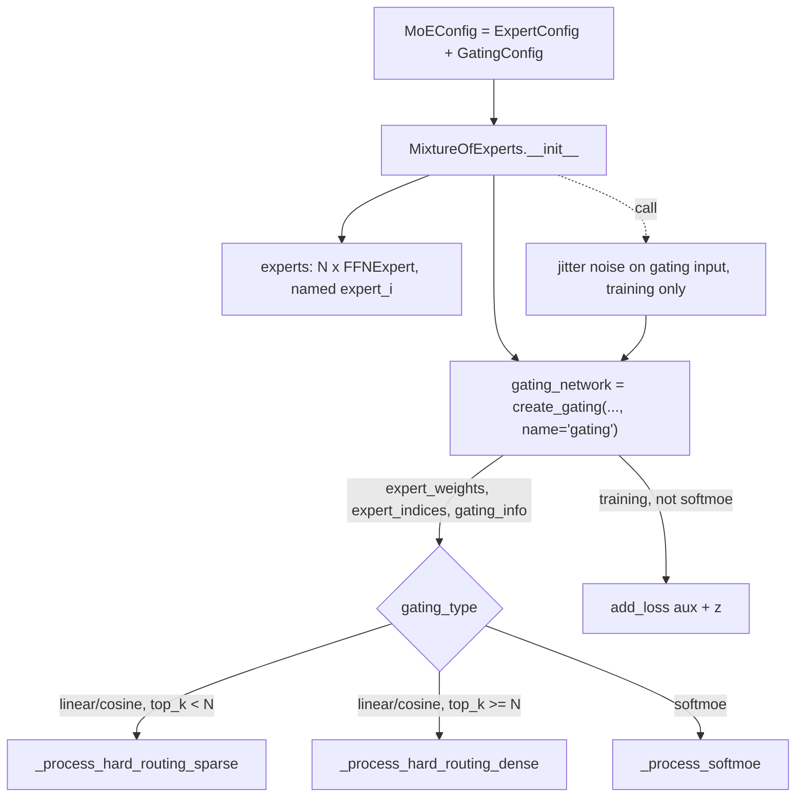

# moe

Path: `src/dl_techniques/layers/moe`
Purpose: Keras 3 mixture-of-experts layer (`MixtureOfExperts`) with FFN experts, three router types, two auxiliary losses and dataclass configs.

## Scope

In: the layer, the routers, the FFN-expert wrapper, the auxiliary-loss functions, the config dataclasses, and the `create_ffn_moe` factory.

Not here: the FFN implementations (built through `dl_techniques.layers.ffn`), the normalization layers (built through `dl_techniques.layers.norms`), and any model that uses the layer. No capacity-based dispatch exists and none is planned. There is no `integration.py` in this directory.

Consumers (grep `layers.moe` / `MixtureOfExperts` outside this dir): `layers/transformers/transformer.py` (builds `MixtureOfExperts(config=self.moe_config, name=name)`), `models/language/qwen/components.py`, `qwen3.py`, `qwen3_next.py`. Other hits (`utils/dtype_policy.py`, `utils/validation.py`, `src/train/qwen3_next/common.py`) only mention the module in docstrings or comments and do not import it.

## Architecture



Call flow in `MixtureOfExperts.call`:

1. Static rank from `inputs.shape`. Rank 2 stays as is. Rank 3 and higher are reshaped to `(-1, features)`.
2. Gating input: the flattened tokens for hard routing; the unflattened tensor for softmoe (raises `ValueError` below rank 3).
3. If `training` and `jitter_noise > 0`, uniform noise in `[-jitter_noise, jitter_noise]` is added to the gating input only. Experts see the clean tokens.
4. `gating_network(gating_input, training=training)` returns `(expert_weights, expert_indices, gating_info)`.
5. Dispatch by gating type. Hard routing builds `expert_assignment` (a 0/1 mask from `one_hot(indices).sum(-2)`, or all ones if indices span all experts), then picks the kernel by `self.gating_config.top_k >= self.num_experts` (dense) or otherwise (sparse). The result is reshaped to `original_shape[:-1] + [output_dim]`.
6. If `training` and not softmoe: `aux_loss_weight > 0` and `'raw_gate_probs'` in info adds `compute_auxiliary_loss(...)`; `z_loss_weight > 0` and `'gate_logits'` in info adds `compute_z_loss(...)`. Both through `self.add_loss`.

Hard-routing kernels (`layer.py`), both take `inputs_flat`, `weights_flat` `(num_tokens, num_experts)`, `expert_assignment` `(num_tokens, num_experts)` and `training`:

- `_process_hard_routing_dense`: loops over all experts, runs each on every token, multiplies by the gate weight column and the assignment column (both cast to the expert output dtype), stacks and sums over experts. The assignment is all ones when `top_k >= num_experts`.
- `_process_hard_routing_sparse`: per expert, `token_ids = nonzero(expert_assignment[:, e])[0]` (cast to int32), `take` those rows, run the expert, scale by the gate weight taken at `token_ids` (cast to the expert output dtype, no mask), `scatter` into a zero tensor of shape `(num_tokens, expert_output_dim)` and add to the running sum. A zero-token expert is a length-0 gather and is not special-cased.

Router internals (`gating.py`):

- `LinearGating`: `gate_dense` (`Dense(num_experts)`), optional `noise_dense` (`Dense`, no bias, zeros init) when `add_noise`. Training noise: `logits += N(0,1) * softplus(noise_dense(x)) * noise_std`. Then `top_k`, mask non-selected logits to `_mask_neg_inf(dtype)`, softmax. If `top_k >= num_experts`, plain softmax and indices are `arange`.
- `CosineGating`: `linear_projection` (`Dense(embedding_dim)`, no bias) and a weight `expert_embeddings` of shape `(embedding_dim, num_experts)`. Both L2-normalized, matmul gives similarities, divided by `max(temperature, _min_temperature(dtype))`. Learnable temperature is a scalar weight `temperature` with a `ValueRangeConstraint(min_value=_min_temperature(compute_dtype))`. Then the same top-k mask and softmax.
- `SoftMoEGating`: `phi_dense` (`Dense(num_experts * num_slots)`, bias on) gives logits reshaped `[b, s, e, l]`. `dispatch_weights` = softmax over axis 1 (sequence). `combine_weights` = softmax over the flattened `e*l` axis. `expert_inputs` has shape `[b, e, l * h]`. `expert_weights` is `combine_weights` summed over slots.

## Key files

| File | Role | Notes |
| --- | --- | --- |
| `__init__.py` | Public exports | `__all__` has 5 names. Gating classes, `FFNExpert`, `create_gating`, `create_expert` and the loss functions are NOT exported; import from the submodules. |
| `config.py` | `ExpertConfig`, `GatingConfig`, `MoEConfig` | Validation in `__post_init__`; imports `positive_int` from `dl_techniques.utils.validation`. |
| `experts.py` | `BaseExpert`, `FFNExpert`, `create_expert` | `FFNExpert` registered as `dl_techniques.layers.moe.experts`. |
| `gating.py` | Routers, aux losses, `create_gating` | All four layer classes register under `dl_techniques.layers.moe.gating`. |
| `layer.py` | `MixtureOfExperts`, `create_ffn_moe` | Registered as `dl_techniques.layers.moe.layer`. Holds both hard-routing kernels and the softmoe path. |

Tests: `tests/test_layers/test_moe/` (`test_config.py`, `test_experts.py`, `test_gating.py`, `test_layer.py`, `test_end_to_end.py`, `test_the_sparse_kernel_matches_the_dense_oracle.py`, `test_the_auxiliary_loss_survives_a_mixed_precision_fit.py`).

## Public interface

```python
MixtureOfExperts(config: MoEConfig, **layer_kwargs)       # keras.layers.Layer
    .call(inputs, training=None) -> Tensor                 # shape: input shape with last dim replaced by expert output dim
    .compute_output_shape(input_shape) -> tuple
    .get_expert_utilization() -> dict   # config echo only: num_experts, expert_type, expert_ffn_type, routing_type,
                                        # top_k, aux_loss_weight, z_loss_weight, drop_tokens, use_residual_connection
    .get_config() -> {'config': MoEConfig.to_dict(), ...}; from_config pops 'config' and uses MoEConfig.from_dict

create_ffn_moe(num_experts, ffn_config, top_k=1, gating_type='linear', aux_loss_weight=0.01, **kwargs) -> MixtureOfExperts

create_gating(gating_type, num_experts, **kwargs) -> BaseGating   # 'linear' | 'cosine' | 'softmoe'
create_expert(expert_type, **kwargs) -> BaseExpert                 # only 'ffn'
compute_auxiliary_loss(expert_weights, gate_probs, num_experts, aux_loss_weight=0.01) -> float32 scalar
compute_z_loss(gate_logits, z_loss_weight=1e-3) -> float32 scalar
```

Gating layers return `(expert_weights, expert_indices, info)`:

| Type | `expert_weights` | `expert_indices` | `info` keys |
| --- | --- | --- | --- |
| linear | `(..., E)`, zero outside top-k | `(..., top_k)` or `(..., E)` | `gate_logits`, `expert_weights`, `raw_gate_probs` |
| cosine | same | same | `gate_logits`, `expert_weights`, `cosine_similarities`, `raw_gate_probs` |
| softmoe | `(b, s, E)` | `(b, s, E)` arange | `dispatch_weights`, `combine_weights`, `soft_slots`, `expert_inputs`, `expert_weights`, `gate_logits`, `raw_gate_probs` |

`compute_output_shape` of the three concrete gating classes (`LinearGating`, `CosineGating`, `SoftMoEGating`) returns an empty dict for the info slot. `BaseGating` does not define it.

`MixtureOfExperts.compute_output_shape` uses `ffn_config['output_dim']` if not `None`, else `ffn_config['d_model']` if not `None`, else keeps the input width. A key present with value `None` counts as absent.

`create_ffn_moe` routing (declared once in module-level frozensets in `layer.py`):

| Constant | Keys |
| --- | --- |
| `_FFN_MOE_EXPERT_KEYS` | `norm_type`, `norm_config`, `pre_norm`, `post_norm` |
| `_FFN_MOE_EXPERT_ALIASES` | `expert_norm_type` -> `norm_type`, `expert_norm_config` -> `norm_config` |
| `_FFN_MOE_GATING_KEYS` | `add_noise`, `noise_std`, `temperature`, `embedding_dim`, `learnable_temperature`, `num_slots`, `z_loss_weight` |
| `_FFN_MOE_GATING_ALIASES` | `gate_use_bias` -> `use_bias`, `gating_norm_type` -> `norm_type`, `gating_norm_config` -> `norm_config` |
| `_FFN_MOE_MOE_KEYS` | `jitter_noise`, `drop_tokens`, `use_residual_connection` |
| `_FFN_MOE_LAYER_KEYS` | `name`, `dtype`, `trainable` |

Any key outside `_FFN_MOE_DECLARED_KEYS` raises `ValueError`. `use_bias` is in `_FFN_MOE_MISROUTED_KEYS` and gets a hint message.

## Data shapes

Config keys (`MoEConfig.to_dict()`):

```
num_experts, jitter_noise, drop_tokens, use_residual_connection,
expert_config: {ffn_config, use_bias, kernel_initializer, bias_initializer,
                kernel_regularizer, bias_regularizer, norm_type, norm_config, pre_norm, post_norm},
gating_config: {gating_type, top_k, add_noise, noise_std, temperature, use_bias,
                embedding_dim, learnable_temperature, num_slots,
                aux_loss_weight, z_loss_weight, norm_type, norm_config}
```

`to_dict` serializes Keras initializer/regularizer objects in `expert_config`. `from_dict` copies the input dict (shallow), deserializes dict-valued initializers/regularizers, and builds the sub-configs with `**`. Note `from_dict` mutates the nested `expert_config` dict it pops.

Defaults when `ExpertConfig.ffn_config` is empty: `{"type": "mlp", "hidden_dim": 2048, "output_dim": 512}`.

Which `GatingConfig` fields reach the router (from `MixtureOfExperts.__init__`):

| gating_type | forwarded |
| --- | --- |
| linear | `top_k`, `use_bias`, `add_noise`, `noise_std` |
| cosine | `top_k`, `embedding_dim`, `temperature`, `learnable_temperature` |
| softmoe | `num_slots` |
| all | `norm_type`, `norm_config` |

Kernel/bias initializers of the routers are never passed from the config; the router defaults apply (`glorot_uniform`, `zeros`).

## Invariants and constraints

- **Top-k softmax order.** Mask non-selected logits first, then softmax, so weights sum to 1 over the selected experts. Softmax-then-mask would scale the output down. Mask value is `_mask_neg_inf(dtype)`: `-1e4` for float16/bfloat16, `-1e9` otherwise.
- **Dense kernel stays reachable.** `_process_hard_routing_dense` is the numerical oracle for the sparse kernel (gated at `atol=1e-5`, `rtol=0` by the sparse-vs-dense test). Do not delete it or make its `top_k >= num_experts` branch unreachable. Do not add a Python `if` on the length of a gather in the sparse kernel (runtime value, breaks graph mode; length-0 already works). Do not replace scatter-and-add with an in-place update.
- **Dtype of routing weights.** Both hard kernels cast the gate weight to the expert output's dtype (`expert_output.dtype`), never the expert output to the gate's. Only `_process_hard_routing_dense` also has a mask: it casts `expert_mask` (a slice of `expert_assignment`, which comes from `one_hot` and is float32) to the same dtype before `expert_output * expert_weight * expert_mask`. `_process_hard_routing_sparse` builds no mask (it gathers rows with `nonzero` on the assignment column) and casts only the gathered weight before `expert_output * expert_weight[:, None]`. Skipping the casts raises a Mul dtype error under `mixed_float16`. The routing weights are a convex combination in [0, 1], so half precision costs nothing there.
- **Both aux losses return float32.** `compute_z_loss` upcasts `gate_logits` first (squared logsumexp overflows float16 near logits of ~256). `compute_auxiliary_loss` casts its result to float32 because Keras reduces `add_loss` values without casting float values, so a float16 loss crashes `fit()` under mixed precision. Do not remove either cast as redundant.
- **`top_k` scaling of the aux loss is deliberate.** Balanced-routing floor is `aux_loss_weight * top_k`, worst case `aux_loss_weight * num_experts`. Do not normalize by `top_k` without deciding to retune the Qwen consumers (they use `top_k` 8 and 10). Pinned by `test_gating.py::TestAuxiliaryLossTopKScaling`.
- **Cosine temperature floor** comes from `_min_temperature(dtype)` (`max(10/|mask sentinel|, keras.config.epsilon())`), not from epsilon alone. The `ValueRangeConstraint` on the weight is the real bound; the in-`call` `maximum` is the second line. The constraint is rebuilt on every `build()` and is not serialized.
- **Sub-layer naming.** Experts are named `expert_{i}`, the router `gating`, the expert FFN `ffn` (a named copy `{"name": "ffn", **ffn_config}`; `self.ffn_config` stays unchanged), norms `pre_norm` / `post_norm` / `pre_gate_norm`. Two builds of the same config must produce the same weight paths; do not leave names to the Keras counter.
- **Build discipline.** Sub-layers are created in `__init__` and built explicitly in `build()`. `FFNExpert.build` builds the post-norm against `ffn_block.compute_output_shape(input_shape)`, since the FFN may change width. `MixtureOfExperts.build` builds softmoe experts at `(input_shape[0], input_shape[-1])` and hard-routing experts at the full input shape. Build config is `{"input_shape": ...}`.
- **Inert flags.** `drop_tokens`, `use_residual_connection` and `ExpertConfig.use_bias/kernel_*/bias_*` are read by no forward path. Keep them serialized; do not wire them up silently.
- **Registration.** Classes register with `register_dl_technique("dl_techniques.layers.moe.<module>")`. The four gating classes share one package string; the class name makes the key unique. `BaseExpert` is not registered.
- **Integer config fields** go through `positive_int` (rejects bool and np.bool_, coerces numpy ints to `int`, caps at `2**31 - 1`) and the coerced value is assigned back, so `json.dumps(to_dict())` works.
- **`MoEConfig` cross-check.** `top_k <= num_experts` is checked only for `linear` and `cosine`; softmoe never reads `top_k`. Do not drop the `gating_type` test to "fix" this.

## Dependencies

Internal:

- `dl_techniques.layers.ffn`: `create_ffn_from_config`, `validate_ffn_config` (all FFN validation is delegated).
- `dl_techniques.layers.norms`: `create_normalization_layer` for expert and router norms.
- `dl_techniques.constraints.value_range_constraint.ValueRangeConstraint`: cosine temperature bound.
- `dl_techniques.utils.keras_registration.register_dl_technique`, `dl_techniques.utils.logger.logger`, `dl_techniques.utils.validation.positive_int`.

External: `keras` only (all tensor work through `keras.ops` and `keras.random`).

## Failure modes

| Condition | Result |
| --- | --- |
| `ffn_config` without `type` | `ValueError` in `ExpertConfig.__post_init__` and in `FFNExpert.__init__` |
| FFN factory rejects the config | `ValueError("Invalid FFN configuration for expert: ...")` or `"Failed to create FFN expert using factory..."` |
| bad `gating_type`, `top_k`, `num_slots`, `embedding_dim`, `temperature`, `noise_std` | `ValueError` in `GatingConfig.__post_init__` (and again in each gating class) |
| `top_k > num_experts` with linear/cosine | `ValueError` in `MoEConfig.__post_init__` |
| `jitter_noise < 0` | `ValueError` |
| `config` not a `MoEConfig` | `ValueError("config must be an instance of MoEConfig")` |
| last input dim `None` | `ValueError` in `MixtureOfExperts.build` |
| softmoe with rank < 3 | `ValueError` in `build` and in `call` |
| undeclared `create_ffn_moe` keyword | `ValueError` listing declared keys |
| `create_gating` / `create_expert` with unknown type | `ValueError` |
| removed fields (`capacity_factor`, `routing_dtype`, `train_capacity_factor`, `eval_capacity_factor`) in a config dict | `TypeError` from the dataclass constructors and `MoEConfig.from_dict` |
| `create_gating` given a key the gating type does not take | silently dropped (not an error) |

Memory: `_process_hard_routing_dense` stacks all `num_experts` weighted outputs before summing, so it can run out of memory at large expert counts (the `layer.py` docstring records a dense OOM at `num_experts=512`, `top_k=10`). `_process_hard_routing_sparse` runs whenever `top_k < num_experts`, and accumulates one scatter result per expert instead of stacking.

## Working here

- Conventions: Sphinx/reST docstrings (`:param:` / `:type:`), `import keras` and qualified `keras.ops.*`, logging through `dl_techniques.utils.logger`, no prints. Match the file you edit.
- New gating type: subclass `BaseGating`, register with `register_dl_technique("dl_techniques.layers.moe.gating")`, create sublayers in `__init__`, build them in `build()`, return the `(weights, indices, info)` triple with `raw_gate_probs` and `gate_logits` if the aux losses should apply. Then update in tandem: the `Literal` and `valid_types` tuple in `config.py`, the branch in `create_gating`, the key-forwarding branch in `MixtureOfExperts.__init__` (`layer.py`), the hard-routing vs softmoe branches in `build` / `call` if routing differs, and tests.
- New `create_ffn_moe` keyword: add it to the matching frozenset or alias dict in `layer.py`; the declared-key set and the filters derive from those, so there is no second list to edit. Add the field to the config dataclass and, if it must reach the router, to the forwarding lists in `MixtureOfExperts.__init__` and `create_gating`.
- New config field: add it to the dataclass, validate it in `__post_init__`, and check `to_dict` / `from_dict` round-trip (`to_dict` for gating uses `dict(__dict__)`, so any non-JSON value needs explicit handling).
- Changing a loss or a routing kernel: run the sparse-vs-dense test and the mixed-precision fit test first (`test_the_sparse_kernel_matches_the_dense_oracle.py` and `test_the_auxiliary_loss_survives_a_mixed_precision_fit.py` under `tests/test_layers/test_moe/`), then the full `test_moe/` directory with the command below.
- Run tests (scoped, never the full suite):

```bash
.venv/bin/python -m pytest tests/test_layers/test_moe/ -q
```

  Also run `tests/test_layers/test_transformers/` and the Qwen tests under `tests/test_models/` (names containing `qwen`) when a change touches the public surface, since those import this package.
- A forward pass with `training=False` never calls `add_loss`; test loss-related changes with a `training=True` call or a `model.fit()` step.
