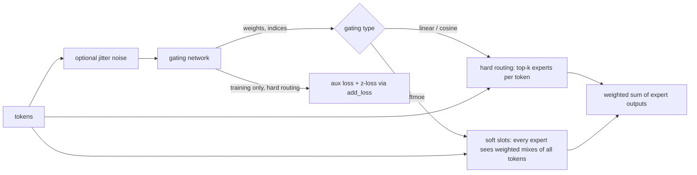

# moe

A Keras 3 layer, `MixtureOfExperts`, that replaces one dense feed-forward block with several feed-forward "experts" and a router that decides which experts see which token. It lives at `src/dl_techniques/layers/moe/` in the `dl_techniques` library.

## What it is for

A normal transformer feed-forward block runs every token through the same weights. A mixture of experts keeps many such blocks (the experts) and adds a small router. For each token the router picks a few experts, and only those run on that token. The model gets many more parameters, but each token only pays for a few experts.

Each expert is built by the library's FFN factory (`dl_techniques.layers.ffn`), so any FFN type the factory knows (for example `mlp` or `swiglu`) can be an expert. The router comes in three kinds: linear, cosine and soft. This package also provides the two training-time losses that keep the router from sending everything to one expert.

## How it works



1. The input is flattened to a list of tokens. Rank 2 `(batch, features)` and rank 3 `(batch, seq, features)` are the normal cases.
2. The router scores every expert per token.
   - `linear`: a bias-optional `Dense` layer gives the scores. During training, Gaussian noise is added to the scores.
   - `cosine`: tokens are projected, then compared by cosine similarity with one learned vector per expert. The score is divided by a temperature that can be learned.
   - `softmoe`: no top-k. Each expert gets `num_slots` "slots", and each slot is a softmax-weighted mix of all tokens in the sequence. Every expert's output is mixed back to every token.
3. For `linear` and `cosine`, the top `top_k` scores are kept. A softmax over only those scores gives weights that sum to 1 per token.
4. Each token's output is the weighted sum of its chosen experts' outputs.
5. In training, hard routing adds two losses to the layer: a load-balancing loss and a router z-loss. `softmoe` adds neither.

Hard routing has two internal implementations. The sparse one gathers only the tokens routed to each expert, runs the expert on them, and scatter-adds the result. The dense one runs every expert on every token and masks. The dense one runs when `top_k >= num_experts` and serves as the reference the sparse one is tested against.

## Files

- `__init__.py` - exports `MoEConfig`, `ExpertConfig`, `GatingConfig`, `MixtureOfExperts`, `create_ffn_moe`.
- `config.py` - the three config dataclasses, with validation at construction and `to_dict` / `from_dict` for `MoEConfig`.
- `experts.py` - `BaseExpert` (abstract), `FFNExpert` (an FFN with optional pre/post normalization), and `create_expert`.
- `gating.py` - `BaseGating`, `LinearGating`, `CosineGating`, `SoftMoEGating`, `create_gating`, and the loss functions `compute_auxiliary_loss` and `compute_z_loss`.
- `layer.py` - `MixtureOfExperts` and the `create_ffn_moe` convenience factory.

## How to use it

Quick form:

```python
from dl_techniques.layers.moe import create_ffn_moe

moe = create_ffn_moe(
    num_experts=8,
    ffn_config={'type': 'swiglu', 'output_dim': 768, 'ffn_expansion_factor': 4},
    top_k=2,
    gating_type='linear',
    aux_loss_weight=0.01,
    name='moe_ffn',
)
```

Full control through config objects:

```python
from dl_techniques.layers.moe import MixtureOfExperts, MoEConfig, ExpertConfig, GatingConfig

config = MoEConfig(
    num_experts=8,
    expert_config=ExpertConfig(
        ffn_config={'type': 'mlp', 'hidden_dim': 2048, 'output_dim': 768, 'activation': 'gelu'},
        norm_type='rms_norm', pre_norm=True,
    ),
    gating_config=GatingConfig(gating_type='linear', top_k=2, aux_loss_weight=0.01),
)
moe = MixtureOfExperts(config)
```

Use it in place of an FFN inside a transformer block:

```python
import keras

inputs = keras.Input(shape=(128, 768))
x = keras.layers.MultiHeadAttention(num_heads=12, key_dim=64)(inputs, inputs)
x = keras.layers.LayerNormalization()(x + inputs)
x = keras.layers.LayerNormalization()(moe(x) + x)
model = keras.Model(inputs, keras.layers.Dense(10000)(x))
```

Save the config as JSON and rebuild the layer:

```python
import json
with open('moe_config.json', 'w') as f:
    json.dump(config.to_dict(), f, indent=2)
with open('moe_config.json') as f:
    moe = MixtureOfExperts(MoEConfig.from_dict(json.load(f)))
```

`model.save()` and `keras.models.load_model()` also work without custom objects, because the layers are registered.

### Picking a gating type

| `gating_type` | Class | Pick it when |
|---|---|---|
| `linear` (default) | `LinearGating` | You want ordinary sparse top-k routing. |
| `cosine` | `CosineGating` | You want router scores that do not depend on the size of the token vector. |
| `softmoe` | `SoftMoEGating` | You want no discrete routing and no load-balancing loss (the Soft MoE paper, arXiv:2308.00951). |

### Settings

`ExpertConfig`: `ffn_config` (passed straight to the FFN factory, must contain `type`; an empty one becomes an `mlp` with `hidden_dim=2048`, `output_dim=512`), plus optional `norm_type`, `norm_config`, `pre_norm` (default `True`), `post_norm` (default `False`). The fields `use_bias`, `kernel_initializer`, `bias_initializer`, `kernel_regularizer` and `bias_regularizer` are stored and serialized but nothing reads them.

`GatingConfig`: `gating_type`, `top_k` (1), `add_noise` (True), `noise_std` (1.0), `temperature` (1.0), `use_bias` (False), `embedding_dim` (256), `learnable_temperature` (True), `num_slots` (4), `aux_loss_weight` (0.01), `z_loss_weight` (1e-3), and optional `norm_type` / `norm_config` for a norm before the router.

`MoEConfig`: `num_experts` (8), `expert_config`, `gating_config`, `jitter_noise` (0.01), `drop_tokens` (True), `use_residual_connection` (True).

Each setting only matters for some gating types: `use_bias` and `add_noise` / `noise_std` for `linear`; `embedding_dim`, `temperature` and `learnable_temperature` for `cosine`; `num_slots` for `softmoe`.

### `create_ffn_moe` keywords

Beyond `num_experts`, `ffn_config`, `top_k`, `gating_type` and `aux_loss_weight`, it accepts:

- Expert norm: `norm_type`, `norm_config`, `pre_norm`, `post_norm`, `expert_norm_type`, `expert_norm_config`.
- Router: `gate_use_bias`, `add_noise`, `noise_std`, `temperature`, `embedding_dim`, `learnable_temperature`, `num_slots`, `z_loss_weight`, `gating_norm_type`, `gating_norm_config`.
- Layer: `jitter_noise`, `drop_tokens`, `use_residual_connection`, `name`, `dtype`, `trainable`.

Any other keyword raises `ValueError`. `use_bias=` is refused on purpose, because both the router and the expert FFN have a bias. Use `gate_use_bias=` for the router or `ffn_config['use_bias']` for the expert.

## Things to know

- **Validation happens at config construction.** `num_experts`, `top_k`, `num_slots` and `embedding_dim` must be positive ints (bools are rejected, numpy integers are converted to `int`). `temperature` must be above 0, `noise_std` and `jitter_noise` must be 0 or more. `top_k` must not exceed `num_experts` for `linear` and `cosine`; `softmoe` ignores `top_k`.
- **`drop_tokens` and `use_residual_connection` do nothing.** No token is ever dropped. They are only echoed by `get_expert_utilization()`. There is no capacity setting.
- **Retune `aux_loss_weight` when you change `top_k`.** The loss follows the Switch Transformer formula, which is built for `top_k=1`. With perfectly balanced routing it sits at `aux_loss_weight * top_k`, not at zero. The worst case is `aux_loss_weight * num_experts`.
- **Both losses are always float32**, whatever the dtype policy. Without that, mixed-precision `fit()` crashed or produced `inf`.
- **Sparse in FLOPs is not always faster in wall-clock.** One FFN call is made per expert in both implementations, and the sparse one adds a gather and a scatter. At small token counts it can be slower. The `layer.py` docstring also records lower memory use at every size. Timings recorded in the `layer.py` docstring (sparse speed relative to dense, `d_model=512`, `hidden=1024`) show 0.913x at 2048 tokens with 64 experts, 0.871x at 2048 tokens with 128 experts, and 2.108x at 8192 tokens with 64 experts.
- **Cosine temperature divides.** A larger value gives flatter routing. Older versions multiplied.
- **Old config dicts.** A dict that still contains `capacity_factor`, `routing_dtype`, `train_capacity_factor` or `eval_capacity_factor` raises `TypeError` in the constructors and in `MoEConfig.from_dict`. Remove those keys.
- **`SoftMoE` needs rank 3 or more with a known last dimension.** Its auxiliary info exposes `dispatch_weights` and `combine_weights`.
- **Construction cost grows with `num_experts`.** One `FFNExpert` layer is created per expert in a Python loop.
- **`create_gating` is looser than `create_ffn_moe`.** It silently drops keywords the chosen gating type does not take.
- **Expert collapse** (some experts never get tokens) is not detected by the layer. `get_expert_utilization()` reports configuration only, not token counts.

## References

- Switch Transformer: arXiv:2101.03961
- GLaM: arXiv:2112.06905
- Soft MoE: arXiv:2308.00951
