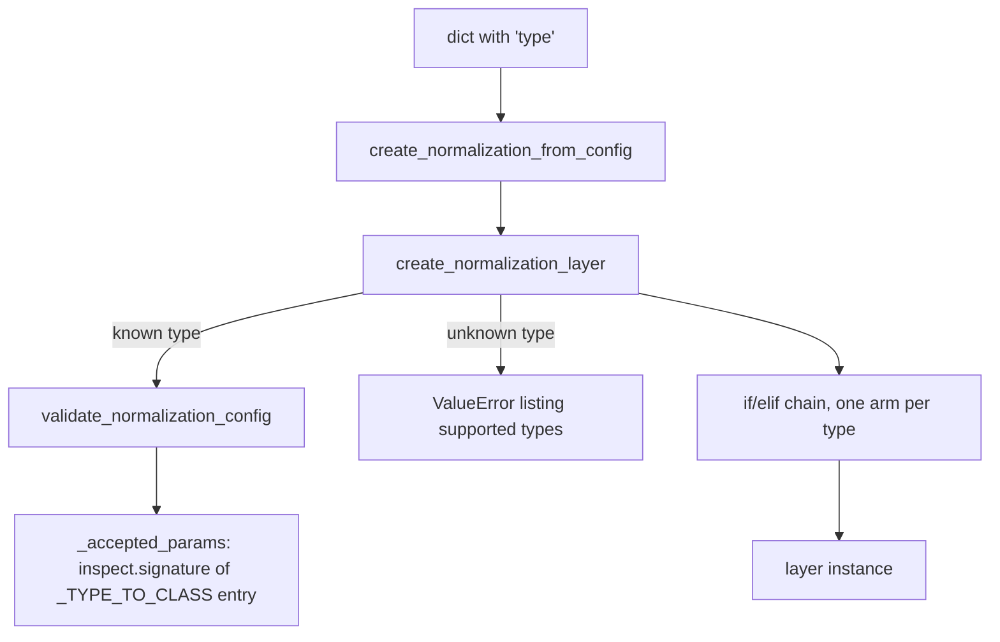

# norms

Path: `src/dl_techniques/layers/norms/`
Purpose: 17 Keras 3 layer classes plus a string-keyed factory (19 registered keys) for the `dl_techniques` library.

## Scope

Lives here: activation normalization layers (RMS, band, logit, bias-free batch norm, GRN, LRN, DynamicTanh, EnergyLayerNorm), the weight reparameterization layer `PolarWeightNorm` with its `polar_encode` / `polar_decode` helpers, the factory, and the shared masking helper.

Does not live here: the stock Keras `LayerNormalization` / `BatchNormalization` (the factory only wraps them), per-block normalization wiring in transformers or attention (those call `create_normalization_layer` from here), and `LAYER_NORM_EPSILON` in `layers/transformers/causal_stack.py`, which is deliberately `1e-3` and bypasses the factory.

Consumers: `layers/attention`, `layers/transformers`, `layers/conv_blocks`, `layers/ssm`, `layers/time_series`, many `models/*` packages, `src/train/rms_variants_train/` (uses `BandLogitNorm`). About 119 files under `src/` mention `create_normalization_layer`.

## Architecture



- `_TYPE_TO_CLASS` (19 keys) maps each key to the class it instantiates. Two keys (`layer_norm`, `batch_norm`) map to stock Keras classes. The other 17 keys map to 16 distinct package classes, because `dml_plus_focal` and `dml_plus_center` both map to `DMLPlus`. The 17th exported class, `PolarWeightNorm`, is not a factory type.
- `_accepted_params(type)` = named constructor parameters of the class (excluding `self`, positional-or-keyword and keyword-only only) + `_FACTORY_LEVEL_PARAMS` (`name`, `epsilon`) + `_KERAS_BASE_PARAMS` (`name`, `dtype`, `trainable`, `activity_regularizer`, `autocast`) - `_FACTORY_OWNED_PARAMS` (`model_type` for both DML+ keys) - `_FACTORY_DROPPED_PARAMS` (`epsilon` for `dynamic_tanh`).
- The builder calls the validator only for keys in `_TYPE_TO_CLASS`. An unknown type skips it and reaches the final `else`, whose message lists all supported types. The validator's own unknown-type message is shorter, and tests pin the richer one.
- Every class registers with `@register_dl_technique("dl_techniques.layers.norms.<module>")`. The three classes in `max_logit_norm.py` share one package string (distinct class names keep the keys unique).

Layer families and their computation:

| Family | Classes | Computation |
| --- | --- | --- |
| RMS | `RMSNorm`, `ZeroCenteredRMSNorm` | `x / sqrt(mean(x^2) + eps) * scale`; zero-centered subtracts the mean first |
| Band | `BandRMS`, `ZeroCenteredBandRMSNorm` | RMS-normalize, then `* s`, `s = (1-a) + a*sigmoid(5*band_param)`, one scalar `band_param`, `a = max_band_width`. RMS is `maximum(sqrt(ms + eps), eps)` |
| Adaptive band | `AdaptiveBandRMS`, `ZeroCenteredAdaptiveBandRMS` | same, but `s` comes from internal `Dense(num_params)(log(mean(rms over non-batch axes)))`, named `band_dense` |
| Logit | `LogitNorm`, `BandLogitNorm` | L2 norm sums over `axis`; `LogitNorm` divides by `norm * temperature` |
| MaxLogit | `MaxLogitNorm`, `DecoupledMaxLogit`, `DMLPlus` | `x / sqrt(sum(x^2) + eps)`; the DML classes reduce the axis away (see Data shapes) |
| Other | `BiasFreeBatchNorm`, `GlobalResponseNormalization`, `LocalResponseNormalization`, `DynamicTanh`, `EnergyLayerNorm`, `PolarWeightNorm` | see Key files |

## Key files

| File | Role | Notes |
| --- | --- | --- |
| `__init__.py` | Public surface | `__all__` has 24 names: 17 classes (including `PolarWeightNorm`, which is not a factory type), `polar_encode`, `polar_decode`, 4 factory functions, `NormalizationType` |
| `factory.py` | Factory, validator, registry, info | 784 lines. Module docstring still says "18 registered types / sixteen from this package"; the real counts are 19 keys, of which 17 are package keys (16 distinct classes) |
| `_masking.py` | `normalizes_only_the_feature_axis(axis, rank=None)` | `rank=None` (the `__init__` moment): True only if every entry is `-1`. With a rank (the `build()` moment): rank < 2 gives False, else resolved axes must equal `{rank-1}`. Imported by exactly 7 modules |
| `rms_norm.py` | `RMSNorm` | `scale` stored at `param_shape` (one dim per normalized axis), reshaped in `call()` only for non-trailing ascending axes |
| `zero_centered_rms_norm.py` | `ZeroCenteredRMSNorm` | same scale logic as `RMSNorm` |
| `band_rms.py` | `BandRMS` | scalar `band_param`, regularizer defaults to `L2(1e-5)` when None |
| `zero_centered_band_rms_norm.py` | `ZeroCenteredBandRMSNorm` | as `BandRMS` plus centering |
| `adaptive_band_rms.py` | `AdaptiveBandRMS` | `Dense` built in `build()`; own copy of `_compute_param_shape_and_axes` |
| `zero_centered_adaptive_band_rms_norm.py` | `ZeroCenteredAdaptiveBandRMS` | a separate copy of the adaptive logic, not shared with `AdaptiveBandRMS` |
| `band_logit_norm.py` | `BandLogitNorm` | inner `LayerNormalization` acts on a length-1 axis, so the scale is constant |
| `logit_norm.py` | `LogitNorm` | no weights; epsilon is a floor (`maximum`), not added inside the sqrt |
| `max_logit_norm.py` | `MaxLogitNorm`, `DecoupledMaxLogit`, `DMLPlus` | epsilon is added inside the sqrt here |
| `bias_free_batch_norm.py` | `BiasFreeBatchNorm` | weights `running_var` (non-trainable, init ones) and optional `gamma`; no `moving_mean`, no `beta` |
| `global_response_norm.py` | `GlobalResponseNormalization` | rank 2, 3, 4; `gamma`, optional `beta` of shape `(1,)*(rank-1) + (C,)` |
| `local_response_norm.py` | `LocalResponseNormalization`, `_NeighbourhoodBandInitializer` | rank 3 or 4; one non-trainable `neighbourhood_band` weight `(C, C)` |
| `dynamic_tanh.py` | `DynamicTanh` | weights `alpha` (scalar), `weight`, `bias`; `supports_masking=True` always |
| `energy_layer_norm.py` | `EnergyLayerNorm` | scalar `gamma`, vector `delta`; statistics over the last axis only |
| `polar_weight_norm.py` | `PolarWeightNorm`, `polar_encode`, `polar_decode` | not a factory type; Dense-style layer with `radius` `(units,)` and `angles` `(units, d-1)` |

## Public interface

Factory (all in `factory.py`, re-exported from the package):

```python
create_normalization_layer(normalization_type: NormalizationType, name: Optional[str] = None,
                           epsilon: float = 1e-6, **kwargs) -> keras.layers.Layer
create_normalization_from_config(config: Dict[str, Any]) -> keras.layers.Layer
validate_normalization_config(normalization_type: NormalizationType, **kwargs) -> bool
get_normalization_info() -> Dict[str, Dict[str, Any]]   # keys: 'description', 'parameters', 'use_case'
```

- `create_normalization_layer` raises `ValueError` for an unknown type (message lists supported types), for a kwarg outside `_accepted_params` (message `Invalid parameters for <type>: {...}. Valid parameters: [...]`), and for a failed value check. It raises `TypeError` if the class rejects a kwarg type.
- `create_normalization_from_config` copies the dict, pops `'type'`, forwards the rest. Missing `'type'` raises `KeyError("Configuration dictionary must contain 'type' key")`. The caller's dict is not mutated.
- `validate_normalization_config` returns `True` or raises `ValueError`. Value checks: `max_band_width` in the open interval (0, 1) for `band_rms`, `adaptive_band_rms`, `band_logit_norm`, `zero_centered_band_rms_norm`, `zero_centered_adaptive_band_rms_norm`; `temperature > 0` for `logit_norm`; `constant` a positive number for `decoupled_max_logit`; `epsilon > 0` for `rms_norm`, `zero_centered_rms_norm`, `bias_free_batch_norm`; `momentum` in `[0, 1]` for `bias_free_batch_norm`; `alpha_init_value > 0` for `dynamic_tanh`.

Factory keys (19): `layer_norm`, `batch_norm`, `bias_free_batch_norm`, `rms_norm`, `zero_centered_rms_norm`, `zero_centered_band_rms_norm`, `zero_centered_adaptive_band_rms_norm`, `band_rms`, `adaptive_band_rms`, `band_logit_norm`, `global_response_norm`, `local_response_norm`, `logit_norm`, `max_logit_norm`, `decoupled_max_logit`, `dml_plus_focal`, `dml_plus_center`, `dynamic_tanh`, `energy_layer_norm`.

Per-arm factory behavior:

- Exactly three types skip the epsilon `setdefault`: `global_response_norm`, `local_response_norm` and `dynamic_tanh` (the next two bullets). The other 16 types all do `layer_kwargs.setdefault('epsilon', epsilon)`: `layer_norm`, `batch_norm`, `bias_free_batch_norm`, `rms_norm`, `zero_centered_rms_norm`, `zero_centered_band_rms_norm`, `zero_centered_adaptive_band_rms_norm`, `band_rms`, `adaptive_band_rms`, `band_logit_norm`, `logit_norm`, `max_logit_norm`, `decoupled_max_logit`, `dml_plus_focal`, `dml_plus_center`, `energy_layer_norm`.
- `global_response_norm` (excluded): sets `eps = epsilon` only if `'eps'` is not already in kwargs.
- `local_response_norm` and `dynamic_tanh` (excluded): `epsilon` is never forwarded. `epsilon` is a named parameter of the builder (`Optional[float] = None`), so the validator never sees it; the builder logs a warning when an explicit value is given for one of these two (`_EPSILON_FREE_TYPES`) and builds anyway, because ten callers (text_decoder, tree_transformer, qwen, mambalct, fnet, ...) pass `epsilon` for any configured type. Calling `validate_normalization_config` directly with `epsilon=` does raise for both (`_FACTORY_DROPPED_PARAMS`).
- `dml_plus_focal` / `dml_plus_center` (NOT excluded, they are 2 of the 16): after the epsilon `setdefault` they set `model_type` to `'focal'` / `'center'`. A caller-passed `model_type` is rejected by the validator.

Class constructors (defaults as in code):

- `RMSNorm`, `ZeroCenteredRMSNorm`: `axis=-1, epsilon=1e-6, use_scale=True, scale_initializer="ones"`. `axis` int or tuple of ints; `TypeError` otherwise. `ValueError` if epsilon <= 0, or a normalized axis is dynamic with `use_scale=True`.
- `BandRMS`, `ZeroCenteredBandRMSNorm`: `max_band_width=0.1, axis=-1, epsilon=1e-7, band_initializer="zeros", band_regularizer=None`.
- `AdaptiveBandRMS`, `ZeroCenteredAdaptiveBandRMS`: same signature; `band_regularizer` stays None. Axis 0, out-of-range axes and `None`-sized normalized axes raise `ValueError` in `build()`. Input rank must be 2 or more.
- `BandLogitNorm(max_band_width=0.01, axis=-1, epsilon=1e-7)`, `LogitNorm(temperature=0.04, axis=-1, epsilon=1e-7)`, `MaxLogitNorm(axis=-1, epsilon=1e-7)`, `DecoupledMaxLogit(constant=1.0, axis=-1, epsilon=1e-7)`, `DMLPlus(model_type, axis=-1, epsilon=1e-7)` (`model_type` required, `"focal"` or `"center"`).
- `BiasFreeBatchNorm(axis=-1, epsilon=1e-6, momentum=0.99, use_scale=True)`: `axis` must be an `int` (`TypeError`), channel dim static.
- `GlobalResponseNormalization(eps=1e-6, gamma_initializer='ones', beta_initializer='zeros', gamma_regularizer=None, beta_regularizer=None, activity_regularizer=None, use_beta=True)`.
- `LocalResponseNormalization(depth_radius=2, alpha=1e-4, beta=0.75, k=1.0, data_format=None)`: `depth_radius` a non-negative non-bool `int`; `alpha`, `beta`, `k` > 0; `data_format` in `None`, `'channels_last'`, `'channels_first'` (`None` resolves to `keras.config.image_data_format()`); `channels_first` needs rank 4.
- `DynamicTanh(axis=-1, alpha_init_value=0.5, kernel_initializer='ones', bias_initializer='zeros', kernel_regularizer=None, bias_regularizer=None, kernel_constraint=None, bias_constraint=None)`: `axis` int or list; stored as a list.
- `EnergyLayerNorm(epsilon=1e-5, gamma_initializer='ones', delta_initializer='zeros', gamma_constraint=<sentinel>)`.
- `PolarWeightNorm(units, activation=None, use_bias=True, kernel_initializer="glorot_uniform", bias_initializer="zeros", radius_regularizer=None, angle_regularizer=None, bias_regularizer=None, epsilon=1e-12)`.
- `polar_encode(x: (N, d)) -> (radius (N, 1), angles (N, d-1))`, `d` a statically known power of two; `polar_decode(radius, angles) -> (N, d)`.

## Data shapes

| Layer | Input | Output |
| --- | --- | --- |
| All except the rows below | any rank (GRN 2-4, LRN 3-4, adaptive band 2+) | same shape and dtype |
| `DecoupledMaxLogit` | `(..., C)` | 3-tuple `(output, max_cosine, max_norm)`, each with `axis` removed, e.g. `(B,)` for `(B, C)` |
| `DMLPlus(model_type="focal")` | `(..., C)` | one tensor with `axis` removed |
| `DMLPlus(model_type="center")` | `(..., C)` | 2-tuple `(max_norm, norm)`; `norm` keeps the reduced axis at size 1 |
| `PolarWeightNorm` | `(..., fan_in)` | `(..., units)` |

Weights by layer:

- `RMSNorm` / `ZeroCenteredRMSNorm`: `scale`, shape = sizes of the normalized axes (e.g. `(8,)` at `axis=-1`). Stored shape is checkpoint-visible.
- `BandRMS` / `ZeroCenteredBandRMSNorm`: `band_param`, shape `()`.
- Adaptive pair: all weights inside `dense_layer` (`kernel (1, num_params)` + `bias`), `num_params` = product of the normalized axis sizes (1 in the all-non-batch-axes case with rank > 2).
- `BandLogitNorm`: weights of the inner `LayerNormalization` named `<layer name>_layer_norm`.
- `BiasFreeBatchNorm`: `running_var (C,)` non-trainable, `gamma (C,)` when `use_scale`. Both in the variable dtype with `autocast=False`.
- `GlobalResponseNormalization`: `gamma`, `beta` (absent when `use_beta=False`), shape `(1,)*(rank-1) + (C,)`.
- `LocalResponseNormalization`: `neighbourhood_band (C, C)`, non-trainable, initialized by `_NeighbourhoodBandInitializer`.
- `DynamicTanh`: `alpha ()`, `weight` and `bias` shaped by the normalized axes, broadcast via a static `_broadcast_shape` fixed in `build()`.
- `EnergyLayerNorm`: `gamma ()`, `delta (D,)`.
- `PolarWeightNorm`: `radius (units,)`, `angles (units, d-1)` with `d = next_power_of_two(fan_in)`, `bias (units,)` when `use_bias`. No Cartesian kernel is stored.

## Invariants and constraints

- **Validator must accept whatever the builder accepts.** `_accepted_params` is derived from `inspect.signature`, never a hand-kept list. A hand-kept list drifted twice. Do not replace it. When you add a constructor argument, nothing else needs updating for validation.
- **`get_normalization_info()[t]['parameters']` is documentation only.** It is incomplete for every type. Do not use it as a whitelist.
- **`create_normalization_layer` must call the validator for every known type, before the if/elif chain.** Without it, parameters the factory throws away (`model_type` on DML+, `epsilon` on `dynamic_tanh`) would be accepted silently.
- **Registry keys, the `NormalizationType` literal and `_TYPE_TO_CLASS` are public API.** Adding, renaming or removing a key is a breaking change. Keep the three in step with the if/elif chain and the `else` arm's `supported_types` list (four places).
- **The factory epsilon (1e-6) differs from the class default** for most types. Measured table (factory vs class): `layer_norm`, `batch_norm` 1e-6 vs 1e-3 (1000x); `energy_layer_norm` 1e-6 vs 1e-5; `band_rms`, `adaptive_band_rms`, `band_logit_norm`, `logit_norm`, `max_logit_norm`, `decoupled_max_logit`, `dml_plus_focal`, `dml_plus_center`, `zero_centered_band_rms_norm`, `zero_centered_adaptive_band_rms_norm` 1e-6 vs 1e-7; `rms_norm`, `zero_centered_rms_norm`, `bias_free_batch_norm`, `global_response_norm` 1e-6 vs 1e-6. The `epsilon=None` default of the factory means "the factory default 1e-6", not "the class default". Do not route an existing direct `keras.layers.BatchNormalization()` through the factory without passing `epsilon=1e-3`.
- **`supports_masking` is a promise about the axis.** The seven modules that import `_masking` (`rms_norm`, `zero_centered_rms_norm`, `band_rms`, `zero_centered_band_rms_norm`, `band_logit_norm`, `logit_norm`, `max_logit_norm`) set it in `__init__` from `normalizes_only_the_feature_axis(axis)` and again in `build()` with `rank=len(input_shape)`. Do not set it `True` unconditionally in `__init__`, and do not test the spelling `axis == -1` in `build()` (axis 2 on rank 3 is the feature axis). `DynamicTanh` and `EnergyLayerNorm` set it `True` unconditionally (elementwise or last-axis-only). `AdaptiveBandRMS`, `ZeroCenteredAdaptiveBandRMS`, `BiasFreeBatchNorm`, GRN, LRN, `DecoupledMaxLogit` and `DMLPlus` leave it `False` and must not claim it.
- **Statistics dtype.** `rms_norm`, `zero_centered_rms_norm`, `band_rms`, `zero_centered_band_rms_norm`, both adaptive classes, `bias_free_batch_norm` and `energy_layer_norm` compute in `statistics_dtype(input_dtype)` (from `dl_techniques.utils.dtype_policy`) and cast back. Do not hardcode `"float32"`. In the band classes `band_param` is cast to `stat_dtype` before use, and in the adaptive classes the `Dense` output is cast to `stat_dtype` before the multiply (both needed under `mixed_float16`). Inner sublayers take `dtype=self.dtype_policy`.
- **Weight shapes are checkpoint-visible.** Do not widen `RMSNorm.scale` to full rank; `call()` reshapes for broadcast.
- **Do not sort an unsorted `axis` tuple in `RMSNorm` / `ZeroCenteredRMSNorm`.** A tuple like `(-1, -2)` keeps the legacy broadcast and fails on the first call; the documented spelling is ascending.
- **`EnergyLayerNorm.gamma` stays a scalar with a positive floor.** `_GAMMA_FLOOR = 1e-3` via `ValueRangeConstraint`, chosen over `NonNeg` because `gamma == 0` makes the Hessian vacuous. The sentinel `_DEFAULT_CONSTRAINT` separates "not given" (apply floor) from an explicit `None` (no constraint); `get_config()` serializes the constraint so reload keeps it. Do not add a `lagrangian()` / `energy()` method; the block energy of the consumer does not include this term.
- **`DynamicTanh` rejects `alpha_init_value <= 0` in `__init__`.** This is checkpoint-visible (an archive with such a config fails to load). Only the config value is checked, not the learned weight. Delete the guard rather than weaken it if a real checkpoint appears.
- **`BiasFreeBatchNorm` must stay variance-only.** Never add `moving_mean` or `beta`; either breaks degree-1 homogeneity at inference. Moving statistics are read with `autocast=False`.
- **`LocalResponseNormalization` builds its band via `add_weight(trainable=False)`**, in `compute_dtype`, not as a bare tensor from `build()` (graph-scope bug) and not in `floatx()` (precision bug under a float64 policy).
- **`PolarWeightNorm.build()` is eager** (NumPy seed kernel). Never trace an unbuilt instance. The forward pass runs in float32. `activation` goes through `layers.activations.common.resolve_activation`, which rejects `keras.layers.Layer` instances.
- **`get_config()` returns every constructor argument**, and `axis` as written (not build-normalized). `GlobalResponseNormalization.get_config()` returns `eps` as `float`.

## Dependencies

Internal:

- `dl_techniques.utils.logger.logger` for debug logging (no prints).
- `dl_techniques.utils.keras_registration.register_dl_technique` for registration.
- `dl_techniques.utils.dtype_policy.statistics_dtype` for the statistics dtype.
- `dl_techniques.constraints.value_range_constraint.ValueRangeConstraint` (`energy_layer_norm.py`).
- `dl_techniques.layers.activations.common` (`resolve_activation`, `serialize_activation`) and `dl_techniques.utils.tensors.is_power_of_two` (`polar_weight_norm.py`).

External: `keras` (Keras 3, `keras.ops` for math), `numpy` (only `polar_weight_norm.py`), `inspect` and `typing` (factory).

## Failure modes

- Unknown type: `ValueError("Unknown normalization type: '<x>'. Supported types: ...")` from the builder.
- Misspelled or unsupported kwarg: `ValueError("Invalid parameters for <type>: {...}. Valid parameters: [...]")`.
- Out-of-range value: `ValueError` from the validator (builder path) or from the class `_validate_inputs` (direct path). Messages differ: the factory says `epsilon must be a positive number` for `rms_norm`, but via the builder `epsilon` is a named argument, so the class's `epsilon must be positive, got ...` is what surfaces.
- `epsilon=` passed to the builder for `local_response_norm` or `dynamic_tanh`: no error, value dropped.
- Adaptive band layers built with `axis=(1, 2)` then called at another resolution: `InvalidArgumentError` on the multiply (CPU message `Incompatible shapes ...`).
- `RMSNorm` / `ZeroCenteredRMSNorm` with `use_scale=True` and a dynamic normalized dimension: `ValueError` in `build()`.
- `BiasFreeBatchNorm`, `EnergyLayerNorm`, `GlobalResponseNormalization`, `LocalResponseNormalization`, `PolarWeightNorm` with an undefined channel / last dimension: `ValueError` in `build()`.
- Axis 0 or out of range in the adaptive pair: `ValueError` in `build()`.
- `DMLPlus` with an unknown `model_type`: `ValueError`. `DMLPlus` without `model_type`: `TypeError` (required argument).
- Swapping a shape-preserving norm for `decoupled_max_logit` / `dml_plus_*` through a config: downstream shape or unpacking errors, not a factory error.

## Working here

- **Adding a layer type**: create `<name>.py` with `@register_dl_technique("dl_techniques.layers.norms.<name>")`, implement `__init__`, `build`, `call`, `compute_output_shape`, `get_config`; export it from `__init__.py` (and update the docstring counts and `__all__`); then, if it belongs in the factory, edit `factory.py` in all of: the `NormalizationType` literal, `_TYPE_TO_CLASS`, a new if/elif arm in `create_normalization_layer`, the `supported_types` list in the `else` arm, the `get_normalization_info()` dict, and `validate_normalization_config` if it needs a value check. Also bump the "19" counts in docstrings.
- **Deciding on an epsilon arm**: use `setdefault('epsilon', epsilon)` if the class has `epsilon`. If its stabilizing constant has another name (`eps`, `k`), map or skip it as `global_response_norm` and `local_response_norm` do.
- **Masking**: if the layer is per-position along the feature axis, import `normalizes_only_the_feature_axis`, call it in `__init__` and again in `build()`. Otherwise leave `supports_masking` at its default.
- **Style**: Sphinx/reST docstrings (`:param:` / `:type:` / `:raises:`) like every other file here. Use `keras.ops` for math. Several older files still do `from keras import ops`; new code uses `import keras` and qualifies at the call site. Log through `dl_techniques.utils.logger`.
- **Tests** live in `tests/test_layers/test_norms/`. Per-class files: `test_rms_norm.py`, `test_zero_centered_rms_norm.py`, `test_band_rms.py`, `test_zero_centered_band_rms_norm.py`, `test_adaptive_band_rms.py`, `test_zero_centered_adaptive_band_rms_norm.py`, `test_band_logit_norm.py`, `test_logit_norm.py`, `test_max_logit_norm.py`, `test_bias_free_batch_norm.py`, `test_global_response_norm.py`, `test_local_response_norm.py`, `test_dynamic_tanh.py`, `test_energy_layer_norm.py`, `test_polar_weight_norm.py`. Cross-cutting guards: `test_factory.py`, `test_the_norm_factory_family_is_pinned.py` (pins keys and the epsilon behavior), `test_the_factory_and_class_validators_agree.py`, `test_the_norms_propagate_masks.py`, `test_the_norm_statistics_follow_the_dtype_policy.py`, `test_the_scale_broadcasts_on_a_non_trailing_axis.py`, `test_an_inner_layer_follows_the_owners_dtype.py`, `test_the_base_from_config_round_trips.py`, `test_the_negative_alpha_init_is_checkpoint_visible.py`.
- **Running tests** (from the repo root, with the `.venv`): `.venv/bin/python -m pytest tests/test_layers/test_norms/ -q`. Scope to this directory plus the consumers you touched. Do not run the full suite (about 1.5 hours). Do not run pytest jobs in parallel.
- **Known stale text in code**: the `factory.py` module docstring says 18 types and "sixteen" package classes, and the comment above `_TYPE_TO_CLASS` says "18 keys" (real: 19 keys, 17 of them package keys, 16 distinct package classes); the `_accepted_params` docstring quotes 113 omitted pairs while `get_normalization_info` quotes 107; the `LocalResponseNormalization` note says `count_params()` reports 0, but the layer holds a `(C, C)` non-trainable band, so it reports `C*C` (measured 256 for C=16). Fix these when touching the files.
