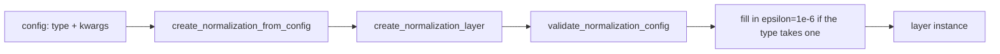

# norms

A package of 17 Keras 3 layer classes (16 normalization layers plus `PolarWeightNorm`, a weight reparameterization), and a factory that builds 19 named normalization types from a string key. Of the 19 keys, 2 are stock Keras layers and 17 are this package's classes. Those 17 keys map to 16 distinct classes, because `dml_plus_focal` and `dml_plus_center` both build `DMLPlus`. It lives at `src/dl_techniques/layers/norms/` in the `dl_techniques` library.

## What it is for

Deep networks train better when the size of the numbers flowing through them is controlled. A normalization layer does that. Different models want different versions: transformers like RMS-based ones, classifiers want their output scores bounded, out-of-distribution (OOD) detectors want direction and length of the logits kept apart, and bias-free image denoisers need a layer that adds no offset at all.

This package holds those variants in one place. The factory lets a config file say `"type": "rms_norm"` instead of hard-coding a class, so a model can swap its normalization without code changes.

## How it works

Most layers follow one recipe: pick the axes to reduce over, compute a statistic (RMS, L2 length, variance), divide the input by it, then apply an optional learnable scale. The families differ in what that last step is.



Families:

- **RMS family** (`rms_norm`, `zero_centered_rms_norm`): divide by the root mean square over the axis. The zero-centered version subtracts the mean first.
- **Band family** (`band_rms`, `zero_centered_band_rms_norm`, `adaptive_band_rms`, `zero_centered_adaptive_band_rms_norm`): RMS-normalize, then multiply by a scale held inside `[1 - max_band_width, 1]`. In `band_rms` and its zero-centered twin the scale is one learned scalar. In the adaptive pair it comes from a small internal `Dense` fed with the log of the input's own RMS.
- **Logit family** (`logit_norm`, `band_logit_norm`, `max_logit_norm`, `decoupled_max_logit`, `dml_plus_focal`, `dml_plus_center`): L2-normalize logit vectors, for calibration or OOD detection.
- **Others**: `bias_free_batch_norm` (variance only, no mean, no beta), `global_response_norm` (ConvNeXt V2 GRN), `local_response_norm` (AlexNet LRN), `dynamic_tanh` (`weight * tanh(alpha * x) + bias`, no statistics at all), `energy_layer_norm` (scalar gamma, vector delta).
- **Standard Keras**: `layer_norm` and `batch_norm` are wrappers over the stock Keras layers, only reachable through the factory.
- **Not a factory type**: `PolarWeightNorm`, a Dense-style layer whose kernel is stored as a radius per unit plus polar angles. It normalizes weights, not activations.

## Files

- `__init__.py` - exports 24 names: 17 classes, `polar_encode`, `polar_decode`, the 4 factory functions and the `NormalizationType` alias.
- `factory.py` - `create_normalization_layer`, `create_normalization_from_config`, `validate_normalization_config`, `get_normalization_info`, the `NormalizationType` literal and the `_TYPE_TO_CLASS` registry.
- `_masking.py` - `normalizes_only_the_feature_axis`, the helper that decides whether a layer may claim `supports_masking`.
- `rms_norm.py` - `RMSNorm`.
- `zero_centered_rms_norm.py` - `ZeroCenteredRMSNorm`.
- `band_rms.py` - `BandRMS`.
- `zero_centered_band_rms_norm.py` - `ZeroCenteredBandRMSNorm`.
- `adaptive_band_rms.py` - `AdaptiveBandRMS`.
- `zero_centered_adaptive_band_rms_norm.py` - `ZeroCenteredAdaptiveBandRMS`.
- `band_logit_norm.py` - `BandLogitNorm`.
- `logit_norm.py` - `LogitNorm`.
- `max_logit_norm.py` - `MaxLogitNorm`, `DecoupledMaxLogit`, `DMLPlus` (three classes in one file).
- `bias_free_batch_norm.py` - `BiasFreeBatchNorm`.
- `global_response_norm.py` - `GlobalResponseNormalization`.
- `local_response_norm.py` - `LocalResponseNormalization` and its private band-matrix initializer.
- `dynamic_tanh.py` - `DynamicTanh`.
- `energy_layer_norm.py` - `EnergyLayerNorm`.
- `polar_weight_norm.py` - `PolarWeightNorm`, `polar_encode`, `polar_decode`.

## How to use it

Through the factory:

```python
from dl_techniques.layers.norms import (
    create_normalization_layer,
    create_normalization_from_config,
)

rms = create_normalization_layer('rms_norm', epsilon=1e-8, use_scale=True)

band = create_normalization_from_config(
    {'type': 'band_rms', 'max_band_width': 0.2, 'epsilon': 1e-7}
)
```

Directly, when the type is fixed:

```python
import keras
from dl_techniques.layers.norms import RMSNorm, PolarWeightNorm

y = RMSNorm(axis=-1)(keras.random.normal((4, 16, 64)))
z = PolarWeightNorm(4, activation="relu")(keras.random.normal((8, 7)))
```

Check what a type accepts before building:

```python
from dl_techniques.layers.norms import validate_normalization_config

validate_normalization_config('band_rms', axis=-1, max_band_width=0.1)  # returns True, or raises ValueError
```

Registered factory keys: `layer_norm`, `batch_norm`, `bias_free_batch_norm`, `rms_norm`, `zero_centered_rms_norm`, `zero_centered_band_rms_norm`, `zero_centered_adaptive_band_rms_norm`, `band_rms`, `adaptive_band_rms`, `band_logit_norm`, `global_response_norm`, `local_response_norm`, `logit_norm`, `max_logit_norm`, `decoupled_max_logit`, `dml_plus_focal`, `dml_plus_center`, `dynamic_tanh`, `energy_layer_norm`.

Constructor defaults worth knowing (class defaults, not factory defaults):

| Class | Key defaults |
| --- | --- |
| `RMSNorm`, `ZeroCenteredRMSNorm` | `axis=-1`, `epsilon=1e-6`, `use_scale=True`, `scale_initializer="ones"` |
| `BandRMS`, `ZeroCenteredBandRMSNorm` | `max_band_width=0.1`, `epsilon=1e-7`, `band_initializer="zeros"`, `band_regularizer` falls back to L2(1e-5) |
| `AdaptiveBandRMS`, `ZeroCenteredAdaptiveBandRMS` | same as above, but `band_regularizer=None` stays None |
| `BandLogitNorm` | `max_band_width=0.01`, `epsilon=1e-7` |
| `LogitNorm` | `temperature=0.04`, `epsilon=1e-7` |
| `MaxLogitNorm`, `DecoupledMaxLogit` | `epsilon=1e-7`; `DecoupledMaxLogit` also `constant=1.0` |
| `DMLPlus` | `model_type` required (`"focal"` or `"center"`), `epsilon=1e-7` |
| `BiasFreeBatchNorm` | `epsilon=1e-6`, `momentum=0.99`, `use_scale=True` |
| `GlobalResponseNormalization` | `eps=1e-6`, `gamma_initializer='ones'`, `beta_initializer='zeros'`, `use_beta=True` |
| `LocalResponseNormalization` | `depth_radius=2`, `alpha=1e-4`, `beta=0.75`, `k=1.0` |
| `DynamicTanh` | `alpha_init_value=0.5`, `kernel_initializer='ones'`, `bias_initializer='zeros'` |
| `EnergyLayerNorm` | `epsilon=1e-5`, `gamma_constraint` defaults to a floor of 1e-3 |
| `PolarWeightNorm` | `units` required, `kernel_initializer="glorot_uniform"`, `epsilon=1e-12` |

## Things to know

- **The factory is not a drop-in for direct construction.** It sets `epsilon=1e-6` on every type that takes one, unless you pass `epsilon` yourself. For `global_response_norm` the value goes to `eps`, and an explicit `eps` wins. For Keras `layer_norm` and `batch_norm` the Keras default is `1e-3`, so the factory divides epsilon by 1000. `energy_layer_norm` goes from `1e-5` to `1e-6`. The band, `band_logit_norm`, `logit_norm`, `max_logit_norm` and `decoupled_max_logit` types go from `1e-7` to `1e-6`. Build the class directly if you want its own default.
- **`epsilon` is ignored for two types, and the factory says so.** `local_response_norm` has no epsilon (its constant is `k`), and `dynamic_tanh` has none either. The factory takes `epsilon` as a named argument (default `None`, meaning 1e-6 for every other type) and does not forward it for those two; an explicit value logs a warning and the layer still builds, because callers such as the text decoder pass `epsilon` for any configured type.
- **Three factory types do not preserve shape.** They reduce the normalized axis away. On a `(3, 5, 8)` input at `axis=-1`: `decoupled_max_logit` returns a 3-tuple `(combined score, MaxCosine, MaxNorm)` of `(3, 5)` tensors; `dml_plus_center` returns a 2-tuple `(MaxNorm, norm factor)` shaped `(3, 5)` and `(3, 5, 1)`; `dml_plus_focal` returns one `(3, 5)` tensor. `max_logit_norm` does keep its shape.
- **The factory rejects unknown kwargs.** The accepted set for each type is read from the target class's `__init__` signature plus `name`, `epsilon`, and the Keras base kwargs (`dtype`, `trainable`, `activity_regularizer`, `autocast`). `get_normalization_info()[t]['parameters']` is only a curated hint list, not the full set.
- **`model_type` cannot be passed to `dml_plus_focal` or `dml_plus_center`.** The factory sets it, and the validator raises if you try.
- **GRN and LRN are different algorithms.** GRN (`global_response_norm`) scores each channel over all spatial positions, multiplies the input by that score and adds the input back; it has trainable `gamma` and `beta`. LRN (`local_response_norm`) divides each channel by the squared energy of neighbouring channels, and has no trainable weights. LRN accepts rank 3 or 4 only; GRN accepts rank 2, 3 or 4.
- **GRN gamma starts at ones.** The ConvNeXt V2 paper starts it at zero (identity at init). Pass `gamma_initializer='zeros'` to match the paper.
- **Masking depends on the axis.** Seven classes import `_masking` and claim `supports_masking` only when the normalized axis is the feature axis (the last one): `rms_norm`, `zero_centered_rms_norm`, `band_rms`, `zero_centered_band_rms_norm`, `band_logit_norm`, `logit_norm` and `max_logit_norm`. `DynamicTanh` and `EnergyLayerNorm` always claim it. The two adaptive band types (`adaptive_band_rms`, `zero_centered_adaptive_band_rms_norm`), `bias_free_batch_norm`, GRN, LRN, `decoupled_max_logit` and `dml_plus` do not claim it at all.
- **Adaptive band layers lock to a resolution** when a spatial or sequence axis is normalized. The internal `Dense` is sized at build time from the product of the normalized axis sizes. `axis=(1, 2)` built on 8x8 input fails on 16x16. The default `axis=-1` and the all-non-batch-axes case do not lock. Axis 0 is rejected.
- **`BandLogitNorm`'s adaptive part is inert.** Its inner `LayerNormalization` runs on a length-1 axis and always yields 0, so the scale is the constant `1 - 0.5 * max_band_width`. It is L2 normalization times a constant. It is kept as is because `src/train/rms_variants_train/` uses it.
- **`BiasFreeBatchNorm` is homogeneous only at inference.** `f(a*x) = a*f(x)` holds with `training=False`. In training mode it uses batch variance and is scale-invariant instead. It has `running_var` and optional `gamma`, and no `moving_mean` or `beta`.
- **`DynamicTanh` rejects `alpha_init_value <= 0`.** A saved model whose config holds a non-positive value no longer loads.
- **`EnergyLayerNorm` keeps `gamma` a scalar on purpose.** Its output is the gradient of a Lagrangian with a positive semi-definite Hessian, which the Energy Transformer's energy-descent guarantee needs. A per-feature gamma breaks that. `gamma` is constrained to `>= 1e-3` by default; pass `gamma_constraint=None` to turn it off.
- **`PolarWeightNorm` is not shape-preserving or a factory type.** It maps `(..., fan_in)` to `(..., units)`, rebuilds its kernel on every forward pass, and runs the forward pass in float32. Build it by calling it once eagerly (or via `keras.Input`) before wrapping it in `tf.function`, because `build()` uses NumPy.
- **`LocalResponseNormalization` holds one non-trainable weight**, `neighbourhood_band`, shape `(C, C)`, built from `depth_radius`.
- **Statistics dtype.** The RMS family, `bias_free_batch_norm` and `energy_layer_norm` compute their statistics in float32 at minimum (float64 under a float64 policy) and cast back to the input dtype.
- Tests are in `tests/test_layers/test_norms/`.
