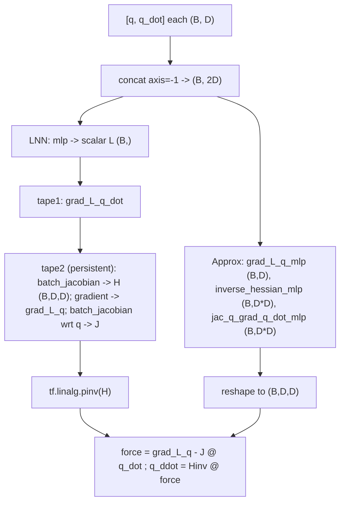

# physics

Path: `src/dl_techniques/layers/physics`
Purpose: Lagrangian Neural Network layers that map `[q, q_dot]` to accelerations `q_ddot` (Cranmer et al., arXiv:2003.04630).

## Scope

Lives here: two Keras layers, one per module, both computing `q_ddot` from generalized coordinates `q` and velocities `q_dot`.

Does not live here: a `factory.py` (none exists), a curated `__init__.py` (the file is empty, no `__all__`), losses, integrators, or training scripts. Consumers import the module path directly.

Related file outside the package: `src/dl_techniques/losses/jacobian_symmetry.py` cites `lagrange_layer.py` in its docstring as precedent for the nested-`tf.GradientTape` idiom. It does not import it.

## Architecture

Euler-Lagrange: `q_ddot = H^-1 * (dL/dq - J * q_dot)`, with `H = d2L/dq_dot2` and `J = d/dq(dL/dq_dot)`.

`LagrangianNeuralNetworkLayer.call`: concat, run `self.mlp` (hidden Dense layers then `Dense(1, name="lagrangian_output")`), squeeze to `(B,)`. Inner `tape1` yields `dL/dq_dot`. Persistent outer `tape2` (watching `q` and `q_dot`, `watch_accessed_variables=False`) yields `H` via `batch_jacobian(grad_L_q_dot, q_dot)`, `grad_L_q` via `gradient(lagrangian, q)`, and `J` via `batch_jacobian(grad_L_q_dot, q)`. The tape is deleted, `H` is inverted with `tf.linalg.pinv`, the rest is `keras.ops` matmul/squeeze.

`ApproximatedLNNLayer.call`: three `keras.Sequential` MLPs on the same concatenated input; two outputs are reshaped to `(-1, D, D)` with `D = ops.shape(q)[-1]`; the final assembly is identical to the exact layer but uses `keras.ops` only.

## Key files

| File | Role | Notes |
| --- | --- | --- |
| `lagrange_layer.py` | `LagrangianNeuralNetworkLayer` | TensorFlow-backend-only by design. Imports `tensorflow as tf`. Registered as `dl_techniques.layers.physics.lagrange_layer` |
| `approximate_lagrange_layer.py` | `ApproximatedLNNLayer` | Backend-agnostic forward path. Registered as `dl_techniques.layers.physics.approximate_lagrange_layer` |
| `__init__.py` | empty | exports nothing |

## Public interface

Both classes: `Layer(hidden_dims: List[int], activation: str = 'softplus', **kwargs)`.

- Call: `layer([q, q_dot], training=None) -> q_ddot`. Inputs `(batch, coord_dim)`, output has the shape of `q`.
- `build(input_shape)` raises `ValueError` if `input_shape` is not a list/tuple of length 2, or if `q_shape[-1] != q_dot_shape[-1]`.
- `__init__` raises `ValueError` if `hidden_dims` is empty or any entry is `<= 0`.
- `compute_output_shape(input_shape)` returns `input_shape[0]`.
- `get_config()` returns `hidden_dims` and `serialize_activation(self.activation)` on top of the base config.
- Sub-layer attributes: LNN has `mlp` (name `lagrangian_mlp`). Approx has `grad_L_q_mlp`, `inverse_hessian_mlp`, `jac_q_grad_q_dot_mlp`, built by `_create_complete_mlp(name, output_units)`.

## Data shapes

| Tensor | Shape |
| --- | --- |
| `q`, `q_dot`, `q_ddot` | `(B, D)` |
| MLP input | `(B, 2D)` (build uses `(None, 2*D)`) |
| LNN scalar `L` | `(B, 1)` squeezed to `(B,)` |
| `H`, `H^-1`, `J` | `(B, D, D)` |
| Approx MLP outputs | `grad_L_q` `D`; `inverse_hessian` and `jac_q_grad_q_dot` `D*D` |

Config keys: `hidden_dims`, `activation` (plus base Layer keys).

## Invariants and constraints

- `lagrange_layer.py` must keep raw TensorFlow in `call`. `keras.ops` has no autodiff API and no `pinv`; the module docstring records this as an accepted exception and says not to force a `keras.ops` rewrite. `ApproximatedLNNLayer` is the portable alternative.
- `ApproximatedLNNLayer.call` must stay `keras.ops`-only. Do not add `tf` calls.
- `ApproximatedLNNLayer` output Dense layers depend on `coord_dim`, so they are appended in `build()` under `if not ...built:`. `__init__` creates only the hidden stacks.
- Sub-layers are built explicitly in `build()` (needed for save/load). `super().build(input_shape)` is called last.
- `H^-1` uses `tf.linalg.pinv`, not `inv`, in the exact layer, for stability with singular Hessians.
- `batch_jacobian` is used on the assumption of no cross-sample coupling; any layer inside `mlp` that mixes samples (for example batch-statistics norm) would break it.
- `tests/test_the_keras_submodule_import_population_cannot_grow.py` pins one `from keras import ...` site in each of the two files (`"...physics/approximate_lagrange_layer.py": 1`, `"...physics/lagrange_layer.py": 1`). Do not add more such imports. Changing or removing the existing line means updating that table.

## Dependencies

- Internal: `dl_techniques.utils.activation_serialization` (`serialize_activation`, `deserialize_activation`); `dl_techniques.utils.keras_registration.register_dl_technique`.
- External: `keras`; `tensorflow` (only `lagrange_layer.py`); `typing`.

## Failure modes

- Wrong number of inputs or mismatched last dimension: `ValueError` from `build`. Note the count-error message formats `len(input_shape)`, so a non-sized `input_shape` would fail with a different error first.
- Invalid `hidden_dims`: `ValueError` in the constructor.
- Exact layer with an activation whose second derivative is zero (e.g. ReLU): `H` is zero or degenerate, so `pinv` returns a zero or meaningless inverse and `q_ddot` is wrong with no error. `softplus` is the default for this reason.
- Exact layer on JAX or PyTorch backend: fails because of the `tf` calls.
- Exact layer is computationally heavier (nested tapes, per-sample Jacobians, pseudoinverse) than the approximate one.

## Working here

- Tests: `.venv/bin/python -m pytest tests/test_layers/test_physics/ -q`. The file `test_lagrange_layer.py` has `TestApproximatedLNNLayer` and `TestLagrangianNeuralNetworkLayer`, each covering construction, invalid `hidden_dims`, forward pass, output shape, `get_config`, and a `.keras` serialization round trip. Do not run the full suite.
- Keep the two layers in sync on constructor signature, validation messages, and `get_config` keys. Any change to one usually needs a matching change to the other plus a test.
- Docstrings in this package use Sphinx/reST (`:param:`, `:type:`, `:raises:`); match them.
- Registered names are the module's dotted path. Moving a file changes the key; a new layer here needs `@register_dl_technique("dl_techniques.layers.physics.<module>")` and a test under `tests/test_layers/test_physics/`.
- No factory exists. If one is added, register both classes and follow the repo rule that factories raise `ValueError` on unknown keys.
- Never use `from keras import ...` in new code; use `import keras` and qualify at the call site.
