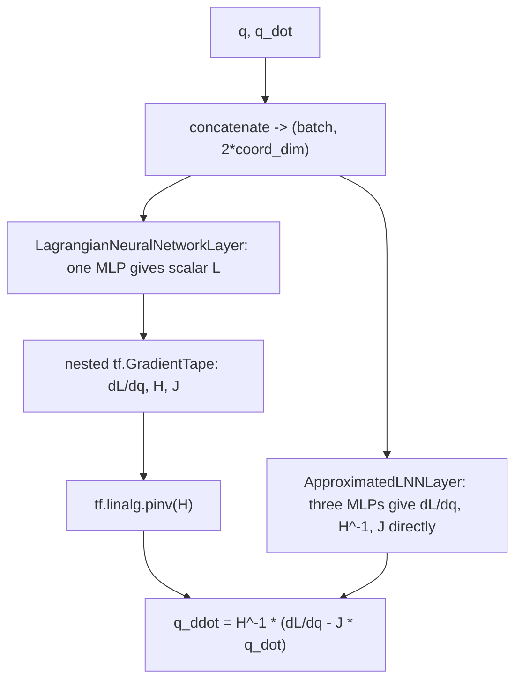

# physics

Two Keras layers that predict the acceleration of a mechanical system from its positions and velocities, using the idea of a Lagrangian (a single energy-like function that describes how a system moves).

## What it is for

In classical mechanics, a system can be described by one scalar function `L(q, q_dot)`, called the Lagrangian. Here `q` are the generalized coordinates (positions, angles) and `q_dot` are their velocities. The Euler-Lagrange equation turns `L` into accelerations `q_ddot`. These layers learn that structure from data instead of assuming a fixed physical law.

Use them when you want a neural dynamics model that outputs `q_ddot` for a given state `(q, q_dot)`, for example to fit a pendulum or a multi-body system. The idea comes from "Lagrangian Neural Networks" (Cranmer et al., 2020, https://arxiv.org/abs/2003.04630).

There are two versions. One is exact but only works on the TensorFlow backend. The other is an approximation that works on any Keras backend.

## How it works

Both layers take a list `[q, q_dot]`, each of shape `(batch, coord_dim)`, and return `q_ddot` of shape `(batch, coord_dim)`. The formula is:

```
q_ddot = H^-1 * ( dL/dq - J * q_dot )
H = d^2L / dq_dot^2      (Hessian of L with respect to velocities)
J = d/dq ( dL/dq_dot )   (mixed partial derivatives)
```



- `LagrangianNeuralNetworkLayer` learns only the scalar `L` with one MLP. It then differentiates `L` automatically (twice, with `tf.GradientTape`) to get `dL/dq`, `H` and `J`, and inverts `H` with a pseudoinverse. This is the faithful version of the paper.
- `ApproximatedLNNLayer` skips the differentiation. It has three separate MLPs that directly output `dL/dq` (size `coord_dim`), `H^-1` (size `coord_dim^2`, reshaped to a matrix) and `J` (size `coord_dim^2`, reshaped). It then assembles the same formula with matrix multiplications. It has about three times the parameters but is faster at inference. The learned pieces are not forced to be consistent with one single `L`.

## Files

- `lagrange_layer.py` - `LagrangianNeuralNetworkLayer`, the autodiff-based layer. TensorFlow backend only.
- `approximate_lagrange_layer.py` - `ApproximatedLNNLayer`, the three-MLP layer. Uses only `keras.ops`.
- `__init__.py` - empty. Nothing is re-exported; import from the modules directly.

## How to use it

```python
import numpy as np
from dl_techniques.layers.physics.lagrange_layer import LagrangianNeuralNetworkLayer
from dl_techniques.layers.physics.approximate_lagrange_layer import ApproximatedLNNLayer

q = np.random.randn(8, 3).astype("float32")
q_dot = np.random.randn(8, 3).astype("float32")

exact = LagrangianNeuralNetworkLayer(hidden_dims=[64, 64], activation="softplus")
approx = ApproximatedLNNLayer(hidden_dims=[64, 64])

q_ddot_exact = exact([q, q_dot])    # shape (8, 3)
q_ddot_approx = approx([q, q_dot])  # shape (8, 3)
```

Both constructors take `hidden_dims` (list of positive ints, hidden units of each internal MLP) and `activation` (default `'softplus'`).

## Things to know

- `LagrangianNeuralNetworkLayer` is TensorFlow-only on purpose. It uses `tf.GradientTape` and `tf.linalg.pinv`, and `keras.ops` has no autodiff or pseudoinverse. Do not try to rewrite it with `keras.ops`. Use `ApproximatedLNNLayer` when you need another backend.
- Prefer a smooth activation such as `softplus`. The exact layer needs a non-zero second derivative of the MLP, and a ReLU gives a zero Hessian.
- `q` and `q_dot` must have the same last dimension, or `build` raises `ValueError`. The input must be a list or tuple of exactly two tensors.
- An empty `hidden_dims` or any value `<= 0` raises `ValueError` in the constructor.
- The layers work on rank-2 inputs `(batch, coord_dim)`. Higher ranks are not handled by the code.
- `training` is only passed down to the internal MLPs; the layers add no behaviour of their own for it.
- Both register for serialization under `dl_techniques.layers.physics.lagrange_layer` and `dl_techniques.layers.physics.approximate_lagrange_layer`.
- Tests are in `tests/test_layers/test_physics/test_lagrange_layer.py`.
