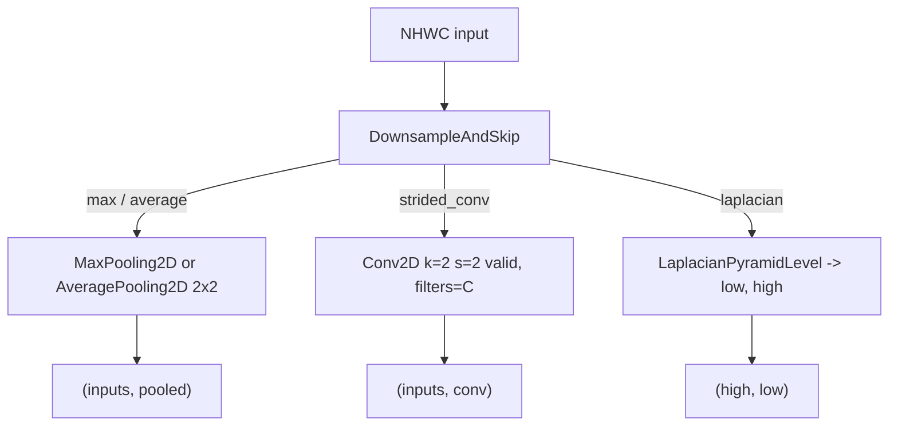

# pooling

Path: `src/dl_techniques/layers/pooling`
Purpose: Keras 3 layers that change spatial size or layout of a feature map (blur-pool, pixel shuffle/unshuffle, patch merging, global sum pool, U-Net downsample-and-skip junction).

## Scope

Lives here: six modules, seven registered classes. Nearly all are parameter-free or have a small projection.

Does not live here:
- Sequence pooling `(B, T, D) -> (B, D)`: that is `layers/sequence_pooling/`.
- The Laplacian pyramid itself: `layers/signal_processing/laplacian_filter.py` (`LaplacianPyramidLevel`). `DownsampleAndSkip` wraps it.
- Complex-valued average pooling: `layers/complex/`.

There is no `factory.py` and `__init__.py` is empty (zero bytes). Import from the module files, for example `from dl_techniques.layers.pooling.blur_pool import BlurPool2D`.

## Architecture

Independent layers; no module imports another in this package. `DownsampleAndSkip` composes Keras pooling/conv layers or `LaplacianPyramidLevel` internally.



## Key files

| File | Role | Notes |
| --- | --- | --- |
| `blur_pool.py` | `BlurPool2D`, helper `_binomial_1d(size)` | Fixed non-trainable depthwise kernel `blur_kernel` of shape `(k, k, C, 1)` created in `build()` |
| `downsample_and_skip.py` | `DownsampleAndSkip` | Two outputs; sub-layer names derived from the layer name |
| `global_sum_pool.py` | `GlobalSumPooling` | Axes resolved in `build()` into `_sum_axes`; any spatial rank |
| `patch_merging.py` | `PatchMerging` | Sub-layers `norm` (LayerNormalization, epsilon 1e-5) and `reduction` (Dense `2*dim`) built explicitly |
| `pixel_shuffle.py` | `PixelShuffle` | Rank-3 ViT tokens with leading CLS token |
| `pixel_unshuffle.py` | `PixelUnshuffle2D`, `PixelShuffle2D` | NHWC; both registered under the package `...pooling.pixel_unshuffle` |
| `__init__.py` | empty | no exports |

## Public interface

Registration strings (all through `register_dl_technique` from `dl_techniques.utils.keras_registration`):

| Class | Package string |
| --- | --- |
| `BlurPool2D` | `dl_techniques.layers.pooling.blur_pool` |
| `DownsampleAndSkip` | `dl_techniques.layers.pooling.downsample_and_skip` |
| `GlobalSumPooling` | `dl_techniques.layers.pooling.global_sum_pool` |
| `PatchMerging` | `dl_techniques.layers.pooling.patch_merging` |
| `PixelShuffle` | `dl_techniques.layers.pooling.pixel_shuffle` |
| `PixelUnshuffle2D`, `PixelShuffle2D` | `dl_techniques.layers.pooling.pixel_unshuffle` |

Constructors:

```python
BlurPool2D(strides: int = 2, padding: str = "same", kernel_size: int = 4, **kwargs)
DownsampleAndSkip(pool_type: str = "max", laplacian_kernel_size: Tuple[int, int] = (5, 5),
                  use_bias: bool = True, kernel_initializer="glorot_uniform",
                  kernel_regularizer=None, **kwargs)
GlobalSumPooling(axes: Optional[Union[int, Sequence[int]]] = None, keepdims: bool = False, **kwargs)
PatchMerging(dim: int, use_bias: bool = False, kernel_initializer="glorot_uniform",
             bias_initializer="zeros", kernel_regularizer=None, bias_regularizer=None, **kwargs)
PixelShuffle(scale_factor: int = 2, validate_spatial_dims: bool = True, **kwargs)
PixelUnshuffle2D(scale: int = 2, out_channels: Optional[int] = None, use_bias: bool = True,
                 kernel_initializer="glorot_uniform", bias_initializer="zeros",
                 kernel_regularizer=None, bias_regularizer=None, **kwargs)
PixelShuffle2D(block_size: int = 2, **kwargs)
```

Raised errors (all `ValueError`):

- `BlurPool2D`: `strides` or `kernel_size` not a positive int (bool rejected); `padding` not `same`/`valid` (lowercased first); `build` with a `None` channel axis.
- `DownsampleAndSkip`: `pool_type` not in `("max", "average", "strided_conv", "laplacian")`; `laplacian_kernel_size` not a length-2 non-str sequence.
- `GlobalSumPooling`: empty `axes`; duplicate `axes`; input rank < 3; an axis that is not in `1..spatial_rank` after normalizing negatives; axes that resolve to duplicates.
- `PatchMerging`: `dim <= 0`.
- `PixelShuffle`: `scale_factor` not a positive int; at build, input not rank 3; if `validate_spatial_dims` and the sequence length is known: `seq_len - 1 <= 0`, not a perfect square, or side not divisible by `scale_factor`.
- `PixelUnshuffle2D`: `scale` not an int >= 1; `out_channels` not a positive int or None; build with a `None` channel axis.
- `PixelShuffle2D`: `block_size` not an int >= 1.

## Data shapes

| Layer | Input | Output |
| --- | --- | --- |
| `BlurPool2D` | `(B, H, W, C)` | `same`: `ceil(H/s)`; `valid`: `(H - k)//s + 1`; `C` unchanged |
| `DownsampleAndSkip` | `(B, H, W, C)` | tuple `(skip, down)`: skip `(B, H, W, C)`, down `(B, H/2, W/2, C)` |
| `GlobalSumPooling` | `(B, *spatial, C)` | summed axes dropped, or set to 1 if `keepdims` |
| `PatchMerging` | `(B, H, W, dim)` | `(B, ceil(H/2), ceil(W/2), 2*dim)` |
| `PixelShuffle` | `(B, 1 + H*W, C)` | `(B, 1 + (H/s)*(W/s), C*s^2)` |
| `PixelUnshuffle2D` | `(B, H, W, C)` | `(B, H//s, W//s, out_channels or s*s*C)` |
| `PixelShuffle2D` | `(B, H, W, C)` | `(B, H*r, W*r, C//(r*r))` |

Config keys: each `get_config()` returns the constructor arguments plus the base-layer keys. `GlobalSumPooling` serializes `axes` as a list (or None). `DownsampleAndSkip` stores `laplacian_kernel_size` as a tuple.

## Invariants and constraints

- `DownsampleAndSkip` output order is `(skip, downsampled)` on every branch. The laplacian branch swaps `LaplacianPyramidLevel`'s `(low, high)` into `(high, low)` in both `call` and `compute_output_shape`. Both outputs are rank 4, so a swapped tuple passes shape checks; treat the order as a contract.
- `DownsampleAndSkip` sub-layer names are `f"{name}_pool"`, `f"{name}_conv"`, `f"{name}_pyramid"`. Only the active branch's sub-layer exists; the others stay `None`. The `strided_conv` Conv2D is created in `build()` (filters from `input_shape[-1]`), and the active sub-layer is built explicitly there so weights are not lost on `.keras` reload. Keep that explicit build.
- `DownsampleAndSkip` `laplacian_kernel_size`, `use_bias`, `kernel_initializer`, `kernel_regularizer` are inert except where the branch uses them (`use_bias`/initializer/regularizer only for `strided_conv`) but are always written to the config.
- `use_bias=False` on `strided_conv` keeps the encoder path linear and degree-1 homogeneous, which the bias-free denoisers rely on. Max pooling is not linear; average pooling is.
- `PixelShuffle2D` and `PixelUnshuffle2D` use reshape, transpose `(0, 1, 3, 2, 4, 5)`, reshape. They are exact inverses: `PixelUnshuffle2D(scale=r)(PixelShuffle2D(r)(x)) == x`. A source comment records a decision not to replace this with `keras.layers.DepthToSpace`, `keras.ops.nn.depth_to_space` or a Lambda (the reasoning given is that `DepthToSpace` does not exist in Keras 3.8 and a Lambda breaks `.keras` round trips).
- Both unshuffle/shuffle 2D layers use fully dynamic `ops.shape`, so a symbolic `None` height/width builds. Do not add static-shape checks in `build`.
- `BlurPool2D` kernel: binomial outer product divided by its squared sum, so the kernel sums to 1. Stored as non-trainable weight with the layer's `compute_dtype`.
- `PatchMerging.build` computes the merged shape with `(H + 1)//2` to match the pad-on-odd behavior in `call`. Channel layout of the concat is order `x0` (top-left), `x1` (bottom-left), `x2` (top-right), `x3` (bottom-right); changing it changes weight meaning.
- `PixelShuffle` with `scale_factor == 1` returns inputs unchanged. Its `call` assumes a square grid and takes the CLS token at index 0.
- `GlobalSumPooling` keeps `axes` verbatim for the config and resolves into `_sum_axes` at build; `compute_output_shape` calls `_resolve_axes` if not built.

## Dependencies

Internal:
- `dl_techniques.utils.keras_registration.register_dl_technique` (all modules).
- `dl_techniques.utils.logger.logger` (`blur_pool.py`, `pixel_unshuffle.py`; debug logs only).
- `dl_techniques.layers.signal_processing.laplacian_filter.LaplacianPyramidLevel` (`downsample_and_skip.py`).

External: `keras` (`ops`, layers, initializers, regularizers), `numpy` (`blur_pool.py` only).

Known callers outside the package (from imports in `src/`):
- `DownsampleAndSkip`: `models/vision/bias_free_denoisers/bfunet.py`, `bfconvunext.py` (imported, noqa F401), `models/vision/convunext/model.py`.
- `PixelShuffle`: `layers/modality_projection.py` (`from .pooling.pixel_shuffle import PixelShuffle`).
- `PixelShuffle2D`: `models/vision/image_restoration/darkir/model.py`, `models/vision/super_resolution/pft_sr/model.py`; `models/vision/image_restoration/doc_res/components.py` imports both `PixelShuffle2D` and `PixelUnshuffle2D` from `pixel_unshuffle`.
- `BlurPool2D`, `GlobalSumPooling`: no callers in `src/` outside this package (tests only).
- `PatchMerging`: `models/vision/swin_transformer/model.py`, `models/vision_language/clifford_clip/model.py`, `src/train/cliffordnet/train_downsampling_techniques.py`.

## Failure modes

- Non-divisible spatial size into `PixelUnshuffle2D` fails at call time in the reshape, not at build.
- Channel count not divisible by `block_size**2` fails in `PixelShuffle2D.call` reshape. `compute_output_shape` would silently floor-divide.
- `DownsampleAndSkip` on odd `H`/`W`: the skip keeps full size, while the Keras 2x2 pool and valid strided conv floor (default pooling padding in Keras is `valid`). Skip and downsampled sizes then disagree with a decoder that doubles back. The laplacian branch behavior on odd sizes is defined by `LaplacianPyramidLevel`, not read here.
- `PatchMerging` with an input whose channels differ from `dim` fails when the norm/Dense are built on `4*dim`.
- `PixelShuffle` with `validate_spatial_dims=False` and a bad token count fails at call time in the reshape.
- `PixelShuffle.compute_output_shape` floor-divides the spatial count by `scale_factor**2` and does not validate.

## Working here

- Style: Sphinx/reST docstrings (`:param:`, `:type:`, `:raises:`), `import keras`, `get_config()` covering every constructor argument, logging through `dl_techniques.utils.logger`. Existing files here use `from keras import ops` in some modules; match the file being edited.
- New layer: one new module in this directory, decorated `@register_dl_technique("dl_techniques.layers.pooling.<module>")`, own tests in `tests/test_layers/test_pooling/test_<module>.py`. No factory exists to update.
- Do not give two classes the same bare `__name__` anywhere in the repo; the legacy `Custom>ClassName` alias would collide. This is why the 2D shuffle is `PixelShuffle2D` and the token one is `PixelShuffle`.
- Sub-layers that carry weights must be built explicitly in `build()`, as `PatchMerging`, `PixelUnshuffle2D` and `DownsampleAndSkip` do.
- Tests: `.venv/bin/python -m pytest tests/test_layers/test_pooling/ -q` from the repo root. Files: `test_blur_pool.py`, `test_downsample_and_skip.py`, `test_global_sum_pool.py`, `test_patch_merging.py`, `test_pixel_shuffle.py`, `test_pixel_shuffle_2d.py`, `test_pixel_unshuffle.py`. Also run the tests of any model from the caller list above that you affect, and do not run the full suite.
