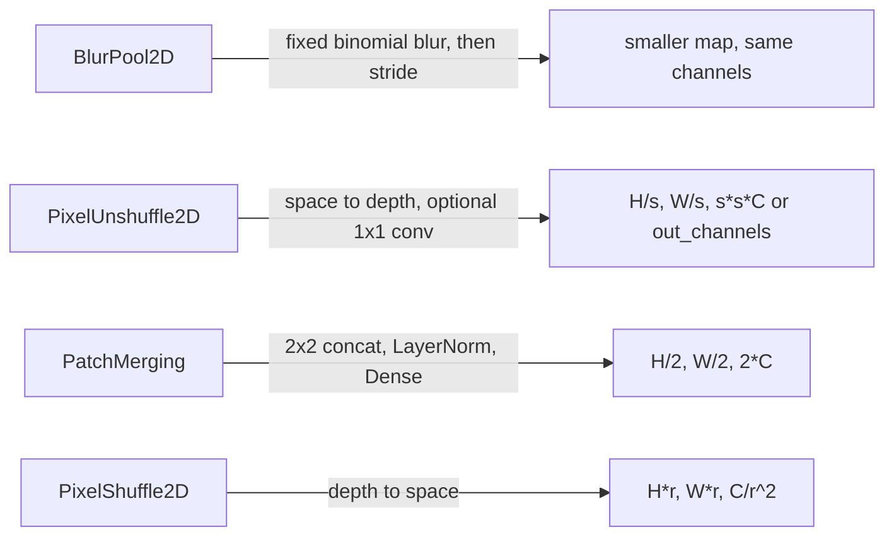

# pooling

Keras 3 layers that change the size or layout of a feature map: anti-aliased downsampling, space-to-depth and depth-to-space shuffles, Swin-style patch merging, global sum pooling, and the downsample-plus-skip junction used in U-Net encoders.

## What it is for

Vision models need to shrink a feature map, grow it back, or collapse it to a vector. Plain max or average pooling throws information away and can alias fine detail. The layers here cover other ways to do it. The pixel shuffle layers and `GlobalSumPooling` have no weights. `BlurPool2D` uses a fixed filter, while `PatchMerging` and the optional `out_channels` projection in `PixelUnshuffle2D` learn a small projection. All of them are registered Keras serializable classes, so models using them save and load as `.keras` files.

## How it works

Most layers expect channels-last tensors `(batch, height, width, channels)`.



- `BlurPool2D` builds a 1-D binomial filter (for length 4: 1, 3, 3, 1), takes its outer product to make a 2-D kernel that sums to 1, copies it per channel, and runs one depthwise convolution with the chosen stride. The kernel is a non-trainable weight. `kernel_size=1` turns it into plain decimation.
- `PixelUnshuffle2D` reshapes each `scale x scale` block of pixels into the channel axis. With `out_channels` set, a 1x1 `Conv2D` follows. `PixelShuffle2D` is its exact inverse.
- `PixelShuffle` (no "2D") is different: it works on ViT token sequences `[CLS, spatial tokens]` of shape `(batch, 1 + H*W, C)`. It folds the square token grid by `scale_factor`, and zero-pads the CLS token to the new channel width.
- `PatchMerging` takes the four pixels of each 2x2 patch, concatenates them (`4*C` channels), applies LayerNormalization, then a Dense layer to `2*C`. Odd height or width is padded by one first.
- `GlobalSumPooling` sums over the spatial axes. The default is all of them, leaving `(batch, channels)`.
- `DownsampleAndSkip` returns the pair `(skip, downsampled)`. For `max`, `average` and `strided_conv` the skip is the unchanged input. For `laplacian` the skip is the high-frequency band and the downsampled output is the low band.

## Files

- `blur_pool.py` - `BlurPool2D`: fixed binomial blur plus stride, no learned weights.
- `downsample_and_skip.py` - `DownsampleAndSkip`: encoder junction with four downsample modes.
- `global_sum_pool.py` - `GlobalSumPooling`: sum over chosen spatial axes, any spatial rank.
- `patch_merging.py` - `PatchMerging`: Swin Transformer 2x2 merge with LayerNorm and Dense.
- `pixel_shuffle.py` - `PixelShuffle`: space-to-depth on ViT token sequences with a CLS token.
- `pixel_unshuffle.py` - `PixelUnshuffle2D` (space-to-depth, NHWC) and `PixelShuffle2D` (depth-to-space, NHWC).
- `__init__.py` - empty. Import from the module files.

## How to use it

```python
import keras
from dl_techniques.layers.pooling.blur_pool import BlurPool2D
from dl_techniques.layers.pooling.pixel_unshuffle import PixelUnshuffle2D, PixelShuffle2D
from dl_techniques.layers.pooling.patch_merging import PatchMerging
from dl_techniques.layers.pooling.global_sum_pool import GlobalSumPooling
from dl_techniques.layers.pooling.pixel_shuffle import PixelShuffle
from dl_techniques.layers.pooling.downsample_and_skip import DownsampleAndSkip

x = keras.layers.Input(shape=(32, 32, 96))
a = BlurPool2D(strides=2)(x)                          # (None, 16, 16, 96)
b = PixelUnshuffle2D(scale=2, out_channels=96)(x)     # (None, 16, 16, 96)
c = PatchMerging(dim=96)(x)                           # (None, 16, 16, 192)
d = PixelShuffle2D(block_size=2)(PixelUnshuffle2D(scale=2)(x))  # (None, 32, 32, 96)
v = GlobalSumPooling()(x)                             # (None, 96)
skip, down = DownsampleAndSkip(pool_type="average", name="enc1_downsample")(x)

tokens = keras.layers.Input(shape=(1 + 16 * 16, 64))
t = PixelShuffle(scale_factor=2)(tokens)              # (None, 1 + 64, 256)
```

## Things to know

- `PixelShuffle` (token sequences) and `PixelShuffle2D` (feature maps) are different classes with different shapes. Do not swap them.
- `pixel_unshuffle.py` holds two classes, and both register under the package string `dl_techniques.layers.pooling.pixel_unshuffle`. The class names keep the registry keys distinct.
- `PixelUnshuffle2D` needs a static channel count but accepts `None` height and width. It does not check at build time that height and width divide by `scale`. A bad size fails at call time in the reshape.
- `PixelShuffle2D` does not check that the channel count divides by `block_size**2`.
- `PatchMerging(dim=...)` must equal the input channel count. It is not inferred.
- `PatchMerging` defaults to `use_bias=False`.
- `BlurPool2D` needs a static channel count. It accepts `padding` of `same` or `valid` (case-insensitive) and rejects `bool` for `strides` and `kernel_size`.
- `PixelShuffle` validates at build time (when the sequence length is known) that the spatial token count is a perfect square and the side divides by `scale_factor`. `scale_factor=1` returns the input untouched.
- `DownsampleAndSkip` only supports a factor of 2. The `strided_conv` mode keeps the channel count (a `Conv2D` with kernel 2, stride 2, valid padding). It is the only mode with weights.
- `DownsampleAndSkip` imports `LaplacianPyramidLevel` from `dl_techniques.layers.signal_processing.laplacian_filter`.
- `GlobalSumPooling` cannot sum the batch axis or the channel axis. Inputs need rank 3 or more.
- Tests are in `tests/test_layers/test_pooling/`. Run them from the repo root with `.venv/bin/python -m pytest tests/test_layers/test_pooling/`.
