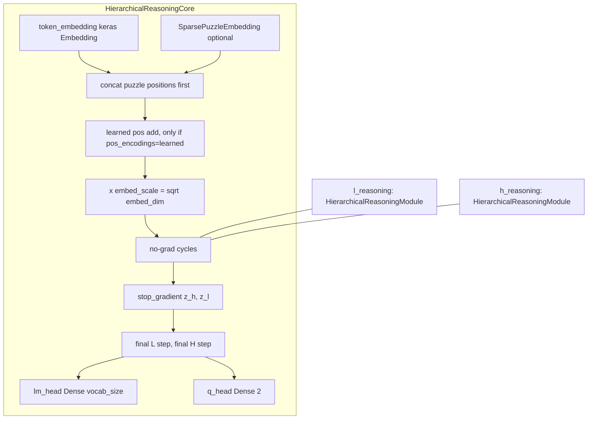

# reasoning

Path: `src/dl_techniques/layers/reasoning`
Purpose: Keras 3 layers for the Hierarchical Reasoning Model (HRM): stateful two-level reasoning core, transformer-stack module with input injection, and a caching puzzle-id embedding.

## Scope

In this directory: three registered layers, one class per module, plus an empty `__init__.py` (0 bytes, exports nothing; import from submodules). The package is named for the Hierarchical Reasoning Model (HRM): two transformer stacks (a low-level `z_l` and a high-level `z_h`) that refine each other, with a truncated-gradient scheme.

In-repo consumers (found by grep over `src/`):

- `src/dl_techniques/models/language/hrm/model.py` imports `HierarchicalReasoningCore` and wraps it with the Adaptive Computation Time (ACT) outer loop: halting on `q_halt > q_continue` up to `halt_max_steps`, and a Q-value target. That model does not choose a loss or optimizer; the caller compiles it. The loss classes (`StableMaxCrossEntropy`, `HRMLoss`) live in `src/dl_techniques/losses/hrm_loss.py`.
- `src/dl_techniques/layers/blt/blt_core.py` (lines 35-36) imports `HierarchicalReasoningModule` and `SparsePuzzleEmbedding` and builds its own `h_reasoning`, `l_reasoning` and `puzzle_embedding` from them. It does not use `HierarchicalReasoningCore`.

No code under `src/` outside this package reads `local_embeddings` or `local_ids`. The cache is written in training mode and nothing in the repo consumes it, and nothing here implements a sparse update.

Not here: the ACT outer loop, losses, training code, the transformer block itself (`layers/transformers`), and the rest of the Byte Latent Transformer stack (`layers/blt`).

Tests: `tests/test_layers/test_reasoning/` (`test_hierarchical_reasoning_core.py`, `test_hierarchical_reasoning_module.py`, `test_sparse_puzzle_embedding.py`). Also touching this code: `tests/test_the_shared_initializer_population_cannot_grow.py` (lists `layers/reasoning/hrm_reasoning_module.py`) and `tests/test_models/test_hrm/test_positional_signal.py` (permutation-equivariance guard, cited in the source).

## Architecture



Cycle structure in `HierarchicalReasoningCore.call(carry, inputs, training)`:

- Loop `for h_step in range(h_cycles): for l_step in range(l_cycles)`: `z_l = l_reasoning([z_l, z_h + input_emb])`, skipping the last l step of the last h cycle. After each l loop, `z_h = h_reasoning([z_h, z_l])`, skipping the last h cycle.
- One `keras.ops.stop_gradient` on `z_h` and `z_l`, then the held-back final `l_reasoning` and `h_reasoning` calls run with gradient. Gradient therefore flows through one L-module call and one H-module call, not through a full round of `l_cycles` L calls. Totals: `h_cycles * l_cycles` L-module calls and `h_cycles` H-module calls.
- Outputs read from the final `z_h`: `lm_head(z_h[:, puzzle_emb_len:])` and `q_head(z_h[:, 0])`.
- Returned carry is `stop_gradient` of the final `z_h`, `z_l`.

`HierarchicalReasoningModule.call(inputs, attention_mask, training)`: `x = hidden_states + input_injection`, then `x = block(x, attention_mask=attention_mask, training=training)` over `blocks`, a Python list of `TransformerLayer` named `transformer_layer_{i}`.

## Key files

| File | Role | Notes |
| --- | --- | --- |
| `hrm_reasoning_core.py` | `HierarchicalReasoningCore` | 671 lines. Registered as `dl_techniques.layers.reasoning.hrm_reasoning_core`. Owns sub-layers `token_embedding`, `puzzle_embedding` (or None), `position_embedding` (or None), `h_reasoning`, `l_reasoning`, `lm_head`, `q_head`, and weights `h_init`, `l_init`. |
| `hrm_reasoning_module.py` | `HierarchicalReasoningModule` | 331 lines. Registered as `dl_techniques.layers.reasoning.hrm_reasoning_module`. Wraps `TransformerLayer` stack. |
| `hrm_sparse_puzzle_embedding.py` | `SparsePuzzleEmbedding` | 234 lines. Registered as `dl_techniques.layers.reasoning.hrm_sparse_puzzle_embedding`. |
| `__init__.py` | empty | No `__all__`, no factory. |

## Public interface

All classes subclass `keras.layers.Layer` and are registered with `@register_dl_technique("<dotted module path>")`.

### HierarchicalReasoningCore

```python
HierarchicalReasoningCore(
    vocab_size: int, seq_len: int, embed_dim: int, num_puzzle_identifiers: int,
    puzzle_emb_dim: int = 0, batch_size: int = 32,
    h_layers: int = 4, l_layers: int = 4, h_cycles: int = 2, l_cycles: int = 2,
    num_heads: int = 8, ffn_expansion_factor: int = 4,
    pos_encodings: Literal["rope", "learned"] = "rope", rope_theta: float = 10000.0,
    dropout_rate: float = 0.0, use_bias: bool = False,
    embeddings_initializer="truncated_normal", kernel_initializer="he_normal",
    embeddings_regularizer=None, kernel_regularizer=None, **kwargs)
```

- `call(carry: Dict, inputs: Dict, training=None) -> (new_carry: Dict, outputs: Dict)`. Note the argument order: carry first. `inputs` needs `"token_ids"`; `"puzzle_ids"` is read only when `puzzle_emb_dim > 0` (a missing key then yields `None` into the puzzle embedding and fails).
- `empty_carry(batch_size) -> {"z_h", "z_l"}` zeros of `(batch_size, total_seq_len, embed_dim)`.
- `reset_carry(reset_flag, carry)`: `reset_flag` is a `(batch,)` bool; flagged rows are replaced with `h_init` / `l_init` broadcast over positions.
- `compute_output_shape(input_shape_dict) -> (carry_shapes, output_shapes)`.
- `get_config()` returns every constructor argument (initializers and regularizers serialized).
- Raises `ValueError` at construction for: non-positive `vocab_size`, `seq_len`, `embed_dim`, `num_puzzle_identifiers`, `batch_size`, `h_layers`, `l_layers`, `h_cycles`, `l_cycles`, `num_heads`, `ffn_expansion_factor`, `rope_theta`; negative `puzzle_emb_dim`; `embed_dim % num_heads != 0`; `pos_encodings` not in `["rope", "learned"]`; `dropout_rate` outside `[0, 1]`. Note `num_puzzle_identifiers` must be positive even when `puzzle_emb_dim == 0`.

Derived attributes: `puzzle_emb_len = max(1, ceil(puzzle_emb_dim / embed_dim))` if `puzzle_emb_dim > 0` else 0; `total_seq_len = seq_len + puzzle_emb_len`; `embed_scale = sqrt(embed_dim)`.

### HierarchicalReasoningModule

```python
HierarchicalReasoningModule(
    num_layers: int, embed_dim: int, num_heads: int = 8, ffn_expansion_factor: int = 4,
    attention_type: AttentionType = 'group_query', max_seq_len: int = 2048,
    rope_theta: float = 10000.0, normalization_type: NormalizationType = 'rms_norm',
    normalization_position: NormalizationPositionType = 'post', ffn_type: FFNType = 'swiglu',
    dropout_rate: float = 0.0, use_bias: bool = False,
    kernel_initializer="he_normal", kernel_regularizer=None, **kwargs)
```

- `call(inputs: [hidden_states, input_injection], attention_mask=None, training=None) -> Tensor` of the shape of `hidden_states`. Raises `ValueError` if `inputs` is not a list of length 2.
- `build(input_shape)`: requires a list of two shapes, identical to each other, with last dim `embed_dim`; builds each block.
- `compute_output_shape` returns `input_shape[0]`.
- Construction `ValueError`s: non-positive `num_layers`, `embed_dim`, `num_heads`, `ffn_expansion_factor`, `max_seq_len`, `rope_theta`; `embed_dim % num_heads != 0`.
- Each `TransformerLayer` gets `hidden_size=embed_dim`, `intermediate_size=embed_dim * ffn_expansion_factor`, `dropout_rate` and `attention_dropout_rate` both set to `dropout_rate`.

### SparsePuzzleEmbedding

```python
SparsePuzzleEmbedding(num_embeddings: int, embedding_dim: int, batch_size: int,
    embeddings_initializer="zeros", embeddings_regularizer=None, **kwargs)
```

- `build` requires 1D `input_shape` (`ValueError` otherwise). Creates trainable `embeddings (num_embeddings, embedding_dim)`, non-trainable `local_embeddings (batch_size, embedding_dim)` (zeros) and non-trainable `local_ids (batch_size,)` of dtype `INDEX_WEIGHT_DTYPE` (`"int64"`).
- `call(inputs, training=None)`: casts ids to int32, `keras.ops.take(embeddings, ids, axis=0)`. Only `if training` truthy does it `assign` the output and ids into `local_embeddings` / `local_ids`. Returns `(batch, embedding_dim)`.
- `compute_output_shape(input_shape)` returns `input_shape + (embedding_dim,)`.
- Construction `ValueError` for non-positive `num_embeddings`, `embedding_dim`, `batch_size`.

## Data shapes

| Name | Shape | Notes |
| --- | --- | --- |
| `inputs["token_ids"]` | `(B, seq_len)` | Token embedding is built with `(None, seq_len)`. |
| `inputs["puzzle_ids"]` | `(B,)` | Optional unless `puzzle_emb_dim > 0`. |
| `carry["z_h"]`, `carry["z_l"]` | `(B, total_seq_len, embed_dim)` | |
| `outputs["logits"]` | `(B, seq_len, vocab_size)` | Puzzle positions dropped. |
| `outputs["q_halt_logits"]`, `["q_continue_logits"]` | `(B,)` | Channel 0 and 1 of `q_head(z_h[:, 0])`. |
| `h_init`, `l_init` | `(embed_dim,)` | Non-trainable, `TruncatedNormal(stddev=1.0)`. |
| Puzzle embedding pad | `puzzle_emb_len * embed_dim - puzzle_emb_dim` | Zero-padded, reshaped to `(B, puzzle_emb_len, embed_dim)`, concatenated in front of the tokens. |

`q_head`: `Dense(2, use_bias=True)` with kernel zeros and bias `Constant(-5.0)`. `lm_head`: `Dense(vocab_size, use_bias=False)`.

## Invariants and constraints

- Truncated BPTT is the design. The single `stop_gradient` before the final step, and the detached returned carry, must stay. Removing them changes memory behavior and diverges from the reference HRM. Source decision: plan-2026-08-14T233721-d4f9beb2/D-030.
- `h_init` and `l_init` are non-trainable. They reach the loss only through `reset_carry` into the carry, which crosses the `stop_gradient`, so the gradient is `None`. Do not set `trainable=True`; it would overstate the trainable count by `2 * embed_dim`.
- Position handling (plan-2026-08-17T183311-79c63e38/D-012). `pos_encodings="rope"` owns no layer in the core. It selects `attention_type='group_query'` for both reasoning modules, so RoPE rotates Q and K inside attention. Do not add a `RotaryPositionEmbedding` to the core or apply one in `_input_embeddings`: that previously left the whole stack permutation-equivariant (measured `max|P f(x) - f(P x)| = 2.02656e-06`). `"learned"` selects `multi_head` and adds `position_embedding.pos_embedding` as `0.707106781 * (embeddings + pos)` before the `embed_scale` multiply.
- The core passes `max_seq_len=total_seq_len` and `rope_theta` to both modules, so RoPE tables cover puzzle positions as well.
- The module forwards `num_kv_heads`, `max_seq_len`, `rope_theta` as `attention_args` ONLY when `attention_type == 'group_query'`. The attention factory raises on undeclared keys, so passing them to `multi_head` would fail construction. `multi_head_latent` is RoPE-capable but has no `num_kv_heads`, so it is deliberately excluded. Do not simplify the default back to `multi_head`.
- Each `TransformerLayer` in the module gets its own `clone_initializer(self.kernel_initializer)` (plan-2026-08-23T091307-9a110062/D-560). One shared seedless initializer instance replays the same draw into every same-shape kernel. `tests/test_the_shared_initializer_population_cannot_grow.py` lists this file. The core's `lm_head` uses `self.kernel_initializer` directly.
- `SparsePuzzleEmbedding.local_ids` must stay `INDEX_WEIGHT_DTYPE` (int64): an int32 variable lives in host memory and an XLA-compiled GPU step cannot reach it. `tests/index_weights.py` (`int32_variables`) guards this.
- Sub-layers are created in `__init__` and built explicitly in `build` in computational order (token embedding, puzzle embedding, position embedding, h and l modules, `lm_head`, `q_head`) for save/load. Keep that when adding sub-layers.
- `reset_carry` is a plain method and uses `h_init`/`l_init`; it only works after `build`.
- The `training` flag reaches `l_reasoning` / `h_reasoning` explicitly. It is not passed explicitly to the token embedding, puzzle embedding or heads.

## Dependencies

Internal:
- `dl_techniques.layers.transformers`: `TransformerLayer`, `AttentionType`, `NormalizationType`, `NormalizationPositionType`, `FFNType` (module).
- `dl_techniques.initializers.clone_initializer` (module).
- `dl_techniques.layers.embedding.positional_embedding.PositionalEmbedding` (core, learned mode; the core reads its `pos_embedding` attribute).
- `dl_techniques.utils.keras_registration.register_dl_technique` (all three).
- `dl_techniques.utils.dtype_policy.INDEX_WEIGHT_DTYPE` (puzzle embedding).

External: `keras` (3.x), with `keras.ops` for all tensor math; `math` for `sqrt`.

Consumers: `dl_techniques/models/language/hrm/model.py` imports `HierarchicalReasoningCore` and calls `core.build`, `core.empty_carry`, `core.reset_carry` and the core itself. `dl_techniques/layers/blt/blt_core.py` imports `HierarchicalReasoningModule` and `SparsePuzzleEmbedding` (not the core).

## Failure modes

- Calling `reset_carry` before the core is built raises on the `None` `h_init`. The consuming model builds the core explicitly in its own `build` for this reason.
- `puzzle_emb_dim > 0` with no `"puzzle_ids"` in `inputs` passes `None` to `SparsePuzzleEmbedding`, which fails.
- Training-mode `SparsePuzzleEmbedding` with a batch whose size differs from the `batch_size` argument fails at the `assign` into the fixed-size cache.
- `embeddings_initializer` on the core is accepted, stored and serialized but the token embedding ignores it (hard-coded `TruncatedNormal(stddev=1/sqrt(embed_dim))`). Not a crash, a silent no-op.
- `HierarchicalReasoningModule.build` raises if the two input shapes differ or the last dim is not `embed_dim`.
- The module's `attention_mask` is supported but the core never passes one, so core attention is unmasked.

## Working here

- Docstrings in this package are Sphinx/reST (`:param:` / `:type:`); match them.
- Any new constructor argument must be validated in `__init__`, stored, and added to `get_config()`. Round-trip serialization is tested.
- Do not change the registration strings; they are keys for saved `.keras` files.
- If you add a new attention type option to the module, check whether it declares `num_kv_heads`, `max_seq_len`, `rope_theta` before forwarding them.
- Run the scoped tests only:
  ```bash
  .venv/bin/python -m pytest tests/test_layers/test_reasoning/ -q
  .venv/bin/python -m pytest tests/test_models/test_hrm/ -q
  ```
  The second covers the consuming model and its positional-signal guard. Do not run the full suite.
