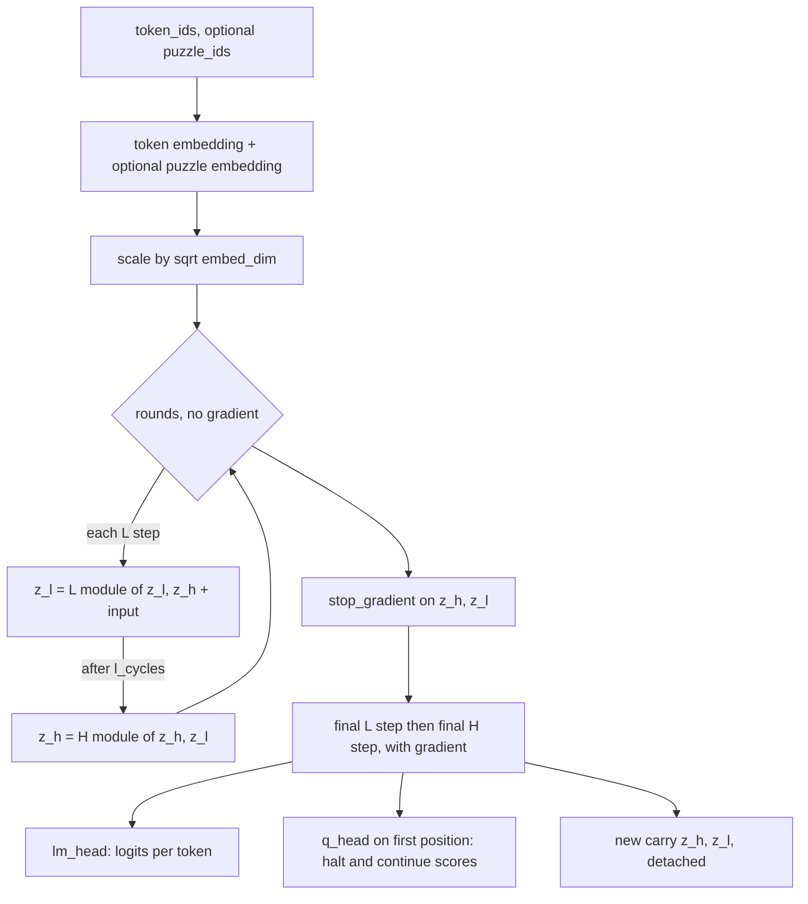

# reasoning

Keras 3 layers for the Hierarchical Reasoning Model (HRM): a recurrent reasoning core built from transformer blocks, the transformer stack it uses, and a large-vocabulary embedding table for puzzle identifiers. The package lives at `dl_techniques/layers/reasoning` inside the `dl_techniques` library.

## What it is for

HRM solves tasks that need many steps of thinking, such as puzzles, by looping a small transformer over its own state instead of making the network deeper. Two states are kept: a slow high-level state (`z_h`) and a fast low-level state (`z_l`). Each call runs several rounds in which the low-level state is refined using the high-level state plus the input, and then the high-level state is refined using the new low-level state.

Gradients flow only through the final single low-level step and the final single high-level step. All earlier steps run to get a better state but are cut off from backpropagation, so memory does not grow with the number of rounds. The core also outputs a "halt or continue" score, so an outer loop can decide how many times to call it per problem. The outer loop lives in the model that wraps the core, `dl_techniques/models/language/hrm/model.py`, not in this package. Two other pieces are reused by `dl_techniques/layers/blt/blt_core.py`: the reasoning module and the puzzle embedding.

## How it works



Step by step:

1. Token ids are embedded. If `puzzle_emb_dim > 0`, a puzzle embedding is looked up from `puzzle_ids`, zero-padded to a multiple of `embed_dim`, reshaped into `puzzle_emb_len` extra positions and put in front of the token positions.
2. If `pos_encodings="learned"`, a learned positional table is added. If it is `"rope"` (the default), no position term is added here. Position is injected inside attention by the reasoning modules instead.
3. The loop runs `h_cycles` high-level rounds with `l_cycles` low-level steps each. The very last low-level step and the last high-level step are held back.
4. `z_h` and `z_l` get a `stop_gradient`, then the held-back final low-level and high-level steps run with gradients.
5. `lm_head` gives per-token logits (puzzle positions are skipped). `q_head` reads the first position of `z_h` and gives two scores.
6. The new carry is returned detached. The caller feeds it back on the next call.

Each reasoning module (`HierarchicalReasoningModule`) adds an injection tensor to its hidden states, then passes the sum through a stack of `TransformerLayer` blocks.

## Files

- `hrm_reasoning_core.py` - `HierarchicalReasoningCore`: the stateful core with the two states, embeddings, cycle loop, `lm_head` and `q_head`.
- `hrm_reasoning_module.py` - `HierarchicalReasoningModule`: a configurable stack of `TransformerLayer` with input injection. The core uses one instance for the high level and one for the low level.
- `hrm_sparse_puzzle_embedding.py` - `SparsePuzzleEmbedding`: an embedding table that, in training mode, also copies the batch's embeddings and ids into non-trainable variables (`local_embeddings`, `local_ids`).
- `__init__.py` - empty. Import from the submodules.

## How to use it

```python
import keras
from dl_techniques.layers.reasoning.hrm_reasoning_core import HierarchicalReasoningCore

core = HierarchicalReasoningCore(
    vocab_size=12, seq_len=81, embed_dim=128,
    num_puzzle_identifiers=1000, puzzle_emb_dim=128,
    batch_size=8, h_layers=2, l_layers=2, h_cycles=2, l_cycles=2, num_heads=4,
)
token_ids = keras.ops.zeros((8, 81), dtype="int32")
puzzle_ids = keras.ops.zeros((8,), dtype="int32")

carry = core.empty_carry(8)
new_carry, outputs = core(carry, {"token_ids": token_ids, "puzzle_ids": puzzle_ids})
# outputs["logits"]: (8, 81, 12); outputs["q_halt_logits"], ["q_continue_logits"]: (8,)

# Before running a halted sequence again, reset its rows to the learned start state:
halted = keras.ops.zeros((8,), dtype="bool")
new_carry = core.reset_carry(halted, new_carry)
```

The module can be used alone:

```python
from dl_techniques.layers.reasoning.hrm_reasoning_module import HierarchicalReasoningModule

module = HierarchicalReasoningModule(num_layers=2, embed_dim=128, num_heads=4)
out = module([hidden_states, input_injection])  # both (batch, seq, 128)
```

Tests are in `tests/test_layers/test_reasoning/`.

## Things to know

- `reset_carry` reads `h_init` and `l_init`, which are created in `build`. Build the core (call it once, or call `build`) before `reset_carry`.
- `h_init` and `l_init` are non-trainable on purpose. The `stop_gradient` in `call` would block any gradient to them anyway.
- The `embeddings_initializer` argument is stored and serialized but the token embedding does not use it. It always uses a truncated normal with standard deviation `1/sqrt(embed_dim)`. The puzzle table always starts at zeros.
- `empty_carry` returns zeros, so the first call starts from zero states unless you call `reset_carry`.
- `pos_encodings="rope"` makes the reasoning modules use `group_query` attention with `num_kv_heads == num_heads` (plain multi-head in arithmetic), because that is the plain self-attention type that also applies RoPE to queries and keys. `"learned"` uses `multi_head` attention, which has no position signal of its own.
- `SparsePuzzleEmbedding` does not perform a sparse update. In training mode it only writes `local_embeddings` and `local_ids`; no code under `src/` reads them. `local_ids` is int64 on purpose so a compiled step on a GPU can write it.
- `SparsePuzzleEmbedding` caches only when `training` is true, and its cache is sized by the `batch_size` argument. A different batch size in training mode fails on the assign.
- `SparsePuzzleEmbedding` expects 1D input `(batch,)` and refuses anything else at build.
- `batch_size` on the core only sizes the puzzle embedding cache.
- Keep `embed_dim` divisible by `num_heads`; both classes raise `ValueError` otherwise.
