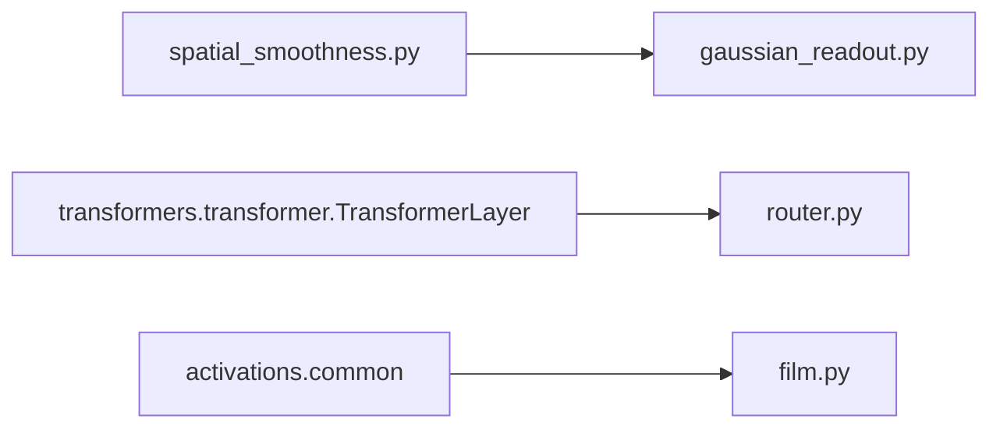

# regularization

Path: `src/dl_techniques/layers/regularization`
Purpose: Keras 3 layers for dropout variants, gradient control, residual scaling, FiLM conditioning, compute routing, and unit-grid topography (spatial smoothness penalty and Gaussian readout).

## Scope

Lives here: ten layer classes plus the grid helpers used by two of them. One class family per module, no factory, empty `__init__.py`.

Does not live here:
- The TopoLM model and its objective. `models/language/topolm/` imports `SpatialSmoothness` and the grid helpers only; it does not import `GaussianReadout`. `GaussianReadout` is used by the TopoLM trainer, `src/train/topolm/common.py`.
- Logging of the smoothness loss. `callbacks/spatial_loss_logger.py` reads `SpatialSmoothness`.
- Any factory entry. Import each class from its module path.

Other layers and models import from this package (for example `transformers/transformer.py`, `conv_blocks/*`, `models/language/topolm/*`, `src/train/topolm/*`). Treat every public name, constructor argument and `get_config` key as API.

## Architecture

Each layer is independent, except:



- `gaussian_readout.py` imports `SpatialLayout` and `resolve_grid_shape` from `spatial_smoothness.py`.
- `router.py` imports `TransformerLayer`.
- `film.py` imports `activation_spec`, `resolve_activation`, `serialize_activation` from `dl_techniques.layers.activations.common`.

Spatial pipeline: `resolve_grid_shape` -> `SpatialLayout` (frozen permutation, `perm`, `positions`, `cell_to_unit`) -> `build_patch_tables` (patch table, upper-triangle flat indices, centred unit-norm inverse-distance vector `d_unit`) -> `spatial_smoothness_loss` (pure function) -> `SpatialSmoothness.call` does `add_loss(alpha * penalty)`.

Where state is created (checked by constructing each layer and inspecting it before and after `build`):

| Layer | In `__init__` | In `build` |
| --- | --- | --- |
| `ScheduledDropout` | nothing (`step_counter` and `seed_generator` are `None`) | `step_counter` weight, `SeedGenerator` |
| `LayerScale` | nothing (`gamma` is `None`) | `gamma` weight |
| `FiLMLayer` | style `layer_norm` if `use_layer_norm`; style `dropout` if `projection_dropout_rate > 0`; projection attributes set to `None` | gamma/beta projections per `modulation_mode`, channel projections when the unit count differs from the channel count, then explicit `build` of every sub-layer |
| `RouterLayer` | `router_bottleneck` and `router_output` Dense layers (unbuilt); the wrapped `transformer_layer` arrives as an argument | builds `transformer_layer`, then the two Dense layers with input shapes `(B, num_windows, hidden_size)` and `(B, num_windows, router_bottleneck_dim)` |
| `SpatialSmoothness` | `seed_generator`; `layout`, tables and `last_spatial_loss` set to `None` | `SpatialLayout`, tables, five non-trainable weights |
| `GaussianReadout` | `blur` Conv2D (unbuilt, kernel arrives through an initializer); `layout`, `perm`, `cell_to_unit_flat` set to `None` | `SpatialLayout`, `cell_to_unit_flat` and `perm` weights, `blur.build((-1, h, w, 1))` |
| `SelectiveGradientMask` | `supports_masking = True` | validates shapes, sets `input_spec`, no weights |
| `StochasticDepth`, `StochasticGradient`, `ConditionalOutputLayer` | config only | no `build` override, no weights |

Training-mode behaviour per layer:

| Layer | Condition for the effect | Inference |
| --- | --- | --- |
| `ScheduledDropout` | `training` truthy | identity, counter not advanced |
| `StochasticDepth` | not (`training is False` or rate == 0) | identity |
| `StochasticGradient` | not (`training is False` or rate == 0) | identity |
| `SelectiveGradientMask` | `training` truthy | returns `signal` |
| `SpatialSmoothness` | `training is True`, `alpha > 0`, input not a `KerasTensor` | identity, no loss |
| `ConditionalOutputLayer`, `LayerScale`, `GaussianReadout` | `training` ignored | same computation |
| `FiLMLayer` | `training` reaches only the optional style LayerNorm and Dropout | same |
| `RouterLayer` | `training` forwarded to router MLP and transformer | same |

## Key files

| File | Role | Notes |
| --- | --- | --- |
| `scheduled_dropout.py` | `ScheduledDropout` | Registry key `dl_techniques.layers.regularization.scheduled_dropout`. Custom `from_config` deserializes a dict `rate`. |
| `stochastic_depth.py` | `StochasticDepth` | Mask shape `[batch, 1, ..., 1]`, uses unseeded `keras.random.uniform`. |
| `stochastic_gradient.py` | `StochasticGradient` | One scalar draw, `keras.ops.cond` between input and `stop_gradient(input)`. |
| `selective_gradient_mask.py` | `SelectiveGradientMask` | `build` validates two equal shapes and sets `input_spec`. |
| `conditional_output_layer.py` | `ConditionalOutputLayer` | Per-sample `where(all(gt == 0), inference, gt)`. No weights. |
| `layer_scale.py` | `LayerScale`, `MultiplierType` | `gamma` weight, default init `ones`, constraint `non_neg`. |
| `film.py` | `FiLMLayer` | Style `LayerNormalization` and `Dropout` are created in `__init__` via `_create_sublayers()`. The gamma/beta Dense projections and their channel Dense projections are created in `build`, once the content channel count is known. |
| `router.py` | `RouterLayer` | Returns a tuple. Custom `from_config` (mutates the dict it is given). The two router Dense layers are created in `__init__` and only built in `build`. |
| `spatial_smoothness.py` | `SpatialSmoothness` plus layout and table helpers | 1070 lines, the largest file. Docstring carries the design rationale. |
| `gaussian_readout.py` | `GaussianReadout` plus Gaussian kernel helpers | Non-trainable blur kernel and two index weights. The `blur` Conv2D is created in `__init__`; the layout, the two index weights and the `blur` build happen in `build`. |
| `__init__.py` | empty | Re-exports nothing. |

## Public interface

All layers are `keras.layers.Layer` subclasses decorated with `@register_dl_technique("dl_techniques.layers.regularization.<module>")`.

```python
ScheduledDropout(rate: float | LearningRateSchedule, noise_shape=None, seed=None, **kw)
    .call(inputs, training=False); .current_rate() -> float32 scalar tensor
    # rate float must be in [0, 1) (bool refused); other types raise TypeError
    # current_rate() raises ValueError before build
    # weights: step_counter (int64, scalar, non-trainable)

StochasticDepth(drop_path_rate: float = 0.5, **kw)      # [0, 1), TypeError/ValueError
StochasticGradient(drop_path_rate: float = 0.5, **kw)   # [0, 1), TypeError/ValueError

SelectiveGradientMask(name=None, dtype=None, **kw)
    .call([signal, mask], training=None)    # shapes must be equal

ConditionalOutputLayer(**kw)
    .call([ground_truth, inference], training=None)   # list/tuple of exactly 2, equal static shapes

LayerScale(multiplier_type=MultiplierType.CHANNEL, initializer="ones",
           regularizer=None, constraint="non_neg", **kw)
    # MultiplierType.from_string accepts str (case-insensitive, stripped) or enum
    # GLOBAL weight shape (1,), CHANNEL weight shape (input_shape[-1],), needs rank >= 2

FiLMLayer(gamma_units=None, beta_units=None, gamma_activation='tanh', beta_activation='linear',
          use_bias=True, scale_factor=1.0, projection_dropout_rate=0.0, use_layer_norm=False,
          gamma_kernel_initializer='glorot_uniform', beta_kernel_initializer='glorot_uniform',
          gamma_bias_initializer='zeros', beta_bias_initializer='zeros',
          kernel_regularizer=None, bias_regularizer=None, activity_regularizer=None,
          gamma_constraint=None, beta_constraint=None,
          modulation_mode='both', epsilon=1e-8, **kw)
    .call([content, style], training=None)

RouterLayer(transformer_layer: TransformerLayer, router_bottleneck_dim=128, num_windows=8,
            kernel_initializer='glorot_uniform', bias_initializer='zeros',
            kernel_regularizer=None, bias_regularizer=None, **kw)
    .call(inputs, attention_mask=None, layer_idx=0, layer_decision=None, training=None)
        -> (output (B, S, H), logits (B, 3))      # actions SKIP=0, EXECUTE=1, REPEAT=2

SpatialSmoothness(alpha=2.5, radius=5, num_neighborhoods=5, distance="linf", permute=True,
                  grid_shape=None, seed=None, max_samples=None, eps=1e-6, grid_dim=2, **kw)
    .reset_statistics()
    # attributes after build: layout, perm, patch_table, triu_flat, d_unit, last_spatial_loss

GaussianReadout(fwhm=2.0, unit_spacing=1.0, permute=True, grid_shape=None, seed=None,
                kernel_size=None, padding_mode="nearest", **kw)
    # padding_mode in ("nearest", "zeros"); kernel_size odd; default 2*ceil(3*sigma)+1
    # attributes: sigma, kernel_size, blur (Conv2D), perm, cell_to_unit_flat
```

Module-level helpers in `spatial_smoothness.py`:

```python
DISTANCE_METRICS = ("linf", "l1", "l2")
validate_grid_dim(grid_dim) -> int                       # 2 or 3, refuses bool/str/float
resolve_grid_shape(num_units, grid_shape=None, grid_dim=2) -> tuple
permutation_seed(base_seed, tap_index) -> int            # None -> tap_index, else base*1000 + tap_index
SpatialLayout(num_units, grid_shape=None, permute=True, seed=None, grid_dim=2)
    .to_grid(values) / .from_grid(grid) / .get_config() / .from_config(cfg)   # NumPy only
NeighborhoodTables  # NamedTuple: patch_table, triu_flat, d_unit, grid_shape, radius, side,
                    # patch_units, num_pairs, num_centers, grid_dim=2
build_patch_tables(cell_to_unit, radius, distance="linf") -> NeighborhoodTables
spatial_smoothness_loss(activations, patch_indices, triu_flat, d_unit, eps=1e-6) -> scalar in [0, 1]
```

Helpers in `gaussian_readout.py`: `DEFAULT_FWHM = 2.0`, `DEFAULT_UNIT_SPACING = 1.0`, `PADDING_MODES`, `gaussian_sigma(fwhm, unit_spacing)`, `gaussian_kernel_1d(kernel_size, sigma)`, `gaussian_kernel_2d(kernel_size, sigma)`.

## Data shapes

- `ConditionalOutputLayer`, `SelectiveGradientMask`: two tensors with identical shape; output has that shape.
- `FiLMLayer`: content `(B, ..., C)` with static `C`, style `(B, S)`. Gamma and beta are reshaped to `[B, 1, ..., 1, C]`, so rank-2, 3, 4+ content all work. Output shape equals content shape.
- `RouterLayer`: input `(B, S, H)` where `H == transformer_layer.hidden_size`. The routing summary uses `min(num_windows, S)` windows and drops the trailing `S % windows` tokens from the summary only. A rank-3 or rank-4 mask is reduced to `(B, S)` with `ops.max` over the query and head axes.
- `SpatialSmoothness`: input `(..., num_units)`, flattened to `(-1, num_units)`, cast to `promote_types(dtype, float32)`. Optional `max_samples` rows are drawn with `keras.random.randint`. `num_neighborhoods` centres are drawn per call.
- `SpatialLayout`: `perm` and `positions` and `cell_to_unit` are NumPy `int32`. `grid_shape == cell_to_unit.shape`, row-major, last axis fastest.
- Weights of `SpatialSmoothness` (all non-trainable): `perm`, `patch_table`, `triu_flat` in `INDEX_WEIGHT_DTYPE` (`"int64"`), `d_unit` and `last_spatial_loss` in float32.
- Weights of `GaussianReadout`: `cell_to_unit_flat` and `perm` in `INDEX_WEIGHT_DTYPE`, plus the non-trainable Conv2D kernel `blur/kernel`, stored as `(k, k, 1, 1)` (checked by building the layer on CPU: k=7 gives `(7, 7, 1, 1)`). The `(1, k, k, 1)` array exists only inside `_kernel_initializer`, which reshapes it to the requested shape.
- Implicit grids: 2D uses the largest divisor `<= isqrt(n)` as height; 3D uses `_factor_3d_cubic` with `h <= w <= d` (784 -> 7x8x14, 343 -> 7x7x7).

## Invariants and constraints

- Table weights are produced inside `add_weight` initializer closures that return NumPy arrays (`_table_initializer`, `_index_initializer`, `_kernel_initializer`). Do not replace them with a computed value followed by `.assign()` in `build`: when the layer is first reached from a parent's `call`, Keras runs `build` under a `StatelessScope` that discards the assignment.
- Index tables must stay `INDEX_WEIGHT_DTYPE` (int64), never int32. An int32 TensorFlow variable sits in host memory and an XLA-compiled GPU step cannot read it.
- Layout travels as weights, not in `get_config`. `SpatialSmoothness.get_config` and `GaussianReadout.get_config` carry constructor arguments only; a reloaded model restores the trained permutation from weights.
- `resolve_grid_shape` takes the rank from the stated `grid_dim` and checks `len(grid_shape)` against it. Never change it to `grid_dim = len(grid_shape)`. `GaussianReadout` relies on a 3-tuple raising there, and tests pin this (`test_gaussian_readout.py::TestGridRankRefusal`, `test_spatial_smoothness_3d.py`).
- One axis order for layouts, tables and positions. Do not transpose or rename axes. A symmetric shape test would not catch a mirrored layout.
- `spatial_smoothness_loss` gathers `(M, K, P)` then transposes to `(K, P, M)` before `matmul`. Leaving `(K, M, P)` yields a wrong but plausible loss of about 0.5.
- `d_unit` is centred and unit-normalised once in `build_patch_tables` (float64, then cast). Do not recompute the norm per step. In the loss it is cast to the working dtype of the correlations (needed under `mixed_float16`).
- `SpatialSmoothness` with `alpha=0` still builds all tables and weights, so an `alpha=0` control has the same weight set.
- Loss is added only when `training is True`. `last_spatial_loss.assign(penalty)` runs in the same branch.
- `GaussianReadout`: `'nearest'` padding is done by `_replicate_pad` and the conv runs `'valid'`; `'zeros'` uses the conv's own `'same'`. `_replicate_pad` uses the top edge row for the top pad and the bottom edge row for the bottom pad (and likewise for columns). Do not use `keras.ops.pad` SYMMETRIC, which mirrors instead of replicating.
- `ScheduledDropout.call` reads `step_counter` before `assign_add(1)`. Swapping the order shifts every rate by one step. The rate is cast to `inputs.dtype` before `keras.random.dropout` (required under `mixed_float16`). In `ScheduledDropout` the `SeedGenerator` is created in `build`, not `__init__` (a source comment records a control showing the placement is behaviourally identical and that no state belongs in `__init__`). `SpatialSmoothness` is the opposite: its `SeedGenerator` is created in `__init__`.
- `LayerScale.call` casts `gamma` to the input dtype (required under `mixed_float16` + XLA gradient pass).
- `FiLMLayer` stores raw activation spec on `gamma_activation` / `beta_activation` (via `activation_spec`) and the resolved callable on `_gamma_activation_fn` / `_beta_activation_fn`. Keep the split so `get_config` serializes the spec.
- `FiLMLayer` builds `gamma_projection` only for `'multiplicative'`/`'both'` and `beta_projection` only for `'additive'`/`'both'`. In `'additive'` mode `scale_factor` is not applied.
- `RouterLayer.call` uses the static sequence length path when `inputs.shape[1]` is a Python int (JAX-jit and XLA safe). Do not merge it back into one dynamic reshape.

## Dependencies

Internal:
- `dl_techniques.utils.keras_registration.register_dl_technique` (all layers).
- `dl_techniques.utils.logger.logger` (`ScheduledDropout`, `StochasticDepth`, `StochasticGradient`, `SpatialSmoothness`, `GaussianReadout`).
- `dl_techniques.utils.dtype_policy.INDEX_WEIGHT_DTYPE` (`spatial_smoothness.py`, `gaussian_readout.py`).
- `dl_techniques.layers.activations.common` (`film.py`).
- `dl_techniques.layers.transformers.transformer.TransformerLayer` (`router.py`).

External: `keras` (3.x, `keras.ops` and `keras.random`), `numpy` (layout and tables, Gaussian kernels), `math`.

## Failure modes

- `ConditionalOutputLayer` raises `ValueError` for non-list input, a length other than 2, or unequal static shapes.
- `SelectiveGradientMask` raises `ValueError` from `build` and `call` for non-pair input or unequal shapes.
- `FiLMLayer.__init__` raises `ValueError` for `projection_dropout_rate` outside `[0, 1)`, an unknown `modulation_mode`, or `epsilon <= 0`. `build` raises for an `input_shape` that is not a list of two shapes or a `None` content channel count; `call` raises if `inputs` does not hold exactly two tensors.
- `FiLMLayer.call` reads the batch size from `gamma.shape[0]` / `beta.shape[0]` (static). Behaviour with an unknown static batch was not checked.
- `RouterLayer` raises `TypeError` if `transformer_layer` is not a `TransformerLayer`, and `ValueError` for non-positive `router_bottleneck_dim` or `num_windows`.
- `LayerScale` raises `ValueError` for an invalid `multiplier_type` string or CHANNEL mode on input below rank 2.
- `SpatialSmoothness.__init__` raises `ValueError` for `alpha < 0`, `radius < 1`, `num_neighborhoods < 1`, unknown `distance`, `eps <= 0`, bad `grid_dim`, `max_samples < 2`. `build` raises on a `None` last axis, a `grid_shape` whose product is not `num_units`, or a grid shorter than `2 * radius + 1` on any axis.
- `build_patch_tables` raises `ValueError` if the inverse-distance vector is constant.
- `GaussianReadout` raises `ValueError` for non-positive `fwhm` or `unit_spacing`, an even or non-positive `kernel_size`, an unknown `padding_mode`, a `None` last axis, or a three-entry `grid_shape`.
- Silent behaviours worth knowing: `RouterLayer` with a non-multiplicative mask gives wrong logits with no error; `ScheduledDropout` accepts out-of-range schedules and relies on the call-time clip; `StochasticDepth`/`StochasticGradient` act when `training=None`.

## Working here

- Follow the Keras 3 layer pattern: `__init__` validates and stores config, `build` creates weights, `call` uses `keras.ops`, `get_config` returns every constructor argument. Sub-layer placement is not uniform here (see the state table under Architecture): shape-independent sub-layers are created in `__init__` (`FiLMLayer` norm and dropout, `RouterLayer` Dense pair, `GaussianReadout.blur`), and only those whose size depends on the input are created in `build` (`FiLMLayer` projections). Check where a sub-layer is created before moving it. Register with the module path as the `register_dl_technique` string, matching existing files.
- Docstrings in this package are Sphinx/reST (`:param:`, `:type:`, `:raises:`). Match the file you edit.
- Import style is `import keras` with qualified calls. `film.py` and `layer_scale.py` import `from keras import ops` and `router.py` imports `from keras import layers, initializers, regularizers, ops`; leave those as they are unless you are rewriting the file.
- Use `dl_techniques.utils.logger.logger`, never `print`.
- A new layer goes in its own module here, with its own `register_dl_technique` string and a test file in `tests/test_layers/test_regularization/`. There is no factory to update.
- Changing a `get_config` key, constructor default or registry string is a breaking change for saved models and for consumers such as `models/language/topolm/` and `src/train/topolm/`.
- Tests: `tests/test_layers/test_regularization/` holds one `test_<module>.py` per layer, plus `test_spatial_smoothness_3d.py`, `test_spatial_smoothness_oracle.py` with `spatial_smoothness_oracle.py` (a NumPy reference for the loss), and `test_the_symbolic_trace_leaves_no_stale_loss.py`.
- Run only this package's tests: `.venv/bin/python -m pytest tests/test_layers/test_regularization/`. Do not run the full suite. If you touch `SpatialSmoothness`, `SpatialLayout` or `resolve_grid_shape`, also run `tests/test_models/test_topolm/` and `tests/test_callbacks/test_topographic_callbacks.py`.
- Do not run GPU jobs in parallel.
