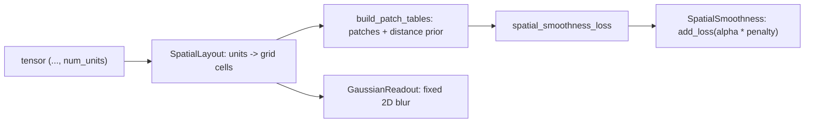

# regularization

A set of small Keras 3 layers that control how a network trains or how its signal is routed: dropout with a schedule, random depth, gradient blocking, learnable scaling, FiLM conditioning, a compute router, and two helpers for giving a layer's units a spatial layout.

This is `dl_techniques.layers.regularization`, one subpackage of the `dl_techniques` layer library. The name is wider than the content. Some files are true regularizers (dropout, stochastic depth, the smoothness penalty). Others are conditioning or routing layers that had no better home (FiLM, router, conditional output).

## What it is for

Deep networks often need a layer that does something other than transform features: drop part of the signal while training, block a gradient on purpose, scale a residual branch, or mix a "style" vector into a feature map. Each such layer here is a self-contained building block that you drop into a model.

The layers fall into four groups:

- Drop and noise: `ScheduledDropout`, `StochasticDepth`, `StochasticGradient`.
- Gradient and signal control: `SelectiveGradientMask`, `ConditionalOutputLayer`, `LayerScale`.
- Conditioning and routing: `FiLMLayer`, `RouterLayer`.
- Spatial layout for topographic models: `SpatialSmoothness` and `GaussianReadout`, which share one grid description.

## How it works

Every layer is a `keras.layers.Layer` registered with `register_dl_technique("dl_techniques.layers.regularization.<module>")` and supports `get_config()` round trips. Nothing here has a factory; you import each class from its own module.

**ScheduledDropout.** The drop rate at step `t` is `clip(schedule(t), 0, 1 - 1e-6)`. `schedule` is a Keras `LearningRateSchedule` or a plain float. The step `t` is a non-trainable `int64` weight inside the layer that counts its own training-mode calls. At inference it returns the input untouched and does not count.

**StochasticDepth.** In training, one random draw per sample decides whether that sample's tensor is zeroed. Survivors are divided by `1 - drop_path_rate`. At inference it is the identity.

**StochasticGradient.** The forward pass is always the identity. In training, one scalar draw per call decides whether the whole batch's gradient passes or is stopped with `stop_gradient`.

**SelectiveGradientMask.** Takes `[signal, mask]`. In training it returns `stop_gradient(signal) * mask + signal * (1 - mask)`. The forward value equals `signal`; the gradient is blocked where `mask == 1`. At inference it returns `signal`.

**ConditionalOutputLayer.** Takes `[ground_truth, inference]`. For each sample, if every element of `ground_truth` is zero it outputs the `inference` sample, otherwise the `ground_truth` sample. Used so that labeled samples add zero loss when the loss target is also `ground_truth`.

**LayerScale.** `output = gamma * input`. `gamma` is one scalar (`GLOBAL`) or one value per last-axis channel (`CHANNEL`, the default). It starts at ones and is constrained non-negative by default.

**FiLMLayer.** Takes `[content, style]`. Dense projections of the style vector give `gamma` and `beta`, and the output is `content * (scale_factor + gamma) + beta`. `modulation_mode` picks `'multiplicative'`, `'additive'` or `'both'`. Two optional steps run on the style vector first: a layer norm (`use_layer_norm`) and dropout (`projection_dropout_rate`). Those two are created when the layer is constructed. The projections are created when the layer is built, because their output width depends on the content channel count.

**RouterLayer.** Wraps a `TransformerLayer`. A small MLP looks at window-averaged input and produces 3 logits for SKIP, EXECUTE, REPEAT. All three paths are computed, and a one-hot mask picks one. It returns `(output, logits)`.

**SpatialSmoothness and GaussianReadout.** The units on the last axis of a tensor are assigned to cells of a 2D (or 3D, for `SpatialSmoothness`) grid by a frozen random permutation (`SpatialLayout`). `SpatialSmoothness` is an identity tap that, in training, adds a penalty `0.5 * (1 - corr(r, d))`. Here `r` is the pairwise correlation of unit activations inside sampled neighbourhoods and `d` is the inverse grid distance of the same pairs. `GaussianReadout` blurs activations over the same grid with a fixed Gaussian kernel, to simulate a sensor that averages neighbouring units.



## Files

- `__init__.py` - empty. Nothing is re-exported.
- `scheduled_dropout.py` - `ScheduledDropout`, dropout whose rate follows a schedule.
- `stochastic_depth.py` - `StochasticDepth`, per-sample residual path dropping.
- `stochastic_gradient.py` - `StochasticGradient`, random gradient stop with identity forward.
- `selective_gradient_mask.py` - `SelectiveGradientMask`, element-wise gradient blocking by mask.
- `conditional_output_layer.py` - `ConditionalOutputLayer`, per-sample choice between two tensors.
- `layer_scale.py` - `LayerScale` and the `MultiplierType` enum (`GLOBAL`, `CHANNEL`).
- `film.py` - `FiLMLayer`, feature-wise linear modulation from a style vector.
- `router.py` - `RouterLayer`, skip, run once or run twice routing around a `TransformerLayer`.
- `spatial_smoothness.py` - `SpatialSmoothness`, `SpatialLayout`, `NeighborhoodTables`, `build_patch_tables`, `resolve_grid_shape`, `validate_grid_dim`, `permutation_seed`, `spatial_smoothness_loss`, `DISTANCE_METRICS`.
- `gaussian_readout.py` - `GaussianReadout` plus `gaussian_sigma`, `gaussian_kernel_1d`, `gaussian_kernel_2d`.

## How to use it

```python
import keras
from dl_techniques.layers.regularization.scheduled_dropout import ScheduledDropout
from dl_techniques.layers.regularization.stochastic_depth import StochasticDepth
from dl_techniques.layers.regularization.layer_scale import LayerScale
from dl_techniques.layers.regularization.film import FiLMLayer

schedule = keras.optimizers.schedules.CosineDecay(
    initial_learning_rate=0.3, decay_steps=50 * 200, alpha=0.1
)
dropout = ScheduledDropout(schedule, seed=42)

x = keras.ops.ones((4, 16, 64))
branch = LayerScale(multiplier_type="CHANNEL")(x)
branch = StochasticDepth(drop_path_rate=0.1)(branch, training=True)

style = keras.ops.ones((4, 32))
out = FiLMLayer()([x, style])        # same shape as x
```

Spatial smoothness tap on a tensor whose last axis has 784 units:

```python
from dl_techniques.layers.regularization.spatial_smoothness import SpatialSmoothness
from dl_techniques.layers.regularization.gaussian_readout import GaussianReadout

tap = SpatialSmoothness(alpha=2.5, radius=5, num_neighborhoods=5, seed=0)
y = tap(acts, training=True)          # y is acts; the penalty is in tap.losses
readout = GaussianReadout(fwhm=2.0, unit_spacing=1.0, seed=0)
smoothed = readout(acts)              # same shape as acts
```

Tests live in `tests/test_layers/test_regularization/`. Run them with `.venv/bin/python -m pytest tests/test_layers/test_regularization/`.

## Things to know

- `StochasticDepth` and `StochasticGradient` only skip their effect when `training is False` (or the rate is 0). With `training=None` they behave as in training.
- `ScheduledDropout` counts its own training-mode calls, not optimizer steps. Calling it twice per step, sharing one instance, or running `model(x, training=True)` for Monte Carlo sampling advances the schedule faster than expected. The counter is saved with the model; the random stream position is not.
- A `ScheduledDropout` schedule that leaves `[0, 1)` is not rejected at construction. Only the call-time clip protects against it.
- `RouterLayer` computes all three paths on every call (about two transformer applications of cost), so it does not save compute. The router MLP gets no gradient from the task loss, because choosing the action is an argmax. It trains only if you attach a loss to the returned logits or pass `layer_decision`.
- `RouterLayer.attention_mask` must be multiplicative (1 = keep). An additive mask silently corrupts the routing summary.
- `RouterLayer` imports `TransformerLayer` from `dl_techniques.layers.transformers.transformer`, and its constructor refuses any other wrapped layer type.
- `FiLMLayer` needs a static content channel count. `epsilon` only reaches the optional layer norm. If `gamma_units` or `beta_units` differs from the channel count, an extra bias-free Dense maps back to the channel width.
- `ConditionalOutputLayer` treats an all-zero `ground_truth` sample as "unlabeled". A genuinely labeled sample that is all zeros is treated as unlabeled too.
- `SpatialSmoothness` and `GaussianReadout` need a statically known last axis. `grid_dim` (2 or 3) is always stated, never inferred from `grid_shape`.
- `GaussianReadout` is 2D only and rejects a three-entry `grid_shape` at build.
- The penalty is added only when `training is True`, so validation loss stays the plain task loss. Layout tables are stored as non-trainable weights, so a reloaded model keeps the layout it trained with.
- `SpatialSmoothness` needs a grid at least `2 * radius + 1` across on every axis; otherwise `build` raises `ValueError`.
