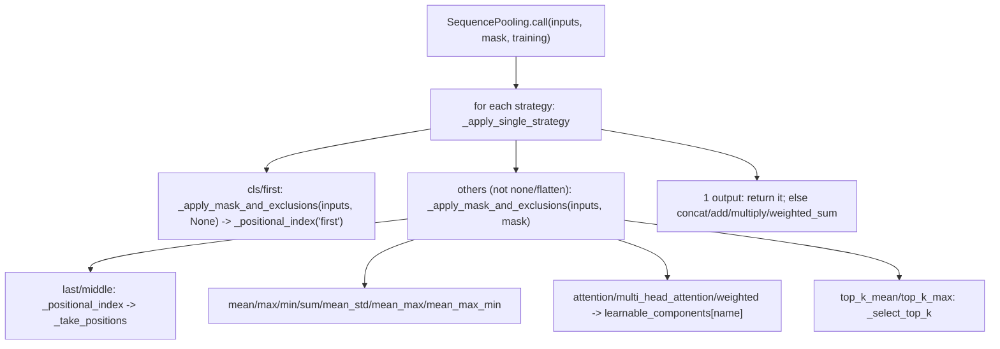

# sequence_pooling

Path: `src/dl_techniques/layers/sequence_pooling`
Purpose: Keras 3 layers that collapse `(batch, seq_len, dim)` to one vector per example, with a registry-backed factory.

## Scope

In: `AttentionPooling`, `WeightedPooling`, `SequencePooling` (18 strategies, 4 aggregation methods), the factory, the shared strategy validator `check_strategy_config`.

Out: the NLP task heads' `pooling_type='attention'`. That is an inline `Dense(1, tanh)` scorer inside `layers/heads/nlp`, not `AttentionPooling`. Spatial pooling (blur, pixel shuffle, patch merging) lives in `layers/pooling/`, not here.

Consumers: `layers/transformers/text_encoder.py` and `vision_encoder.py` (pass `output_mode` as `strategy`; `VisionEncoder` adds `exclude_positions=[0]` for reductions when it has a CLS token), `layers/heads/nlp/base.py`, `layers/heads/vlm/*`, `models/vision/{vit,vit_siglip,vit_hmlp,beit}`, `models/vision_language/clifford_clip`.

## Architecture

- `_apply_mask_and_exclusions` is the single place that folds `exclude_positions` into the keep-mask. It returns `(inputs, combined_mask)`; `combined_mask` is `None` only if there is no mask and no exclusions. That `None` is the key for every no-mask fast path.
- `none` and `flatten` skip that step. With a mask they zero masked positions via `ops.where`. They ignore `exclude_positions`.
- Learnable sub-layers are created in `SequencePooling.__init__` into `self.learnable_components` (a dict keyed by strategy name: `attention`, `multi_head_attention`, `weighted`) and built explicitly in `build`. Names: `attention_pooling`, `multi_head_attention_pooling`, `weighted_pooling` (sub-layer `name=` is `f'{strat}_pooling'`, and `'weighted_pooling'`).
- `aggregation_weights` (shape `(len(strategy),)`, init `'ones'`) exists only when more than one strategy and `aggregation_method == 'weighted_sum'`; it goes through `softmax` in `call`.

## Key files

| File | Role | Notes |
| --- | --- | --- |
| `__init__.py` | Curated export, `__all__` has 13 names | Factory functions, `SequencePoolingType`, `SEQUENCE_POOLING_REGISTRY`, `STRICT_DROPPED_KEY_MARKER`, three layers, `PoolingStrategy`, `AggregationMethod` |
| `sequence_pooling.py` | `SequencePooling`, literals, validators | 1091 lines; helpers `check_strategy_config`, `_check_exclude_positions`, `_strategy_width`; module consts `STRATEGY_NAMES`, `AGGREGATION_NAMES`, `_WIDTH_MULTIPLE`, `_KERNEL_STRATEGIES` |
| `attention_pooling.py` | `AttentionPooling` | `attention_dense` (`Dense(hidden_dim*num_heads, tanh)`) plus `context_vector (num_heads, hidden_dim)` |
| `weighted_pooling.py` | `WeightedPooling` | `position_weights (max_seq_len,)` |
| `factory.py` | Registry and builders | Dispatch is registry lookup, no if/elif |
| `README.md` | User doc | A repo test parses its `#### Shared knobs` table (see Working here) |
| `GUIDE.md` | Longer guide | A repo test parses its Pattern B code block |

Registration strings: `dl_techniques.layers.sequence_pooling.sequence_pooling`, `.attention_pooling`, `.weighted_pooling` (via `register_dl_technique`).

## Public interface

Factory (`factory.py`):

- `create_sequence_pooling_layer(pooling_type: 'attention'|'weighted'|'sequence', name: Optional[str] = None, **kwargs) -> keras.layers.Layer`. Runs `validate_sequence_pooling_config`, merges registry defaults under the caller's kwargs, builds. A `TypeError` or `ValueError` from the constructor is re-raised as `ValueError("Failed to create '<type>' sequence pooling layer ...")`.
- `create_sequence_pooling_from_config(config: dict)`. Pops `'type'`; missing key raises `ValueError`.
- `validate_sequence_pooling_config(pooling_type, **kwargs) -> None`. Raises `ValueError`.
- `get_sequence_pooling_info() -> dict`. Deep copy per entry (the `class` value is shared).
- `list_sequence_pooling_types() -> List[str]`. Sorted: `['attention', 'sequence', 'weighted']`.
- `STRICT_DROPPED_KEY_MARKER = "unsupported parameter(s)"`. `_KERAS_BASE_PARAMS = {name, dtype, trainable, activity_regularizer, autocast}` are always accepted.

Layers (all `call(inputs, mask=None, training=None)`; mask is `(batch, seq_len)`, 1/True = keep):

- `SequencePooling(strategy='mean', exclude_positions=None, aggregation_method='concat', attention_hidden_dim=256, attention_num_heads=1, attention_dropout_rate=0.0, weighted_max_seq_len=512, top_k=10, temperature=1.0, use_bias=True, kernel_initializer='glorot_uniform', bias_initializer='zeros', kernel_regularizer=None, bias_regularizer=None, **kwargs)`.
- `AttentionPooling(hidden_dim=256, num_heads=1, dropout_rate=0.0, use_bias=True, temperature=1.0, kernel_initializer, bias_initializer, kernel_regularizer, bias_regularizer, **kwargs)`.
- `WeightedPooling(max_seq_len=512, dropout_rate=0.0, temperature=1.0, initializer='ones', regularizer=None, **kwargs)`.

Output shapes: `compute_output_shape` returns `input_shape` for `['none']`; otherwise `(batch, width)` where width comes from `_strategy_width` (`_WIDTH_MULTIPLE[s] * dim`, or `seq_len * dim` for `flatten`, `None` if unknown); summed for `concat`, the common width otherwise. `AttentionPooling` and `WeightedPooling` return `(batch, input_shape[-1])`.

## Data shapes

Strategies (`PoolingStrategy`, 18): `cls first last middle mean max min sum mean_max mean_std mean_max_min attention multi_head_attention weighted top_k_mean top_k_max none flatten`. Aggregations (`AggregationMethod`, 4): `concat add multiply weighted_sum`.

Registry entry (`SEQUENCE_POOLING_REGISTRY[type]`): `class`, `description`, `required_params` (empty for all three), `optional_params` (name to default), `use_case`.

`get_config` of `SequencePooling` stores `strategy` as the caller gave it (string stays string, sequence becomes list), `exclude_positions` as a list of ints, initializers serialized only if they are `Initializer` instances, regularizers serialized.

## Invariants and constraints

- Masking is by selection, never addition. Use `keras.ops.where(keep, value, mask_sentinel(self.compute_dtype))` with `dl_techniques.utils.dtype_policy.mask_sentinel` (float16 `-1e4`, float32 `-1e9`). `x + (1 - mask) * -1e9` gives `0 * -inf = NaN` under float16. `min` negates the sentinel. A repo test greps README and GUIDE code blocks for the additive form.
- `cls`/`first` ignore the keep-mask on purpose (index 0 by intent) but honour `exclude_positions`. Do not pass `mask` to `_apply_mask_and_exclusions` in that branch. `last`/`middle` are mask-aware; `last` is the last kept index, not `sum(mask) - 1`; `middle` is the `n // 2`-th kept position (0-based), not `seq_len // 2` of the padded length.
- The unmasked, no-exclusion fast paths (`inputs[:, 0, :]`, `[:, -1, :]`, `[:, seq_len // 2, :]`) are kept separate for bit-identical numerics. Do not route them through `_positional_index`.
- Empty keep set gives index 0 for positional modes. No strategy rescues a fully masked row and none raises.
- `_take_positions` gathers with a flat-row `keras.ops.take`, not `take_along_axis`. `take_along_axis` breaks XLA on GPU on a retrace with unknown length (`BroadcastArgs must be a compile-time constant`).
- No Python `if pos < seq_len` guard in `_apply_mask_and_exclusions`: under a symbolic `seq_len` it becomes a traced `if`. `indices != pos` is already a no-op for an out-of-range `pos`.
- No `tril`/`triu`, and no `argmax` over one-hot, in `_positional_index`; it uses `where` -> `min`/`max` (and `cumsum` for `middle`).
- `_select_top_k` excludes masked tokens twice and both are needed: the ranking norm of a masked token is replaced by the sentinel, and per-row validity gathered at the selected indices removes masked picks from the reduction. Do not clamp `k` to the batch minimum kept count. With an unknown length it pads `top_k` positions so `k` is the constant `self.top_k` (XLA on GPU refuses `minimum(top_k, seq_len)`), padded norms use `2 * sentinel`.
- `mean_std` is population variance (ddof 0) in `accumulation_dtype`, floored with `stability_floor(accum, 1e-6)` inside `sqrt`, same floor masked and unmasked.
- Kernel initializer resolution: `SequencePooling` calls `keras.initializers.get` on `kernel_initializer` and `bias_initializer` only if `_KERNEL_STRATEGIES` (`attention`, `multi_head_attention`) intersects the strategies. Otherwise the raw value is stored. A seedless Keras random initializer takes a seed from the global RNG at creation, so resolving it for a weightless pooler shifted later fixed-seed draws. Do not resolve unconditionally.
- `AttentionPooling` uses `clone_initializer` (from `dl_techniques.initializers.clone`) for the Dense kernel, the Dense bias and the context vector, so a seedless instance does not replay one draw into several weights. Never pass `self.kernel_initializer` directly to two sites.
- `weighted` and `aggregation_weights` init `'ones'` on purpose (start as a plain mean). Both take `kernel_regularizer`.
- All learnable sub-layers are created in `__init__` and built explicitly in `build` (needed for serialization). `WeightedPooling` and `AttentionPooling` call `build` of their own dropout.
- `check_strategy_config` is called by both `SequencePooling.__init__` and `validate_sequence_pooling_config`, so any config the factory accepts is one the layer accepts. Rules: names in `STRATEGY_NAMES`, aggregation in `AGGREGATION_NAMES` (checked even for one strategy), no repeats, no `none` in a list of two or more, non-`concat` aggregation needs equal widths and no `flatten`.
- `_check_exclude_positions`: list or tuple of distinct non-negative ints (numpy ints accepted, returned as Python ints; bool refused).
- The factory refuses undeclared keywords inside `validate_sequence_pooling_config`, not by filtering in the create function. Do not reintroduce a filter.
- `STRICT_DROPPED_KEY_MARKER` and `_KERAS_BASE_PARAMS` are copies of definitions in other factories (not imported, to avoid pulling their layer trees). A repo test finds every definition under `src` and fails if the marker drifts.

## Dependencies

Internal:

- `dl_techniques.utils.dtype_policy`: `accumulation_dtype`, `mask_sentinel`, `stability_floor`.
- `dl_techniques.utils.validation`: `positive_int` (rejects bool, float, str, None, 0, negatives; returns a Python int), `positive_float` (positive finite number, returns float).
- `dl_techniques.utils.keras_registration.register_dl_technique`.
- `dl_techniques.initializers.clone.clone_initializer` (`attention_pooling.py` only).
- `dl_techniques.utils.logger.logger` (`factory.py`).

External: `keras` (Keras 3, `keras.ops` only for tensor math), `numpy` (type checks in `_check_exclude_positions`).

## Failure modes

- Unknown strategy, aggregation, or bad combination: `ValueError` from `check_strategy_config`, prefixed `SequencePooling:`.
- Undeclared keyword at the factory: `ValueError` containing `unsupported parameter(s)`.
- Unknown type: `ValueError("Unknown sequence pooling type ...")`. Missing `'type'` key in `create_sequence_pooling_from_config`: `ValueError`.
- Bad count or temperature: `ValueError` from `positive_int` / `positive_float`.
- Dropout rate: the factory accepts `[0.0, 1.0]` for `dropout_rate` and `attention_dropout_rate`. `AttentionPooling` and `WeightedPooling` accept `[0, 1)`, so exactly `1.0` passes validation and then surfaces as `Failed to create ...`. `SequencePooling` does not check `attention_dropout_rate` itself; the error comes from the sub-layer, and only if a learnable strategy is present.
- `WeightedPooling` with static `seq_len > max_seq_len`: `ValueError` from `_check_length`, at `build` and again at `call`. With unknown length no check is traced, the backend raises `Incompatible shapes` on a longer input.
- `_positional_index` called with a mode outside `first/middle/last`: `ValueError` (internal).
- Fully masked rows: finite output, see Invariants. Never NaN in the pooling paths.

## Working here

- Add a strategy: extend the `PoolingStrategy` literal; add a branch in `_apply_single_strategy`; if its width is not `dim`, add it to `_WIDTH_MULTIPLE` (every non-`flatten`, non-`none` name is auto-included at 1); handle mask and `exclude_positions` through `_apply_mask_and_exclusions`; keep `compute_output_shape` and `call` in agreement; update README strategy table.
- Add a learnable strategy: create the layer in `__init__` into `learnable_components`, build it in `build`, and add its knobs to the README `#### Shared knobs` table.
- Add a constructor parameter to a layer: add it to `get_config`, to the matching `optional_params` in `factory.py`, to `validate_sequence_pooling_config` if it has a range, and to the README.
- The registry key set and each entry's `required_params` / `optional_params` are public API, asserted by `tests/test_layers/test_factory_registry_drift.py`.
- Docstrings in this package are a mix: `sequence_pooling.py` has Sphinx-style `:param:` in helpers and Google `Args:` in the class docstring. Match the surrounding block; do not convert wholesale.
- Use `import keras` and qualify (`keras.ops.where`). Never `from keras import ops`. Log through `dl_techniques.utils.logger`, no `print`.
- Docs are tested. `tests/test_layers/test_the_sequence_pooling_docs_match_the_code.py` requires: no fenced python block in README or GUIDE with an additive mask or `from keras import`; the GUIDE has exactly one block containing `class MyPooling` that parses and uses `mask_sentinel(self.compute_dtype)` and `keras.ops.where`; the README keeps a `#### Shared knobs` section whose table's first-column backtick names equal the test's check set (`temperature`, `attention_dropout_rate`, `attention_hidden_dim`, `attention_num_heads`, `use_bias`, `bias_initializer`, `bias_regularizer`, `kernel_initializer`, `kernel_regularizer`, `weighted_max_seq_len`, `top_k`) and each "Reaches" claim holds; the README contains the phrase ``inline `Dense(1, tanh)` scorer``. The README table must stay the last table in that section, which ends at the next `####` heading.
- Tests live in `tests/test_layers/`: `test_sequence_pooling.py` (main suite, includes `TestPositionalModesIsolateMaskedPositions`) plus single-claim files named `test_the_sequence_pooling_*`, `test_the_pooling_layers_refuse_bad_arguments_early.py`, `test_a_fully_masked_row_pools_to_the_plain_mean.py`, `test_no_two_pooling_weights_replay_one_draw.py`, `test_the_attention_pooler_bias_knobs_take_effect.py`.
- Run scoped, from the repo root, with the venv: `CUDA_VISIBLE_DEVICES= .venv/bin/python -m pytest tests/test_layers/test_sequence_pooling.py tests/test_layers/test_the_sequence_pooling_docs_match_the_code.py -q`. Add the transformers encoder tests if you change a signature the encoders use. Do not run the full suite.
