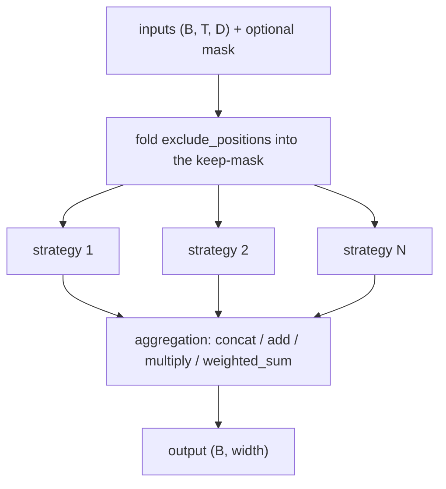

# sequence_pooling

Keras 3 layers that turn a sequence of vectors, shape `(batch, seq_len, dim)`, into one summary vector per example, plus a factory that builds them from a config. It lives at `src/dl_techniques/layers/sequence_pooling` in the `dl_techniques` library.

## What it is for

A text or vision encoder (Transformer, LSTM) outputs one vector per token or patch. A classifier, embedding head or similarity score usually wants one vector per example. Something has to collapse the sequence axis. That step is called pooling.

There is no single best way to pool. You can read one token (the `[CLS]` token), average everything, take the maximum, or learn which tokens matter. This package puts all of these behind one layer, `SequencePooling`, so you can switch or combine them by changing a config string. It also understands padding masks, so padded positions do not leak into the result.

## How it works

Three layers, one factory.

- `AttentionPooling`: each token goes through a `Dense` with `tanh`. The result is scored against a learned context vector. A softmax over the sequence turns scores into weights. The output is the weighted sum of the original tokens. With several heads, the per-head sums are averaged.
- `WeightedPooling`: one learned scalar per position, up to `max_seq_len`. The first `seq_len` scalars go through a softmax and weight the tokens. The weights do not depend on the token content.
- `SequencePooling`: the general entry point. It runs one or more named strategies, then joins the results with an aggregation method. For `attention`, `multi_head_attention` and `weighted` it creates the two layers above inside itself.



With one strategy the aggregation step is skipped and that strategy's output is returned as is.

The 18 strategies:

| Group | Names | Output width |
| --- | --- | --- |
| Positional | `cls`, `first`, `last`, `middle` | `D` |
| Statistical | `mean`, `max`, `min`, `sum` | `D` |
| Combined statistical | `mean_max`, `mean_std` (2 x `D`), `mean_max_min` (3 x `D`) | 2D or 3D |
| Learnable | `attention`, `multi_head_attention`, `weighted` | `D` |
| Top-k (by squared L2 norm of each token) | `top_k_mean`, `top_k_max` | `D` |
| Special | `none` (the sequence itself), `flatten` (`T * D`) | `(T, D)` / `T * D` |

The 4 aggregation methods are `concat`, `add`, `multiply` and `weighted_sum` (a softmax over one learned scalar per strategy).

How masks are treated:

- A mask is `(batch, seq_len)`, true or 1 means keep.
- `mean`, `sum`, `max`, `min`, `mean_std`, `attention`, `weighted` and the two top-k strategies ignore masked positions.
- `last` returns the last kept position. `middle` returns the middle of the kept positions, not of the padded length.
- `cls` and `first` always return index 0, even if the mask hides it. This is intended.
- `none` and `flatten` return masked positions as zeros.
- A fully masked row is not rescued. `mean`, `sum` and `top_k_mean` give zeros. `attention` and `weighted` give the plain mean over the whole sequence. `max`, `min` and `top_k_max` give the large finite mask sentinel. `last`, `middle` and `first` pick index 0.

## Files

- `__init__.py` - re-exports the 13 names in `__all__`: five factory functions (`create_sequence_pooling_layer`, `create_sequence_pooling_from_config`, `validate_sequence_pooling_config`, `get_sequence_pooling_info`, `list_sequence_pooling_types`), `SEQUENCE_POOLING_REGISTRY`, the `STRICT_DROPPED_KEY_MARKER` string, the `SequencePoolingType` literal, three layers, and the `PoolingStrategy` and `AggregationMethod` literals.
- `sequence_pooling.py` - `SequencePooling`, the `PoolingStrategy` and `AggregationMethod` literals, `STRATEGY_NAMES`, `AGGREGATION_NAMES`, and `check_strategy_config`, the shared strategy validator.
- `attention_pooling.py` - `AttentionPooling`.
- `weighted_pooling.py` - `WeightedPooling`.
- `factory.py` - `SEQUENCE_POOLING_REGISTRY` and the functions that validate, describe and build layers from it.
- `GUIDE.md` - a longer usage guide that a repo test checks against the code.

## How to use it

Through the factory:

```python
import numpy as np
from dl_techniques.layers.sequence_pooling import create_sequence_pooling_layer

x = np.random.rand(2, 7, 16).astype("float32")
mask = np.array([[1] * 7, [1] * 4 + [0] * 3], dtype="bool")

mean_pool = create_sequence_pooling_layer("sequence", strategy="mean")
print(mean_pool(x, mask=mask).shape)          # (2, 16)

combined = create_sequence_pooling_layer(
    "sequence",
    strategy=["mean", "attention"],
    aggregation_method="concat",
    attention_hidden_dim=32,
)
print(combined(x, mask=mask).shape)           # (2, 32)

skip_cls = create_sequence_pooling_layer(
    "sequence", strategy="mean", exclude_positions=[0]
)
print(skip_cls(x).shape)                      # (2, 16)
```

From a dict (the `type` key picks the layer, the rest are constructor arguments):

```python
from dl_techniques.layers.sequence_pooling import create_sequence_pooling_from_config

pool = create_sequence_pooling_from_config(
    {"type": "weighted", "max_seq_len": 256, "temperature": 2.0}
)
```

Directly:

```python
from dl_techniques.layers.sequence_pooling import SequencePooling

pool = SequencePooling(strategy=["mean", "max"], aggregation_method="concat")
```

Other factory helpers: `list_sequence_pooling_types()` returns `['attention', 'sequence', 'weighted']`; `get_sequence_pooling_info()` returns a deep copy of each registry entry (description, required and optional params, use case); `validate_sequence_pooling_config(type, **kwargs)` runs the checks without building.

## Things to know

- Registry keys are `attention`, `weighted` and `sequence`. None has required parameters.
- The factory refuses any keyword the type does not declare, with a `ValueError` whose text contains `unsupported parameter(s)`. A typo such as `dropout=` for `dropout_rate=` fails instead of silently doing nothing. The Keras base keywords `name`, `dtype`, `trainable`, `activity_regularizer` and `autocast` are always accepted.
- `exclude_positions` takes distinct non-negative ints. A negative, repeated, boolean or non-integer entry raises `ValueError`. Every strategy honours it except `none` and `flatten`. It is an explicit instruction, so `cls` and `first` with position 0 excluded return the first non-excluded position, though they still ignore the keep-mask.
- A list of strategies is refused if a name repeats, if it contains `none`, or if the aggregation is not `concat` and the strategies have different output widths (`flatten` never matches). A single strategy still has its `aggregation_method` name checked.
- `WeightedPooling` raises `ValueError` naming `max_seq_len` when a static sequence length is longer than `max_seq_len`. With an unknown length the backend fails at run time instead.
- `weighted` and the `weighted_sum` aggregation weights start at `'ones'` regardless of `kernel_initializer`, so they begin as a plain mean.
- `SequencePooling` resolves `kernel_initializer` and `bias_initializer` only when an attention strategy is present. This avoids consuming a random seed for a layer with no weights.
- The NLP task heads' `pooling_type='attention'` is not `AttentionPooling` or `SequencePooling('attention')`: it is the head's own inline `Dense(1, tanh)` scorer, with its own weights.
- `temperature` must be a positive finite number. Count arguments (`hidden_dim`, `num_heads`, `max_seq_len`, `top_k` and their prefixed forms) must be positive ints. Booleans, floats and strings are refused.

#### Shared knobs

`SequencePooling` builds its learnable strategies from one set of knobs, so one value can reach more than one sub-layer.

| Knob | Reaches | Note |
|------|---------|------|
| `temperature` | every `AttentionPooling` and the `WeightedPooling` | One value for all learnable strategies. |
| `attention_dropout_rate` | every `AttentionPooling` and the `WeightedPooling` | Despite the name it is also the `weighted` pooler's dropout. |
| `attention_hidden_dim` | every `AttentionPooling` | |
| `attention_num_heads` | the `multi_head_attention` pooler | `attention` always has one head. |
| `use_bias`, `bias_initializer`, `bias_regularizer` | every `AttentionPooling`'s projection | `weighted` and the `weighted_sum` aggregation weights have no bias. |
| `kernel_initializer` | every `AttentionPooling`'s projection kernel and context vector | One clone per weight. `weighted` and the aggregation weights always start at `'ones'`. |
| `kernel_regularizer` | every `AttentionPooling`'s kernel and context vector, the `weighted` position weights, the `weighted_sum` aggregation weights | The last two have only this one weight each. |
| `weighted_max_seq_len` | the `WeightedPooling`'s `max_seq_len` | |
| `top_k` | `top_k_mean`, `top_k_max` | A positive int. |
