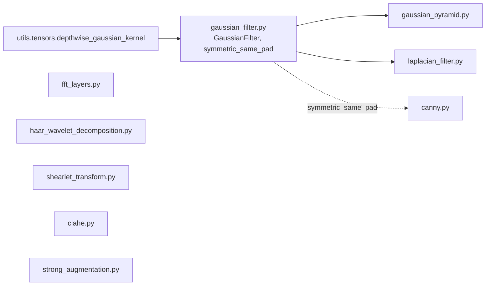

# signal_processing

Path: `src/dl_techniques/layers/signal_processing/`
Purpose: Keras 3 layers for classical/fixed signal and image processing (blur, edges, wavelets, FFT, shearlets, CLAHE, strong augmentation).

## Scope

In `dl_techniques/layers/` (the custom Keras layer package). This subpackage holds layers whose kernels or transforms come from a formula, not from training. Exceptions with learnable state: `CLAHE.mapping_kernel`, and the Gaussian blur inside `GaussianFilter` / `GaussianPyramid` / `LaplacianPyramidLevel` when `trainable=True` / `blur_trainable=True`.

Not here: learned convolutions (`layers/conv_blocks/`), spatial pooling layers (`layers/pooling/`), complex-valued layers (`layers/complex/`). No `factory.py`; `__init__.py` is empty (zero bytes), so every import names the module file.

## Architecture



Intra-package imports: `gaussian_pyramid.py` imports `GaussianFilter`; `laplacian_filter.py` imports `GaussianFilter, symmetric_same_pad`; `canny.py` imports `symmetric_same_pad`. All other files are standalone. All classes use `@register_dl_technique("dl_techniques.layers.signal_processing.<module>")` from `dl_techniques.utils.keras_registration`.

Consumers outside the package:

| Consumer | Uses |
| --- | --- |
| `layers/pooling/downsample_and_skip.py` | `LaplacianPyramidLevel` |
| `layers/time_series/prism_blocks.py` | `HaarWaveletDecomposition` |
| `layers/geometric/sparse_depth_splat.py` | `GaussianFilter` |
| `models/vision/coshnet/model.py`, `train/coshnet/train_coshnet.py` | `ShearletTransform` |
| `models/vision/depth_anything/model.py` | `StrongAugmentation` |
| `models/vision/image_restoration/pw_fnet/model.py` | `FFTLayer`, `IFFTLayer` |

## Key files

| File | Role | Notes |
| --- | --- | --- |
| `gaussian_filter.py` | `GaussianFilter`, `symmetric_same_pad`, `_warn_once` | kernel built from `utils.tensors.depthwise_gaussian_kernel`; logs at info on every construction |
| `gaussian_pyramid.py` | `GaussianPyramid`, `gaussian_pyramid()` | one `GaussianFilter` per level, `average_pool` between levels |
| `laplacian_filter.py` | `LaplacianFilter`, `AdvancedLaplacianFilter`, `LaplacianPyramidLevel` | all three share one registration package string |
| `canny.py` | `Canny` | fixed Gaussian + Sobel kernels as non-trainable weights, `keras.ops` only |
| `clahe.py` | `CLAHE` | imports `tensorflow`; eager only; input has no batch axis |
| `haar_wavelet_decomposition.py` | `HaarWaveletDecomposition` | rank 3/4/5 inputs select 1D/2D/3D at `build` |
| `shearlet_transform.py` | `ShearletTransform` | filter bank fixed at build from static H, W; weights are float32, `autocast=False` |
| `fft_layers.py` | `FFTLayer`, `IFFTLayer`, `_cast_to_compute_dtype` | float32 island, float16 saturation |
| `strong_augmentation.py` | `StrongAugmentation` | training-only color jitter + CutMix |

## Public interface

All layers take `**kwargs` for the `Layer` base class and serialize through `get_config()`.

`GaussianFilter(kernel_size=(5,5), strides=(1,1), sigma=-1, padding="same", data_format=None, trainable=False)`
- `padding`: `"valid"`, `"same"` or `"symmetric"` (lower-cased). `sigma <= 0` or `None` becomes `(1.0, 1.0)`; a bool raises; a pair needs positive entries. `sigma` is a pixel std, converted for the util as `nsig = (k - 1) / (2 * sigma)` per axis.
- `symmetric_same_pad(inputs, kernel_size, strides, data_format="channels_last")` returns the mirror-padded tensor, or `None` (with a one-time warning) when padding cannot be computed. Callers must fall back to `"same"`.
- Raises `ValueError` for `kernel_size`/`strides` not length 2, bad padding, bad `data_format`, undefined channel dim at build.

`GaussianPyramid(levels=3, kernel_size=(5,5), sigma=-1, scale_factor=2, padding="same", data_format=None, trainable=False)` returns a `List` of `levels` tensors. `gaussian_pyramid(inputs, levels, kernel_size, sigma, scale_factor, padding, data_format, name)` is a functional wrapper that builds and calls the layer (it does not forward `trainable`). `compute_output_shape` raises `ValueError` if a level would have a dimension below 1.

`LaplacianFilter(kernel_size=(5,5), strides=(1,1), sigma=1.0, scale_factor=1.0, kernel_initializer, kernel_regularizer)` output is `scale_factor * (blur - input)`, same shape as input. `kernel_size` entries must be positive odd ints. `strides`, `kernel_initializer`, `kernel_regularizer` are stored and serialized but change nothing.

`AdvancedLaplacianFilter(method='dog'|'log'|'kernel', kernel_size, strides, sigma=1.0, scale_factor, ...)`. `'dog'` pins the blur to stride `(1,1)`. `'log'`/`'kernel'` use a depthwise conv with the `strides` and `"same"` output size. `'kernel'` is the 3x3 stencil `[[0,1,0],[1,-4,1],[0,1,0]]` only when `kernel_size == (3,3)`, otherwise it uses the LoG kernel. `sigma` must be positive. Channel dim must be defined at build.

`LaplacianPyramidLevel(blur_kernel_size=(5,5), blur_sigma=-1, blur_trainable=False)`: `call` returns `(low, high)`; `split(x)` is the same; `merge(low, high)` returns `high + up(low)`. Blur is stride 2 with `"same"` padding, upsample is bilinear `UpSampling2D(2,2)`. `build` raises `ValueError` if a static H or W is odd.

`Canny(sigma=0.8, threshold_min=50, threshold_max=80, tracking_connection=5, tracking_iterations=3)`: input `(B,H,W,1)`, output same shape, values 0/1 in the input dtype. Raises `ValueError` when `sigma < 0.8`, `threshold_min >= threshold_max`, or either tracking arg `< 1`.

`CLAHE(clip_limit=4.0, n_bins=256, tile_size=16, kernel_initializer="glorot_uniform", kernel_regularizer=None, kernel_constraint=None)`: input `(H,W,1)` on a 0-255 scale. `build` raises unless rank 3 with last dim 1. Raises for `clip_limit <= 0`, `n_bins <= 1`, `tile_size <= 0`.

`HaarWaveletDecomposition(num_levels=3)`: input rank 3 `[B,L,C]`, 4 `[B,H,W,C]` or 5 `[B,D,H,W,C]`; other ranks raise `ValueError` in `build`. Returns `[approx] + details` ordered coarsest to finest. 1D detail entries are tensors; 2D entries are `(LH, HL, HH)`; 3D entries are `(LLH, LHL, LHH, HLL, HLH, HHL, HHH)`. `num_levels < 1` raises.

`ShearletTransform(scales=4, directions=8, alpha=0.5, high_freq=True)`: input `[B,H,W,C]` with static H, W. Output `[B,H,W,C*F]` with `F = 1 + scales * (2*(directions//2) + 1)` (37 at defaults); channel index is `c * F + f`. `alpha` (checked in `(0,1]`) and `high_freq` are inert and log a one-time warning when non-default.

`FFTLayer()`: `[B,H,W,C]` to `[B,H,W,2C]` as `concat(real, imag)`. `IFFTLayer()`: `[B,H,W,2C]` to `[B,H,W,C]` (real part of the inverse); `compute_output_shape` raises `ValueError` on an odd channel count.

`StrongAugmentation(cutmix_prob=0.5, cutmix_ratio_range=(0.1,0.5), color_jitter_strength=0.2, input_value_range=(0.0,1.0))`
- `call(inputs, training=None)` returns the augmented image only.
- `augment_with_mix(inputs, training=None)` returns `(x_aug, mix)`; `mix` is `None` when not training, else `(mix_mask (H,W,1), perm_indices (B,))`.
- `apply_mix_to_target(target, mix)` pastes the same box from the donor rows into a target sharing the batch and spatial axes; `mix=None` returns `target`.
- Raises `ValueError` for `cutmix_prob` outside `[0,1]`, negative jitter, bad ratio range, bad `input_value_range`.

## Data shapes

| Layer | Input | Output |
| --- | --- | --- |
| `GaussianFilter` | `[B,H,W,C]` (or channels-first) | `[B,H',W',C]`; `H' = ceil(H/stride)` for same/symmetric, `(H-k)//s+1` for valid |
| `GaussianPyramid` | `[B,H,W,C]` | list; level i is the input downsampled i times by `scale_factor` (floor, min 1) |
| `Canny` | `[B,H,W,1]` | `[B,H,W,1]` |
| `CLAHE` | `[H,W,1]` | `[H,W,1]` |
| `FFTLayer` / `IFFTLayer` | `[B,H,W,C]` / `[B,H,W,2C]` | `[B,H,W,2C]` / `[B,H,W,C]` |
| `ShearletTransform` | `[B,H,W,C]` | `[B,H,W,C*F]` |

Weights: `GaussianFilter.kernel` (depthwise, `compute_dtype`, weight name `gaussian_kernel`, trainable only when the layer is), `Canny.gaussian_kernel` and `Canny.sobel_kernel` (non-trainable), `ShearletTransform.filter_bank_real` / `filter_bank_imag` (non-trainable float32), `CLAHE.mapping_kernel` of shape `(n_bins,)` (trainable). `AdvancedLaplacianFilter.filter_kernel` is a NumPy array, not a weight.

## Invariants and constraints

- Float32 islands. `fft2`/`ifft2` have no float16 kernel. `FFTLayer`, `IFFTLayer` and `ShearletTransform` cast to float32, transform, then cast back to `compute_dtype`. The shearlet filter-bank weights use `autocast=False` so mixed_float16 does not downcast them. Do not remove either.
- `_cast_to_compute_dtype` saturates to the float16 max with a straight-through gradient (`x + stop_gradient(clip(x) - x)`). A plain clip would zero the gradient past the limit.
- `Canny` computes gradient magnitude in float32 and deliberately does not clip it: clipping creates plateaus that non-maximum suppression keeps, giving multi-pixel-wide edges. Suppression compares the magnitude of neighbors along the gradient direction (`_directional_max` over a tiled magnitude), not the per-bin responses.
- `Canny` thresholds act on the un-normalized Sobel magnitude, so inputs are expected on a 0-255 scale.
- Border handling differs on purpose. `LaplacianFilter` and the `'dog'` branch of `AdvancedLaplacianFilter` use `padding="symmetric"` so a constant image gives a zero response. `LaplacianPyramidLevel` keeps `"same"` (zero padding) so `merge(split(x))` stays exact and for trained-checkpoint compatibility. Do not switch it.
- `LaplacianPyramidLevel` exactness holds because `high = x - up(low)` is defined as a difference. Any change to `up` must be applied in both `split` and `merge`.
- `AdvancedLaplacianFilter` keeps `filter_kernel` as a NumPy array on purpose. Building it as a tensor inside `build` breaks when `build` runs under a `tf.function`.
- `GaussianFilter.build` converts pixel `sigma` to the util's half-extent-in-stds argument. Passing `sigma` straight through makes a larger sigma blur less.
- `symmetric_same_pad` pad widths equal what `"same"` would use, smaller half first. It returns `None` for a stride above 1 on an unknown axis or a pad wider than the axis. Every caller must handle `None`.
- `GaussianFilter.strides` is stored as a `tuple` so a deserialized list does not break tuple/list arithmetic.
- `CLAHE`: tile histograms use `tf.histogram_fixed_width` with range `[0, 255]`; pixel-to-bin index is `floor(n_bins * tile / 255)` clipped to `[0, n_bins-1]`. The Python tile loop depends on runtime `H`/`W`, so the layer is eager only.
- `HaarWaveletDecomposition` does not validate `num_levels` against the input length. `_decompose_*` truncate odd axes to even before each level; `_compute_output_shape_*` mirrors that with floor division.
- `ShearletTransform` filter bank: Meyer-window scale and direction windows, floor of `1e-3`, symmetrized under `w -> -w` so taking the real part loses nothing, then a tight-frame normalization. Frequency grid is `(arange(n) - n//2) / n`. The inverse FFT is computed as `conj(fft2(conj(z)))/N` using forward `fft2` only.
- `StrongAugmentation`: the CutMix gate is symbolic (`keras.random.uniform(()) < cutmix_prob`, cast to a mask multiplier), so the layer traces inside `model.fit`. One cut box and one probability draw are shared by the whole batch; the donor permutation is per row. Jitter factors are cast to `x.dtype` so a float16 batch is not promoted. Clipping uses `input_value_range` only.

## Dependencies

- Internal: `dl_techniques.utils.keras_registration.register_dl_technique` (all files); `dl_techniques.utils.logger.logger` (gaussian_filter, gaussian_pyramid, shearlet_transform); `dl_techniques.utils.tensors.depthwise_gaussian_kernel` (gaussian_filter).
- External: `keras` (3.x, ops-based; `keras.ops.fft2`, `ifft2`, `depthwise_conv`, `max_pool`, `while_loop`, `pad(mode="symmetric")`); `numpy` (kernel and filter-bank construction in canny, shearlet, laplacian, fft_layers); `tensorflow` (only `clahe.py`, for `tf.histogram_fixed_width`).

## Failure modes

- `CLAHE` inside `@tf.function` or with a batched input fails: it expects an unbatched `(H,W,1)` eager tensor. Rank other than 3 raises at build.
- `ShearletTransform` with `None` height or width raises `ValueError` at build.
- `HaarWaveletDecomposition` with too many levels yields zero-length axes with no error from the layer; the failure appears downstream.
- `GaussianPyramid.compute_output_shape` raises when `padding="valid"` and depth shrink a level below 1.
- `LaplacianPyramidLevel` raises for an odd static H or W at build.
- `symmetric` padding that falls back to zero padding is silent apart from a one-time `logger.warning` per reason (`_WARNED` set in `gaussian_filter.py`). Zero padding darkens bright borders.
- Under a float16 policy FFT outputs beyond 65504 saturate (wrong values, finite). Use float32 for large maps.
- `Canny` output is a hard threshold of the gradient field, so it passes no useful gradient back to its input.
- `ShearletTransform` logs a one-time warning when `alpha != 0.5` or `high_freq=False`, because they change nothing.

## Working here

- Follow the Keras 3 layer pattern: `__init__` (validate, store config), `build`, `call`, `compute_output_shape`, `get_config` including every constructor argument. Register with `@register_dl_technique("dl_techniques.layers.signal_processing.<module>")` where `<module>` is the file name. Use `import keras` and qualify (`keras.ops...`); no `from keras import ops`.
- Docstrings are Sphinx/reST (`:param:` / `:type:`) with a boxed `.. code-block:: text` architecture diagram. Match the file you edit.
- Use `logger` from `dl_techniques.utils.logger`, not `print`.
- A new blur-based layer should reuse `GaussianFilter` and `symmetric_same_pad` rather than rebuilding the kernel.
- Tests are in `tests/test_layers/test_signal_processing/`, one file per module (`test_canny.py`, `test_clahe.py`, `test_fft_layers.py`, `test_gaussian_filter.py`, `test_gaussian_pyramid.py`, `test_haar_wavelet_decomposition.py`, `test_laplacian_filter.py`, `test_shearlet_transform.py`, `test_strong_augmentation.py`) plus `test_the_signal_processing_audit_fixes.py`. Run only these, plus the consumer tests for any layer you change (pw_fnet, coshnet, depth_anything, prism, downsample_and_skip):

```bash
.venv/bin/python -m pytest tests/test_layers/test_signal_processing/ -q
```

- Changing a registered class name or its package string changes the serialization key and breaks saved `.keras` files. Changing `LaplacianPyramidLevel` padding or `ShearletTransform` weight shapes breaks saved checkpoints.
- The files contain `DECISION plan-.../D-xxx` comments naming settled choices (float32 island, symmetric border, sigma conversion, NumPy kernel in `build`, input-range clip). Leave them in place and keep the behavior they describe.
