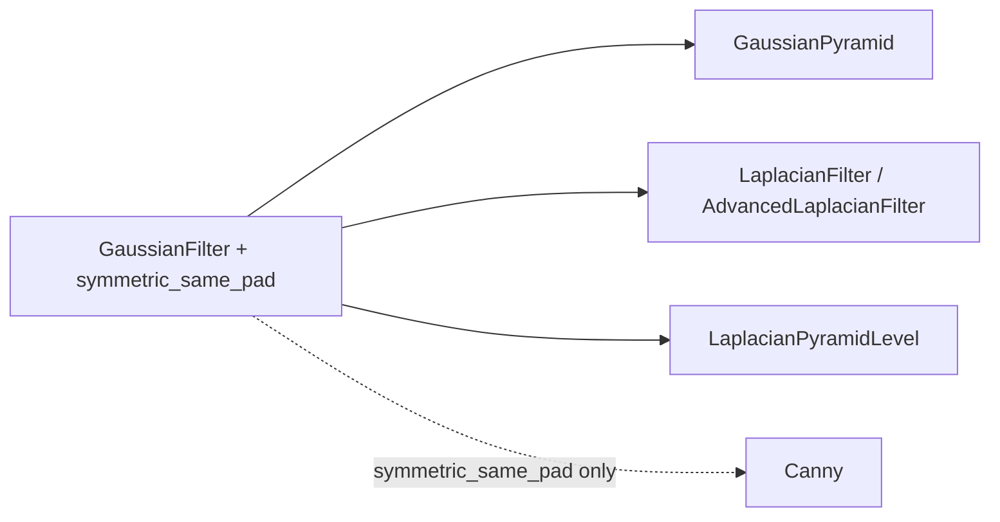

# signal_processing

Keras 3 layers that do classical signal and image processing: blurring, edge detection, wavelets, Fourier transforms, shearlets, histogram equalization and a training-time augmentation. It lives at `src/dl_techniques/layers/signal_processing/` in the `dl_techniques` library.

## What it is for

Most layers in a neural network learn their weights. The layers here mostly do not. They apply a known formula, such as a Gaussian blur or a Haar wavelet, so a model can use that formula as a fixed building block inside a normal Keras graph. You can feed a model a blurred image, a set of frequency bands or an edge map without leaving Keras, and the result saves and loads like any other layer.

Two layers differ from the rest. `CLAHE` has one small trainable weight (a gate over histogram bins). `StrongAugmentation` changes the input only while training and does nothing at inference.

Models in this repo use these layers: PW-FNet uses `FFTLayer`/`IFFTLayer`, CoSH-Net uses `ShearletTransform`, Depth Anything uses `StrongAugmentation`, and the PRISM time-series blocks use `HaarWaveletDecomposition`.

## How it works

Every layer is a `keras.layers.Layer` registered with `register_dl_technique("dl_techniques.layers.signal_processing.<module>")`, and implements `build`, `call`, `compute_output_shape` and `get_config`. Images are channels-last `[batch, H, W, C]` unless a layer says otherwise.

`gaussian_filter.py` is the base the others lean on. It builds a Gaussian kernel and applies it as a depthwise convolution (each channel blurred on its own). Its helper `symmetric_same_pad` mirrors the border so a constant image stays constant after filtering.



The rest are independent:

- `FFTLayer` / `IFFTLayer` turn a real map into real and imaginary spectra stacked on the channel axis and back.
- `ShearletTransform` takes the 2D FFT, multiplies by a fixed bank of direction-and-scale filters, and transforms back.
- `HaarWaveletDecomposition` repeatedly averages and differences neighboring samples to split a signal into approximation and detail bands.
- `Canny` runs smoothing, Sobel gradients, thin-edge suppression, double thresholding and hysteresis tracking.
- `CLAHE` equalizes the histogram of each image tile separately.
- `StrongAugmentation` jitters brightness and contrast, then pastes a random rectangle from another image in the batch (CutMix).

## Files

- `gaussian_filter.py` - `GaussianFilter` (depthwise Gaussian blur) and the `symmetric_same_pad` helper.
- `gaussian_pyramid.py` - `GaussianPyramid` (list of blurred, progressively downsampled levels) and the functional wrapper `gaussian_pyramid(...)`.
- `laplacian_filter.py` - `LaplacianFilter` (difference of Gaussians), `AdvancedLaplacianFilter` (`'dog'`, `'log'` or `'kernel'` method) and `LaplacianPyramidLevel` (invertible low/high band split).
- `canny.py` - `Canny` edge detector with fixed kernels.
- `clahe.py` - `CLAHE`, trainable contrast-limited adaptive histogram equalization for single-channel images.
- `haar_wavelet_decomposition.py` - `HaarWaveletDecomposition` for 1D, 2D and 3D signals.
- `shearlet_transform.py` - `ShearletTransform`, a fixed shearlet filter bank applied in the Fourier domain.
- `fft_layers.py` - `FFTLayer` and `IFFTLayer`.
- `strong_augmentation.py` - `StrongAugmentation` (color jitter plus CutMix), with `augment_with_mix` and `apply_mix_to_target` for supervised use.
- `__init__.py` - empty. Import from the module files.

## How to use it

```python
import keras
from dl_techniques.layers.signal_processing.gaussian_filter import GaussianFilter
from dl_techniques.layers.signal_processing.laplacian_filter import LaplacianPyramidLevel
from dl_techniques.layers.signal_processing.haar_wavelet_decomposition import HaarWaveletDecomposition
from dl_techniques.layers.signal_processing.fft_layers import FFTLayer, IFFTLayer

x = keras.random.uniform((2, 64, 64, 3))

blurred = GaussianFilter(kernel_size=(5, 5), sigma=1.5, padding="symmetric")(x)

# Exact split and merge of one pyramid level (height and width must be even).
level = LaplacianPyramidLevel()
low, high = level(x)             # low: (2, 32, 32, 3), high: (2, 64, 64, 3)
restored = level.merge(low, high)

# [approx, details_3, details_2, details_1]; each details entry is (LH, HL, HH).
bands = HaarWaveletDecomposition(num_levels=3)(x)

# (2, 64, 64, 3) -> (2, 64, 64, 6) -> (2, 64, 64, 3)
spectrum = FFTLayer()(x)
back = IFFTLayer()(spectrum)
```

Supervised use of `StrongAugmentation`, so the target gets the same pasted rectangle:

```python
from dl_techniques.layers.signal_processing.strong_augmentation import StrongAugmentation

aug = StrongAugmentation(cutmix_prob=0.5, input_value_range=(0.0, 1.0))
x_aug, mix = aug.augment_with_mix(images, training=True)
y_aug = aug.apply_mix_to_target(depth_maps, mix)
```

## Things to know

- Only `CLAHE` and `GaussianFilter(trainable=True)` / `GaussianPyramid(trainable=True)` / `LaplacianPyramidLevel(blur_trainable=True)` have weights that train. Everything else is fixed. `Canny` and `ShearletTransform` keep their kernels as non-trainable weights.
- `CLAHE` takes a single image `(H, W, 1)` with values on a 0 to 255 scale (no batch axis), needs the TensorFlow backend and must run eagerly, not inside `@tf.function`.
- `Canny` thresholds (`threshold_min=50`, `threshold_max=80`) are on the 0 to 255 scale. Scale them down for 0 to 1 images. The output is a hard 0/1 edge map and passes no useful gradient back.
- `ShearletTransform` needs known (not `None`) height and width at build time. Its `alpha` and `high_freq` arguments are stored but do not change the filter bank.
- `FFTLayer` and `IFFTLayer` run the transform in float32 even under a float16 policy. Under float16 the output saturates at the float16 maximum instead of becoming infinite. Use a float32 policy for large maps.
- `HaarWaveletDecomposition` truncates odd lengths and does not stop you from choosing too many levels. Keep `num_levels` below what your input length allows.
- `LaplacianPyramidLevel` raises at build if height or width is odd.
- `GaussianFilter` `sigma` is in pixels. A kernel that is too small truncates the blur: use `kernel_size` of about `6 * sigma + 1` when the exact scale matters.
- `padding="symmetric"` falls back to zero padding (and logs a warning once) if the image is smaller than the pad or the stride is above 1 on an unknown-length axis.
- `StrongAugmentation` returns its input unchanged unless `training` is true. Set `input_value_range=None` for inputs that are standardized or in `[-1, 1]`, otherwise jittered values are clipped into `[0, 1]`.
- The tests are in `tests/test_layers/test_signal_processing/`.
