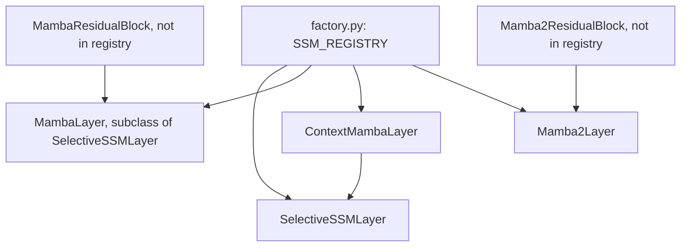

# ssm

Path: `src/dl_techniques/layers/ssm`
Purpose: Keras 3 selective state space layers (Mamba v1, Mamba-2, temporal ContextMamba), two residual wrappers, and a strict registry factory.

## Scope

In: `SelectiveSSMLayer`, `MambaLayer`, `MambaResidualBlock`, `Mamba2Layer`, `Mamba2ResidualBlock`, `ContextMambaLayer`, and `factory.py`.

Not here: the token-sequence foundation models that stack these layers (`models/language/mamba/`, `models/language/zamba2/`, `models/language/hnet/`) and the tracker that uses `ContextMambaLayer` (`models/vision/mambalct/`). Embeddings, LM heads and weight-tying are those models' business.

## Architecture

`SelectiveSSMLayer.call`:
`in_proj` (Dense, `2*d_inner`) -> split `x`, `z` -> `conv1d` (depthwise, causal, `groups=d_inner`) -> SiLU -> `x_proj` (Dense, `dt_rank + 2*d_state`, no bias) -> split `dt_raw`, `B`, `C` -> `dt_proj` (Dense, bias) -> `softplus` -> `_selective_scan` (`while_loop`) -> `+ D*u` -> `* silu(z)` -> `out_proj`. `d_inner = int(expand * d_model)`. Internally tensors are channel-first `(B, d_inner, L)` for the scan.

`Mamba2Layer.call`:
`in_proj` emits, in order, `z0, x0` (MLP branch, each `d_mlp = d_inner - d_ssm`), `z` (`d_ssm`), `xBC` (`d_ssm + 2*ngroups*d_state`), `dt` (`nheads`). `xBC` -> `conv1d` -> SiLU -> split `x`, `B`, `C` -> reshape to heads `(B, L, nheads, headdim)` and groups `(B, L, ngroups, d_state)` -> `_ssm_scan` -> `+ einsum(x, D)` -> optional RMSNorm / gate (order set by `norm_before_gate`) -> concat with `silu(z0) * x0` when `d_mlp > 0` -> `out_proj`.

`ContextMambaLayer.call` takes `(features (B,T,L,D), context (B,Nc,D))`: flatten frames to `(B, T*L, D)`, concat `[context, flat, bridge]` on axis 1, `input_proj` (Dense `d_model`) -> `norm` (from the norms factory) -> `ssm` (`SelectiveSSMLayer`), then slice: frames `[ctx_len : ctx_len+T*L]`, bridge output `[ctx_len+T*L :]`. Updated context is `bridge_out + zeros_like(context)`, a broadcast of one row to `Nc` rows.

## Key files

| File | Role | Notes |
| --- | --- | --- |
| `__init__.py` | Curated exports | `__all__` has 15 names: 9 factory-side names (`SSM_REGISTRY`, `SsmType`, `create_ssm_from_config`, `create_ssm_layer`, `validate_ssm_config`, `assemble_ssm_config`, `get_ssm_info`, `list_ssm_types`, `get_ssm_requirements`) plus 6 classes. Update both the import and `__all__` when adding a class. |
| `selective_ssm.py` | S6 scan, `MambaLayer`, `MambaResidualBlock` | All three register with package string `dl_techniques.layers.ssm.selective_ssm`; the latter two add `legacy_packages=("dl_techniques.models.mamba.components",)` |
| `mamba2.py` | `Mamba2Layer`, `Mamba2ResidualBlock` | Package string `dl_techniques.layers.ssm.mamba2`; the block adds legacy `dl_techniques.models.mamba.components_v2` |
| `context_mamba.py` | `ContextMambaLayer` | Package string `dl_techniques.layers.ssm.context_mamba` |
| `factory.py` | Registry, validation, construction | Imports `logger` from `dl_techniques.utils.logger` |

## Public interface

Layers (all `keras.layers.Layer` subclasses, registered via `register_dl_technique`):

- `SelectiveSSMLayer(d_model, d_state=16, d_conv=4, expand=2, dt_rank="auto", dt_min=0.001, dt_max=0.1, dt_init="random", dt_scale=1.0, dt_init_floor=1e-4, conv_bias=True, use_bias=False, layer_idx=None, **kwargs)`. In and out `(B, L, d_model)`. Raises `ValueError` for non-positive `d_model`, `d_state`, `d_conv`, `expand`, int `dt_rank`; for `dt_min <= 0`, `dt_max <= 0` or `dt_max <= dt_min`; and for `dt_init` not in `{"random", "constant"}`. `dt_rank="auto"` resolves to `ceil(d_model / 16)`; `get_config` returns the raw argument (`dt_rank_arg`), so `"auto"` round-trips as `"auto"`.
- `MambaLayer`: subclass with no overrides.
- `MambaResidualBlock(d_model, norm_epsilon=1e-5, mamba_kwargs=None, **kwargs)`. `call(hidden_states, residual=None, training=None)` returns `(mamba_output, new_residual)` where `new_residual = hidden_states + residual` (or `hidden_states` if `residual` is None) and `mamba_output = mamba(norm(new_residual))`. Norm is `create_normalization_layer("layer_norm", epsilon=norm_epsilon, name="norm")`. Inner layer is `MambaLayer(name="mamba", ...)`.
- `Mamba2Layer(d_model, d_state=128, d_conv=4, expand=2, headdim=64, ngroups=1, d_ssm=None, rmsnorm=True, norm_epsilon=1e-5, norm_before_gate=False, dt_min=0.001, dt_max=0.1, dt_init_floor=1e-4, bias=False, conv_bias=True, **kwargs)`. Raises `ValueError` if `d_ssm % headdim != 0`, `ngroups <= 0`, or `nheads % ngroups != 0`. No other range checks in the class (the factory does them). `get_config` stores the resolved `d_ssm`. `training` is accepted and unused.
- `Mamba2ResidualBlock(d_model, d_state, d_conv, expand, headdim, d_ssm, norm_epsilon=1e-5, rmsnorm=True, norm_before_gate=False, ngroups=1, dt_min=0.001, dt_max=0.1, dt_init_floor=1e-4, bias=False, conv_bias=True, **kwargs)`. The first six have no defaults. Pre-norm is `RMSNorm(name="norm")` when `rmsnorm` else `keras.layers.LayerNormalization(name="norm")`. Returns `(output, new_residual)` like the v1 block. Inner layer is `Mamba2Layer(name="mamba2", ...)`.
- `ContextMambaLayer(d_model, d_state=16, d_conv=4, expand=2, dt_rank="auto", dt_min=0.001, dt_max=0.1, dt_init="random", dt_scale=1.0, dt_init_floor=1e-4, conv_bias=True, use_bias=False, normalization_type="layer_norm", norm_epsilon=1e-5, **kwargs)`. `call((features, context), training=None)` returns `(enhanced, updated_context)`; raises `ValueError` if the input is not a 2-sequence. Does not take `layer_idx`. Validates like `SelectiveSSMLayer`, plus `norm_epsilon > 0`.

Factory (`factory.py`):

- `SSM_REGISTRY: Dict[str, Dict[str, Any]]`; each entry has `class`, `description`, `required_params`, `optional_params` (name to default), `use_case`, `complexity`, `paper`.
- `SsmType = Literal['selective_ssm', 'context_mamba', 'mamba', 'mamba2']`.
- `create_ssm_layer(ssm_type, name=None, **kwargs) -> keras.layers.Layer`.
- `create_ssm_from_config(config: dict)`: pops `'type'`, forwards the rest. Raises `ValueError` if not a dict or no `'type'`.
- `validate_ssm_config(ssm_type, **kwargs) -> None`: raises on undeclared key, unknown type, missing required, non-positive values.
- `assemble_ssm_config(ssm_type, wrapper_config, caller_args=None, *, passthrough=('name',)) -> dict`: filters `wrapper_config` to registry keys plus passthrough, then merges `caller_args` unfiltered. Raises `ValueError` on unknown type.
- `get_ssm_info()` (shallow copy of each entry), `list_ssm_types()` (sorted), `get_ssm_requirements(ssm_type)`.
- Module constant `STRICT_DROPPED_KEY_MARKER = "unsupported parameter(s)"` appears in every undeclared-key error message.

## Data shapes

Registry optional params, by key:

| Key | Class | Required | Optional (default) |
| --- | --- | --- | --- |
| `selective_ssm` | `SelectiveSSMLayer` | `d_model` | `d_state` 16, `d_conv` 4, `expand` 2, `dt_rank` 'auto', `dt_min` 0.001, `dt_max` 0.1, `dt_init` 'random', `dt_scale` 1.0, `dt_init_floor` 1e-4, `conv_bias` True, `use_bias` False, `layer_idx` None |
| `mamba` | `MambaLayer` | `d_model` | same as `selective_ssm` |
| `context_mamba` | `ContextMambaLayer` | `d_model` | the `selective_ssm` set without `layer_idx`, plus `normalization_type` 'layer_norm', `norm_epsilon` 1e-5 |
| `mamba2` | `Mamba2Layer` | `d_model` | `d_state` 128, `d_conv` 4, `expand` 2, `headdim` 64, `ngroups` 1, `d_ssm` None, `rmsnorm` True, `norm_epsilon` 1e-5, `norm_before_gate` False, `dt_min` 0.001, `dt_max` 0.1, `dt_init_floor` 1e-4, `bias` False, `conv_bias` True |

Weights:

- `SelectiveSSMLayer`: `A_log (d_inner, d_state)` init `log(1..d_state)` tiled; `D (d_inner,)` ones; `dt_proj.bias` is the inverse softplus of a log-uniform sample in `[dt_min, dt_max]` clipped at `dt_init_floor`; `dt_proj.kernel` is `Constant(dt_rank**-0.5 * dt_scale)` for `"constant"`, else `RandomUniform(+-that)`.
- `Mamba2Layer`: `A_log (nheads,)` = `log(np.random.uniform(1, 16))`; `D (nheads,)` ones; `dt_bias (nheads,)` from `np.random.rand`. Sub-layers named `in_proj`, `conv1d`, `silu`, `rmsnorm` (only when `rmsnorm`), `out_proj`.
- `ContextMambaLayer`: `bridge_token (1, 1, d_model)` init ones, trainable; sublayers `input_proj`, `norm`, `ssm`.

## Invariants and constraints

- The registry key set, the `SsmType` literals and each entry's `required_params` / `optional_params` are public API, pinned by `tests/test_layers/test_factory_registry_drift.py`. Adding, renaming or removing one is breaking.
- Keep each registry entry's `optional_params` equal to the class's `__init__` defaults. Registry defaults are merged in by `create_ssm_layer`, so a mismatch silently overrides the class default.
- The factory never filters and drops: an undeclared keyword raises. Callers holding a generic wrapper config must pre-filter with `assemble_ssm_config`.
- The residual blocks return two tensors and never close the residual. Do not change that contract: `models/language/mamba/` and `models/language/zamba2/` thread the residual themselves.
- Explicit sub-layer names are load-bearing: `mamba` in `MambaResidualBlock`, `mamba2` in `Mamba2ResidualBlock`, `norm` in both. Keras counters would make two same-config builds disagree on weight paths. Do not drop them.
- Every `build` must build every sub-layer that `call` runs, so a standalone reload finds them built. `SelectiveSSMLayer`, `Mamba2Layer` and `ContextMambaLayer` guard with `if self.built: return` because wrappers call their inner layer's `build` directly; keep that guard.
- The `ContextMambaLayer.bridge_token` must stay learnable and ones-initialized. A constant-zero token is zeroed by the norm and the SSM gate then pins the context update at exactly 0.0.
- Scans cast to `self.variable_dtype`, run in `keras.ops.while_loop` with `maximum_iterations=seq_len`, and cast back to `self.compute_dtype`. `A` is `-exp(A_log)` (kept negative).
- On the TensorFlow backend, both `call` paths wrap the scan with `tf.recompute_grad`, called positionally (it only supports keyword args in eager mode). Other backends call the scan directly. `SelectiveSSMLayer` also passes `tf.convert_to_tensor(self.D)`.
- In `Mamba2Layer`, B and C are broadcast to heads with `keras.ops.repeat(..., nheads // ngroups, axis=2)` (consecutive heads share a group), never summed across groups. The repeat is skipped when `ngroups == nheads`.
- `Mamba2Layer.build` draws `A_log` and `dt_bias` from `np.random`, not `keras.random`, so a NumPy-seeded build is bit-identical.
- Docstrings are Sphinx/reST (`:param:`, `:type:`, `:raises:`), matching the rest of `layers/`.

## Dependencies

Internal:

- `dl_techniques.layers.norms.factory.create_normalization_layer` (`selective_ssm.py`, `context_mamba.py`).
- `dl_techniques.layers.norms.rms_norm.RMSNorm` (`mamba2.py`).
- `dl_techniques.utils.keras_registration.register_dl_technique` (all layer files).
- `dl_techniques.utils.logger.logger` (`factory.py`).

External: `keras` (Keras 3, `keras.ops` only for tensor math), `numpy` (initializers and Mamba-2 weight draws), `math`; `tensorflow` imported lazily inside `call` and only when `keras.config.backend() == "tensorflow"`.

Consumers (outside this package): `models/language/mamba/` (`mamba_v1.py`, `mamba_v2.py`, `__init__.py`), `models/language/zamba2/layers.py`, `models/language/hnet/components.py` (`Mamba2Layer`), `models/vision/mambalct/model.py` (`ContextMambaLayer`).

## Failure modes

- Undeclared factory keyword: `ValueError` containing `unsupported parameter(s)`, raised before the construction `try`, so it is not re-wrapped.
- Unknown type, missing `d_model`, non-positive value in the checked set (`d_model`, `d_state`, `d_conv`, `expand`, `headdim`, `ngroups`, int `dt_rank`, `dt_min`, `dt_max`, `dt_scale`, `dt_init_floor`, `norm_epsilon`): `ValueError` from `validate_ssm_config`. Within `create_ssm_layer`, `TypeError`/`ValueError` from validation or construction is logged and re-raised as `ValueError("Failed to create ...")` chained from the original.
- `validate_ssm_config` does not check `dt_max > dt_min` or `dt_init` values; the layer constructors do (v1 and context, not Mamba-2).
- `ContextMambaLayer.build` raises `ValueError` if the shape nest has no features shape; `call` raises if not given a pair.
- `Mamba2Layer` with `nheads % ngroups != 0` or `d_ssm % headdim != 0` fails at construction.
- `ContextMambaLayer` with `Nc > 1`: no error, but all context rows of the update are identical.
- Half-precision compute does not speed the scan (it runs in variable dtype). Memory is high for long sequences; the source notes `Mamba2Layer` at `variant="130m"` on a 12 GB GPU fit only batch 1 at `seq_len=128` even with recompute.
- `Mamba2Layer` and `Mamba2ResidualBlock` ignore `training`.

## Working here

- Add a new SSM type: write the class (Sphinx docstring, `@register_dl_technique("dl_techniques.layers.ssm.<module>")`, `build` that builds all sub-layers, `get_config` with every constructor argument), then add a `SSM_REGISTRY` entry with `class`, `description`, `required_params`, `optional_params`, `use_case`, `complexity`, `paper`; extend `SsmType`; export from `__init__.py`; update the module docstring key list ("4 keys") in `factory.py` and `__init__.py`; update `tests/test_layers/test_factory_registry_drift.py` expectations.
- If you add a new numeric parameter, add it to the matching range-check tuple in `validate_ssm_config`.
- A parameter that exists in `__init__` but not in the registry entry cannot be passed through the factory; add it to `optional_params` with the same default.
- Changing `get_config` keys or weight/sub-layer names breaks existing `.keras` archives. Legacy registration keys are in `legacy_packages`; keep them.
- Tests: `.venv/bin/python -m pytest tests/test_layers/test_ssm/ -q` plus `tests/test_layers/test_factory_registry_drift.py` after touching the registry. Also run the consumer suites that import these layers (mamba, zamba2, hnet, mambalct under `tests/test_models/`). Do not run the full suite.
- Use `import keras` and qualify (`keras.ops.…`); no `from keras import ops`. No print statements; use the shared logger.
