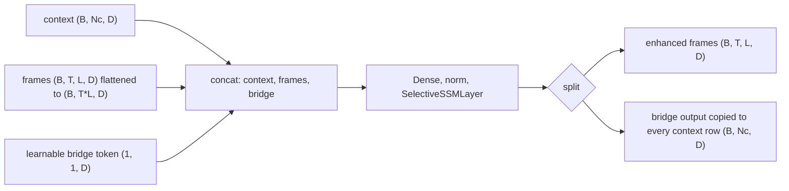

# ssm

Keras 3 layers for selective state space models (Mamba v1, Mamba-2) and a temporal context mixer built on the Mamba v1 scan. Lives at `src/dl_techniques/layers/ssm` in the `dl_techniques` library.

## What it is for

Attention costs time that grows with the square of the sequence length. A state space model (SSM) reads a sequence one step at a time and keeps a small hidden state, so its cost grows linearly. A "selective" SSM lets the input decide, at every step, how much of the state to keep or forget. That is the idea behind Mamba.

This package holds the reusable layers for that idea. They take a `(batch, sequence, features)` tensor and return one of the same shape. They are not tied to text: the same layers are used by language models and by a video tracker. A factory builds any of them from a string key and a config dict, so model code can choose the layer from configuration.

## How it works

`SelectiveSSMLayer` (Mamba v1):

1. A dense projection doubles the width and splits it into a signal `x` and a gate `z`.
2. `x` goes through a causal depthwise 1D convolution (each channel is filtered on its own, and a step never sees the future), then SiLU.
3. From the convolved signal, a projection produces the step size `delta`, and the input and output maps `B` and `C`, separately for every token.
4. A loop walks the sequence: `h = exp(delta * A) * h + delta * B * x`, then `y = C * h`. `A` is learned and kept negative so the state decays.
5. The skip term `D * x` is added, the result is multiplied by `silu(z)`, and a final dense layer projects back to `d_model`.

`Mamba2Layer` changes the layout. One projection produces everything: an optional gated MLP branch, the SSM gate, the convolution input (signal plus `B` plus `C`) and one step size per head. The state is split into heads of size `headdim`. `B` and `C` are computed per group (`ngroups`) and shared by the heads of that group. The SSM output goes through an RMS norm and gate, is concatenated with the MLP branch, and is projected back to `d_model`.

`ContextMambaLayer` is a wrapper for tracking over video. It takes frame features and a small set of context tokens, joins them into one sequence, scans it once, and splits it back:



Both scans run in a Python-level `keras.ops.while_loop` over time, in the layer's variable dtype. On the TensorFlow backend the scan is wrapped in `tf.recompute_grad` to save memory.

## Files

- `__init__.py` - exports the layers, the registry and the factory functions (15 names).
- `selective_ssm.py` - `SelectiveSSMLayer` (S6 scan), `MambaLayer` (subclass alias), `MambaResidualBlock` (pre-norm residual wrapper).
- `mamba2.py` - `Mamba2Layer` (multi-head scan with grouped `B`/`C`) and `Mamba2ResidualBlock`.
- `context_mamba.py` - `ContextMambaLayer`, the temporal context mixer used by MambaLCT.
- `factory.py` - `SSM_REGISTRY`, `SsmType`, validation and construction functions.

## How to use it

```python
import keras
from dl_techniques.layers.ssm import create_ssm_layer, MambaResidualBlock

x = keras.random.normal((2, 64, 128))

mamba = create_ssm_layer("selective_ssm", d_model=128)       # (2, 64, 128)
mamba2 = create_ssm_layer("mamba2", d_model=128, d_state=64)  # (2, 64, 128)
y = mamba(x)

frames = keras.random.normal((2, 3, 16, 128))   # (B, T, L, D)
context = keras.random.normal((2, 1, 128))      # (B, Nc, D)
ctx_layer = create_ssm_layer("context_mamba", d_model=128)
enhanced, new_context = ctx_layer((frames, context))

block = MambaResidualBlock(d_model=128, mamba_kwargs={"d_state": 16})
hidden, residual = block(x, residual=None)
hidden, residual = block(hidden, residual=residual)
```

Config-driven form: `create_ssm_from_config({"type": "mamba2", "d_model": 128})`.

Other factory helpers: `list_ssm_types()`, `get_ssm_info()`, `get_ssm_requirements(type)`, `validate_ssm_config(type, **kwargs)` (check without building), and `assemble_ssm_config(type, wrapper_config, caller_args)` (see below).

Registered keys: `selective_ssm`, `context_mamba`, `mamba`, `mamba2`. Every key requires `d_model`.

## Things to know

- The factory raises `ValueError` for any keyword the chosen type does not declare. Nothing is dropped silently. If you hold a generic config meant for several types, pass it through `assemble_ssm_config` first: it keeps only the keys the type accepts (plus `name`) and then merges in your explicit arguments, which are never filtered.
- `layer_idx` is accepted by `selective_ssm` and `mamba` only. `context_mamba` and `mamba2` do not take it.
- The two residual blocks (`MambaResidualBlock`, `Mamba2ResidualBlock`) are not factory keys. Import them directly.
- A residual block returns two tensors, `(layer_output, new_residual)`. It adds the incoming residual to its input, normalizes the sum, runs the layer on it, and does not close the residual. The caller must pass the second value to the next block. Pass `residual=None` for the first block.
- `Mamba2ResidualBlock` has no defaults for `d_state`, `d_conv`, `expand`, `headdim` and `d_ssm`; all five must be given. The Mamba-2 factory defaults are `d_state=128`, `headdim=64`.
- `Mamba2Layer` requires `d_ssm % headdim == 0` and `nheads % ngroups == 0`, where `nheads = d_ssm // headdim` and `d_ssm` defaults to `expand * d_model`. With `d_ssm` smaller than `expand * d_model`, the remainder becomes a gated MLP branch.
- `MambaLayer` has exactly the behavior of `SelectiveSSMLayer`. It exists for the paper name and so that older archive keys (`dl_techniques.models.mamba.components`) still load. `MambaResidualBlock` and `Mamba2ResidualBlock` also carry legacy keys.
- In `ContextMambaLayer` the bridge token starts at ones and is trainable. A zero token would be wiped by the norm and the gate would shut, pinning the context update at zero. When `Nc > 1`, all context rows of the update are identical copies of one bridge output. The intended use is `Nc == 1`.
- `Mamba2Layer` ignores `training`. `A_log` and `dt_bias` are drawn with `np.random` at build time, so seed NumPy if you need reproducible weights.
- The scan is a sequential loop, so half-precision compute does not speed it up, and long sequences are slow compared with a fused kernel.
- Consumers elsewhere in the repo: `models/language/mamba/`, `models/language/zamba2/`, `models/language/hnet/` and `models/vision/mambalct/`.
- Tests are in `tests/test_layers/test_ssm/`. The registry key set and each entry's parameter lists are also pinned by `tests/test_layers/test_factory_registry_drift.py`.
