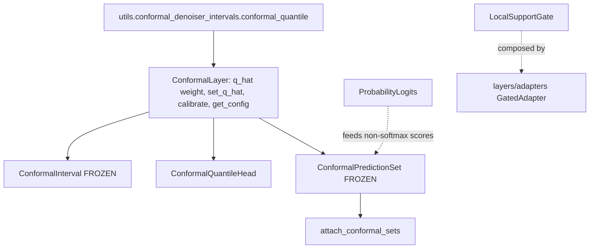

# statistics

Path: `src/dl_techniques/layers/statistics`
Purpose: Probability and statistics Keras 3 layers for `dl_techniques`: distribution-valued outputs (MDN, conditional normalizing flow), eigendecomposition-fitted feature layers (deep kernel PCA, invertible kernel PCA and its denoiser), a reversible scaler, a moving standard deviation filter, a residual-ACF diagnostic, a per-token support gate, a probability-to-log-odds map, and the `conformal/` sub-package of split-conformal layers.

## Scope

Lives here: the nine top-level modules below and `conformal/`.

Does not live here: the NumPy math that fits and scores conformal calibration (`src/dl_techniques/utils/conformal_denoiser_intervals.py`: `conformal_quantile`, `calibrate_per_sigma`, `predict_intervals`, `evaluate_coverage`; `src/dl_techniques/utils/conformal_classification.py`: `aps_scores`, `calibrate_aps`, `predict_sets`, `evaluate_sets`), and the trainer step that calibrates and exports (`src/train/common/conformal.py`). Per-sigma (Mondrian) calibration inside one graph is out of scope.

Nothing here has been trained or benchmarked in this repository.

## Architecture

The modules are independent leaf layers; only `conformal/` has internal structure. `__init__.py` is empty: import from the module. `conformal/__init__.py` is curated with `__all__`.



Conformal flow: `calibrate` runs in NumPy on the host and writes a Keras weight, so it is never part of a traced graph. `call` only reads `q_hat`.

- `ConformalInterval.call(mu)`: `mu_c = clip(mu, domain_min, domain_max)`; returns `(mu_c, mu_c - q_hat, mu_c + q_hat)`, or `(lower, upper)` when `return_mu=False`.
- `ConformalQuantileHead.call(x)`: one `Dense(forecast_length * output_dim * 3)` named `quantile_projection`, reshaped to `(-1, forecast_length, output_dim, 3)`. `q_hat` is not applied. `predict_intervals(x)` runs `self(x, training=False)` and returns `(median, lower - q_hat, upper + q_hat)`.
- `ConformalPredictionSet.call(logits)`: float32 softmax, `argsort(-probs)`, `take_along_axis` to sort, `cumsum <= q_hat` on the sorted probs, `argsort(order)` to undo the sort. Returns `(probs, in_set)`, both float32 `(batch, num_classes)`.

## Key files

The class count lives HERE and nowhere else. Re-derive it rather than trust it:

```bash
grep -hoP '^class \K\w+' src/dl_techniques/layers/statistics/*.py \
  src/dl_techniques/layers/statistics/conformal/*.py | sort
```

That prints 16 names: the 11 layers of the top-level modules, `ACFMonitorCallback` (a callback, not a layer) and the 4 conformal classes (`ConformalLayer` and three layers).

| File | Holds | Notes |
|---|---|---|
| `scaler.py` | `UnifiedScaler` | RevIN when `axis=1`, z-score when `axis=-1`; `inverse_transform`, `denormalize`, `get_stats`, `reset_stats` |
| `mdn_layer.py` | `MDNLayer`; numpy helpers `get_point_estimate`, `get_uncertainty`, `get_prediction_intervals`, `check_component_diversity`; mode finders `get_mixture_modes` (graph-safe, `keras.ops`, float32 or wider; returns stationary points reached from each component mean, slow to converge within about 2 sigma of a merge) and `get_mode_estimate` (wrapper, highest-density mode per sample) | Methods `split_mixture_params`, `loss_func`, `sample`. Output width `2 * num_mixtures * output_dimension + num_mixtures` |
| `normalizing_flow.py` | `AffineCouplingLayer`, `NormalizingFlowLayer` | Conditional Real NVP. `call([data, context])` is data to latent and returns `(z, log_det)`; `loss_func` consumes that tuple; `sample` is latent to data |
| `deep_kernel_pca.py` | `DeepKernelPCA` | Needs `adapt`. Also `compute_kernel_matrix`, `extract_components`, `get_explained_variance_ratio`, a custom `load_own_variables` |
| `invertible_kernel_pca.py` | `InvertibleKernelPCA`, `InvertibleKernelPCADenoiser` | Both need `adapt`. Methods `transform`, `inverse_transform`, `fit_transform`, `compute_reconstruction_error`, `estimate_noise_level` |
| `local_support_gate.py` | `LocalSupportGate` | EM-fitted, frozen; inert until fitted. `fit_pos`, `fit_neg`, `fit`, `observe`, `reset`, `is_fitted`, `num_dead_components`, `get_saved_state`. `output_mode` is `'hard'`, `'smoothed'` or `'scores'` |
| `moving_std.py` | `MovingStd` | Shifted two-pass variance through one shared `AveragePooling2D`; rank-4 input only |
| `probability_logits.py` | `ProbabilityLogits` | Weightless log-odds map; computes in float32 whatever the policy, because `1 - 1e-6` is exactly 1 in float16. `epsilon` must lie in `(0, 0.5)` |
| `residual_acf.py` | `ResidualACFLayer`, `ACFMonitorCallback` | Input `[predictions, targets]`, returns predictions. `acf_values` attribute, `get_acf_summary()`. `ACFMonitorCallback` is a `keras.callbacks.Callback`, not a layer |
| `conformal/__init__.py` | Exports `ConformalLayer`, `ConformalInterval`, `ConformalQuantileHead`, `ConformalPredictionSet`, `attach_conformal_sets` | Has `__all__` |
| `conformal/base.py` | `ConformalLayer` | Key `dl_techniques.layers.statistics.conformal.base`. No `call`; not usable alone |
| `conformal/interval.py` | `ConformalInterval` | `FROZEN = True`. Key `...conformal.interval` |
| `conformal/quantile_head.py` | `ConformalQuantileHead`, `LOWER, MEDIAN, UPPER = 0, 1, 2`, `NUM_QUANTILES = 3` | `FROZEN` stays False. Key `...conformal.quantile_head` |
| `conformal/prediction_set.py` | `ConformalPredictionSet`, `attach_conformal_sets`, `_Q_HAT_KEEPS_EVERY_LABEL = 2.0` | `FROZEN = True`. Key `...conformal.prediction_set` |

Outside importers are a grep, not a claim:

```bash
grep -rnE "(layers\.statistics|\.\.statistics)[.a-z_]* import" src --include=*.py \
  | grep -v "^src/dl_techniques/layers/statistics/"
```

Today: `MDNLayer` (`models/time_series/mdn`, `train/time_series/mdn`), `ProbabilityLogits` (`train/capsnet/train_capsnet.py`), `LocalSupportGate` (`layers/adapters/gated_adapter.py`), `ConformalQuantileHead` (`layers/time_series/forecasting_layers.py`) and the conformal classes (`train/common/conformal.py`, which trainers under `src/train/` use). The others have no importer outside tests.

## Public interface

Registration. Every layer class registers (`ACFMonitorCallback` is a `keras.callbacks.Callback` and does not) through `@register_dl_technique("<defining module's dotted path>")` from `dl_techniques.utils.keras_registration`:

```python
from dl_techniques.utils.keras_registration import register_dl_technique

@register_dl_technique("dl_techniques.layers.statistics.scaler")
class UnifiedScaler(keras.layers.Layer):
    ...
```

`keras.saving.get_registered_name(UnifiedScaler)` is `dl_techniques.layers.statistics.scaler>UnifiedScaler`. Nothing is stripped under `layers/`, so the conformal classes register under `dl_techniques.layers.statistics.conformal.<module>`. Never a bare `@keras.saving.register_keras_serializable()`: its key `Custom>ClassName` ignores `__module__`, so two same-named classes claim one slot. The helper also binds `Custom>ClassName` as an alias for old archives.

Conformal signatures:

`ConformalLayer(q_hat_init: float, **kwargs)`

- `FROZEN: bool = False` class attribute. When true, `__init__` pops any inbound `trainable` and forces `trainable=False`.
- `add_q_hat_weight() -> None`: creates weight `conformal_q_hat`, shape `()`, `Constant(q_hat_init)`, `trainable=False`, `dtype=self.variable_dtype`, `autocast=False`.
- `set_q_hat(value: float) -> None`: raises `ValueError` if unbuilt, or if `value` is negative or NaN. Assigns and logs at info level.
- `calibrate(scores: np.ndarray, alpha: float = 0.1) -> None`: unbuilt layer raises `ValueError`; `conformal_quantile` raises `ValueError` for empty scores or `alpha` outside `(0, 1)`. Result is `+inf` when `ceil((n + 1)(1 - alpha)) > n`.
- `_normalize_q_hat(value, argument="q_hat") -> float`: hook; non-negative, not NaN (`not value >= 0.0`), else `ValueError` naming argument and value.
- `get_config()`: `q_hat_init` is the CURRENT weight value when built, else the stored init.

`ConformalInterval(q_hat_init=0.0, domain_min=0.0, domain_max=1.0, return_mu=True, **kwargs)`: raises `ValueError` if `domain_min >= domain_max`. `compute_output_shape` returns a 3- or 2-tuple of the input shape. Config adds `domain_min`, `domain_max`, `return_mu`.

`ConformalQuantileHead(forecast_length, output_dim, kernel_initializer="glorot_uniform", kernel_regularizer=None, q_hat_init=0.0, **kwargs)`: raises `ValueError` for non-positive `forecast_length` or `output_dim`. `build` requires rank-2 input with known last dim. `predict_intervals(inputs) -> (median, lower, upper)`, each `(batch, forecast_length, output_dim)`. `compute_output_shape` is `(input_shape[0], forecast_length, output_dim, 3)`. Config adds `forecast_length`, `output_dim`, `kernel_initializer` (spec), `kernel_regularizer` (serialized).

`ConformalPredictionSet(q_hat_init=2.0, **kwargs)`: `build` raises `ValueError` if the input is not rank 2 or the class count is known and below 2. `_normalize_q_hat` caps at `2.0` after calling `super()`.

`attach_conformal_sets(model, tau, input_shape) -> keras.Model`: calls `model` on `keras.Input(tuple(input_shape))`, raises `ValueError` if the result is a list, tuple or dict, creates `ConformalPredictionSet(name="conformal_prediction_set")`, applies it, `set_q_hat(tau)`, returns `keras.Model(inputs, [logits, probs, in_set], name=f"{model.name}_conformal")`. The model's weights are shared, not copied. A deep-supervised model must first be reduced to its primary output with `dl_techniques.utils.deep_supervision.create_inference_model_from_training_model`.

## Data shapes

| Item | Shape / value |
|---|---|
| `q_hat` weight | scalar, variable dtype, name `conformal_q_hat` |
| Interval input / outputs | `(..., domain)`; outputs same shape |
| Quantile head input | `(batch, input_dim)`; output `(batch, forecast_length, output_dim, 3)`, last axis 0 lower, 1 median, 2 upper |
| Prediction set input | `(batch, num_classes)` logits; outputs `(probs, in_set)` |
| Scores for `calibrate` | `(n,)`; interval `abs(truth - mu)`; head `max(q_low - y, y - q_high)`; set `aps_scores(..., randomized=False)` |
| `MDNLayer` output | `(batch, 2 * num_mixtures * output_dimension + num_mixtures)`; the pi part is raw logits |
| `NormalizingFlowLayer` input | list `[data, context]`; output `(z, log_det)` shaped `(batch, output_dimension)` and `(batch,)` |
| `MovingStd` | rank-4, `(batch, H, W, C)` for `channels_last` |

## Invariants and constraints

Package-wide:

- **Docstrings are Sphinx/reST** (`:param:`, `:type:`, `:raises:`) in every module here (`grep -c "Args:"` is 0 in all files). Match the file you edit; never convert a file wholesale.
- **New code uses `import keras` only**, with `keras.ops.*` qualified at the call site. All eight older top-level modules still say `from keras import ops`; `probability_logits.py` and every conformal module do not (`grep -n "^from keras" src/dl_techniques/layers/statistics/*.py`). Do not copy that into new code, and do not rewrite a module just to remove it.
- **Sub-layers are created in `__init__`; weights in `build()`; `super().build(input_shape)` last.** Pinned by `test_the_package_is_v2_compliant.py` (no sub-layer created in `build`).
- **`call` is symbolic.** No Python branch on a tensor value, no `.assign` in `call`, no logging, no layer construction. `DeepKernelPCA` and `InvertibleKernelPCA` therefore fit in an eager `adapt()` and branch in `call` on a Python list length, not on a tensor. `_fit_flag` is written and never read on purpose: `load_own_variables` counts weights, so deleting it breaks every saved file.
- **Dtypes come from the tensor, never a literal.** `float16(1e-10)` is exactly 0.0, so a stability floor is `stability_floor(self.compute_dtype, 1e-10)` from `dl_techniques.utils.dtype_policy`, and a constant is `ops.cast(value, tensor.dtype)`, not a bare `ops.sqrt(2.0)` or `ops.eye(n)`. Pinned by `test_the_eigenvalue_divides_survive_fp16.py` and `test_the_four_carried_defects_are_fixed.py`.
- **Validation names the value.** Every `raise ValueError(...)` here is an f-string with the offending value; `test_no_value_error_message_is_bare` fails otherwise. Pair each new raise with a test.
- **No caller-dict mutation, JSON-safe `get_config`.** Store specs, not instances.

Per layer:

- **Initializers are cloned per site.** `MDNLayer` gives each Dense its own `clone_initializer(...)`; passing the shared instance made `mdn_mus.kernel == mdn_sigmas.kernel` at init (measured).
- **`MDNLayer`'s pi head emits raw logits.** No softplus or softmax on it: every consumer applies exactly one softmax or log_softmax. `seed` must reach both `keras.random` draws in `sample`.
- **A method that bypasses `Layer.__call__` builds first.** `AffineCouplingLayer.forward/inverse` and `NormalizingFlowLayer.sample` call `self.build(...)` when unbuilt, otherwise their weights land outside the layer's name scope (bare `dense_1/kernel`). Do not add a `call()` to fix it.
- **`ResidualACFLayer` never branches on a symbolic shape**: it slices with Python-int lag offsets and decides in-range from the static sequence length, and it logs nothing on the forward path.
- **`InvertibleKernelPCA` has one inverse path, a learned linear decoder.** Do not bring back the removed arccos / frequency-Gram pseudo-inverse code; a real pre-image solver is out of scope. Its seed guard is `is not None`, never truthiness (`random_seed=0` is falsy).
- **`InvertibleKernelPCADenoiser` thresholds only when `adaptive_components` and `training` are both true.** The threshold factor is built in `noise_level`'s dtype.
- **`DeepKernelPCA`'s fitted path runs no inter-level coupling.** Do not re-enable it to match the paper.
- **`LocalSupportGate`**: fitting is always an explicit call, never a side effect of `call`. Both mixtures are non-trainable weights. An unfitted gate reports every token out of support.
- **`UnifiedScaler.inverse_transform`** divides by `gamma` with its magnitude floored at `eps`, keeping its sign.

Conformal:

- One weight, one name: `conformal_q_hat`. Subclasses call `self.add_q_hat_weight()` in `build()` before `super().build(input_shape)`.
- `autocast=False` means the subclass casts `q_hat` where it uses it: the interval and head cast to the output dtype, the set layer casts to float32. Do not store `q_hat` in the compute dtype; a float16 value could round a radius down and under-cover.
- Validation lives only in `_normalize_q_hat`. `__init__`, `set_q_hat` and `calibrate` all go through it. A subclass override must call `super()` first.
- `calibrate` is the exact order statistic (`conformal_quantile`), not an interpolated `np.quantile`. For n = 9 and alpha = 0.1 it returns the largest score.
- `get_config()["q_hat_init"]` carries the calibration. Subclasses extend with `config.update(...)` and never write `q_hat_init` themselves.
- `ConformalPredictionSet` is the deterministic `u = 1` APS rule and matches `predict_sets(logits, tau, randomized=False)` of the NumPy utility, to float32 rounding at the threshold. Ties break by class index. Do not make it randomized, and do not change the rule on one side only.
- `ConformalQuantileHead` keeps its `Dense` created in `__init__` and builds it in `build()`. `call` never applies `q_hat`. Return order of `predict_intervals` is `(median, lower, upper)`. The kernel initializer is stored as a spec via `initializer_spec`.

## Dependencies

Internal:

- `dl_techniques.utils.keras_registration.register_dl_technique`: registration, every module.
- `dl_techniques.utils.logger.logger`: `mdn_layer.py` (info in `__init__`, debug in `build`), `local_support_gate.py` (info in `__init__` and `fit_*`, warning when dead components are re-seeded), `moving_std.py` (debug in `build`), `residual_acf.py` (debug in `__init__`, `build` and `get_acf_summary`; info and warning in `ACFMonitorCallback`), `conformal/base.py` (info in `set_q_hat`).
- `dl_techniques.utils.dtype_policy`: `stability_floor` (`deep_kernel_pca.py`, `invertible_kernel_pca.py`) and `accumulation_dtype` (`deep_kernel_pca.py`).
- `dl_techniques.initializers.clone`: `clone_initializer` (`mdn_layer.py`), `initializer_spec` (`conformal/quantile_head.py`).
- `dl_techniques.utils.activation_serialization`: `serialize_activation`, `deserialize_activation` (`mdn_layer.py`).
- `dl_techniques.layers.activations.common`: `resolve_activation`, `serialize_activation` (`normalizing_flow.py`).
- `dl_techniques.utils.conformal_denoiser_intervals.conformal_quantile`: the order statistic behind `calibrate` (`conformal/base.py`).

External:

- `keras` (3.x): every module. `numpy`: `mdn_layer.py`, `deep_kernel_pca.py`, `invertible_kernel_pca.py`, `residual_acf.py`, `normalizing_flow.py`, `conformal/base.py`, `conformal/quantile_head.py`.
- `scipy`: `scipy.stats`, imported inside `get_prediction_intervals` in `mdn_layer.py`; a missing install raises `ImportError` when that helper is called, not at import.

## Failure modes

- `set_q_hat` or `calibrate` on an unbuilt conformal layer: `ValueError` "is not built". Call the layer once on a sample first.
- Negative or NaN `q_hat`: `ValueError` naming the argument.
- Too few scores for `alpha`: `q_hat = +inf` (an unbounded interval); the set layer stores `2.0`, which keeps every label.
- Wrong input rank or fewer than 2 classes: `ValueError` from `ConformalPredictionSet.build`. Head with rank other than 2 or unknown `input_dim`: `ValueError` from `ConformalQuantileHead.build`.
- Multi-output model passed to `attach_conformal_sets`: `ValueError`.
- `predict_intervals` on an uncalibrated head returns the raw learned quantiles (`q_hat` is 0).
- `NormalizingFlowLayer.call` with other than two inputs: `ValueError`.
- `MovingStd.build` with non-rank-4 input: `ValueError`.
- Kernel PCA layers without `adapt`: no error; output is a meaningless random projection.
- Loading a `.keras` file that recorded removed conformal names: fails, by decision.

## Working here

Tests: `tests/test_layers/test_statistics/`, one file per module, the conformal ones in `test_conformal/`. Run only this directory with the repo `.venv`, never the full suite:

```bash
.venv/bin/python -m pytest tests/test_layers/test_statistics -q
```

Five package-wide guards in that directory, plus a shared oracle and its RED proof:

| Guard | Pins |
|---|---|
| `test_the_package_is_v2_compliant.py` | An AST walk over every source file of the package, sub-package included (`rglob`), against the authoring guide `research/2026_keras_custom_models_instructions_v2.md` (the "v2 guide"): no sub-layer built in `build`, every `ValueError` names the value, cross-parameter contracts at construction, `training=` forwarded. `MIN_SOURCE_FILES` is its anti-vacuity floor |
| `test_the_package_meets_the_v2_test_bar.py` | Section 16.3 ("The Tests, Before You Call It Done") of the v2 guide for the nine older layers (`SUBJECTS`): value round trip, weights before first call, build parity, dtype arms, XLA vs eager, gradients per variable. Strict `xfail` entries (`XFAILS`) carry the measured reason |
| `v2_compliance_oracle.py` + `test_the_v2_oracle_can_fail.py` | The shared instruments and the proof that each rejects a broken subject. The oracle has no `test_` prefix on purpose |
| `test_the_eigenvalue_divides_survive_fp16.py` | The two whitening divides under `mixed_float16` |
| `test_the_four_carried_defects_are_fixed.py` | The dtype and weight-path fixes of an earlier defect-repair plan (dated 2026-08-30) |
| `test_the_statistics_docs_name_real_things.py` | `README.md` and `AGENTS.md` here and in `conformal/`: paths exist, every class is named, every README snippet runs, the class count and outside-importer list match the code |

Conformal tests: `test_base_contract.py`, `test_interval.py`, `test_quantile_head.py`, `test_prediction_set.py`. Named tests worth knowing: `test_the_threshold_is_not_rounded_to_float16_under_mixed_precision` and `test_it_matches_the_numpy_prediction_sets` in `test_prediction_set.py`.

Adding a top-level layer: add it to `SUBJECTS` in the test bar, to the README catalogue and layout, and to the Key files table above (and update the class count line).

Adding a conformal layer:

1. Subclass `ConformalLayer` in a new module in `conformal/`; set `FROZEN`; call `super().__init__(q_hat_init=..., **kwargs)`.
2. Call `self.add_q_hat_weight()` in `build()` before `super().build(...)`, and cast `self.q_hat` where you use it.
3. Register under `dl_techniques.layers.statistics.conformal.<module>`.
4. Add it to `conformal/__init__.py` and `__all__`.
5. Add a `Subject` to `SUBJECTS` in `test_base_contract.py`. Its first test compares `SUBJECTS` with `ConformalLayer.__subclasses__()` and asserts `len(SUBJECTS) == 3`, so it fails until you add the subject and update that count.
6. Add a test file for what is specific to the layer: dtype policies, XLA vs eager, an unknown-batch trace, weights compared before the reloaded model's first call.
7. Update the README tables and the file table here.

Do not:

- Convert Sphinx docstrings to Google style, or the reverse.
- Register with the bare decorator, or rename a registered class without saying which archives stop loading.
- Move an `adapt()` fit or any `.assign` into `call()`.
- Write `from keras import ops` in new code.
- Put a measured accuracy, speed, coverage or set-size number in the docs: nothing here has been trained or benchmarked in this repository.
- Add aliases for removed conformal names: `ConformalIntervalLayer`, `ConformalPredictionSetLayer`, `q_init`, `tau_init`, `self.q`, `self.tau`, `conformal_q`, `conformal_tau`, or the old `calibrate(value)`. Archives using them fail to load, by decision.
- Set `autocast=True` on `q_hat`, replace the order statistic with an interpolated quantile, or add a per-sigma (Mondrian) radius to `ConformalInterval`.
