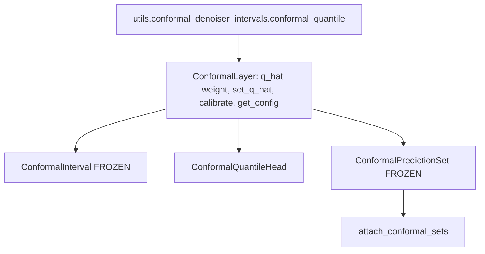

# statistics/conformal

Path: `src/dl_techniques/layers/statistics/conformal`
Purpose: Split-conformal Keras layers that hold one frozen scalar `q_hat` (the finite-sample quantile of held-out scores) and apply it to a point estimate, to learned quantiles, or to classifier logits.

## Scope

Lives here: the shared base `ConformalLayer`, three concrete layers, and the helper `attach_conformal_sets`.

Does not live here: the NumPy math that fits `q_hat` and evaluates coverage. That is in `src/dl_techniques/utils/conformal_denoiser_intervals.py` (`conformal_quantile`, `calibrate_per_sigma`, `predict_intervals`, `evaluate_coverage`) and `src/dl_techniques/utils/conformal_classification.py` (`aps_scores`, `calibrate_aps`, `predict_sets`, `evaluate_sets`). The trainer step that calibrates and exports is `src/train/common/conformal.py`. Per-sigma (Mondrian) calibration inside one graph is out of scope.

Parent package `src/dl_techniques/layers/statistics/` registers every class as `@register_dl_technique("<defining module dotted path>")`, uses Sphinx/reST docstrings and Keras `import keras` only in new code.

## Architecture

`calibrate` runs in NumPy on the host and writes a Keras weight, so it is never part of a traced graph. `call` only reads `q_hat`.

Flow per layer:

- `ConformalInterval.call(mu)`: `mu_c = clip(mu, domain_min, domain_max)`; returns `(mu_c, mu_c - q_hat, mu_c + q_hat)`, or `(lower, upper)` when `return_mu=False`.
- `ConformalQuantileHead.call(x)`: one `Dense(forecast_length * output_dim * 3)` named `quantile_projection`, reshaped to `(-1, forecast_length, output_dim, 3)`. `q_hat` is not applied. `predict_intervals(x)` runs `self(x, training=False)` and returns `(median, lower - q_hat, upper + q_hat)`.
- `ConformalPredictionSet.call(logits)`: float32 softmax, `argsort(-probs)`, `take_along_axis` to sort, `cumsum <= q_hat` on the sorted probs, `argsort(order)` to undo the sort. Returns `(probs, in_set)`, both float32 `(batch, num_classes)`.

## Key files

| File | Role | Notes |
| --- | --- | --- |
| `__init__.py` | Curated exports with `__all__` | `ConformalLayer`, `ConformalInterval`, `ConformalQuantileHead`, `ConformalPredictionSet`, `attach_conformal_sets` |
| `base.py` | `ConformalLayer` | `FROZEN`, `add_q_hat_weight`, `_normalize_q_hat`, `_require_built`, `set_q_hat`, `calibrate`, `get_config`. Registered key `dl_techniques.layers.statistics.conformal.base`. No `call`; not usable alone |
| `interval.py` | `ConformalInterval` | `FROZEN = True`. Key `...conformal.interval` |
| `quantile_head.py` | `ConformalQuantileHead`, constants `LOWER, MEDIAN, UPPER = 0, 1, 2`, `NUM_QUANTILES = 3` | `FROZEN` stays False. Key `...conformal.quantile_head` |
| `prediction_set.py` | `ConformalPredictionSet`, `attach_conformal_sets`, `_Q_HAT_KEEPS_EVERY_LABEL = 2.0` | `FROZEN = True`. Key `...conformal.prediction_set` |

## Public interface

`ConformalLayer(q_hat_init: float, **kwargs)`

- `FROZEN: bool = False` class attribute. When true, `__init__` pops any inbound `trainable` and forces `trainable=False`.
- `add_q_hat_weight() -> None`: creates weight `conformal_q_hat`, shape `()`, `Constant(q_hat_init)`, `trainable=False`, `dtype=self.variable_dtype`, `autocast=False`.
- `set_q_hat(value: float) -> None`: raises `ValueError` if unbuilt, or if `value` is negative or NaN. Assigns and logs at info level.
- `calibrate(scores: np.ndarray, alpha: float = 0.1) -> None`: unbuilt layer raises `ValueError`; `conformal_quantile` raises `ValueError` for empty scores or `alpha` outside `(0, 1)`. Result is `+inf` when `ceil((n + 1)(1 - alpha)) > n`.
- `_normalize_q_hat(value, argument="q_hat") -> float`: hook; non-negative, not NaN (`not value >= 0.0`), else `ValueError` naming argument and value.
- `get_config()`: `q_hat_init` is the CURRENT weight value when built, else the stored init.

`ConformalInterval(q_hat_init=0.0, domain_min=0.0, domain_max=1.0, return_mu=True, **kwargs)`: raises `ValueError` if `domain_min >= domain_max`. `compute_output_shape` returns a 3- or 2-tuple of the input shape. Config adds `domain_min`, `domain_max`, `return_mu`.

`ConformalQuantileHead(forecast_length, output_dim, kernel_initializer="glorot_uniform", kernel_regularizer=None, q_hat_init=0.0, **kwargs)`: raises `ValueError` for non-positive `forecast_length` or `output_dim`. `build` requires rank-2 input with known last dim. `predict_intervals(inputs) -> (median, lower, upper)`, each `(batch, forecast_length, output_dim)`. `compute_output_shape` is `(input_shape[0], forecast_length, output_dim, 3)`. Config adds `forecast_length`, `output_dim`, `kernel_initializer` (spec), `kernel_regularizer` (serialized).

`ConformalPredictionSet(q_hat_init=2.0, **kwargs)`: `build` raises `ValueError` if the input is not rank 2 or the class count is known and below 2. `_normalize_q_hat` caps at `2.0` after calling `super()`.

`attach_conformal_sets(model, tau, input_shape) -> keras.Model`: calls `model` on `keras.Input(tuple(input_shape))`, raises `ValueError` if the result is a list, tuple or dict, creates `ConformalPredictionSet(name="conformal_prediction_set")`, applies it, `set_q_hat(tau)`, returns `keras.Model(inputs, [logits, probs, in_set], name=f"{model.name}_conformal")`. The model's weights are shared, not copied. A deep-supervised model must first be reduced to its primary output with `dl_techniques.utils.deep_supervision.create_inference_model_from_training_model`.

## Data shapes

| Item | Shape / value |
| --- | --- |
| `q_hat` weight | scalar, variable dtype, name `conformal_q_hat` |
| Interval input / outputs | `(..., domain)`; outputs same shape |
| Quantile head input | `(batch, input_dim)`; output `(batch, forecast_length, output_dim, 3)`, last axis 0 lower, 1 median, 2 upper |
| Prediction set input | `(batch, num_classes)` logits; outputs `(probs, in_set)` |
| Scores for `calibrate` | `(n,)`; interval `abs(truth - mu)`; head `max(q_low - y, y - q_high)`; set `aps_scores(..., randomized=False)` |

## Invariants and constraints

- One weight, one name: `conformal_q_hat`. Subclasses call `self.add_q_hat_weight()` in `build()` before `super().build(input_shape)`.
- `autocast=False` means the subclass casts `q_hat` where it uses it: the interval and head cast to the output dtype, the set layer casts to float32. Do not store `q_hat` in the compute dtype; a float16 value could round a radius down and under-cover.
- Validation lives only in `_normalize_q_hat`. `__init__`, `set_q_hat` and `calibrate` all go through it. A subclass override must call `super()` first.
- `calibrate` is the exact order statistic (`conformal_quantile`), not an interpolated `np.quantile`. For n = 9 and alpha = 0.1 it returns the largest score.
- `get_config()["q_hat_init"]` carries the calibration. Subclasses extend with `config.update(...)` and never write `q_hat_init` themselves.
- `ConformalPredictionSet` is the deterministic `u = 1` APS rule and matches `predict_sets(logits, tau, randomized=False)` of the NumPy utility, to float32 rounding at the threshold. Ties break by class index. Do not make it randomized, and do not change the rule on one side only.
- `ConformalQuantileHead` keeps its `Dense` created in `__init__` and builds it in `build()`. `call` never applies `q_hat`. Return order of `predict_intervals` is `(median, lower, upper)`. The kernel initializer is stored as a spec via `initializer_spec`.
- `call` bodies are symbolic: no `.assign`, no logging, no Python branching on tensor values.

## Dependencies

- `dl_techniques.utils.conformal_denoiser_intervals.conformal_quantile`: the order statistic used by `calibrate`.
- `dl_techniques.utils.keras_registration.register_dl_technique`: registration.
- `dl_techniques.utils.logger.logger`: info log in `set_q_hat`.
- `dl_techniques.initializers.clone.initializer_spec`: used by the quantile head.
- External: `keras`, `numpy`.
- Consumers outside this directory: `src/dl_techniques/layers/time_series/forecasting_layers.py` (`ConformalQuantileHead`), `src/train/common/conformal.py` (imports from this package, including `attach_conformal_sets`), and trainers under `src/train/` that use `conformal.py` (for example `vit`, `resnet`, `cliffordnet`, `convnext`, `capsnet`).

## Failure modes

- Calling `set_q_hat` or `calibrate` before the layer is built: `ValueError` "is not built". Call the layer once on a sample first.
- Negative or NaN `q_hat`: `ValueError` naming the argument.
- Too few scores for `alpha`: `q_hat = +inf` (an unbounded interval); the set layer stores `2.0`, which keeps every label.
- Wrong input rank or fewer than 2 classes: `ValueError` from `ConformalPredictionSet.build`. Head with rank other than 2 or unknown `input_dim`: `ValueError` from `ConformalQuantileHead.build`.
- Multi-output model passed to `attach_conformal_sets`: `ValueError`.
- `predict_intervals` on an uncalibrated head returns the raw learned quantiles (`q_hat` is 0).

## Working here

Adding a conformal layer:

1. Subclass `ConformalLayer` in a new module here; set `FROZEN`; call `super().__init__(q_hat_init=..., **kwargs)`.
2. Call `self.add_q_hat_weight()` in `build()` before `super().build(...)`, and cast `self.q_hat` where you use it.
3. Register under `dl_techniques.layers.statistics.conformal.<module>`.
4. Add it to `__init__.py` and `__all__`.
5. Add a `Subject` to `SUBJECTS` in `tests/test_layers/test_statistics/test_conformal/test_base_contract.py`. Its first test compares `SUBJECTS` with `ConformalLayer.__subclasses__()` and asserts `len(SUBJECTS) == 3`, so it fails until you add the subject and update that count.
6. Add a test file for what is specific to the layer: dtype policies, XLA vs eager, an unknown-batch trace, weights compared before the reloaded model's first call.
7. Update the README table and the file table here.

Tests: `tests/test_layers/test_statistics/test_conformal/` (`test_base_contract.py`, `test_interval.py`, `test_quantile_head.py`, `test_prediction_set.py`). Relevant named tests: `test_the_threshold_is_not_rounded_to_float16_under_mixed_precision` and `test_it_matches_the_numpy_prediction_sets` in `test_prediction_set.py`. Run only this directory, not the full suite. Use the repo `.venv`.

Do not:

- Add aliases for removed names: `ConformalIntervalLayer`, `ConformalPredictionSetLayer`, `q_init`, `tau_init`, `self.q`, `self.tau`, `conformal_q`, `conformal_tau`, or the old `calibrate(value)`. Archives using them fail to load, by decision.
- Set `autocast=True` on `q_hat`.
- Replace the order statistic with an interpolated quantile.
- Quote coverage or set-size numbers in docs: none has been measured on a trained model.
- Write `from keras import ops`; this package is `import keras` only.
- Add a per-sigma (Mondrian) radius to `ConformalInterval`.
