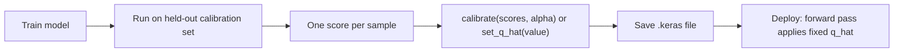

# conformal

Keras 3 layers for split conformal prediction, in `src/dl_techniques/layers/statistics/conformal/`. Each layer holds one frozen number, `q_hat`, and uses it in the forward pass to turn a model output into an interval or a set with a coverage guarantee.

## What it is for

A trained model gives a prediction but no promise about how often it is right. Split conformal prediction adds that promise without changing the model. You hold out a calibration set, measure how wrong the model was on each item (the "score"), and take a finite-sample quantile of those scores. That quantile is `q_hat`. Adding it to the output gives an interval, or a set of labels, that contains the truth with probability at least `1 - alpha`. This holds for any model, as long as calibration data and deployment data are exchangeable (drawn from the same distribution, order not mattering).

These layers are the in-graph half of that recipe. `q_hat` is stored as a weight, so the calibrated model saves as one `.keras` file. The fitting itself runs on the host in NumPy and writes the weight.

## How it works

All layers extend `ConformalLayer` (`base.py`). It owns the weight `conformal_q_hat` (a non-trainable scalar) and two ways to fill it:

- `calibrate(scores, alpha=0.1)` sets `q_hat` to the `ceil((n + 1) * (1 - alpha))`-th smallest score. If there are too few scores for that `alpha`, the result is `+inf`.
- `set_q_hat(value)` assigns a value fitted elsewhere.

The layers differ in what they apply `q_hat` to:

| Class | Applies `q_hat` to | Output | Score to calibrate with | `q_hat_init` default |
|---|---|---|---|---|
| `ConformalInterval` | a point estimate `mu` | `(mu_c, lower, upper)`, or `(lower, upper)` with `return_mu=False`; `mu_c` is `mu` clipped to `[domain_min, domain_max]`, `lower = mu_c - q_hat`, `upper = mu_c + q_hat` | `abs(truth - mu)` | `0.0` |
| `ConformalQuantileHead` | three learned quantiles per step and feature | `call`: `(batch, forecast_length, output_dim, 3)` as lower, median, upper, with no `q_hat` applied. `predict_intervals`: `(median, lower, upper)` with `lower - q_hat` and `upper + q_hat` | `max(q_low - truth, truth - q_high)` | `0.0` |
| `ConformalPredictionSet` | classifier logits | `(probs, in_set)`; `in_set` is a 0/1 float mask `(batch, num_classes)` of labels whose cumulative sorted probability is at most `q_hat` | `dl_techniques.utils.conformal_classification.aps_scores(..., randomized=False)` | `2.0` (every label) |

Workflow:



`get_config()` stores the current calibrated value under the key `q_hat_init`, so reloading from config alone keeps the calibration.

`attach_conformal_sets(model, tau, input_shape)` (in `prediction_set.py`) wraps a trained classifier: it builds a Functional model from the input to `(logits, probs, in_set)`, sharing the classifier's weights, with `tau` assigned as `q_hat`.

## Files

- `__init__.py` - exports `ConformalLayer`, `ConformalInterval`, `ConformalQuantileHead`, `ConformalPredictionSet`, `attach_conformal_sets` (with `__all__`).
- `base.py` - `ConformalLayer`: the frozen `q_hat` weight, validation, `set_q_hat`, `calibrate`, `get_config`.
- `interval.py` - `ConformalInterval`: clip a point estimate and widen it by `q_hat`.
- `quantile_head.py` - `ConformalQuantileHead`: a Dense projection to three quantiles, plus `predict_intervals`.
- `prediction_set.py` - `ConformalPredictionSet` and `attach_conformal_sets`.

## How to use it

A point estimate with an interval (the prediction here is a stand-in for your model's output on a held-out set):

```python
import numpy as np
import keras
from dl_techniques.layers.statistics.conformal import ConformalInterval

rng = np.random.default_rng(0)
truth = rng.uniform(size=(2000, 8)).astype("float32")
mu = np.clip(truth + rng.normal(0.0, 0.05, truth.shape), 0.0, 1.0).astype("float32")

layer = ConformalInterval()
layer(mu[:1])                                           # build the layer
layer.calibrate(np.abs(truth - mu).ravel(), alpha=0.1)  # score = |truth - prediction|
mu_c, lower, upper = layer(mu)
print(float(keras.ops.convert_to_numpy(layer.q_hat)))
```

Learned quantiles (conformalized quantile regression):

```python
import numpy as np
import keras
from dl_techniques.layers.statistics.conformal import ConformalQuantileHead

rng = np.random.default_rng(0)
head = ConformalQuantileHead(forecast_length=4, output_dim=1)
features = rng.normal(size=(600, 16)).astype("float32")
truth = rng.normal(size=(600, 4, 1)).astype("float32")   # held-out targets
head(features[:1])                                       # build the layer

quantiles = keras.ops.convert_to_numpy(head(features))   # (600, 4, 1, 3): lower, median, upper
scores = np.maximum(quantiles[..., 0] - truth, truth - quantiles[..., 2]).ravel()
head.calibrate(scores, alpha=0.1)
median, lower, upper = head.predict_intervals(features[:5])
```

A classifier's prediction set:

```python
import numpy as np
import keras
from dl_techniques.layers.statistics.conformal import ConformalPredictionSet, attach_conformal_sets
from dl_techniques.utils.conformal_classification import aps_scores

rng = np.random.default_rng(0)
classifier = keras.Sequential([keras.Input((16,)), keras.layers.Dense(10)])  # emits logits
x = rng.normal(size=(1000, 16)).astype("float32")
y = rng.integers(0, 10, size=1000)
logits = keras.ops.convert_to_numpy(classifier(x))

layer = ConformalPredictionSet()
layer(logits[:1])                                                           # build the layer
layer.calibrate(aps_scores(logits, y, randomized=False), alpha=0.1)
q_hat = float(keras.ops.convert_to_numpy(layer.q_hat))

sets_model = attach_conformal_sets(classifier, q_hat, input_shape=(16,))
logits_out, probs, in_set = sets_model(x[:5])                               # in_set: 0/1 mask (5, 10)
```

The classifier above is untrained, so its sets are large. The point is the calling pattern.

## Things to know

- Build the layer (call it once on a sample) before `calibrate` or `set_q_hat`. On an unbuilt layer both raise `ValueError`.
- The guarantee is marginal: averaged over the data, not true for every input or every class.
- Calibration and deployment data must be exchangeable. `ConformalInterval` carries one radius, so it covers one noise regime. Per-regime radii inside one graph are not supported.
- The model should not have been chosen using the calibration set, or the guarantee weakens.
- `q_hat` must be non-negative and not NaN. `+inf` is allowed. `ConformalPredictionSet` stores any value above `2.0` (including `+inf`) as `2.0`, which already keeps every label.
- `ConformalPredictionSet` uses the deterministic APS rule (the cumulative mass through a label, inclusive). It is valid but a little conservative, needs no random draw, and can return an empty set when `q_hat` is below the top probability. It needs rank-2 logits with at least 2 classes.
- `ConformalQuantileHead.predict_intervals` returns the median first: `(median, lower, upper)`.
- `ConformalInterval` and `ConformalPredictionSet` are forced `trainable=False`. `ConformalQuantileHead` has a trainable Dense projection; only `q_hat` is frozen.
- `ConformalLayer` itself is registered but has no `call` and is not usable on its own.
- Under `mixed_float16` the weight stays in its variable dtype; each layer casts it where it is used.
- The NumPy-side fits live in `src/dl_techniques/utils/conformal_denoiser_intervals.py` (`conformal_quantile`, `calibrate_per_sigma`) and `src/dl_techniques/utils/conformal_classification.py` (`aps_scores`, `calibrate_aps`, `predict_sets`, `evaluate_sets`).
- No coverage or set-size numbers are quoted here: none has been measured on a trained model in this repository.
- Tests: `tests/test_layers/test_statistics/test_conformal/` (`test_base_contract.py`, `test_interval.py`, `test_quantile_head.py`, `test_prediction_set.py`).
