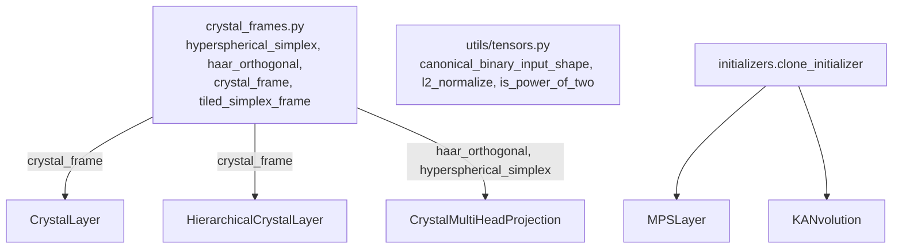

# structured_linear

Path: `src/dl_techniques/layers/structured_linear/`
Purpose: Keras 3 layers that replace a dense weight matrix with another parameterization (quantized, tensor-train, orthogonal, random-feature, spline, distance-scored, spherical-code), plus the shared crystal-frame geometry.

## Scope

In scope: eleven `keras.layers.Layer` subclasses and `crystal_frames.py` (pure NumPy). Each layer lives in its own module and registers under `dl_techniques.layers.structured_linear.<module>` via `register_dl_technique`.

Out of scope: no factory, no registry dict, no model code. `__init__.py` is empty (zero bytes), so there is no package-level import; always import from the defining module. No `MIGRATION.md` exists in this directory (older docs and a test docstring mention one).

## Architecture



Layers are otherwise independent. Common construction pattern:

1. `__init__` validates arguments (raises `ValueError`), resolves initializers/regularizers, creates sub-layers (never in `build`).
2. `build(input_shape)` requires a static last dimension and creates weights.
3. `call` is graph-safe (`keras.ops` only; NumPy only inside initializers or `reassign`).
4. `get_config` serializes every constructor argument; `from_config` deserializes nested initializer/regularizer/constraint dicts, then `cls(**config)`.

## Key files

| File | Role | Notes |
| --- | --- | --- |
| `bitlinear_layer.py` | `BitLinear` | Weights `kernel`, optional `bias`; optional `input_norm` LayerNormalization sub-layer. |
| `mps_layer.py` | `MPSLayer` | Weights `mps_cores (input_dim, bond_dim, bond_dim)`, `projection (bond_dim, output_dim)`, `bias`. |
| `orthoblock.py` | `OrthoBlock` | Sub-layers `ortho_dense` (Dense), `zero_centered_rms_norm`, `constrained_scale` (LayerScale). |
| `orthogonal_butterfly.py` | `OrthogonalButterfly`, `_butterfly_apply` | Weight `angles (num_blocks, log2(d), d/2)`, optional `bias (d,)`. |
| `random_fourier_features.py` | `RFFKernelLayer` | Frozen `omega (input_dim, n_features)`, `b (n_features,)`; sub-layer `output_projection` Dense. |
| `kanvolution.py` | `KANvolution` | Weights `control_points`, `w_spline`, `w_silu`, `bias`, frozen `grid`. |
| `harmonic_dense.py` | `HarmonicDense` | Weight `kernel (dim, units)`. |
| `hierarchical_harmonic.py` | `HierarchicalHarmonicHead` | Weights `nodes_l{k}`, `members`, frozen `slot_of_class`, `class_of_slot`. Helpers `_balanced_branching`, `_greedy_capacity_assignment`. |
| `crystal_frames.py` | geometry | `__all__` = `crystal_frame`, `haar_orthogonal`, `hyperspherical_simplex`, `tiled_simplex_frame`. |
| `crystal_layer.py` | `CrystalLayer` | Weight `crystal_vertices (input_dim, num_classes)`. |
| `hierarchical_crystal_layer.py` | `HierarchicalCrystalLayer` | Weights `macro_centroids`, `micro_leaves`. Module helpers `_split_leading_dims`, `_merge_trailing_pair`. |
| `crystal_multihead_projection.py` | `CrystalMultiHeadProjection` | Weight `crystal_prisms (H, D_h, D_h+1)`; sub-layer `out_projection` Dense. |

## Public interface

Constructor signatures (defaults as in code). All accept `**kwargs` for `keras.layers.Layer`.

```python
BitLinear(units, weight_bits=1.58, activation_bits=8, weight_scale_method="abs_mean",
          activation_scale_method="abs_max", weight_per_channel=False,
          quantization_method="round_clip", activation=None, use_bias=False,
          use_input_norm=False, ste_lambda=1.0, ste_clip_gradient=True, epsilon=1e-5,
          norm_epsilon=1e-6, seed=None, kernel_initializer="glorot_uniform",
          bias_initializer="zeros", kernel_regularizer=None, bias_regularizer=None,
          kernel_constraint=None)

MPSLayer(output_dim, bond_dim=16, use_bias=True, kernel_initializer="glorot_uniform",
         kernel_regularizer=None, bias_initializer="zeros", bias_regularizer=None,
         activity_regularizer=None, seed=None)

OrthoBlock(units, activation=None, use_bias=False, ortho_reg_factor=0.01,
           ortho_l1_factor=0.0, ortho_l2_factor=0.0, kernel_initializer=None,
           bias_initializer="zeros", bias_regularizer=None, scale_initial_value=0.8,
           binary_preference_factor=1e-4, seed=None)

OrthogonalButterfly(num_blocks=1, use_bias=False, angle_initializer="zeros",
                    angle_regularizer=None, bias_initializer="zeros",
                    bias_regularizer=None, seed=None)
    .call(inputs, training=None, inverse=False)
    .inverse(inputs)                 # call(inputs, inverse=True)
    .log_det_jacobian(inputs)        # zeros, shape inputs.shape[:-1]

RFFKernelLayer(input_dim, output_dim=None, n_features=1000, gamma=1.0, use_bias=True,
               activation=None, kernel_initializer="glorot_uniform",
               bias_initializer="zeros", kernel_regularizer=None, bias_regularizer=None,
               kernel_constraint=None, bias_constraint=None, seed=None)

KANvolution(filters, kernel_size, grid_size=16, strides=(1, 1), padding="same",
            dilation_rate=(1, 1), activation=None, use_bias=True,
            kernel_initializer="glorot_uniform", bias_initializer="zeros",
            kernel_regularizer=None, bias_regularizer=None, activity_regularizer=None,
            seed=None)

HarmonicDense(units, n=None, output_mode="probs", epsilon=1e-8,
              kernel_initializer="glorot_uniform", kernel_regularizer=None, seed=None)

HierarchicalHarmonicHead(num_classes, branching=None, n=None, output_mode="probs",
                         epsilon=1e-8, kernel_initializer="glorot_uniform",
                         kernel_regularizer=None, node_initializer="glorot_uniform",
                         node_regularizer=None, seed=None)
    .set_n_per_level(values)
    .cluster_probs(inputs)           # level-1 distribution (..., K1)
    .beam_call(inputs, top_k=2)      # -> (probs, class_ids), shapes (..., k*S1)
    .reassign(representatives=None)  # -> {"moved": int}; eager NumPy
    .num_levels                      # property == depth

CrystalLayer(num_classes, scale=10.0, trainable_crystal=False, candidate_trials=5,
             seed=None, eps=1e-7)

HierarchicalCrystalLayer(num_macro_classes, num_micro_per_macro, cluster_spread=0.25,
                         scale=10.0, return_hierarchy=False, trainable_crystal=False,
                         seed=None, eps=1e-7)

CrystalMultiHeadProjection(num_heads, output_dim=None, scale=5.0, trainable_crystal=False,
                           seed=None, eps=1e-7, kernel_initializer="glorot_uniform",
                           use_bias=True)
```

`crystal_frames.py`:

```python
hyperspherical_simplex(dimensions: int) -> np.ndarray          # (N+1, N) float64, pairwise inner product -1/N
haar_orthogonal(dimensions: int, rng: np.random.Generator) -> np.ndarray   # (N, N)
crystal_frame(dimensions, width, candidate_trials=5, seed=None) -> np.ndarray  # (N, width) float32, unit columns
tiled_simplex_frame(dimensions, width) -> np.ndarray           # (N, width) float32, degenerate, no layer uses it
```

`crystal_frame` raises `ValueError` for `dimensions < 1`, `width < 1`, `candidate_trials < 1`. `seed` accepts anything `np.random.default_rng` accepts, including a `SeedSequence`.

Return types: every layer returns one tensor with last axis replaced, except `HierarchicalCrystalLayer(return_hierarchy=True)`, which returns a dict with keys `macro_logits`, `micro_logits`, `joint_probabilities` (and `compute_output_shape` returns a matching dict). `HierarchicalHarmonicHead.beam_call` returns a tuple, not a dense vector.

## Data shapes

| Layer | Input | Output |
| --- | --- | --- |
| `BitLinear` | `(..., D)` | `(..., units)` |
| `MPSLayer` | `(..., input_dim)`, rank >= 2 | `(..., output_dim)` |
| `OrthoBlock` | `(..., D)` | `(..., units)` |
| `OrthogonalButterfly` | `(..., d)`, d a power of two | same shape |
| `RFFKernelLayer` | `(..., input_dim)` | `(..., output_dim)` |
| `KANvolution` | `(B, H, W, C)` only | `(B, H', W', filters)` |
| `HarmonicDense` | `(..., dim)` | `(..., units)` |
| `HierarchicalHarmonicHead` | `(..., dim)` | `(..., num_classes)` |
| `CrystalLayer` | `(..., input_dim)` | `(..., num_classes)` |
| `HierarchicalCrystalLayer` | `(..., input_dim)` | `(..., num_macro * num_micro)` or dict |
| `CrystalMultiHeadProjection` | `(..., D)`, `D % num_heads == 0` | `(..., output_dim or D)` |

Hierarchical head tree: `total_leaves = prod(branching)`; default `branching` is `(ceil(sqrt(N)), ceil(N / ceil(sqrt(N))))`. `slot_of_class` and `class_of_slot` are float32 non-trainable weights holding integers (integer variables are pinned to CPU by TensorFlow, which breaks GPU/XLA graphs); every use casts to int32. `class_of_slot` is `-1` for padded slots. Padding is a suffix of the slot range.

`BitLinear` bits mapping (`_parse_bits`): tuple/list is an explicit `(min, max)` range (needs `min < max`); `1` is binary via `sign` with ties to +1; any other value `< 3` (so 1.58 and 2) is ternary; otherwise `int(bits)` gives range `+-(2^(n-1) - 1)`. `bool` and non-positive values raise `ValueError`.

`KANvolution` weight shapes: `control_points (filters, C, kh, kw, grid_size + 1)`, `w_spline` and `w_silu` `(filters, C, kh, kw)`, `grid (grid_size + 1,)` non-trainable (`np.linspace(-1, 1, ...)` via an initializer).

Mode strings: `output_mode` in `"probs" | "logits" | "distances"` (both harmonic heads). `quantization_method` in `"round_clip" | "stochastic"`. Scale methods in `"abs_max" | "abs_mean" | "abs_median"`.

## Invariants and constraints

- Never create frames, grids or projections by `add_weight(...)` then `.assign(...)` in `build`. A parent's symbolic build runs in a `StatelessScope` that discards such assignments and leaves zeros. Compute the value inside the weight initializer. Crystal layers (`_frame_initializer`, `_prism_initializer`, `_macro_initializer`, `_micro_initializer`), `KANvolution.grid` and `RFFKernelLayer.omega`/`b` follow this. `HierarchicalHarmonicHead.slot_of_class` and `class_of_slot` follow this too (identity and `-1`-padded tables from initializers); `TestAssignmentTablesSurviveAParentBuild` builds the head through a parent. `reassign()` still assigns, which is fine because it runs eagerly outside `build`.
- Independent initializer clones: `MPSLayer` (`mps_cores`, `projection`) and `KANvolution` (`control_points`, `w_spline`, `w_silu`) pass `clone_initializer(self.kernel_initializer)` per site. Do not revert to the bare attribute: one seedless Keras 3 initializer replays the same random sample at every site. Exemptions that stay tied by design: a caller-supplied seeded instance, deterministic initializers, and custom initializers whose config round trip fails (deepcopy fallback). Bias sites are not cloned.
- `HierarchicalHarmonicHead` hands the same `seed` to both `kernel_initializer` and `node_initializer` when each is a string, and does not clone them.
- `BitLinear`: `gamma` statistics are under `stop_gradient` and never reduce over the batch axis (activation: feature axis; weight: axis 0 if `weight_per_channel`, else whole tensor). Stochastic rounding applies only when `quantization_method="stochastic"` and `training` is true, with a `keras.random.SeedGenerator(seed)` created in `__init__`. `supports_masking = True`. Do not move `norm_epsilon` into `epsilon`; they guard different denominators.
- `BitLinear.use_bias` defaults to `False`; changing the default silently changes parameter counts and breaks weight-file loading.
- `OrthoBlock`: order is Dense -> `ZeroCenteredRMSNorm(use_scale=False)` -> gate -> activation. The gate is `LayerScale(multiplier_type="CHANNEL")` with `Constant(scale_initial_value)`, `ValueRangeConstraint(0, 1)`, and `BinaryPreferenceRegularizer` only when `binary_preference_factor > 0`. Every coefficient of `SoftOrthonormalConstraintRegularizer` is passed explicitly with `use_matrix_scaling=True`. `kernel_initializer=None` builds a fresh `OrthogonalHypersphereInitializer` per layer. The ReLU-family warning keys on `activation.__name__` in `{"relu", "relu6"}`.
- `OrthogonalButterfly`: forward with bias is `W x + b`; inverse is `W^T (y - b)` (bias subtracted first). Angles are cast to the input dtype; do not cast to float32 internally. `d == 1` gives zero levels, no `angles` weight, identity map. Inverse reverses block and stage order and flips the sign of the sine terms.
- `RFFKernelLayer`: `omega`/`b` are drawn with `np.random.default_rng(self.seed)` (not `keras.random`, which ignores `set_random_seed` for `seed=None`), stored as float32 non-trainable weights, and cast to the input dtype in `call`. `input_dim` is fixed at construction.
- `KANvolution`: `call` must not be simplified to `conv(x, w_spline + w_silu)`; the spline basis is the point. Weight reshapes assume the `(kh, kw, channels)` tap order of `keras.ops.image.extract_patches`, hence the `(0, 2, 3, 1)` transposes. The basis is normalized by its sum (`+ 1e-8`).
- `HarmonicDense` / `HierarchicalHarmonicHead`: squared distances use the expanded form `||x||^2 - 2xW + ||w||^2` floored at `epsilon`. `n=None` resolves to `sqrt(dim)` at build into `effective_n` (list per level in the hierarchical head). `get_config` writes the constructor `n`, not `effective_n`. `set_n_per_level` before build is overwritten by `build`.
- Hierarchical head padding: empty nodes are known statically from `(num_classes, branching)`. Fully empty sibling groups are evaluated on zeros then overwritten with `-inf` so `log_softmax` gradients stay finite. Keep that pattern in `_level_logprob` and `beam_call`.
- `reassign` is deterministic (stable sorts, ties by index), keeps per-node capacity exact, and permutes `members` columns with the classes. It must not run inside a traced function.
- Crystal layers: the packing metric is `max <v, w>` on the signed inner product, so antipodal pairs are unpenalized. Switching to `max |.|` moves every frame wider than `dimensions + 1` and invalidates existing seeded frames; it is a recorded, deferred option.
- `crystal_frame` first `dimensions + 1` columns are one rotated simplex (equiangular at `-1/dimensions`); later simplexes are placed by best-of-`candidate_trials` Haar rotations; `candidate_trials < 2` skips the search. The last simplex is sliced to fit `width`.
- `HierarchicalCrystalLayer`: macro frame uses `SeedSequence.spawn(num_macro + 1)` child 0, leaf bundle `g` uses child `g + 1`. The root and the spawn result are cached on the instance (`_child_seed_cache`) because `spawn` is stateful and `SeedSequence(None)` draws fresh entropy per construction. `_micro_initializer` deliberately re-derives the centroids instead of reading `macro_weights`. Leaf bundle norm is floored at `1e-12`. `candidate_trials` is not a constructor argument here (macro and bundle frames use the `crystal_frame` default).
- Shape helpers in the hierarchical layer and `CrystalMultiHeadProjection` build reshape targets by tuple concatenation (`ops.shape(x)[:-2] + (n,)`), not `ops.concatenate`/`ops.stack`, because traced shape elements are not Python ints. Slice the shape of the tensor being reshaped (`features`), not of `inputs`.
- `CrystalMultiHeadProjection`: `out_projection` is created in `__init__` with explicit name; its `units` is patched in `build` when `output_dim is None` (placeholder `1` until then). The GELU is `gelu_tanh` from `layers/activations/gelu_tanh.py`. Prism normalization is along axis 1 (`D_h`).
- `trainable_crystal=False` is the default for all three crystal layers; with `True`, `call` still re-normalizes weights, so logits remain cosines.
- Cosine normalization goes through `l2_normalize` from `utils/tensors.py` (keras 3.8 `ops` has none; it rescales before squaring).

## Dependencies

Internal:
- `dl_techniques.utils.keras_registration.register_dl_technique` (all layers).
- `dl_techniques.utils.tensors`: `canonical_binary_input_shape` (all 11 layers), `is_power_of_two` (butterfly), `l2_normalize` (three crystal layers).
- `dl_techniques.utils.logger.logger` (`OrthogonalButterfly`, `KANvolution`, `OrthoBlock`).
- `dl_techniques.initializers.clone_initializer` (`MPSLayer`, `KANvolution`).
- `dl_techniques.layers.activations.common`: `resolve_activation`, `serialize_activation` (`BitLinear`, `KANvolution`, `OrthoBlock`, `RFFKernelLayer`); `layers.activations.gelu_tanh.gelu_tanh` (`CrystalMultiHeadProjection`).
- `OrthoBlock` also uses `layers.regularization.layer_scale.LayerScale`, `layers.norms.zero_centered_rms_norm.ZeroCenteredRMSNorm`, `constraints.value_range_constraint.ValueRangeConstraint`, `regularizers.binary_preference.BinaryPreferenceRegularizer`, `regularizers.soft_orthogonal.SoftOrthonormalConstraintRegularizer`, `initializers.hypersphere_orthogonal_initializer.OrthogonalHypersphereInitializer`.

External: `keras` (Keras 3, `keras.ops` only for tensor math), `numpy` (initializers, tree tables, `reassign`), stdlib `math`.

Known consumers outside the package: `layers/ffn/orthoglu_ffn.py` (`OrthoBlock`), `callbacks/anneal_harmonic_exponent.py` (calls `set_n_per_level` on any layer exposing it), `callbacks/periodic_reassign.py` (calls `reassign(class_means)`), `train/head_comparison/train_heads.py` (`HarmonicDense`, `HierarchicalHarmonicHead`), `initializers/clone.py` (docstring references `MPSLayer`, `KANvolution`).

## Failure modes

- Undefined last dimension: `build` raises `ValueError` (all layers).
- `OrthogonalButterfly`: non-power-of-two `d` raises `ValueError`; `num_blocks` not a positive `int` raises.
- `MPSLayer`: rank < 2 input at build raises; `call` raises if `inputs.shape[-1]` differs from the built width.
- `CrystalLayer`, `HierarchicalCrystalLayer`, `CrystalMultiHeadProjection`: `call` raises on width mismatch; `CrystalMultiHeadProjection.build` raises if `D % num_heads != 0`.
- `RFFKernelLayer.build` raises if the last dim differs from `input_dim`.
- `KANvolution`: constructor raises for `filters <= 0`, `grid_size <= 1`, invalid `padding`, non-positive kernel/stride/dilation entries, and `strides > 1` with `dilation_rate > 1` (TensorFlow refuses that combination at call time). `build` and `compute_output_shape` raise for non-4D shapes.
- `HierarchicalHarmonicHead`: constructor raises if `branching` product is below `num_classes`, per-level `n` length differs from depth, or `epsilon <= 0`; `reassign` raises on a `representatives` shape other than `(num_classes, dim)`; `set_n_per_level` raises on wrong length or non-positive values.
- `HierarchicalHarmonicHead(output_mode="logits")` output is already normalized; passing it to a `from_logits=True` loss normalizes twice (silent, no error).
- `HierarchicalHarmonicHead.beam_call` is approximate beyond depth 2 and uses static `inputs.shape[:-1]`; use the exact `call` for training. Exact forward is slower than a flat head at 10,000 classes.
- `OrthoBlock` with `relu`/`relu6` logs a warning; a gate that reaches 0 never reopens.
- Crystal degeneracies (documented, pinned by tests, not errors): width past `dimensions + 1` degrades separation; `input_dim=1` forces repeated columns; `HierarchicalCrystalLayer(cluster_spread=0)` collapses leaves onto centroids; `cluster_spread=1` can yield an all-zero leaf column; `seed` does nothing to the macro frame when `num_macro_classes <= input_dim + 1`.
- Build cost of `crystal_frame` grows with `dimensions` and `width` (measured on CPU: about 187 ms at `dimensions=256, width=1024`, about 3.3 s at `dimensions=1024, width=4096`, default `candidate_trials`).

## Working here

- Follow the existing layer shape: sub-layers in `__init__`, weights in `build`, `get_config` listing every constructor argument, explicit `from_config` that deserializes initializer/regularizer/constraint dicts (and tuple-typed values such as `branching` and `n` in the hierarchical head).
- Register with `@register_dl_technique("dl_techniques.layers.structured_linear.<module_name>")`. Registering a second class with the same bare name anywhere in the repo collides in the serialization registry.
- Route `build` and `compute_output_shape` through `canonical_binary_input_shape` so a list-wrapped single shape (for example `[[None, 8]]`) does not corrupt the batch axis. All eleven layers do, `KANvolution` included.
- Docstrings are Sphinx/reST (`:param:`, `:type:`, `:raises:`); match the file you edit. Use `import keras` and `keras.ops.*`; never `from keras import ops`. Log through `dl_techniques.utils.logger`, no `print`.
- When adding a layer with several kernel-fed weights, give each its own `clone_initializer(...)`.
- Adding a new `seed` option: decide and document what it covers. Today it differs by layer (see Invariants); do not assume it seeds every random site.
- Tests: `tests/test_layers/test_structured_linear/`, one `test_<module>.py` per layer plus single-claim guards (`test_the_seven_layers_take_a_list_wrapped_shape.py`, `test_the_mps_layer_is_rank_generic.py`, `test_the_kanvolution_guard_and_activation.py`, `test_the_rff_projection_is_reproducible_and_dtype_honest.py`, `test_the_crystal_frame_antipodal_characterisation.py`, `test_the_mutation_suite_found_no_new_holes.py`). `mutation_audit.py` there is a harness without a `test_` prefix, run directly with `python tests/test_layers/test_structured_linear/mutation_audit.py`.
- Run only the module you touched, for example `.venv/bin/python -m pytest tests/test_layers/test_structured_linear/test_hierarchical_harmonic.py`. `OrthoBlock` changes also need `tests/test_layers/test_ffn/` for `OrthoGLUFFN`. Callback-facing changes (`set_n_per_level`, `reassign`) need `tests/test_callbacks/test_harmonic_exponent_annealing.py`. Do not run the full suite. Do not run pytest jobs in parallel.
- Changing frame construction (`crystal_frame`, simplex, packing metric) changes seeded frames and must be paired with updates to the frame and mutation-audit tests.
