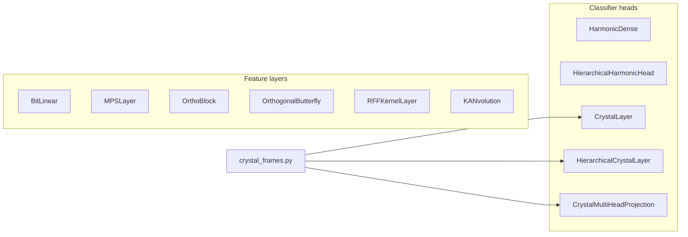

# structured_linear

Keras 3 layers that replace a plain dense weight matrix with another parameterization: quantized, tensor-train, orthogonal, random-feature, spline-based, distance-scored, or spherical-code. Part of `dl_techniques.layers` (`src/dl_techniques/layers/structured_linear/`).

## What it is for

A dense layer computes `y = x @ W + b` with a full `W`. That is the default, but it is not always the right shape of computation. Sometimes you want fewer parameters (tensor train), a weight that is exactly orthogonal (butterfly), weights stored in about 1.6 bits (BitLinear), a kernel machine with a fixed random feature map (RFF), a convolution whose taps are learnable curves (KANvolution), or a classifier head that scores by distance to prototypes or by cosine to a fixed geometric frame (harmonic and crystal heads).

This package holds eleven such layers and one helper module of geometry code. They are independent of each other, apart from the crystal family sharing `crystal_frames.py`. There is no factory and `__init__.py` is empty, so each layer is imported from its own module.

## How it works

Each layer is a `keras.layers.Layer` registered with `register_dl_technique("dl_techniques.layers.structured_linear.<module>")`. Weights are created in `build()` from the last input dimension, which must be static.



Short description of each layer:

- `BitLinear`: `y = matmul(round(x / gamma_x), round(W / gamma_w)) * gamma_x * gamma_w`, with a straight-through estimator through the round. Weights default to ternary `{-1, 0, 1}` (`weight_bits=1.58`); `weight_bits=1` is a separate binary `{-1, +1}` path; activations default to 8 bits. `gamma_x` is computed per token (feature axis) and never over the batch axis, so the output for one sample does not depend on batch size.
- `MPSLayer`: one `(bond_dim, bond_dim)` core per input feature. A boundary vector of ones is multiplied through the cores left to right, scaled by each input value, then projected to `output_dim`. Parameters grow as `input_dim * bond_dim^2`.
- `OrthoBlock`: `Dense` with a soft orthonormality penalty on the kernel, then `ZeroCenteredRMSNorm`, then a learnable per-feature gate in `[0, 1]`, then the activation (last).
- `OrthogonalButterfly`: `log2(d)` stages of `d/2` disjoint 2x2 rotations (FFT butterfly pattern). Exactly orthogonal for any angles, exactly invertible, log-det-Jacobian exactly zero. `d` must be a power of two.
- `RFFKernelLayer`: `phi(x) = sqrt(2/D) * cos(x @ omega + b)` with frozen random `omega` and `b`, followed by a trainable `Dense`.
- `KANvolution`: a 2D convolution where each kernel tap applies `w_spline * B(x) + w_silu * SiLU(x)`, with `B` a linear B-spline over a fixed grid on `[-1, 1]` and `x` squashed by `tanh`.
- `HarmonicDense`: scores each class by Euclidean distance to a learned prototype, `logit_i = -n * log ||x - w_i||`. No bias.
- `HierarchicalHarmonicHead`: the same scoring factored over a fixed balanced tree with a learned class-to-leaf assignment, for large vocabularies.
- `CrystalLayer`: cosine logits against a frame of unit vectors packed from rotated simplexes.
- `HierarchicalCrystalLayer`: two-tier version (macro centroids, leaf bundles around each).
- `CrystalMultiHeadProjection`: splits features into heads, reads each head through its own rotated simplex, then projects back with a `Dense`.

## Files

- `bitlinear_layer.py` - `BitLinear`, quantization-aware dense layer.
- `mps_layer.py` - `MPSLayer`, matrix-product-state (tensor-train) chain.
- `orthoblock.py` - `OrthoBlock`, orthonormally regularized, normalized, gated dense block.
- `orthogonal_butterfly.py` - `OrthogonalButterfly` and the module-level `_butterfly_apply` rotation routine.
- `random_fourier_features.py` - `RFFKernelLayer`, random Fourier feature map plus trainable projection.
- `kanvolution.py` - `KANvolution`, convolution with per-tap learnable spline activation.
- `harmonic_dense.py` - `HarmonicDense`, distance-scored classifier head.
- `hierarchical_harmonic.py` - `HierarchicalHarmonicHead`, tree-factored harmonic head, plus `_balanced_branching` and `_greedy_capacity_assignment` helpers.
- `crystal_frames.py` - pure NumPy geometry: `hyperspherical_simplex`, `haar_orthogonal`, `crystal_frame`, `tiled_simplex_frame`.
- `crystal_layer.py` - `CrystalLayer`, cosine logits against a packed frame.
- `hierarchical_crystal_layer.py` - `HierarchicalCrystalLayer`, macro/micro two-tier crystal classifier.
- `crystal_multihead_projection.py` - `CrystalMultiHeadProjection`, per-head simplex prisms plus output projection.
- `__init__.py` - empty on purpose.

## How to use it

Import each layer from its defining module.

```python
import keras
from dl_techniques.layers.structured_linear.bitlinear_layer import BitLinear
from dl_techniques.layers.structured_linear.harmonic_dense import HarmonicDense
from dl_techniques.layers.structured_linear.crystal_layer import CrystalLayer

inputs = keras.Input(shape=(64,))
x = BitLinear(units=128, activation="gelu", use_bias=True)(inputs)
logits = CrystalLayer(num_classes=10, scale=10.0, seed=0)(x)
model = keras.Model(inputs, logits)
```

Distance-scored head with probabilities, then a hierarchical head for many classes:

```python
from dl_techniques.layers.structured_linear.hierarchical_harmonic import HierarchicalHarmonicHead

head = HierarchicalHarmonicHead(num_classes=10000, branching=(100, 100), output_mode="probs")
# between epochs, outside the graph:
head.reassign()          # re-estimates class-to-slot assignment, returns {"moved": int}
```

Exactly invertible rotation:

```python
from dl_techniques.layers.structured_linear.orthogonal_butterfly import OrthogonalButterfly

layer = OrthogonalButterfly(num_blocks=2, angle_initializer="glorot_uniform")
y = layer(x)             # x has a power-of-two last dimension
x_back = layer.inverse(y)
```

Tests: `tests/test_layers/test_structured_linear/` (for example `python -m pytest tests/test_layers/test_structured_linear/test_bitlinear_layer.py`).

## Things to know

- `use_bias` defaults differ. `False`: `BitLinear`, `OrthoBlock`, `OrthogonalButterfly`. `True`: `MPSLayer`, `RFFKernelLayer`, `KANvolution`, and the output projection of `CrystalMultiHeadProjection`. `HarmonicDense`, `HierarchicalHarmonicHead`, `CrystalLayer` and `HierarchicalCrystalLayer` have no bias at all.
- `BitLinear(units=...)` has no bias unless you pass `use_bias=True`. This differs from `keras.layers.Dense`.
- `seed` means different things per layer. For `BitLinear` it only seeds stochastic rounding. For `RFFKernelLayer` it seeds only the frozen `omega` and `b`, not the output `Dense`. For the crystal layers it seeds only the geometric frames. For `OrthogonalButterfly` it only changes a string initializer that accepts a seed, so with the default `"zeros"` it has no effect. For `KANvolution`, `MPSLayer`, `HarmonicDense`, `HierarchicalHarmonicHead` and `OrthoBlock` it seeds the kernel initializer when that is given as a string (`OrthoBlock` also seeds its default `OrthogonalHypersphereInitializer`).
- `MPSLayer` and `KANvolution` give each kernel-fed weight its own clone of `kernel_initializer`. A single seedless initializer instance would replay the same random numbers at every site and tie the weights together.
- `MPSLayer.call` loops over `input_dim` in Python, so the traced graph grows with the input width.
- `KANvolution` needs 4D channels-last input. Its basis tensor is `(batch, out_h, out_w, kh*kw*channels, grid_size + 1)`, so memory grows with `grid_size`. Using `strides > 1` together with `dilation_rate > 1` raises `ValueError` at construction.
- `OrthogonalButterfly` raises `ValueError` if the last dimension is not a power of two. It does not pad.
- `OrthoBlock` with a `relu` or `relu6` activation can permanently close a gate, because the derivative at zero is zero. The constructor logs a warning in that case. `scale_initial_value` defaults to 0.8, not 0.5.
- `HierarchicalHarmonicHead` with `output_mode="logits"` returns normalized log-probabilities. Do not feed them to a `from_logits=True` loss. `reassign()` runs eagerly in NumPy and must be called between epochs or from a callback, never inside the graph. Its exact forward is not faster than a flat head at 10,000 classes; the benefit is the learned taxonomy and the `beam_call` retrieval path.
- Crystal frames: a frame wider than `input_dim + 1` is a packed spherical code. All columns are distinct (except at `input_dim=1`), but minimum angular separation shrinks with width, and antipodal pairs (`cos` near -1) are not penalized by the packing search. Measured: `dimensions=2, width=64, seed=0` holds a pair at `cos = -1.0000`.
- `HierarchicalCrystalLayer(cluster_spread=0)` is legal but makes every leaf in a group identical to its centroid, so within-group logits are equal. `cluster_spread=1` can produce an all-zero leaf column. Use a strictly positive spread other than 1 if leaves must discriminate.
- `CrystalLayer` and `CrystalMultiHeadProjection` raise `ValueError` in `call` if the input width differs from the width they were built with.
- Crystal frames are computed inside weight initializers, not assigned after `add_weight`, because a `StatelessScope` build discards out-of-initializer assignments. `KANvolution`'s `grid` and `RFFKernelLayer`'s `omega`/`b` use the same pattern.
- All eleven layers read their input shape through `dl_techniques.utils.tensors.canonical_binary_input_shape`, which tolerates a list-wrapped single shape such as `[[None, 8]]`. `KANvolution` still requires the shape to have four elements.
- References: Wang et al. 2024 (BitNet); Stoudenmire and Schwab 2016, Novikov et al. 2015 (tensor trains); Rahimi and Recht 2007 (random features); Liu et al. 2024 and Bodner et al. 2024 (KAN, convolutional KAN); Baek et al. 2025 (harmonic loss); Papyan, Han and Donoho 2020 (neural collapse); Strohmer and Heath 2003 (Grassmannian frames).
