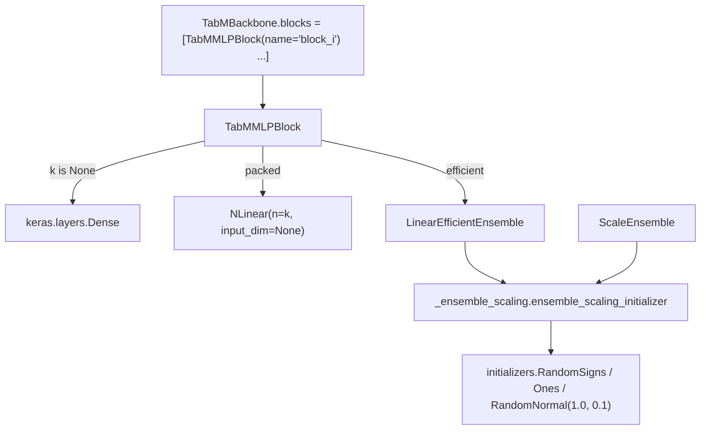

# tabular

Path: `src/dl_techniques/layers/tabular/`
Purpose: Keras 3 building blocks for a TabM batched-ensemble MLP (k ensemble members for roughly the parameter cost of one).

## Scope

In: the five registered layers `ScaleEnsemble`, `LinearEfficientEnsemble`, `NLinear`, `TabMMLPBlock`, `TabMBackbone`, plus the private helper `_ensemble_scaling.py`. One class per module.

Not here:
- The `'random-signs'` initializer: `RandomSigns` is in `src/dl_techniques/initializers/random_signs.py`. `clone_initializer` is in `initializers/clone.py`.
- The TabM model, factories and trainer: `src/dl_techniques/models/tabular/tabm/model.py` (imports `NLinear`, `ScaleEnsemble`, `TabMBackbone` from here).
- A `factory.py`: none exists in this package.
- `__init__.py` is empty (zero bytes). The package exports nothing; always import from the leaf module.

## Architecture

Ensemble tensors are `(batch, k, features)`. Plain mode (`k=None`) is `(batch, features)`.



Effective per-member weight in `LinearEfficientEnsemble` is `diag(r_i) @ W @ diag(s_i)`; `W` is shared `(input_dim, units)`, `r` is `(k, input_dim)`, `s` is `(k, units)`.

All sub-layers are created in `__init__` (dims are config-known), not in `build()`, so weights restore across serialization. `TabMMLPBlock.build` and `TabMBackbone.build` build their children explicitly in order, threading `compute_output_shape` forward.

## Key files

| File | Role | Notes |
| --- | --- | --- |
| `_ensemble_scaling.py` | `EnsembleInitDistribution = Literal['ones','normal','random-signs']`, `ensemble_scaling_initializer()` | `__all__` lists both names. Annotation is used by 4 layers; resolver is called by 2 (`ScaleEnsemble`, `LinearEfficientEnsemble`), once each in `__init__`. Not registered with Keras. |
| `scale_ensemble.py` | `ScaleEnsemble`, weight `(k, input_dim)` named `ensemble_weight` | Elementwise multiply. Default `init_distribution='normal'`. |
| `linear_efficient_ensemble.py` | `LinearEfficientEnsemble` | Weights: `kernel`, optional `input_scaling` (`self.r`), `output_scaling` (`self.s`), `bias` `(k, units)`. |
| `nlinear.py` | `NLinear` | Kernels `(n, input_dim, output_dim)`, biases `(n, output_dim)`; `einsum('bni,nio->bno')`. `input_dim` may be `None` and is filled at build. |
| `tabm_mlp_block.py` | `TabMMLPBlock` | Sub-layer attribute `linear`, plus `dropout`. `activation` (serializable) vs `activation_fn` (live callable). |
| `tabm_backbone.py` | `TabMBackbone` | `blocks` list; passes ensemble knobs straight to each block. |

## Public interface

Registration keys (all via `register_dl_technique`): `dl_techniques.layers.tabular.<module>` for `scale_ensemble`, `linear_efficient_ensemble`, `nlinear`, `tabm_mlp_block`, `tabm_backbone`.

```python
ensemble_scaling_initializer(init_distribution: EnsembleInitDistribution) -> keras.initializers.Initializer
# 'ones' -> Ones(); 'normal' -> RandomNormal(mean=1.0, stddev=0.1); 'random-signs' -> RandomSigns(); else ValueError

ScaleEnsemble(k: int, input_dim: int, init_distribution='normal', kernel_regularizer=None, **kwargs)

LinearEfficientEnsemble(units: int, k: int, use_bias=True, ensemble_scaling_in=True,
    ensemble_scaling_out=True, init_distribution='random-signs',
    kernel_initializer='glorot_uniform', bias_initializer='zeros',
    kernel_regularizer=None, bias_regularizer=None, **kwargs)

NLinear(n: int, input_dim: Optional[int], output_dim: int, use_bias=True,
    kernel_initializer='glorot_uniform', bias_initializer='zeros',
    kernel_regularizer=None, bias_regularizer=None, **kwargs)   # input_dim has no default

TabMMLPBlock(units: int, k: Optional[int]=None, ensemble_type='efficient',
    ensemble_scaling_in=True, ensemble_scaling_out=True, init_distribution='random-signs',
    activation='relu', dropout_rate=0.0, use_bias=True,
    kernel_initializer='glorot_uniform', bias_initializer='zeros',
    kernel_regularizer=None, bias_regularizer=None, **kwargs)

TabMBackbone(hidden_dims: List[int], k: Optional[int]=None, ensemble_type='efficient',
    ensemble_scaling_in=True, ensemble_scaling_out=True, init_distribution='random-signs',
    activation='relu', dropout_rate=0.0, use_bias=True, kernel_initializer=..., bias_initializer=...,
    kernel_regularizer=None, bias_regularizer=None, **kwargs)
```

`call(inputs)` for the first three; `call(inputs, training=None)` for the block and backbone. Each layer has `compute_output_shape` and `get_config`.

## Data shapes

| Layer | Input | Output |
| --- | --- | --- |
| `ScaleEnsemble` | `(B, k, input_dim)` | `(B, k, input_dim)` |
| `LinearEfficientEnsemble` | `(B, k, input_dim)` | `(B, k, units)` |
| `NLinear` | `(B, n, input_dim)` | `(B, n, output_dim)` |
| `TabMMLPBlock`, `k=None` | `(..., D)` | `(..., units)` (all leading axes kept) |
| `TabMMLPBlock`, `k` set | `(B, k, D)` | `(B, k, units)` |
| `TabMBackbone` | as the first block | as the last block, last axis `hidden_dims[-1]` |

Config keys: exactly the constructor arguments listed above. `ScaleEnsemble` and `LinearEfficientEnsemble` serialize only `init_distribution`, never an initializer for the scaling vectors. `NLinear.get_config` emits the resolved `input_dim` after build. `TabMBackbone.get_config` emits the uncloned initializers.

## Invariants and constraints

- Flag/weight lockstep in `LinearEfficientEnsemble`: `r`, `s`, `bias` are created in `build()` only when `ensemble_scaling_in`, `ensemble_scaling_out`, `use_bias` are set, and `call()` reads each behind the same flag. The created weight set is the `.keras` weight layout. Do not make them unconditional; it breaks loading existing archives, and a drifted `call()` raises `AttributeError`.
- Scaling initializers are cloned per `add_weight` site (`clone_initializer(self.scaling_initializer)` for `r` and `s`). A shared seedless instance replays its draw and made `r` and `s` identical when `input_dim == units`.
- `TabMBackbone` clones `kernel_initializer` and `bias_initializer` per block. Without the clone, equal-width blocks get bit-identical kernels. `models/tabular/tabm/model.py` hands one kernel initializer instance to both the backbone and the output layer; that is safe only because the backbone clones per block. A seeded initializer clones to the same seed, so all blocks get identical weights; that is intended. Do not add per-block seed derivation.
- Rank check comes first in `build()` of `ScaleEnsemble`, `LinearEfficientEnsemble`, `NLinear`, before the axis-1 check. Do not reorder; at rank 2 axis 1 is the feature axis and would pass the `k` check by accident. `None` axes are skipped, rank never is.
- `compute_output_shape` of the ensemble layers derives from stored config (`k`, `units`, `input_dim`, `n`, `output_dim`), not by echoing `input_shape`. Only the batch axis is read from the argument. Do not restore the echo.
- `TabMMLPBlock.activation` is the serializable value (often a `str`); `activation_fn` is what `call()` invokes. Do not merge them: `deserialize_activation` returns non-dict values unchanged, so a single attribute would be a string at call time. Do not store `keras.activations.get(...)` into `activation` either, since that loses the factory key in `get_config()`.
- The activation-`Layer` rejection in `TabMMLPBlock.__init__` is hand-rolled on purpose. Its message must contain `'relu'` and `keras.activations.gelu`, and the raising frame must be `tabm_mlp_block.py`; `test_tabm_blocks.py` asserts both. Do not replace it with `deserialize_activation(..., allow_layer=False)`. `TabMBackbone` does not duplicate the guard; it relies on the block's.
- `TabMMLPBlock.dropout` is always created, even at rate 0. `build()` and `call()` skip it when `dropout_rate == 0`.
- `TabMBackbone` owns no shape arithmetic; it threads `block.compute_output_shape`. Keep the formula in `TabMMLPBlock` only.
- `_ensemble_scaling.py`: keep both symbols in this one module; do not copy `Literal` or the resolver into layer files; do not rename to a public `common.py`; do not add a leading underscore to the exported names. It stays unregistered.
- Every class keeps its own `register_dl_technique("dl_techniques.layers.tabular.<module>")`. The class name `TabMMLPBlock` keeps its prefix because the bare `MLPBlock` belongs to `layers/ffn/mlp.py`.

## Dependencies

Internal:
- `dl_techniques.initializers`: `RandomSigns`, `clone_initializer`.
- `dl_techniques.utils.keras_registration.register_dl_technique`.
- `dl_techniques.utils.activation_serialization`: `serialize_activation`, `deserialize_activation` (block and backbone).
- Within the package: `tabm_mlp_block` imports `_ensemble_scaling`, `linear_efficient_ensemble`, `nlinear`; `tabm_backbone` imports `_ensemble_scaling`, `tabm_mlp_block`.

External: `keras` (Keras 3, `keras.ops` only for math, backend agnostic), `typing`.

Downstream: `models/tabular/tabm/model.py`.

## Failure modes

All are `ValueError` unless noted.

- Non-positive `units`, `k`, `n`, `output_dim`, `input_dim` (or `input_dim` for `NLinear` when not `None`), at construction.
- `ensemble_scaling_initializer` with an unknown name. `ScaleEnsemble` and `LinearEfficientEnsemble` therefore raise at construction. `TabMMLPBlock` and `TabMBackbone` do not resolve it themselves; the error surfaces when `LinearEfficientEnsemble` is created, and only in efficient mode with `k` set.
- `build()` on non-rank-3 input, or axis 1 not equal to `k`/`n`. `ScaleEnsemble` also checks the last axis against `input_dim`; `NLinear` checks `input_dim` when given.
- `TabMMLPBlock`: `ensemble_type` not in `('efficient','packed')`; non-default `ensemble_type` with `k=None`; `dropout_rate` outside `[0, 1]`; activation that resolves to a `keras.layers.Layer`.
- `TabMBackbone`: empty `hidden_dims`, non-positive entry, `dropout_rate` outside `[0, 1]`. Other checks (`k`, `ensemble_type`, activation) come from the blocks, so their traceback frame is `tabm_mlp_block.py`.
- Known degenerate `compute_output_shape` under-report: `LinearEfficientEnsemble` and `ScaleEnsemble` with `k == 1` (also `input_dim == 1` for `ScaleEnsemble`) on a built layer queried at a different axis size. Pinned by `TestOutputShapeContract::test_the_degenerate_size_1_axis_is_the_documented_exception`. Exact otherwise.

## Working here

- Follow the repo layer pattern: `__init__`, `build`, `call`, `get_config`, Sphinx/reST docstrings (`:param:`, `:type:`, `:raises:`), `import keras` and qualify (`keras.ops.einsum`), no `from keras import ops`.
- A new ensemble layer goes in its own module with its own registration string. If it takes `init_distribution`, annotate it with `EnsembleInitDistribution` and resolve it with `ensemble_scaling_initializer`. If you add a distribution name, change the `Literal` and the resolver together in `_ensemble_scaling.py`; four layers read the alias.
- Create sub-layers in `__init__`; call child `build()` explicitly from the parent's `build()`.
- New weights that depend on a flag follow the lockstep rule above.
- Any new layer with two same-shaped weights drawn from one initializer needs `clone_initializer` per `add_weight`.
- Tests: `tests/test_layers/test_tabular/test_tabm_blocks.py`. Run only that file, plus tests of the TabM model if you touched anything the model imports (`NLinear`, `ScaleEnsemble`, `TabMBackbone`), e.g. `.venv/bin/python -m pytest tests/test_layers/test_tabular/ -q`. Do not run the full suite.
- No print statements; use `dl_techniques.utils.logger` if logging is ever needed.
