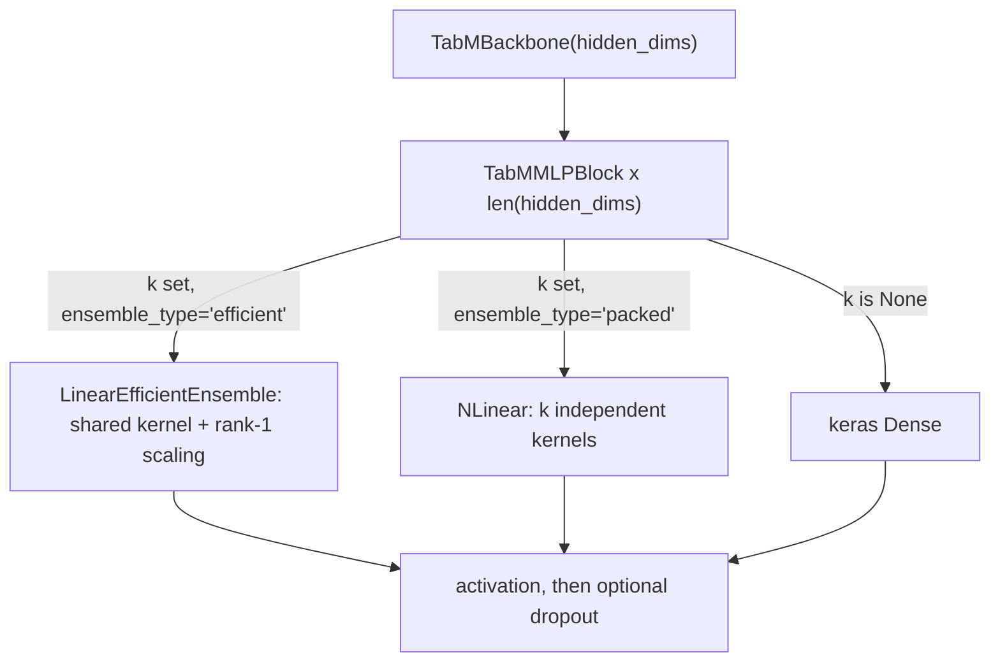

# tabular

Keras 3 layers for building a TabM-style batched-ensemble MLP, used for tabular (spreadsheet-like) data. It lives at `src/dl_techniques/layers/tabular/` in the `dl_techniques` library.

## What it is for

TabM is a way to get an ensemble of `k` small MLPs out of the cost of roughly one. A normal deep ensemble trains `k` separate networks, so it costs `k` times the weights. TabM instead shares most weights and gives each of the `k` members only a thin private perturbation, so the members behave as different models at a fraction of the cost.

This module holds the building blocks for that idea: the per-member scaling layer, two linear layers (one cheap, one fully independent), a single MLP block, and a backbone that stacks blocks. It also supports a plain mode with no ensemble (`k=None`), where each block is an ordinary `Dense`.

Ensemble tensors have shape `(batch, k, features)`: axis 1 indexes the ensemble member.

## How it works

Each ensemble member `i` can see its own effective weight matrix `diag(r_i) @ W @ diag(s_i)`. `W` is one kernel shared by all members. `r` (input scaling) and `s` (output scaling) are small learned vectors, one row per member. This costs `k * (input_dim + units)` extra parameters instead of `k * input_dim * units`.

How `r` and `s` start decides whether the members start as different functions. The `init_distribution` option picks it:

- `'random-signs'`: each entry is -1 or +1 (the paper's choice). Members start different.
- `'normal'`: entries from a normal distribution with mean 1 and standard deviation 0.1. Members start different.
- `'ones'`: all ones. Every member starts with the same weight matrix.



The two ensemble modes trade cost for independence. `'efficient'` is cheap. `'packed'` stores `k` full kernels, which costs about `k` times the parameters and is the honest deep-ensemble baseline.

## Files

- `_ensemble_scaling.py` - private helper. Defines the `EnsembleInitDistribution` type alias (`'ones'`, `'normal'`, `'random-signs'`) and `ensemble_scaling_initializer(name)`, which turns a name into an initializer. Import the layer modules, not this one.
- `scale_ensemble.py` - `ScaleEnsemble`: one learnable per-feature scaling vector per member, applied by elementwise multiply on `(batch, k, input_dim)`.
- `linear_efficient_ensemble.py` - `LinearEfficientEnsemble`: shared kernel plus per-member input scaling `r`, output scaling `s` and bias.
- `nlinear.py` - `NLinear`: `n` fully independent linear layers computed in one `einsum`.
- `tabm_mlp_block.py` - `TabMMLPBlock`: one linear stage (Dense, `LinearEfficientEnsemble` or `NLinear`), then activation, then optional dropout.
- `tabm_backbone.py` - `TabMBackbone`: a list of `TabMMLPBlock`, one per entry of `hidden_dims`.
- `__init__.py` - empty. The package exports nothing; import from the module files.

## How to use it

```python
import keras
from dl_techniques.layers.tabular.tabm_backbone import TabMBackbone

# 8 ensemble members, two hidden layers, shared kernel + rank-1 scaling
backbone = TabMBackbone(hidden_dims=[256, 256], k=8, ensemble_type='efficient')
x = keras.random.normal((32, 8, 20))   # (batch, k, features)
y = backbone(x)                         # (32, 8, 256)

# plain MLP, no ensemble
plain = TabMBackbone(hidden_dims=[256, 256])
y = plain(keras.random.normal((32, 20)))  # (32, 256)
```

Single layers work the same way:

```python
from dl_techniques.layers.tabular.nlinear import NLinear
head = NLinear(n=8, input_dim=None, output_dim=3)   # input_dim inferred at build
out = head(keras.random.normal((32, 8, 256)))        # (32, 8, 3)
```

Tests: `tests/test_layers/test_tabular/test_tabm_blocks.py`. The main consumer is the TabM model in `src/dl_techniques/models/tabular/tabm/model.py`, which imports `NLinear`, `ScaleEnsemble` and `TabMBackbone`.

## Things to know

- The ensemble layers (`ScaleEnsemble`, `LinearEfficientEnsemble`, `NLinear`) need rank-3 input `(batch, k, dim)` and raise `ValueError` in `build()` for any other rank or a mismatched `k`/`n` on axis 1.
- `TabMMLPBlock` with `k=None` and a non-default `ensemble_type` raises `ValueError`, because there is no ensemble to configure.
- `activation` must be a name string (such as `'relu'`) or a stateless callable. An activation `Layer` instance is rejected, because a parameterised one would break saving and would be shared across blocks of different widths.
- In `TabMBackbone`, each block gets its own clone of the kernel and bias initializers, so equal-width blocks draw independent weights. A seeded initializer such as `GlorotUniform(seed=7)` is cloned with the same seed, so every block gets identical weights. For reproducibility use `keras.utils.set_random_seed()` instead.
- `ScaleEnsemble` and `LinearEfficientEnsemble` have no initializer argument for the scaling vectors; `init_distribution` alone decides it.
- `compute_output_shape` of `ScaleEnsemble` and `LinearEfficientEnsemble` can under-report when `k == 1` (or `input_dim == 1` for `ScaleEnsemble`) and a built layer is queried with a different size on that axis. No shipped caller does this.
- Default `init_distribution` is `'normal'` for `ScaleEnsemble` and `'random-signs'` for the other layers.
- `RandomSigns` (the `'random-signs'` initializer) lives in `dl_techniques.initializers`, not here.
