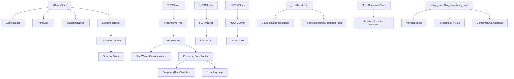

# time_series

Path: `src/dl_techniques/layers/time_series`
Purpose: Keras 3 forecasting and sequence layers (N-BEATS/N-BEATSx, xLSTM, PRISM, DeepAR heads, quantile heads, TCN, lag attention, temporal fusion, naive-benchmark gate, EMA filters) used by `src/dl_techniques/models/time_series/*`.

## Scope

In here: layer classes, one builder function (`create_manokhin_compliant_model`), and nothing else. No training code, no losses, no data handling, no model classes.

Not here: the pinball and likelihood losses that consume the quantile and DeepAR heads, the models that stack these layers (`src/dl_techniques/models/time_series/{adaptive_ema,deepar,nbeats,prism,tirex,xlstm}`), `ConformalQuantileHead` (lives in `layers/statistics/conformal/quantile_head.py` and is imported by `forecasting_layers.py`), `HaarWaveletDecomposition` (`layers/signal_processing/haar_wavelet_decomposition.py`, used by PRISM).

There is no factory. `__init__.py` is curated: 32 names in `__all__`, all classes except the builder `create_manokhin_compliant_model`. Its module docstring says "33 names"; the code has 32 (stale docstring).

## Architecture

All layers follow one pattern: create sub-layers in `__init__`, build them explicitly in `build()`, call them in `call()`, rebuild from `get_config()`. Every public class is decorated `@register_dl_technique("dl_techniques.layers.time_series.<module>")`. The private `_LikelihoodHead` base in `deepar_blocks.py` is deliberately unregistered.



Flows worth knowing:

- N-BEATS: `_forward_dense_stack` (4 Dense, optional RMSNorm, optional Dropout) then `theta_backcast`/`theta_forecast` heads, then `_generate_backcast`/`_generate_forecast` supplied by the subclass. Returns `(backcast, forecast)`.
- PRISM: `PRISMLayer` -> `PRISMTimeTree` loops `tree_depth + 1` levels. Level `i` splits the WHOLE re-stitched sequence into `2**i` overlapping segments, runs one `PRISMNode` per segment, cross-fades the results back to full length. It is a loop, not a recursion over children.
- xLSTM: each Cell does one timestep; each Layer wraps its Cell in `keras.layers.RNN`; each Block adds the paper's residual wrapper (sLSTM post-norm + FFN, Fig. 10; mLSTM up-projection + causal depthwise Conv1D + swish + mLSTM + norm + down-projection, Fig. 11).
- `create_manokhin_compliant_model`: flatten -> `deep_hidden` Dense -> `deep_output` Dense -> reshape gives the deep forecast; `NaiveResidual(inputs, zeros_like(deep))` gives the pure naive baseline; `ForecastabilityGate(inputs, deep, naive)` blends; `ConformalQuantileHead` reads the shared `deep_hidden` output. Two outputs: point `(B, Tf, feat)` and quantiles `(B, Tf, feat, 3)`.

## Key files

| File | Role | Notes |
| --- | --- | --- |
| `nbeats_blocks.py` | `NBeatsBlock` (base), `GenericBlock`, `TrendBlock`, `SeasonalityBlock` | `NUM_DENSE_LAYERS = 4`; `_forward_dense_stack`, `_expand_fixed_basis` are the shared helpers |
| `nbeatsx_blocks.py` | `ExogenousBlock` | overrides `call`; `_generate_*` are stubs returning None |
| `temporal_convolutional_network.py` | `TemporalBlock`, `TemporalConvNet` | dilation `2**i`; residual add lives inside `TemporalBlock`; the file has no module docstring |
| `xlstm_blocks.py` | six xLSTM classes | 1917 lines; log-domain stabilizer state `m_t`; dtype promotion for floors |
| `prism_blocks.py` | five PRISM classes | 1640 lines; `_segment_len` is the single segment-geometry helper |
| `deepar_blocks.py` | `ScaleLayer`, `_LikelihoodHead`, two heads, `DeepARCell` | `MIN_LIKELIHOOD_PARAM = 1e-6`, `_floored_softplus` |
| `quantile_head_fixed_io.py` | `QuantileHead` | fixed horizon; optional flatten |
| `quantile_head_variable_io.py` | `QuantileSequenceHead` | per-position; takes constraints and all regularizers |
| `mixed_sequential_block.py` | `MixedSequentialBlock` | `BlockType = Literal['lstm','transformer','mixed']`; `_CONDITIONAL_ATTENTION_ARG_KEYS = ('window_size',)` |
| `adaptive_lag_attention.py` | `AdaptiveLagAttentionLayer` | list input `[context, lags]`, output `(B, 1)` |
| `temporal_fusion.py` | `TemporalFusionLayer` | list input `[context, lags]`, output `context_shape[:-1] + (output_dim,)` |
| `forecasting_layers.py` | `NaiveResidual`, `ForecastabilityGate`, builder | `ForecastabilityGate.complexity_analyzer` is a `keras.Sequential` |
| `ema_layer.py` | `ExponentialMovingAverage`, `EMASlopeFilter` | `ops.scan` recurrence |
| `__init__.py` | curated re-exports | 32-name `__all__` |

## Public interface

Constructor signatures (defaults shown as in code; all take `**kwargs` for `Layer`):

- `NBeatsBlock(units, thetas_dim, backcast_length, forecast_length, input_dim=1, output_dim=1, dropout_rate=0.0, activation='relu', use_bias=False, use_normalization=False, kernel_initializer='he_normal', theta_initializer='glorot_uniform', kernel_regularizer=None, theta_regularizer=None)`. Input `(B, backcast_length * input_dim)`, output tuple `((B, backcast_length * input_dim), (B, forecast_length * output_dim))`. `build` raises `ValueError` on non-2D input. Logs a warning when `backcast_length < 2 * forecast_length`.
- `GenericBlock(basis_initializer=None, basis_regularizer=None, **NBeatsBlock)`; `TrendBlock(normalize_basis=True, ...)`; `SeasonalityBlock(normalize_basis=True, ...)`.
- `ExogenousBlock(exogenous_dim, tcn_filters=16, tcn_kernel_size=2, tcn_dropout_rate=0.0, use_tcn=True, **NBeatsBlock minus thetas_dim)`. Call: `block(residual, exogenous_inputs=(x_back, x_fore))`, shapes `(B, backcast_length, E)` and `(B, forecast_length, E)`.
- `TemporalBlock(filters, kernel_size, dilation_rate, dropout_rate=0.0, activation='relu', kernel_initializer='he_normal')`; `TemporalConvNet(filters, kernel_size=2, num_levels=4, dropout_rate=0.0, activation='relu')`. Input/output `(B, T, C)` -> `(B, T, filters)`.
- `sLSTMCell(units, forget_gate_activation='sigmoid'|'exp', kernel_initializer='glorot_uniform', recurrent_initializer='orthogonal', bias_initializer='zeros', *_regularizer=None)`; states `[h, c, n, m]`, each `(B, units)`. `mLSTMCell(units, num_heads=1, key_dim=None, value_dim=None, ...)`; `state_size = [units, num_heads*key_dim*value_dim, num_heads*key_dim, num_heads]`. Layers add `return_sequences=True, return_state=False, go_backwards=False, stateful=False, unroll=False`.
- `sLSTMBlock(units, ffn_type='swiglu', ffn_expansion_factor=2, normalization_type='layer_norm', normalization_kwargs=None, forget_gate_activation='sigmoid', dropout_rate=0.0, ...)`; `mLSTMBlock(units, expansion_factor=2, num_heads=1, conv_kernel_size=4, normalization_type='layer_norm', normalization_kwargs=None, ...)`. Input/output `(B, T, units)`.
- `FrequencyBandStatistics(epsilon=1e-6)` -> `(B, C, 6)`; `FrequencyBandRouter(hidden_dim=64, temperature=1.0, dropout_rate=0.1, kernel_initializer='glorot_uniform', kernel_regularizer=None)` takes a list of `(B, len_k, C)` bands, returns `(B, C, K)`; `PRISMNode(num_wavelet_levels=3, router_hidden_dim=64, router_temperature=1.0, dropout_rate=0.1, ...)`; `PRISMTimeTree(tree_depth=2, overlap_ratio=0.25, num_wavelet_levels=3, ...)` raises `ValueError` for `tree_depth < 0` or `overlap_ratio` outside `[0, 0.5)`; `PRISMLayer(..., use_residual=True, use_output_norm=True)`.
- `ScaleLayer(scale_per_sample=True, epsilon=1.0)`; call `layer(x, scale=None, inverse=False)`. `GaussianLikelihoodHead(units=1)` -> `(mu, sigma)`; `NegativeBinomialLikelihoodHead(units=1)` -> `(mu, alpha)`; `DeepARCell(units, dropout_rate=0.0, recurrent_dropout_rate=0.0)` wraps `layers.LSTMCell`, `state_size = units`.
- `QuantileHead(num_quantiles, output_length, dropout_rate=0.1, use_bias=True, flatten_input=False, enforce_monotonicity=False, kernel_initializer, bias_initializer)` -> `(B, L, Q)`. `QuantileSequenceHead(num_quantiles, dropout_rate=0.1, use_bias=True, enforce_monotonicity=False, + kernel/bias/activity regularizers and kernel/bias constraints)` -> `(B, S, Q)`.
- `MixedSequentialBlock(embed_dim, num_heads=8, lstm_units=None, ff_dim=None, block_type='mixed', dropout_rate=0.1, use_layer_norm=True, normalization_type='rms_norm', attention_type='multi_head', ffn_type='mlp', activation='relu', normalization_args=None, attention_args=None, ffn_args=None)`. `call(inputs, training=None, mask=None)`.
- `AdaptiveLagAttentionLayer(num_lags, kernel/bias initializers and regularizers, activity_regularizer)`; `TemporalFusionLayer(output_dim, num_lags, project_lags=False, ...)`. Both raise `ValueError` in `build`/`call` when inputs are not a list of two or the lag last axis is not `num_lags`.
- `NaiveResidual(forecast_length)`: `call(inputs, network_output)`. `ForecastabilityGate(hidden_units=16, activation='relu', kernel_initializer='glorot_uniform', kernel_regularizer=None, forecast_length=None)`: `call(inputs, deep_forecast, naive_forecast, training=None)`.
- `create_manokhin_compliant_model(input_shape: Tuple[int, int], forecast_length, hidden_units=128, gate_hidden_units=16, gate_activation='relu') -> keras.Model` named `manokhin_compliant_forecaster`.
- `ExponentialMovingAverage(period=25, adjust=True)` (`ValueError` if `period < 1`); `EMASlopeFilter(ema_period=25, lookback_period=25, upper_threshold=15.0, lower_threshold=-15.0, output_mode='all', adjust_ema=True)` (`ValueError` on bad period, inverted thresholds or unknown mode).

## Data shapes

- N-BEATS flat layout is time-major: entry `t * dim + i` is step `t` of channel `i`, for every block. `_expand_fixed_basis` reshapes theta to `(B, dim, thetas_dim)`, matmuls the `(thetas_dim, length)` basis, transposes to `(B, length, dim)`, flattens.
- `TrendBlock` basis: time normalized to `[-1, 1]` and centered on the backcast/forecast boundary, rows `t**d`, rows `d > 0` divided by `sqrt(d + 1)` when `normalize_basis`. `SeasonalityBlock` basis: `thetas_dim // 2` harmonics (cos row then sin row), period `backcast_length + forecast_length`, norm taken over the full sequence; odd `thetas_dim` adds a constant-1 row.
- `ExogenousBlock` basis channel count `C = tcn_filters if use_tcn else exogenous_dim`; it is passed to the parent as `thetas_dim`.
- PRISM geometry from `PRISMTimeTree._segment_len(seq_len, overlap_ratio, num_segments, dtype)` returns `(non_overlap_len, overlap_size, segment_len)`. Last segment runs to `seq_len`. Example: `seq_len=96, overlap_ratio=0.25, num_segments=4` -> `(19, 6, 25)`, last segment 39 long.
- mLSTM cell kernel width: `2*num_heads*key_dim + num_heads*value_dim + 2*num_heads + units` (q, k, v, i, f, o).
- `FrequencyBandStatistics` order: mean, std (`sqrt(var + epsilon)`), min, max, diff_mean, diff_std.
- `EMASlopeFilter` returns a tensor for `ema_only`/`slope_only`, a dict of 3 (`signal_above`, `signal_below`, `signal_between`) for `signals_only`, a dict of 5 (adds `ema`, `slope`) for `all`.

## Invariants and constraints

- **Sub-layers are created in `__init__`, built in `build()`, used in `call`.** Nothing is constructed in `build()` or `call()`. A sub-layer only some configurations need is still created unconditionally (`TemporalBlock.downsample`, `PRISMLayer.output_norm`, the weightless `MonotonicityLayer` in both quantile heads) and `build()` builds only what `call` runs.
- **Every sub-layer gets its own initializer.** One Keras `Initializer` instance replays one sample at every site it is handed to. Wrap every `self.<x>_initializer` handed to a sub-layer in `dl_techniques.initializers.clone.clone_initializer`. A string default hides the defect (each site resolves a fresh instance), so a test must pass `Initializer` instances. Sites cloned today: N-BEATS dense spine, theta heads and `GenericBlock` bases; `AdaptiveLagAttentionLayer`; `TemporalFusionLayer`; `ForecastabilityGate`; `sLSTMBlock` (slstm kernel/bias and FFN kernel/bias); `mLSTMBlock` (`up_proj`, `conv1d`, mLSTM, `down_proj`). `FrequencyBandRouter` passes its initializer to an `mlp` FFN, which clones per Dense.
- **Forward every knob to a factory-built sub-layer.** Run the block's defaults through `assemble_ffn_config` / `assemble_attention_config`, which drop what a type cannot take; the caller's `*_args` dict is merged last and never filtered, so a caller typo still reaches the factory's raise. `MixedSequentialBlock` drops only keys in `_CONDITIONAL_ATTENTION_ARG_KEYS` (`window_size`) and only when the attention type rejects them.
- **Static configuration branches in Python, not in the graph.** `ExponentialMovingAverage.adjust` picks the scan step at trace time. `FrequencyBandStatistics` branches on the static time length; do not rewrite it as `ops.cond` on `ops.shape(...)`.
- **Keep static shapes static.** `ForecastabilityGate.call` and `QuantileHead(flatten_input=True)` flatten with `ops.reshape(x, (-1, x.shape[1] * x.shape[2]))`; `build()` already requires both trailing dims. Never construct `keras.layers.Flatten` inside `call`.
- **`activity_regularizer` is charged once, by `Layer.__call__`.** `AdaptiveLagAttentionLayer`, `TemporalFusionLayer` and `QuantileSequenceHead` must not `add_loss` it again or hand it to a sub-layer (D-008, D-007).
- **Positive floors use dtype-aware helpers.** A bare `1e-8` or `1e-10` is `0.0` in float16. Use `stability_floor(dtype, value)` where the floor is inert against healthy values, and `accumulation_dtype(self.compute_dtype)` (float32 under half policies) where the epsilon is ADDED in a log or divide, as in the xLSTM cells.
- **Basis matrices are materialized by an initializer closure,** not `add_weight(zeros)` plus `.assign()`: Keras builds under a `StatelessScope` that discards the assign (D-028).
- **`ExogenousBlock` rejects `thetas_dim`** with `TypeError`; `get_config` deletes `thetas_dim` so the config round-trips.
- **Registration string is the module path:** `dl_techniques.layers.time_series.<file stem>`. Both `EMASlopeFilter` and `ExponentialMovingAverage` share `ema_layer`.

## Dependencies

Internal:

- `dl_techniques.utils.keras_registration.register_dl_technique` (every class).
- `dl_techniques.initializers.clone.clone_initializer` (adaptive_lag_attention, forecasting_layers, nbeats_blocks, temporal_fusion, xlstm_blocks).
- `dl_techniques.utils.dtype_policy`: `stability_floor` (ema_layer, xlstm_blocks), `accumulation_dtype` (xlstm_blocks).
- `dl_techniques.utils.activation_serialization`: `serialize_activation`/`deserialize_activation` (forecasting_layers, nbeats_blocks, temporal_convolutional_network, mixed_sequential_block, xlstm_blocks).
- `dl_techniques.utils.logger.logger` (adaptive_lag_attention, forecasting_layers, mixed_sequential_block, nbeats_blocks, temporal_fusion).
- `layers.norms`: `RMSNorm` (N-BEATS spine, `use_scale=False`), `create_normalization_layer` (mixed block, xLSTM blocks).
- `layers.ffn`: `create_ffn_layer`, `assemble_ffn_config`, `FFN_REGISTRY` (xLSTM blocks), `create_ffn_layer("mlp")` (PRISM router).
- `layers.attention`: `create_attention_layer`, `AttentionType`, `ATTENTION_REGISTRY`, `assemble_attention_config` (mixed block).
- `layers.activations.monotonicity_layer.MonotonicityLayer` (both quantile heads, `method="cumulative_softplus"`, `axis=-1`).
- `layers.signal_processing.haar_wavelet_decomposition.HaarWaveletDecomposition` (PRISM node).
- `layers.statistics.conformal.ConformalQuantileHead` (builder).

External: `keras` 3 (`keras.ops` for math), `numpy` (basis construction in N-BEATS blocks, `np.cumsum` split indices in `mLSTMCell`, dtype choice in `_segment_len`).

Importers of this package: `src/dl_techniques/models/time_series/{tirex/model.py,tirex/model_extended.py,xlstm/model.py,xlstm/forecaster.py,nbeats/nbeats.py,nbeats/nbeatsx.py,adaptive_ema/model.py,prism/model.py,deepar/model.py}` and `src/train/time_series/adaptive_ema/export.py`. Re-derive with `grep -rln "layers.time_series" src --include=*.py | grep -v layers/time_series/`. `models/time_series/nbeats/nbeatsx.py` passes `thetas_dim` only to trend, seasonality and generic blocks; an exogenous stack's entry in the model's `thetas_dim` list is ignored.

## Failure modes

- `ExogenousBlock` called without `exogenous_inputs`: `ValueError`.
- `EMASlopeFilter` with `lookback_period` greater than the time axis, any mode but `ema_only`: backend `InvalidArgumentError` ("required broadcastable shapes"), not a named error.
- `ForecastabilityGate` without `forecast_length`: `compute_output_shape` logs a warning and returns the backcast shape (D-004). Do not turn the warning into a raise: the builder constructs a functional graph that calls this method.
- `QuantileHead(flatten_input=False)` on non-2D input, or `flatten_input=True` with a `None` seq or feature dim: `ValueError` in `build()`. `QuantileSequenceHead`: `ValueError` on non-3D input or `None` feature dim.
- `create_manokhin_compliant_model(...)` round-trips through `.keras` (`test_the_compliant_model_survives_a_keras_round_trip`). The load used to fail because `ForecastabilityGate.build` took a JSON-round-tripped single shape `[None, T, F]` for a list of shapes and read `shape[0]` of `None`; it now checks whether the first element is itself a shape.
- `QuantileSequenceHead` passes `activity_regularizer` to no sub-layer: `Layer.__call__` charges it once on the returned tensor (`len(layer.losses) == 1`), as in `TemporalFusionLayer`.
- `NBeatsBlock` can be instantiated directly (Keras layers are not ABCs) and then has no basis; use a subclass.
- `PRISMTimeTree` does not validate that `tree_depth`, `overlap_ratio`, `num_wavelet_levels` and the input length leave a non-empty deepest band. A band of length 0 gives all-zero statistics; length 1 gives zero diff statistics.
- `FrequencyBandStatistics` on a statically shaped input propagates a real NaN; the finite-only repair runs only when the time axis is `None` (D-050).
- `NegativeBinomialLikelihoodHead` / `GaussianLikelihoodHead`: softplus underflows to 0.0 near logits of -103; the `1e-6` floor prevents `log(0)`, `1/0` and `lgamma(1/0)` (D-037).
- `MixedSequentialBlock`: `ValueError` for non-positive sizes, `embed_dim % num_heads != 0`, `dropout_rate` outside `[0, 1]`, or unknown `block_type`. The factories raise on any keyword the chosen type does not accept.

## Decision anchors

A `# DECISION <plan>/D-NNN` comment marks a measured choice. Read it before changing the line below it and keep the anchor with the code.

| Anchor | File | Rule |
| --- | --- | --- |
| D-001 (plan_2026-05-12) | `ema_layer.py` | `adjust=True` divides each step by `1-(1-a)^(t+1)` and feeds the divided value back; not pandas `ewm`; no `associative_scan` |
| D-009 (plan-2026-08-31) | `ema_layer.py` | floor via `stability_floor`, never `ops.cast(1e-10, dtype)` (0.0 in float16) |
| D-001, D-014 (xLSTM) | `xlstm_blocks.py` | keep log-domain stabilizer `m_t` and the `exp(-m_t)` floor; take logs and divides in `accumulation_dtype` |
| D-004 (plan-2026-08-30) | `forecasting_layers.py` | gate without `forecast_length` warns, never raises |
| D-007, D-008 (plan-2026-08-30) | `temporal_fusion.py`, `adaptive_lag_attention.py` | do not re-add `add_loss` of `activity_regularizer` |
| D-009, D-010 (plan-2026-08-30) | `nbeatsx_blocks.py` | theta reshaped dim-major `(B, dim, C)`; keep the literal `input_dim == output_dim == 1` fast path (not bit-identical on CPU otherwise) |
| D-028, D-072 (plan-2026-08-14) | `nbeats_blocks.py` | basis via initializer closure; `GenericBlock.basis_initializer=None` -> `Orthogonal(gain=0.1)` |
| D-037 (plan-2026-08-14) | `deepar_blocks.py` | keep `ops.softplus` plus the `MIN_LIKELIHOOD_PARAM` floor |
| D-011 (plan-2026-08-17) | `mixed_sequential_block.py` | only allowlisted `attention_args` keys may be dropped; no `'normalization'` default for `window` |
| D-021 (plan-2026-07-30) | `mixed_sequential_block.py` | `differential` FFN takes `branch_activation`: rename, do not drop |
| D-001, D-004, D-014, D-050, D-007 | `prism_blocks.py` | single `_segment_len` helper; static-length branches; last segment runs to the end; finite-only repair; dtype name via `getattr(d, "name", None) or str(d)` |

## Working here

- Docstrings are Sphinx/reST (`:param:`, `:type:`, `:raises:`). Match the file; do not convert one wholesale.
- Imports: eleven modules still carry `from keras import ...` (quantile_head_fixed_io, adaptive_lag_attention, nbeats_blocks, deepar_blocks, ema_layer, temporal_convolutional_network, temporal_fusion, prism_blocks, xlstm_blocks, forecasting_layers, nbeatsx_blocks); `tests/test_the_keras_submodule_import_population_cannot_grow.py` ratchets that population. New code writes `keras.ops.*` and adds no new `from keras import` line.
- New layer: add the file here, decorate with `register_dl_technique("dl_techniques.layers.time_series.<stem>")`, implement `__init__`/`build`/`call`/`compute_output_shape`/`get_config` (every constructor arg round-trips), clone initializers per sub-layer, export it from `__init__.py` (import and `__all__`), add a comprehensive test file plus guards for any measured defect. A new two-parameter DeepAR head subclasses `_LikelihoodHead` and sets `SECOND_PARAMETER` and `POSITIVE_MEAN`.
- Reuse, do not copy: `NBeatsBlock._forward_dense_stack` for the spine, `NBeatsBlock._expand_fixed_basis` for fixed bases, `MonotonicityLayer(method="cumulative_softplus", axis=-1)` for non-crossing quantiles, `clone_initializer` for shared initializers.
- Tests live in `tests/test_layers/test_time_series/`: one suite per module (`test_<module>.py`) plus guards `test_the_six_time_series_defects.py`, `test_the_ema_floor_is_not_cast_to_zero.py`, `test_the_xlstm_floors_survive_fp16.py`, `test_basis_matrices_survive_stateless_build.py`, `test_the_exogenous_theta_regularizer_is_charged.py`, `test_the_time_series_kernels_start_independent.py`, `test_the_slstm_block_ffn_takes_the_block_knobs.py`. Repo-level ratchet: `tests/test_the_shared_initializer_population_cannot_grow.py`.
- Run scoped tests from the repo root with the project virtualenv; never the full suite (about 1.5 hours):

```bash
CUDA_VISIBLE_DEVICES=1 MPLBACKEND=Agg .venv/bin/python -m pytest -q tests/test_layers/test_time_series/ \
  tests/test_models/test_{adaptive_ema,deepar,nbeats,prism,time_series,tirex,xlstm}
```

- Re-derive the class list instead of trusting this file:

```bash
for f in src/dl_techniques/layers/time_series/*.py; do
  echo "$(basename $f): $(grep -oP '^class \K\w+' $f | tr '\n' ' ')"; done
```

- A pure refactor must be bit-identical: overwrite trainable weights from a seed keyed by sub-layer role (not variable order or auto-generated name) and compare outputs at `atol=0` before and after.
- Do not run pytest jobs in parallel and do not write under the repo-root `results/`.
