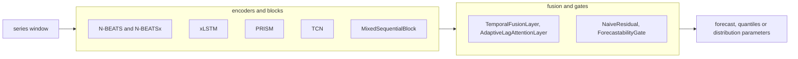

# time_series

Keras 3 layers for forecasting and sequence modeling, in `dl_techniques.layers.time_series`: N-BEATS and N-BEATSx blocks, xLSTM cells and blocks, the PRISM wavelet tree, the DeepAR cell and scale layer, a temporal convolutional network, lag attention, temporal fusion, a naive-benchmark gate and EMA filters. The forecasting heads (quantile and likelihood heads) are in `dl_techniques.layers.heads.time_series`.

## What it is for

Time series models need parts that ordinary vision or language layers do not give you. A forecaster has to say how sure it is (quantile and likelihood heads, which live in `layers/heads/time_series`). It has to handle series whose size differs by orders of magnitude (`ScaleLayer`). It has to split a signal into trend, seasonality and frequency bands (N-BEATS blocks, PRISM). It has to remember far back without numerical blowup (xLSTM).

This package holds those parts as plain Keras layers. The models in `src/dl_techniques/models/time_series/` (adaptive_ema, deepar, nbeats, prism, tirex, xlstm) are built from them. You can also use them directly in your own `keras.Model`.

## How it works

Every layer is a normal `keras.layers.Layer`: it makes its sub-layers in `__init__`, builds them in `build()`, runs them in `call()`, and rebuilds itself from `get_config()`. Every layer is registered with `register_dl_technique`, so saved `.keras` files load.

The layers fall into families:



- N-BEATS blocks turn a flat window into a coefficient vector (theta), then expand theta over a basis into a backcast (rebuild the input) and a forecast. Stack blocks by subtracting each backcast from the input.
- xLSTM cells use exponential gating with a log-space running maximum so the exponentials do not overflow. The sLSTM keeps a vector memory. The mLSTM keeps a matrix memory per head.
- PRISM splits a sequence into overlapping segments, takes a Haar wavelet transform of each, scores the frequency bands with a small shared MLP, and recombines them by softmax weight. Each tree level re-splits the whole stitched sequence.
- Lag attention and temporal fusion weight a short vector of past values using a context vector, with sigmoid weights that do not compete.

## Files

- `__init__.py` - curated exports: 29 names in `__all__`, all layers except the builder `create_manokhin_compliant_model`. No factory.
- `nbeats_blocks.py` - `NBeatsBlock` (base: four dense layers plus two theta heads), `GenericBlock`, `TrendBlock`, `SeasonalityBlock`.
- `nbeatsx_blocks.py` - `ExogenousBlock`, an N-BEATS block whose basis comes from covariates.
- `temporal_convolutional_network.py` - `TemporalBlock` and `TemporalConvNet` (dilated causal convolutions).
- `xlstm_blocks.py` - `sLSTMCell`, `sLSTMLayer`, `sLSTMBlock`, `mLSTMCell`, `mLSTMLayer`, `mLSTMBlock`.
- `prism_blocks.py` - `FrequencyBandStatistics`, `FrequencyBandRouter`, `PRISMNode`, `PRISMTimeTree`, `PRISMLayer`.
- `deepar_blocks.py` - `ScaleLayer`, `DeepARCell`. The likelihood heads moved to `layers/heads/time_series/likelihood_heads.py`.
- `residual_projection_block.py` - `ResidualProjectionBlock`, the residual MLP block of the Timestral patch embedding and quantile head.
- `mixed_sequential_block.py` - `MixedSequentialBlock`, an LSTM, attention or both, with pre-normalization.
- `adaptive_lag_attention.py` - `AdaptiveLagAttentionLayer`.
- `temporal_fusion.py` - `TemporalFusionLayer`.
- `forecasting_layers.py` - `NaiveResidual`, `ForecastabilityGate`, and the builder `create_manokhin_compliant_model`.
- `ema_layer.py` - `ExponentialMovingAverage`, `EMASlopeFilter`.

## What each name does

| Name | What it does |
|---|---|
| `MixedSequentialBlock` | Pre-norm block running an LSTM, self-attention, or both, then an FFN. Output shape equals input shape |
| `TemporalConvNet` | Stack of dilated causal residual blocks (dilation 1, 2, 4, ...) |
| `TemporalBlock` | One residual block of a TCN |
| `sLSTMBlock` / `sLSTMLayer` / `sLSTMCell` | Scalar xLSTM: block (recurrence, norm, FFN, residual), sequence layer, single-step cell |
| `mLSTMBlock` / `mLSTMLayer` / `mLSTMCell` | Matrix xLSTM: block (up-projection, causal depthwise conv, recurrence, down-projection, residual), sequence layer, single-step cell |
| `NBeatsBlock` | Base block. Subclasses supply the basis |
| `GenericBlock` | Learned linear basis. Most flexible, least readable |
| `TrendBlock` | Polynomial basis. `thetas_dim` is the number of powers of time |
| `SeasonalityBlock` | Fourier basis. `thetas_dim` rows, filled by `thetas_dim // 2` cosine and sine pairs |
| `ExogenousBlock` | Basis built from covariates, optionally through a TCN |
| `PRISMLayer` | The PRISM entry point: time tree, dropout, optional residual, optional output norm |
| `PRISMTimeTree` / `PRISMNode` | The tree, and one node of it |
| `FrequencyBandRouter` / `FrequencyBandStatistics` | Band importance weights, and the six summary statistics they read |
| `ResidualProjectionBlock` | `output(silu(hidden(x))) + residual(x)`, three Dense layers named after the Timestral reference state dict |
| `DeepARCell` | Thin wrapper around `keras.layers.LSTMCell` for use inside `keras.layers.RNN` |
| `ScaleLayer` | Divides by a per-item scale (mean over time plus `epsilon`), or multiplies back with `inverse=True` |
| `TemporalFusionLayer` | Gated blend of a context forecast and an attention-weighted lag forecast |
| `AdaptiveLagAttentionLayer` | Per-lag sigmoid weights times lags, summed, times a master gate. Output `(batch, 1)` |
| `NaiveResidual` | Adds a network output to a repeat-the-last-value baseline |
| `ForecastabilityGate` | Learns a per-sample weight between a deep forecast and a naive one |
| `create_manokhin_compliant_model` | Function that returns a two-output `keras.Model` wiring the gate, the naive baseline and a conformal quantile head |
| `ExponentialMovingAverage` | EMA over the time axis |
| `EMASlopeFilter` | EMA, its slope over `lookback_period` steps, and three 0/1 threshold signals |

## How to use it

There is no factory. Import the class by name. Examples below were run as written on CPU.

N-BEATS: a trend block then a seasonality block, with doubly residual stacking.

```python
import keras
from dl_techniques.layers.time_series import TrendBlock, SeasonalityBlock

trend = TrendBlock(units=256, thetas_dim=4, backcast_length=168, forecast_length=24)
seasonality = SeasonalityBlock(units=256, thetas_dim=8, backcast_length=168, forecast_length=24)

inputs = keras.Input(shape=(168 * 1,))     # flat: (batch, backcast_length * input_dim)
b1, f1 = trend(inputs)
b2, f2 = seasonality(inputs - b1)          # each block sees what the last could not explain
model = keras.Model(inputs, f1 + f2)
print(model.output_shape)                  # (None, 24)
```

N-BEATSx: covariates enter as the `exogenous_inputs` call keyword, covering both history and horizon.

```python
import keras
from dl_techniques.layers.time_series import ExogenousBlock

block = ExogenousBlock(exogenous_dim=6, tcn_filters=16, use_tcn=True,
                       units=64, backcast_length=48, forecast_length=12)
backcast, forecast = block(keras.random.normal((8, 48)),
                           exogenous_inputs=(keras.random.normal((8, 48, 6)),
                                             keras.random.normal((8, 12, 6))))
print(backcast.shape, forecast.shape)      # (8, 48) (8, 12)
```

xLSTM and PRISM:

```python
import keras
from dl_techniques.layers.time_series import sLSTMBlock, mLSTMBlock, PRISMLayer

x_in = keras.Input(shape=(64, 128))
x = mLSTMBlock(units=128, num_heads=4)(sLSTMBlock(units=128)(x_in))
print(keras.Model(x_in, x).output_shape)   # (None, 64, 128)

p_in = keras.Input(shape=(128, 32))
p = PRISMLayer(tree_depth=2, num_wavelet_levels=3)(p_in)
print(keras.Model(p_in, p).output_shape)   # (None, 128, 32)
```

DeepAR cell and likelihood heads:

```python
import keras
from dl_techniques.layers.time_series import DeepARCell, ScaleLayer
from dl_techniques.layers.heads.time_series import (
    GaussianLikelihoodHead, NegativeBinomialLikelihoodHead)

inputs = keras.Input(shape=(48, 8))
hidden = keras.layers.RNN(DeepARCell(units=64), return_sequences=True)(ScaleLayer()(inputs))
mu, sigma = GaussianLikelihoodHead(units=1)(hidden)
nb_mu, alpha = NegativeBinomialLikelihoodHead(units=1)(hidden)
```

Encoder, lag attention, fusion and quantile heads:

```python
import keras
from dl_techniques.layers.time_series import (
    TemporalConvNet, AdaptiveLagAttentionLayer, TemporalFusionLayer)
from dl_techniques.layers.heads.time_series import QuantileHead, QuantileSequenceHead

context = keras.Input(shape=(168, 16))
lags = keras.Input(shape=(12,))
encoded = TemporalConvNet(filters=32, kernel_size=2, num_levels=4)(context)
pooled = keras.layers.GlobalAveragePooling1D()(encoded)

weighted = AdaptiveLagAttentionLayer(num_lags=12)([pooled, lags])   # (None, 1)
fused = TemporalFusionLayer(output_dim=24, num_lags=12)([pooled, lags])  # (None, 24)
fixed_q = QuantileHead(num_quantiles=3, output_length=24)(pooled)   # (None, 24, 3)
seq_q = QuantileSequenceHead(num_quantiles=3)(encoded)              # (None, 168, 3)
```

Naive-benchmark model and EMA signals:

```python
import numpy as np, keras
from dl_techniques.layers.time_series import (
    create_manokhin_compliant_model, ExponentialMovingAverage, EMASlopeFilter)

model = create_manokhin_compliant_model(input_shape=(168, 1), forecast_length=24, hidden_units=128)
point, quantiles = model.predict(np.random.randn(4, 168, 1).astype("float32"), verbose=0)
print(point.shape, quantiles.shape)        # (4, 24, 1) (4, 24, 1, 3)

inputs = keras.Input(shape=(256, 1))
smoothed = ExponentialMovingAverage(period=25)(inputs)
signals = EMASlopeFilter(ema_period=25, lookback_period=25, output_mode="all")(inputs)  # dict of 5
```

## Things to know

- **Flat N-BEATS tensors are time-major.** A multivariate window is `(batch, length * dim)` and entry `t * dim + i` is step `t` of channel `i`, in every block including `ExogenousBlock`.
- **`NBeatsBlock` is not truly abstract.** Its two basis methods are marked `@abstractmethod`, but a Keras layer is not an ABC, so Python still lets you instantiate it. Use a subclass.
- **`ExogenousBlock` has no `thetas_dim`.** Passing it raises `TypeError`. The theta width is the basis channel count: `tcn_filters` when `use_tcn=True`, else `exogenous_dim`. Calling it without `exogenous_inputs` raises `ValueError`, so it cannot be dropped into a stack that calls `block(x)`.
- **`TrendBlock` and `SeasonalityBlock` basis matrices are non-trainable weights.** Only theta learns. `GenericBlock` defaults `basis_initializer` to `Orthogonal(gain=0.1)`.
- **Quantile and likelihood heads** are documented in `layers/heads/time_series/README.md`.
- **`DeepARCell` does no concatenation or scaling itself**; the caller concatenates the previous observation with covariates.
- **Lag layers need exactly two inputs**, a list `[context, lags]`, and `lags.shape[-1]` must equal `num_lags`. Both layers use sigmoid, not softmax, so lag weights do not compete. In `TemporalFusionLayer` the weighted lag sum is a single number per sample, so `lag_forecaster` has kernel shape `(1, output_dim)`.
- **`ForecastabilityGate` and output shape.** `deep_forecast` and `naive_forecast` are extra `call` arguments, so Keras gives `compute_output_shape` only the backcast shape. Pass `forecast_length=` to the constructor so the declared output shape is right. Without it the gate logs a warning and declares the backcast shape. `build()` needs both trailing dims of the input to be static.
- **`create_manokhin_compliant_model` survives a `.keras` save and load.** `ForecastabilityGate.build` tells a single saved shape from a list of shapes by looking at the first element. Both entries of `input_shape` must be concrete integers.
- **`EMASlopeFilter` needs a time axis at least `lookback_period` long** (default 25), except in `output_mode="ema_only"`. Otherwise the slope subtraction raises a backend `InvalidArgumentError` about broadcastable shapes. The first `lookback_period` slopes are computed against zero padding, so ignore them. `output_mode` is one of `all`, `signals_only`, `slope_only`, `ema_only`; the first two return a dict.
- **`ExponentialMovingAverage(adjust=True)` is not pandas `ewm(adjust=True)`.** It divides each step after the first by `1 - (1-alpha)^(t+1)` and feeds the divided value into the next step. `adjust=False` matches the plain recurrence.
- **`TemporalBlock` applies its activation three times** (inside both convolutions and on the residual sum), and its 1x1 residual projection is only built when the input channel count differs from `filters`.
- **`MixedSequentialBlock`** takes `block_type` of `lstm`, `transformer` or `mixed`, and builds normalization, attention and FFN through the shared factories, which reject unknown keyword arguments. `embed_dim` must be divisible by `num_heads`. No attention mask is forwarded; a `mask` reaches the LSTM only.
- **PRISM needs usable band lengths.** Each wavelet level halves the length, so the shortest band is about `segment_len // 2 ** num_wavelet_levels`. `PRISMTimeTree` does not validate this. Length 1 gives defined statistics; length 0 is unusable.
- **xLSTM under half precision.** The cells run the divide and the log in float32 when the compute dtype is float16 or bfloat16, because `1e-8` rounds to zero in float16.
- Docstrings in this package are Sphinx/reST. Environment: Keras 3 on TensorFlow 2.18; run Python from the repo `.venv`.
