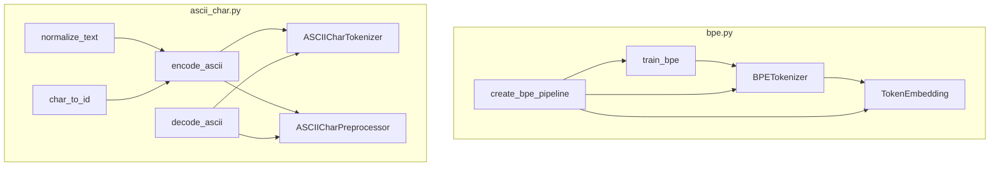

# tokenizers

Path: `src/dl_techniques/layers/tokenizers`
Purpose: Python-side text-to-id tokenizers (trainable BPE, fixed ASCII characters) packaged as Keras 3 layers, plus a BPE token embedding layer.

## Scope

Inside `src/dl_techniques/layers/` (Keras 3 layers library). This package holds:

- A BPE trainer, tokenizer layer, embedding layer and one-call pipeline builder (`bpe.py`).
- A fixed 101-id character-level ASCII vocabulary: pure functions, a tokenizer layer, and a non-layer preprocessor (`ascii_char.py`).

Not here: the tiktoken wrapper `dl_techniques.utils.tokenizer.TiktokenPreprocessor` (the contract `ASCIICharPreprocessor` mimics), the byte tokenizer in `layers/blt/`, and no factory (the package has no `factory.py`). In-graph string tokenization is not supported anywhere in this package.

## Architecture



Both tokenizer layers hold no weights; `call()` raises `NotImplementedError`. All tokenization happens in eager Python methods (`tokenize_texts`, `encode_with_framing`, `__call__`).

ASCII vocabulary (module constants, fixed): `PAD_ID=0`, `CLS_ID=1`, `SEP_ID=2`, `MASK_ID=3`, `UNK_ID=4`, `NEWLINE_ID=5`, `NUM_SPECIAL_TOKENS=6`, printable 32..126 mapped to `ord(c) - 32 + 6`, `VOCAB_SIZE=101`, `ENCODING_NAME="ascii95"`.

## Key files

| File | Role | Notes |
| --- | --- | --- |
| `__init__.py` | Curated exports with `__all__` (8 names) | `ASCIICharPreprocessor`, `ASCIICharTokenizer`, `BPETokenizer`, `TokenEmbedding`, `create_bpe_pipeline`, `decode_ascii`, `encode_ascii`, `train_bpe`. Constants and `char_to_id`, `id_to_char`, `normalize_text` are NOT exported; import from `ascii_char` |
| `bpe.py` | BPE training and layers | 567 lines. Sphinx/reST docstrings |
| `ascii_char.py` | ASCII vocabulary and tokenizers | 768 lines. Module docstring documents the layout and the two load-bearing properties |

## Public interface

`bpe.py`:

- `train_bpe(texts, vocab_size=50000, min_frequency=2, do_lower_case=True, handle_punctuation=True) -> (Dict[str,int], List[Tuple[str,str]])`. Words are written as space-joined characters plus ` </w>`. Initial vocab is the sorted set of single characters plus the `</w>` marker (so `</w>` is in the base vocab); merged tokens are appended in merge order. `texts` must be `str` items (it calls `.lower()` and `re.findall` on them; `train_bpe([b"abc"])` raises `TypeError: cannot use a string pattern on a bytes-like object`, measured). Stops when `len(vocab) >= vocab_size`, no pairs remain, or the best pair count is below `min_frequency`. Tie-break is `max(pairs, key=pairs.get)`, so first-seen wins on ties. With `handle_punctuation=True` words come from `re.findall(r'\w+|[^\s\w]+', text)`; otherwise `text.split()`.
- `BPETokenizer(vocab_dict=None, merges=None, max_length=512, pad_token="<pad>", unk_token="<unk>", eos_token="<eos>", do_lower_case=True)`. Raises `ValueError` if `max_length <= 0`. Methods: `tokenize_texts(texts: List[str]) -> List[List[int]]` (items must be `str`; `bytes` are NOT decoded and raise no error: `.lower()` and `.split()` work on them, but `list(word)` yields ints, so every character id is the `<unk>` id while the appended `</w>` end marker keeps its real vocabulary id; measured on the 30-token example vocabulary under Failure modes, `tokenize_texts([b"abc"])` gives `[28, 28, 28, 2, 29, 27, ...]`, i.e. three `<unk>` ids (28), `</w>` (2), eos (29), then pad (27). `None`, `int` and `list` items raise `AttributeError` on `.lower()`), `decode_tokens(ids) -> str`, `compute_output_shape(shape) -> (shape[0], max_length)`, `get_config`. Attributes: `vocab_dict`, `merges`, `id_to_token`, `merge_priorities`, `vocab_size`. Private: `_get_pairs`, `_apply_bpe`, `_tokenize_text`.
- `TokenEmbedding(vocab_size, embedding_dim, mask_zero=True, embeddings_initializer="uniform")`. Raises `ValueError` on non-positive `vocab_size` or `embedding_dim`. Wraps a `keras.layers.Embedding` named `token_embedding`; `build` builds the inner layer explicitly; `compute_output_shape` is `input_shape + (embedding_dim,)`.
- `create_bpe_pipeline(texts, vocab_size=50000, embedding_dim=512, max_length=512, do_lower_case=True, min_frequency=2) -> (BPETokenizer, TokenEmbedding)`. Does not forward `handle_punctuation`.

`ascii_char.py`:

- `char_to_id(char) -> int`: `"\n"` to 5; `"\t"` and `"\r"` to the space id; printable range to `ord - 26`; else `UNK_ID`. No normalization.
- `id_to_char(token_id) -> str`: raises `ValueError` outside `[0, VOCAB_SIZE)`. Specials decode to `[PAD]`, `[CLS]`, `[SEP]`, `[MASK]`, `[UNK]`, and `"\n"` for 5.
- `normalize_text(text, lowercase=True, normalize_unicode=True)`: NFKD, drop combining marks, then lower.
- `encode_ascii(text, lowercase=True, normalize_unicode=True) -> List[int]`: content ids only, no framing, no padding; `bytes` are decoded as utf-8 with undecodable bytes dropped (`errors="ignore"`). Any other type fails inside `unicodedata.normalize` with `TypeError` (not an explicit check).
- `decode_ascii(token_ids, skip_special_tokens=True) -> str`: newline id always decodes to `"\n"`.
- `ASCIICharTokenizer(max_length=512, lowercase=True, normalize_unicode=True)`: registered Layer. Raises `ValueError` if `max_length` is not an `int` (bool rejected), not positive, or below 3. Methods: `encode(text)`, `encode_with_framing(text)`, `tokenize_texts(texts)` (all go through `encode_ascii`, so each text may be `str` or `bytes`; no explicit type check), `decode`, `decode_tokens`, `compute_output_shape`, `get_config` (three knobs only). Properties: `n_vocab`, `vocab_size`, `encoding_name`, `pad_token_id`, `cls_token_id`, `sep_token_id`, `mask_token_id`, `unk_token_id`. Class attributes mirror the module constants.
- `ASCIICharPreprocessor(max_length=512, lowercase=True, normalize_unicode=True, truncation=True, padding="max_length")`: plain object, not a Layer, no `get_config`. Raises `ValueError` for non-`int` (bool rejected) or `< 3` `max_length`, and `padding` not in `("max_length", "do_not_pad")`.
  - `__call__(texts, return_tensors=None)` returns `{"input_ids", "attention_mask", "token_type_ids"}`, NumPy `int32` (`None` or `"np"`) or tf tensors (`"tf"`). `return_tensors` outside `("np", "tf", None)` raises `ValueError`, checked first.
  - Accepted `texts` types, exactly: `str`, `bytes` (each treated as a batch of one), `list`, `tuple`. Anything else (int, `None`, ndarray, set, iterator) raises `TypeError` ("texts must be a string or a list of strings").
  - Elements of a list/tuple are not type-checked up front. A `str` or `bytes` element works. Any other element (int, nested list) raises `TypeError` from `unicodedata.normalize` inside `encode_ascii` (observed with the default `normalize_unicode=True`).
  - Output shape is `(batch, max_length)` with `padding="max_length"`. An empty list returns three 1-D empty arrays (shape `(0,)`), not `(0, max_length)`.
  - With `truncation=False`, a text whose content exceeds `max_length - 2` ids raises `ValueError`.
  - With `padding="do_not_pad"`, a single short text gives a row shorter than `max_length`; a batch of unequal lengths raises `ValueError` from `np.asarray` (observed).
  - `encode(text, return_tensors=None)`: accepts `str` or `bytes` only, else `TypeError`; calls `self(text, ...)`. A list is rejected here.
  - `decode(token_ids, skip_special_tokens=True, **kwargs)`: accepts anything `np.asarray` flattens (list, array, tensor); `kwargs` ignored.

## Data shapes

- BPE `tokenize_texts` output: `max_length` ids per text, layout `content ids + [eos] + [pad]*k`, truncated at `max_length` (truncation can cut off the eos id).
- BPE vocab: `Dict[str,int]`. Merge ranks: `merge_priorities = {(a, b): index}`.
- ASCII `encode_with_framing` output: `[CLS] + content[:max_length-2] + [SEP] + [PAD]*k`, exactly `max_length` long.
- Preprocessor `attention_mask`: 1 on `[CLS]`, content and `[SEP]`; 0 on pad. `token_type_ids` are all 0.

## Invariants and constraints

- ASCII: `encode_ascii` never emits ids 0 to 3 (PAD, CLS, SEP, MASK). Unknown characters go to `UNK_ID`, never `PAD_ID`. Consumers that count non-pad positions rely on this.
- ASCII ids are corpus-independent. Changing any constant changes the meaning of every saved embedding table.
- Characters are never dropped in `encode_ascii`, so output length equals normalized text length (NFKD can change length versus the raw input).
- `ASCIICharPreprocessor` must stay a non-Layer: overriding `__call__` on a Keras Layer would shadow Keras dispatch. Its rows must be batched and exactly `max_length` long because `train.common.nlp` pipelines index `encoded['input_ids'][0]` and call `tf.ensure_shape(ids, [seq_len])`.
- `ASCIICharPreprocessor` imports TensorFlow lazily, only for `return_tensors="tf"`. Keep it lazy.
- `encoding_name` is a constant (`"ascii95"`) for use in cache keys; `Layer.name` is uniquified per process and must not be used for that.
- Registration: both modules use `@register_dl_technique("dl_techniques.layers.tokenizers.<module>")`; `bpe.py` registers both `BPETokenizer` and `TokenEmbedding` under `dl_techniques.layers.tokenizers.bpe`. The package string must stay equal to the defining module path.

## Dependencies

- Internal: `dl_techniques.utils.logger.logger`, `dl_techniques.utils.keras_registration.register_dl_technique`.
- External: `keras` (Layer, Embedding), `numpy` (preprocessor arrays), stdlib `re`, `collections`, `unicodedata`. `tensorflow` only on the `return_tensors="tf"` path.
- Consumers named in docstrings: `train.common.nlp` (`preprocess_mlm_dataset`, `preprocess_classification_dataset`, `preprocess_clm_dataset`). A grep of `src` and `tests` for `layers.tokenizers` finds only this package and its tests.

## Failure modes

Measured against the code with the repo `.venv`:

- `create_bpe_pipeline` embedding size mismatch. `BPETokenizer.__init__` assigns `self.vocab_dict = vocab_dict or {}`; Keras attribute tracking stores a copy, so the dict returned by `train_bpe` is not extended with the specials. `TokenEmbedding(vocab_size=len(vocab_dict))` is then 3 too small. Example (`vocab_size=60` on 5 copies of `"hello world, hello there."`): `len(vocab_dict)` 27, `tokenizer.vocab_size` 30, embedding `vocab_size` 27, pad id 27, unk id 28, eos id 29; feeding a tokenized row containing the eos id to the embedding raises `InvalidArgumentError` (`indices[0,2] = 29 is not in [0, 27)`) when run with `CUDA_VISIBLE_DEVICES=""`. A run with the default device list did not raise and returned shape `(1, 16, 4)`; whether the gather ran on a GPU was not checked. Fix by sizing the embedding from `tokenizer.vocab_size`. The existing tests do not cover pipeline output going through the embedding.
- BPE `mask_zero` mismatch. Special ids are appended at the end, so id 0 is the alphabetically first token, not pad. `TokenEmbedding(mask_zero=True)` masks that token and does not mask padding.
- BPE JSON round trip. `get_config()["merges"]` holds tuples (wrapped in a Keras `TrackedList`); after `json.dumps` / `json.loads` they are lists, and `{pair: i ...}` in `__init__` raises `TypeError: unhashable type: 'TrackedList'`. Measured: `keras.saving.deserialize_keras_object(json.loads(json.dumps(keras.saving.serialize_keras_object(tok))))` fails with that error, and `BPETokenizer(vocab_dict=..., merges=<lists>)` fails the same way. In-process `get_config` / `from_config` works (the round-tripped tokenizer gave identical ids). Saving a `.keras` file with this layer would hit the JSON path; that exact save was not run.
- BPE train/inference split mismatch. Training splits punctuation (`handle_punctuation=True` default); `_tokenize_text` uses `text.split()`. `"hello,"` is trained as `hello` and `,` but tokenized as one word `hello,`.
- `_tokenize_text` truncates after appending eos, so a long text loses its eos (measured: `max_length=3`, `"hello hello hello"` gives `[15, 15, 15]`, eos id 29 is gone).
- `decode_tokens` stops at the first pad or eos id and replaces `</w>` with a space; unknown ids decode to the `unk_token` string.
- ASCII explicit errors are the `ValueError` / `TypeError` listed under Public interface. Non-str/bytes items inside a batch surface as a `TypeError` from `unicodedata.normalize`, not from a guard. `bytes` given to `BPETokenizer.tokenize_texts` raise nothing: every character becomes the `<unk>` id and only `</w>` and eos keep their real ids (`[b"abc"]` gives `[28, 28, 28, 2, 29, ...]`); `decode_tokens` of that row gives `<unk><unk><unk>`. `ASCIICharTokenizer.decode_tokens` has no `skip_special_tokens` argument.

## Working here

- Match the existing Sphinx/reST docstring style (`:param:`, `:type:`, `:raises:`). Use `from dl_techniques.utils.logger import logger`, no print statements. Use `import keras`, qualify at call sites.
- A new tokenizer layer: follow the pattern here (register with `register_dl_technique` using its own module path, `call()` raising `NotImplementedError` if string-based, `get_config` returning every constructor argument), export it from `__init__.py` and add it to `__all__`. There is no factory to update.
- If you change an ASCII constant, the vocabulary layout, or the framing, update the module docstring in `ascii_char.py` and the tests together.
- If you change the BPE special-token or vocab handling, fix the pipeline embedding sizing and `mask_zero` behavior in the same change.
- Tests: `tests/test_layers/test_tokenizers/test_bpe.py` and `test_ascii_char.py`. Run only these:

```bash
.venv/bin/python -m pytest tests/test_layers/test_tokenizers/ -q
```

