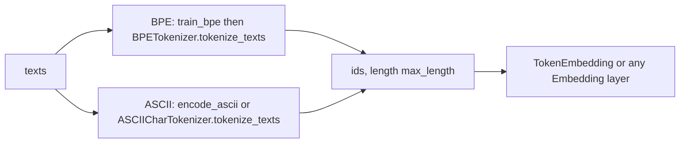

# tokenizers

Two text tokenizers and a token embedding layer, written as Keras 3 layers: a trainable byte-pair-encoding (BPE) tokenizer and a fixed character-level ASCII tokenizer.

## What it is for

Models need integer ids, not strings. This package turns text into fixed-length lists of ids, and (for BPE) turns ids into dense vectors.

There are two ways to do it. BPE learns a sub-word vocabulary from a corpus: frequent character pairs are merged into larger pieces. This keeps sequences short, but the vocabulary depends on the training text and needs a big embedding table. The ASCII tokenizer has no learning at all. Its vocabulary is 101 fixed ids (6 special tokens plus the 95 printable ASCII characters), so a checkpoint's embedding table means the same thing everywhere and no vocabulary file has to travel with it.

Neither tokenizer runs inside a model graph. Keras 3 has no backend-agnostic string ops, so tokenizing happens in plain Python before the model is called.

## How it works



BPE (`bpe.py`):

1. `train_bpe` splits each text into words, writes each word as characters plus an end-of-word marker `</w>`, and repeatedly merges the most frequent adjacent pair until `vocab_size` is reached or the best pair occurs fewer than `min_frequency` times. It returns `(vocab_dict, merges)`. Initial ids are the sorted single characters plus `</w>`, then merged tokens in merge order.
2. `BPETokenizer` takes that vocabulary and merge list. For each word it starts from characters plus `</w>` and applies the merge with the lowest rank (earliest learned) until none apply. Tokens map to ids (unknown tokens go to `<unk>`), the content is cut to `max_length - 1`, an `<eos>` id is appended, and the row is padded with `<pad>` to `max_length`.
3. `TokenEmbedding` wraps `keras.layers.Embedding` (with `mask_zero` on by default).
4. `create_bpe_pipeline` does steps 1 to 3 in one call.

ASCII (`ascii_char.py`):

| id | meaning |
| --- | --- |
| 0 | `[PAD]` |
| 1 | `[CLS]` |
| 2 | `[SEP]` |
| 3 | `[MASK]` |
| 4 | `[UNK]` |
| 5 | newline |
| 6 to 100 | printable ASCII 32 to 126, id = `ord(c) - 32 + 6` |

Text is first folded: NFKD-normalized with combining marks dropped (so an accented `e` becomes `e`) and lowercased. Tab and carriage return become a space. Anything else outside the range becomes `[UNK]`. Characters are never dropped. `encode_ascii` never emits ids 0 to 3, so counting non-pad positions gives the true length.

`encode_with_framing` produces `[CLS] + content + [SEP]`, truncated so `[SEP]` always survives, then right-padded to `max_length`.

## Files

- `__init__.py` - exports `ASCIICharPreprocessor`, `ASCIICharTokenizer`, `BPETokenizer`, `TokenEmbedding`, `create_bpe_pipeline`, `decode_ascii`, `encode_ascii`, `train_bpe`.
- `bpe.py` - `train_bpe`, `BPETokenizer`, `TokenEmbedding`, `create_bpe_pipeline`.
- `ascii_char.py` - the fixed vocabulary constants, `char_to_id`, `id_to_char`, `normalize_text`, `encode_ascii`, `decode_ascii`, `ASCIICharTokenizer` (a Keras layer), `ASCIICharPreprocessor` (a plain Python object for `tf.data` pipelines).

## How to use it

BPE:

```python
from dl_techniques.layers.tokenizers import BPETokenizer, train_bpe

texts = ["hello world, hello there."] * 5
vocab, merges = train_bpe(texts, vocab_size=60)
tok = BPETokenizer(vocab_dict=vocab, merges=merges, max_length=16)
ids = tok.tokenize_texts(["hello, world"])   # list of one 16-long id list
text = tok.decode_tokens(ids[0])
```

ASCII layer:

```python
from dl_techniques.layers.tokenizers import ASCIICharTokenizer

tok = ASCIICharTokenizer(max_length=8)
tok.tokenize_texts(["Hi\n"])   # [[1, 78, 79, 5, 2, 0, 0, 0]]
```

ASCII preprocessor, for pipelines that expect a BERT-style dictionary:

```python
from dl_techniques.layers.tokenizers import ASCIICharPreprocessor

pre = ASCIICharPreprocessor(max_length=6)
out = pre("ab", return_tensors="np")
# out["input_ids"] == [[1, 71, 72, 2, 0, 0]]; also "attention_mask", "token_type_ids", shape (1, 6)
```

## Things to know

- Calling either tokenizer layer as a Keras layer raises `NotImplementedError`. Use `tokenize_texts`.
- BPE special ids are not 0. `<pad>`, `<unk>` and `<eos>` are appended after the learned vocabulary. Id 0 is whichever token sorts first (a comma in the example above). `TokenEmbedding(mask_zero=True)` therefore masks that token, not padding. ASCII is different: its pad id is 0. Moving `<pad>` to id 0 would change every id of a trained vocabulary, so it is left as is.
- `create_bpe_pipeline` sizes `TokenEmbedding` from `tokenizer.vocab_size`, so the embedding has a row for the three special ids as well as the learned vocabulary. `train_bpe` returns a vocabulary without the specials; `BPETokenizer` adds them to its own copy.
- `train_bpe`, `BPETokenizer` and `create_bpe_pipeline` all take `handle_punctuation` (default `True`) and share one splitter, so a word is cut the same way when merges are learned and when they are applied. Pass the value the vocabulary was trained with. With the default, decoded text puts a space between a word and its punctuation.
- `BPETokenizer` configs survive a JSON round trip: `merges` are turned back into tuples in `__init__`.
- `max_length` for `ASCIICharTokenizer` and `ASCIICharPreprocessor` must be an `int` of at least 3. `bool` is rejected.
- Input types. `encode_ascii`, `ASCIICharTokenizer.encode` / `encode_with_framing` / `tokenize_texts` take `str` or `bytes` per text (bytes are decoded as utf-8, bad bytes dropped). `ASCIICharPreprocessor(...)` accepts a `str`, `bytes`, `list` or `tuple`; a single `str` or `bytes` counts as a batch of one, and any other type raises `TypeError`. A list item that is not `str` or `bytes` also raises `TypeError`. `ASCIICharPreprocessor.encode` takes one `str` or `bytes`, not a list. An empty list gives empty 1-D arrays.
- `BPETokenizer.tokenize_texts` expects `str` items. `bytes` are not decoded and raise no error, but each character maps to the `<unk>` id. The `</w>` end marker added after the characters still has its real vocabulary id. With the example vocabulary above, `tok.tokenize_texts([b"abc"])` gives `[28, 28, 28, 2, 29, 27, ...]`: three `<unk>` ids (28), `</w>` (2), the `<eos>` id (29), then `<pad>` (27). Items that are `None`, `int` or `list` raise `AttributeError`.
- `ASCIICharPreprocessor.padding='do_not_pad'` is accepted, but the downstream `tf.data` pipelines need `'max_length'`, and a batch of unequal-length rows raises `ValueError`. With `truncation=False` an over-long text raises `ValueError`.
- `return_tensors='tf'` imports TensorFlow lazily; the default returns NumPy `int32` arrays.
- Tests live in `tests/test_layers/test_tokenizers/` (`test_bpe.py`, `test_ascii_char.py`).
