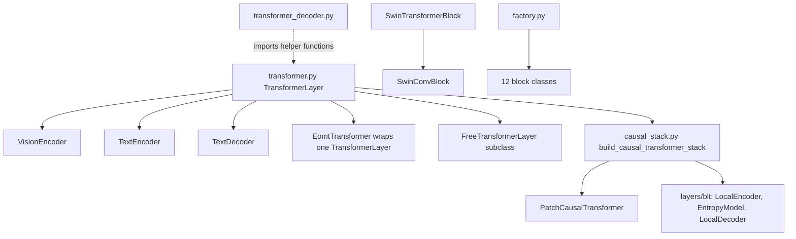

# transformers

Path: `src/dl_techniques/layers/transformers/`
Purpose: Keras 3 transformer blocks and complete encoder/decoder stacks, built mostly by composing the attention, FFN and norm factories from sibling packages.

## Scope

In here: `TransformerLayer` and its decoder; the stacks `VisionEncoder`, `TextEncoder`, `TextDecoder`, `PatchCausalTransformer`; specialized blocks (Swin, Perceiver, EoMT, AdaLN-zero, SD3 AdaLN, Ideogram4, Gemma3, area attention, gated linear attention, Free Transformer, Energy Transformer); the shared causal-stack skeleton; the block factory.

Not in here: the attention, FFN and norm layers themselves (`layers/attention/`, `layers/ffn/`, `layers/norms/`), mixture-of-experts (`layers/moe/`), embeddings (`layers/embedding/`), pooling (`layers/sequence_pooling/`), whole models (`models/`). The BLT layers in `layers/blt/` consume `causal_stack.py` but live elsewhere.

## Architecture

`TransformerLayer.__init__` builds every sub-layer: `attention_norm`, `output_norm`, `attention` (via `create_attention_layer`), `ffn_layer` (via `create_ffn_from_config`, or `MixtureOfExperts` if `moe_config`), `dropout`, optional `attention_stochastic_depth`, `ffn_stochastic_depth`, `attention_layer_scale`, `ffn_layer_scale`. `build` builds them in order. `call`:

- pre: `x + [LayerScale][StochasticDepth](attn(norm(x)))`, then `x + [LayerScale][StochasticDepth](dropout(ffn(norm(x))))`.
- post: `norm(x + branch)` for each of the two sub-blocks.

Two module-level functions in `transformer.py` are the single source for policy shared with the decoder: `build_transformer_ffn_config` (FFN config per type: swiglu drops `hidden_dim`, `activation`, `use_bias` and sets `ffn_expansion_factor=4`, `ffn_multiple_of=256`; differential renames `activation` to `branch_activation`; `squared_relu`, `reglu`, `bilinear` drop `activation`) and `build_transformer_attention_required_params` (type-specific required keys: window family and beit get `window_size`, `group_query` gets `num_kv_heads`, `differential` gets `head_dim` and `lambda_init`, `multi_head_latent` gets `kv_latent_dim = max(1, hidden_size // 4)`). Do not copy either table into a caller.

Stacks:

- `VisionEncoder`: patch embed (`Conv2D` or `Sequential`), reshape, CLS concat, `pos_embed` (factory `positional_learned`), blocks, final norm (pre-norm only), `SequencePooling`.
- `TextEncoder`: word embedding (learned or factorized), optional token-type embedding, optional CLS, positions (`positional_learned` or `continuous_sincos`), `embed_norm`, dropout, blocks, final norm (pre-norm only), `SequencePooling`. `_encode` is shared by `call`, `get_sequence_features`, `get_pooled_features`.
- `TextDecoder`: `embed_tokens` then `decode_embeddings` (positions, `embed_norm`, dropout, `create_causal_attend_mask(x, attention_mask)`, blocks, `final_norm`).
- `PatchCausalTransformer`: `CausalTransformerStackMixin` over `PositionalEmbedding`, `build_causal_transformer_stack` blocks (FFN width `4 * hidden_size`, default pre/post as `TransformerLayer` default, i.e. post), and a `keras.layers.LayerNormalization(epsilon=1e-3)`.

## Key files

| File | Role | Notes |
| --- | --- | --- |
| `transformer.py` (1102 lines) | `TransformerLayer`, shared FFN and attention policy functions | `_MASKLESS_ATTENTION_TYPES = {'fnet','anchor','lighthouse'}`; `NormalizationPositionType` defined here |
| `transformer_decoder.py` | `TransformerDecoderLayer` | Aliases `TransformerLayer._MASKLESS_ATTENTION_TYPES` (same object); builds norms with default args |
| `vision_encoder.py` | `VisionEncoder`, 3 `create_*` helpers | `PatchEmbedType = linear/siglip/conv/hybrid` |
| `text_encoder.py` | `TextEncoder`, 5 `create_*` helpers | Defines its own `EmbeddingType`, `PositionalType` (4 values) |
| `text_decoder.py` | `TextDecoder` | Own `PositionalType` (2 values); uses `SequenceLengthError` |
| `patch_causal_transformer.py` | `PatchCausalTransformer` | No input embedding |
| `causal_stack.py` | Mixin and builders for causal stacks | `LAYER_NORM_EPSILON = 1e-3`; not a Layer, not registered |
| `swin_transformer_block.py` | `SwinTransformerBlock` | `_PADDING_FILL_VALUE`, `_resolve_shift_size`, `_build_swmsa_keep_mask` |
| `swin_conv_block.py` | `SwinConvBlock` | Wraps `SwinTransformerBlock` as `trans_block` |
| `perceiver_transformer.py` | `PerceiverTransformerLayer` | Direct `LayerNormalization(epsilon=1e-6)`, `PerceiverAttention` |
| `eomt_transformer.py` | `EomtTransformer` | Non-trainable `current_step` weight for annealing |
| `adaln_zero.py` | `AdaLNZeroConditionalBlock` | `inputs=[x, c]`; zero-init `adaLN_linear` |
| `sd3_adaln.py` | `AdaLayerNormZero`, `AdaLayerNormZeroX`, `AdaLayerNormContinuous`, `modulate` | `modulate` is imported by models; keep the name public |
| `ideogram4_block.py` | `Ideogram4TransformerBlock`, `Ideogram4FinalLayer` | Conditioning arrives already activated |
| `gemma3_transformer.py` | `Gemma3TransformerBlock` | Four RMSNorms, `group_query` + `geglu` |
| `area_attention_block.py` | `AreaAttentionBlock` | `AreaAttention` + two `ConvBlock` |
| `gated_linear_attention_block.py` | `GatedLinearAttentionBlock` | `gated_linear_scan` dispatches chunked vs sequential |
| `free_transformer.py` | `BinaryMapper`, `FreeTransformerLayer`, `compute_kl_divergence_uniform_prior`, `compute_free_bits_kl_loss` | The two functions are public but not in `__init__` |
| `energy_transformer.py` | `EnergyTransformer`, `HopfieldNetwork`, `WeightedAdjacencyProjector` | Closed-form gradients, no autodiff |
| `factory.py` | `TRANSFORMER_BLOCK_REGISTRY`, `create_transformer_block` | Key sets read from `inspect.signature` |
| `__init__.py` | 34-name curated surface | Does not export Gemma3, Ideogram4, SD3 AdaLN, `WeightedAdjacencyProjector`, `causal_stack` |

## Public interface

Factory:

- `create_transformer_block(config: Dict[str, Any], *, name: Optional[str] = None) -> keras.layers.Layer`. `config["type"]` selects a class. Valid keys are the class `__init__` keywords, `name`, `dtype`, `trainable`, and `type`. Raises `ValueError` for a missing `type`, an unknown type, an unrecognized key, or a missing no-default parameter. `name=` overrides `config["name"]`.
- `TRANSFORMER_BLOCK_REGISTRY: Dict[str, type]` with exactly these keys: `transformer_layer`, `transformer_decoder_layer`, `swin_transformer_block`, `swin_conv_block`, `perceiver_transformer_layer`, `eomt_transformer`, `adaln_zero_conditional_block`, `free_transformer_layer`, `gated_linear_attention_block`, `area_attention_block`, `energy_transformer`, `hopfield_network`.

Constructors (required parameters first):

- `TransformerLayer(hidden_size, num_heads, intermediate_size, ...)`: 28 parameters. `call(inputs, attention_mask=None, layer_idx=0, training=None)`. `n_kv_head=None` becomes `num_heads`.
- `TransformerDecoderLayer(hidden_size, num_heads, intermediate_size, ...)`: 20 parameters (`self_attention_type`, `cross_attention_type`, `attention_args`, `cross_attention_args`, `use_causal_mask`, ...). `call(inputs, encoder_output, self_attention_mask=None, cross_attention_mask=None, layer_idx=0, training=None)`.
- `VisionEncoder(...)`: 27 parameters, all with defaults. `call(inputs, attention_mask=None, training=None)`; `attention_mask` is `(B, num_patches)`. Methods: `get_cls_features`, `get_patch_features`, `get_spatial_features`.
- `TextEncoder(vocab_size, embed_dim, ...)`: 34 parameters. `call(inputs, token_type_ids=None, attention_mask=None, training=None)`; `inputs` is ids or a dict with `input_ids` (and optionally `token_type_ids`, `attention_mask`). Methods: `get_sequence_features`, `get_pooled_features(inputs, pooling_mode='mean', ...)`.
- `TextDecoder(vocab_size, embed_dim, depth, num_heads, ...)`: 18 parameters. `call(input_ids, attention_mask=None, training=None)`; also `embed_tokens`, `decode_embeddings`.
- `PatchCausalTransformer(dim=768, depth=12, num_heads=12, max_patches=512, dropout_rate=0.1, layer_norm_epsilon=1e-3, name_prefix='patch_causal_transformer')`.
- `SwinTransformerBlock(dim, num_heads, window_size=8, shift_size=0, ...)`; `SwinConvBlock(conv_dim, trans_dim, head_dim=32, window_size=8, drop_path_rate=0.0, block_type='W', ...)`.
- `PerceiverTransformerLayer(dim, num_heads=8, mlp_ratio=4.0, ...)`; `call(query_input, kv_input=None, training=None)`.
- `EomtTransformer(hidden_size, num_heads=8, ...)`; `call(inputs, mask=None, training=None)`; `inputs` may be a dict with `inputs` (or `x`) and `mask`.
- `AdaLNZeroConditionalBlock(dim, num_heads, dim_head, mlp_dim, ...)`; `call([x, c], training=None)`.
- `AdaLayerNormZero(dim, eps)`, `AdaLayerNormZeroX`, `AdaLayerNormContinuous`: `call([x, cond])`, `x` is `(B, N, dim)`, `cond` is `(B, dim)`. Return 5, 7 and 1 tensors.
- `Ideogram4TransformerBlock(hidden_size, intermediate_size, num_heads, adaln_dim, ...)`: `call(x, segment_ids, cos, sin, adaln_input)`. `Ideogram4FinalLayer(hidden_size, out_channels, adaln_dim)`: `call(x, c)`.
- `Gemma3TransformerBlock(hidden_size, num_attention_heads, num_key_value_heads, ffn_hidden_size, ...)`; `attention_type` is `full_attention` or `sliding_window`.
- `AreaAttentionBlock(dim, num_heads=8, mlp_ratio=1.2, area=1, use_bias=False, normalization_kwargs=None, kernel_initializer='he_normal')`.
- `GatedLinearAttentionBlock(dim, num_heads, max_seq_len, ...)`; `call(inputs, attention_mask=None, training=None)`.
- `FreeTransformerLayer(hidden_size, num_heads, intermediate_size, use_free_transformer=False, num_latent_bits=16, ...)`, `BinaryMapper(num_bits)`.
- `EnergyTransformer(embed_dim, num_heads, head_dim, hopfield_dim, ...)`, `HopfieldNetwork(dim, hopfield_dim, ...)`, `WeightedAdjacencyProjector(num_heads, embed_dim, kernel_size=1, proj_dim=None)`.

Convenience builders (thin presets, all return the stack class): `create_vision_encoder`, `create_vit_encoder`, `create_siglip_encoder` (patch embed `siglip`), `create_text_encoder`, `create_bert_encoder` (vocab 30522, token types, CLS, `output_mode='cls'`), `create_roberta_encoder` (vocab 50265), `create_modern_encoder` (1024 wide, depth 24, 16 heads, factorized embeddings, `differential` attention, `rms_norm` pre-norm, `swiglu`, `mean` pooling), `create_efficient_encoder` (512 wide, depth 8, `rms_norm` pre, `swiglu`, stochastic depth 0.1, factorized dim 64).

## Data shapes

- Sequence blocks: `(batch, seq, hidden)` in and out. `TextEncoder` and `TextDecoder` take `(batch, seq)` ids.
- Vision stacks and Swin, area, SwinConv: NHWC `(batch, H, W, C)`. `VisionEncoder` output depends on `output_mode`.
- Masks use keep semantics (1 attend, 0 masked): `TransformerLayer` takes rank 2/3/4 as its attention accepts; `create_causal_attend_mask` yields rank 3.
- `TextEncoder.seq_len = max_seq_len + (1 if use_cls_token)`. `VisionEncoder.seq_len = num_patches + (1 if use_cls_token)`.
- `EomtTransformer` sequence layout: patches first, then queries. `mask` is `(B, num_queries, H, W)`, thresholded at 0.5.
- `EnergyTransformer` with `return_energy=True` returns `(x, energies)`; `energies` is `(B, num_steps + 1)`, dtype at least float32.
- `FreeTransformerLayer` with `use_free_transformer=True` always returns `(output, bit_logits)`; `bit_logits` is `(B, T, num_latent_bits)`, zeros at inference.
- Config keys for serialization are the constructor argument names. `activation` is stored through `serialize_activation`.

## Invariants and constraints

- Every layer builds sub-layers in `__init__` and builds them explicitly in `build()`. A lazy first-call build leaves weights unloadable on `.keras` reload. New blocks follow the same pattern.
- Every class is registered with `@register_dl_technique("dl_techniques.layers.transformers.<module>")`. The three `sd3_adaln` classes and the three `energy_transformer` classes share one string per file; class names differ.
- `TransformerLayer.normalization_position` is validated to `'pre'` or `'post'`; `call` branches on `== 'pre'` with an unguarded else.
- `_MASKLESS_ATTENTION_TYPES` is one frozenset object shared by `TransformerLayer`, `TransformerDecoderLayer` and `EomtTransformer`. Do not redeclare it. Never add `'window'`: it honors a causal mask.
- Initializers: `TransformerLayer` forwards `clone_initializer(kernel_initializer)` to the FFN and, when the attention type declares `kernel_initializer`, to the attention, so no two kernels replay one draw. `VisionEncoder` gives each block its own clone. Keep passing clones, not shared instances, when creating several same-shape layers.
- `LAYER_NORM_EPSILON = 1e-3` in `causal_stack.py` is the final-norm epsilon for causal stacks and must stay `1e-3`. `build_causal_stack_norm` builds `keras.layers.LayerNormalization` directly, not through the norm factory (whose epsilon is `1e-6`). A census test pins this.
- `TextEncoder` and `TextDecoder` default `layer_norm_eps=1e-12`. `TextDecoder` passes it to `embed_norm`, `final_norm` and both norms of every block. `TextEncoder` passes `epsilon=layer_norm_eps` (merged with `norm_args`) to `embed_norm` and `final_norm` only; its in-block norms get just `norm_args`.
- `FreeTransformerLayer.__init__` returns before creating encoder parts when `use_free_transformer=False`; `build` and `call` branch on the same flag. `training` is tested by Python truthiness, so a symbolic tensor raises.
- `BinaryMapper` keeps its `(2^H, H)` bit table as a numpy array, not a weight, so the `.keras` file layout does not carry it. `num_bits` is capped at 20.
- `EnergyTransformer`: `update()` of each sub-layer returns `-dE/dg`; `call` adds it. Energy and update must receive the same masks and the same `adjacency_weight` (computed once per call). The Hopfield energy and update are a matched pair per activation (`relu`, `softmax`).
- `GatedLinearAttentionBlock`: `max_seq_len` bounds nothing. `_chunked_scan` is used for a static length, `_sequential_scan` for a symbolic one. Both must agree to reassociation. Masks are applied at three places (before the conv, after the activation, and `alpha=1` at pad steps); keep all three.
- `SwinTransformerBlock`: the roll and the SW-MSA mask both derive from the one `_resolve_shift_size` result, evaluated on unpadded H, W. The shift drops to 0 when a static H or W is at most `window_size`. Padding is bottom/right and cropped before the residual add.
- `AdaLNZeroConditionalBlock._modulate` (no `expand_dims`, caller broadcasts) and `sd3_adaln.modulate` (expands `(B, dim)` chunks to `(B, 1, dim)`) are different on purpose. Do not merge them.
- `Ideogram4FinalLayer` and `Ideogram4TransformerBlock` do not apply SiLU to the conditioning; the caller must.
- `Gemma3TransformerBlock` uses the `gelu_tanh` callable for the GeGLU FFN, not the `"gelu"` string (exact erf form), to match the reference.

## Dependencies

Internal:

- `layers/attention`: `create_attention_layer`, `ATTENTION_REGISTRY`, `assemble_attention_config`, `AttentionType`, `PerceiverAttention`, `WindowAttention`, `AreaAttention`, `Ideogram4Attention`, `EnergyAttention` (plus its private `_mask_dtype`, `_token_keep`, imported by `energy_transformer.py`).
- `layers/ffn`: `create_ffn_from_config`, `create_ffn_layer`, `assemble_ffn_config`, `FFN_REGISTRY`, `FFNType`, `SwinMLP`, `SwiGLUFFN`.
- `layers/norms`: `create_normalization_layer`, `NormalizationType`, `RMSNorm`, `EnergyLayerNorm`.
- `layers/moe`: `MixtureOfExperts`, `MoEConfig`. `layers/regularization`: `StochasticDepth`, `LayerScale`.
- `layers/embedding`: `create_embedding_layer`, `PositionalEmbedding`. `layers/sequence_pooling`: `SequencePooling`, `PoolingStrategy`. `layers/conv_blocks`: `ConvBlock`.
- `layers/activations`: `common.resolve_activation`, `common.serialize_activation`, `factory.resolve_activation_layer`, `gelu_tanh`; `initializers.clone_initializer`.
- `utils`: `logger`, `masking` (`create_causal_attend_mask`, `create_mask`, `MaskFactory`), `tensors` (`window_partition`, `window_reverse`), `keras_registration`, `activation_serialization` (`TextDecoder`, `GatedLinearAttentionBlock`), `sequence_length_guard.SequenceLengthError`.

Direction of dependency: this package imports from the siblings above and must not import `layers/yolo12` (which imports `AreaAttentionBlock` from here). That is why the YOLOv12 norm kwargs cannot be a default in `AreaAttentionBlock`.

External: `keras` (3.8 or later), numpy (`BinaryMapper` bit table).

Consumers: `TransformerLayer` is imported by about 20 modules in the repo. `layers/blt/` uses `causal_stack.py` (`LocalEncoder`, `EntropyModel` through the mixin; `LocalDecoder` through the two builders only) and `BLT` core uses `PatchCausalTransformer`. `models/language/gemma/gemma3.py` uses `Gemma3TransformerBlock`; `models/vision/dit/blocks.py`, `models/vision_language/sd3_mmdit/blocks.py` and `models/vision_language/bit_diffusion/` use `sd3_adaln`; `models/vision_language/ideogram4/transformer.py` uses `ideogram4_block`.

## Failure modes

- `ValueError: Unknown attention type` from `TransformerLayer._get_attention_params` for any `attention_type` outside the 11 handled branches (`multi_head`, `window`, `window_zigzag`, `window_band`, `beit`, `group_query`, `differential`, `multi_head_latent`, `anchor`, `lighthouse`, `fnet`). The `AttentionType` literal is wider than this.
- Unfiltered `attention_args` / `ffn_args` keys reach the factories and raise there, naming the key. This is intended.
- `TransformerLayer` with `moe_config`: `UserWarning` when `ffn_type`/`ffn_args` are set (ignored), and when `intermediate_size` fills in a missing expert `hidden_dim`. It mutates the passed `MoEConfig`'s `ffn_config` (`output_dim`, maybe `hidden_dim`).
- `residual_output_kernel_initializer` with an unsupported attention type, FFN type or with `moe_config` raises `ValueError`.
- `TransformerLayer` drops `attention_mask` silently for `fnet`, `anchor`, `lighthouse`. `EomtTransformer` raises at construction for those with `use_masked_attention=True`. `TransformerDecoderLayer` logs a warning at construction when `use_causal_mask=True` with one of them.
- `TextEncoder`: `positional_type` `rope` or `dual_rope` raises `NotImplementedError`; `embedding_type='shared'` raises `ValueError`; `output_mode='cls'` without `use_cls_token` raises; a 3D `attention_mask` with `use_cls_token=True` raises; static sequence length above `max_seq_len` raises in `build`. The `kernel_initializer` argument has no effect on the blocks (they use `TruncatedNormal(initializer_range)`).
- `TextDecoder`: static length above `max_seq_len` raises `SequenceLengthError` in `build`, except while the class attribute `_loading_recorded_build_shape` is true (set by a model's build-from-config), when it logs a warning. A dynamic length is not checked.
- `VisionEncoder`: `patch_embed_type='hybrid'` with `patch_size != 4` fails at the first forward pass in the position embedding (measured with `img_size=32, patch_size=8`), because the hybrid stem downsamples by a fixed 4x. A rank other than 2 for `attention_mask` raises `ValueError`.
- `differential` attention inside `VisionEncoder`, `TextEncoder`, `TextDecoder`: they call blocks without `layer_idx`, so all blocks use index 0 (same lambda schedule value in every block). `TransformerDecoderLayer` has the same caller-owns-`layer_idx` rule.
- `TransformerDecoderLayer` with `self_attention_type='window'` and a sequence length other than `window_size ** 2` raises at call time when the causal mask is on.
- `FreeTransformerLayer`: the free path reuses `self.dropout` on the attention output (the base class does not), and does not apply LayerScale even if `use_layer_scale=True` was passed. A tensor `training` raises. It does not handle the maskless attention types.
- `GatedLinearAttentionBlock`: interior padding with `attention_mask` is not detected; the causal conv sees zeros. `ffn_args`/`*_norm_args` typos raise.
- `AreaAttentionBlock` with `normalization_kwargs=None` uses the factory default epsilon (`1e-6`); YOLOv12 results need the kwargs passed explicitly.
- `create_transformer_block` rejects any key not in the class signature, including keys that only `**kwargs` would swallow.

## Working here

- New block class: put it in its own file, register it with `register_dl_technique("dl_techniques.layers.transformers.<module>")`, create sub-layers in `__init__`, build them in `build`, implement `compute_output_shape` and a complete `get_config`. Add the import and `__all__` entry in `__init__.py` if it should be public. If it should be buildable from config, add one line to `TRANSFORMER_BLOCK_REGISTRY` and nothing else: do not hand-write key lists.
- Adding a registry key changes the public surface: `tests/test_layers/test_transformers/test_the_block_factory_builds_every_registered_block.py` builds every key and must still pass.
- Changing FFN or attention parameter policy: edit `build_transformer_ffn_config` or `build_transformer_attention_required_params` only, then check both `TransformerLayer` and `TransformerDecoderLayer`.
- A new attention type for `TransformerLayer` needs a branch in `_get_attention_params`; a new mask-less type must be added to `_MASKLESS_ATTENTION_TYPES`.
- Do not change `LAYER_NORM_EPSILON` or route the causal stack's final norm through the norm factory. The per-package epsilon census is `tests/test_models/test_the_norm_epsilon_provenance_is_stated.py`.
- Docstrings in this package are Sphinx/reST (`:param:`, `:type:`, `:raises:`); match the file you edit. Use `import keras` and call `keras.ops...`. Several older files here use `from keras import ops`; do not convert them wholesale. Log through `dl_techniques.utils.logger`, not `print`.
- Tests live in `tests/test_layers/test_transformers/` (one file per module, plus single-claim guards named `test_the_*`). Run from the repo root with the project venv, scoped to this directory and to the packages that import what you changed, for example `.venv/bin/python -m pytest tests/test_layers/test_transformers/ -q`. Also scope to `tests/test_layers/test_blt/` if you touch `causal_stack.py`, and to `tests/test_models/test_gemma/` for `gemma3_transformer.py`. Do not run the full repository suite as a routine check.
- Docstrings and comments in this directory quote counts (for example the number of attention registry keys) that drift when the registries change. Re-derive from `ATTENTION_REGISTRY` rather than copying them.
