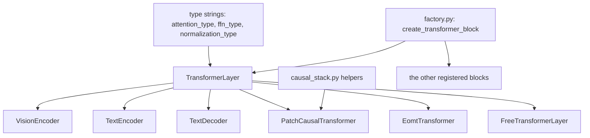

# transformers

Transformer blocks and complete encoder or decoder stacks, written as Keras 3 layers. Lives in `src/dl_techniques/layers/transformers/` and is imported as `dl_techniques.layers.transformers`.

## What it is for

Most transformer models in this library are the same few pieces glued in different ways: an attention layer, a feed-forward network (FFN), a normalization layer, and a choice of where the normalization goes. This package builds those pieces once. `TransformerLayer` takes the attention type, FFN type and normalization type as plain strings and builds the matching sub-layers through the sibling `attention/`, `ffn/` and `norms/` factories (a factory turns a type string plus options into a layer). A new architecture is then mostly a choice of strings, not a new class.

The package also holds blocks that do not fit that shape: Swin windowed attention, a Perceiver cross-attention block, an object-query segmentation block, diffusion-style blocks conditioned on a vector, a recurrent linear-attention mixer, and an energy-based block. Complete stacks (`VisionEncoder`, `TextEncoder`, `TextDecoder`, `PatchCausalTransformer`) wrap `TransformerLayer` with embeddings and pooling.

## How it works



A `TransformerLayer` runs two residual sub-blocks on a `(batch, seq, hidden)` tensor: attention, then an FFN (or a mixture of experts). With `normalization_position='pre'` each sub-block is `x + sublayer(norm(x))`. With `'post'` (the default) it is `norm(x + sublayer(x))`. Optional stochastic depth (randomly skipping a branch during training) and LayerScale (a small learned per-channel scale on each branch) can be added to both branches.

The stacks add the parts around the blocks:

- `VisionEncoder`: image, patch embedding, optional CLS token, learned positions, N blocks, optional final norm (pre-norm only), pooling.
- `TextEncoder`: token ids, word embedding, optional segment embedding, optional CLS token, positions, embedding norm, N blocks, optional final norm (pre-norm only), pooling.
- `TextDecoder`: token ids, word embedding, positions, embedding norm, N blocks under a causal mask (plus an optional padding mask), final norm.
- `PatchCausalTransformer`: vectors that are already embedded, positions, N blocks under a causal mask, final layer norm.

`factory.py` holds `TRANSFORMER_BLOCK_REGISTRY`, a dict from a key to a block class, and `create_transformer_block(config)`. The accepted keys come from the class constructor itself, so the factory cannot drift from the class.

## Files

- `__init__.py` - re-exports 34 names: the classes, the `create_*_encoder` helpers, the registry, and the type aliases.
- `transformer.py` - `TransformerLayer`, plus two shared helpers (`build_transformer_ffn_config`, `build_transformer_attention_required_params`) that the decoder also uses.
- `transformer_decoder.py` - `TransformerDecoderLayer`: causal self-attention, cross-attention to encoder output, FFN.
- `vision_encoder.py` - `VisionEncoder` and `create_vision_encoder`, `create_vit_encoder`, `create_siglip_encoder`.
- `text_encoder.py` - `TextEncoder` and `create_text_encoder`, `create_bert_encoder`, `create_roberta_encoder`, `create_modern_encoder`, `create_efficient_encoder`.
- `text_decoder.py` - `TextDecoder`.
- `patch_causal_transformer.py` - `PatchCausalTransformer`.
- `causal_stack.py` - shared skeleton for causal stacks: `CausalTransformerStackMixin`, `build_causal_transformer_stack`, `build_causal_stack_norm`, `LAYER_NORM_EPSILON`.
- `swin_transformer_block.py` - `SwinTransformerBlock`, windowed and shifted-window attention on a 4D map.
- `swin_conv_block.py` - `SwinConvBlock`, a conv path and a Swin path on split channels.
- `perceiver_transformer.py` - `PerceiverTransformerLayer`, a small latent array attends to a large array.
- `eomt_transformer.py` - `EomtTransformer`, patches and object queries in one sequence, with optional mask-constrained attention.
- `adaln_zero.py` - `AdaLNZeroConditionalBlock`, a DiT-style block conditioned on a second tensor.
- `sd3_adaln.py` - `AdaLayerNormZero`, `AdaLayerNormZeroX`, `AdaLayerNormContinuous`, and the `modulate` function (Stable Diffusion 3 style modulation).
- `ideogram4_block.py` - `Ideogram4TransformerBlock` and `Ideogram4FinalLayer`.
- `gemma3_transformer.py` - `Gemma3TransformerBlock`.
- `area_attention_block.py` - `AreaAttentionBlock`, the YOLOv12 attention stage on a 4D map.
- `gated_linear_attention_block.py` - `GatedLinearAttentionBlock`, a recurrent mixer linear in sequence length.
- `free_transformer.py` - `FreeTransformerLayer`, `BinaryMapper`, and two KL-loss functions.
- `energy_transformer.py` - `EnergyTransformer`, `HopfieldNetwork`, `WeightedAdjacencyProjector`.
- `factory.py` - `TRANSFORMER_BLOCK_REGISTRY` (12 keys) and `create_transformer_block`.

`Gemma3TransformerBlock`, `Ideogram4TransformerBlock`, `Ideogram4FinalLayer`, the three `sd3_adaln` layers, `WeightedAdjacencyProjector` and the `causal_stack.py` helpers are not re-exported from `__init__.py`. Import them from their own module.

## How to use it

A single block:

```python
import keras
from dl_techniques.layers.transformers import TransformerLayer

block = TransformerLayer(
    hidden_size=512,
    num_heads=8,
    intermediate_size=2048,
    normalization_position='pre',
    ffn_type='swiglu',
    use_stochastic_depth=True,
    stochastic_depth_rate=0.1,
)
outputs = block(keras.random.normal((2, 128, 512)))   # (2, 128, 512)
```

Complete stacks:

```python
from dl_techniques.layers.transformers import (
    VisionEncoder, TextEncoder, TextDecoder, PatchCausalTransformer,
    TransformerDecoderLayer,
)

vit = VisionEncoder(img_size=224, patch_size=16, embed_dim=768, depth=12,
                    num_heads=12, use_cls_token=True, output_mode='cls')

bert = TextEncoder(vocab_size=30522, embed_dim=768, depth=12, num_heads=12,
                   max_seq_len=512, positional_type='learned', output_mode='none')

gpt = TextDecoder(vocab_size=50257, embed_dim=768, depth=12, num_heads=12,
                  max_seq_len=1024)

dec_block = TransformerDecoderLayer(hidden_size=512, num_heads=8,
                                    intermediate_size=2048)
# y = dec_block(target_embeddings, encoder_output=memory)

stack = PatchCausalTransformer(dim=768, depth=12, num_heads=12, max_patches=512)
# y = stack(patch_representations)   # (B, P, 768) in, same shape out
```

Config-driven construction:

```python
from dl_techniques.layers.transformers import create_transformer_block

block = create_transformer_block({
    "type": "transformer_layer",
    "hidden_size": 256, "num_heads": 4, "intermediate_size": 1024,
})
```

The registry keys are `transformer_layer`, `transformer_decoder_layer`, `swin_transformer_block`, `swin_conv_block`, `perceiver_transformer_layer`, `eomt_transformer`, `adaln_zero_conditional_block`, `free_transformer_layer`, `gated_linear_attention_block`, `area_attention_block`, `energy_transformer`, `hopfield_network`. A key that is not a constructor keyword (or `name`, `dtype`, `trainable`) raises `ValueError`, and so does a missing constructor parameter that has no default.

Specialized blocks:

```python
import keras
from dl_techniques.layers.transformers import (
    SwinTransformerBlock, SwinConvBlock, PerceiverTransformerLayer, EomtTransformer,
    AreaAttentionBlock, GatedLinearAttentionBlock, EnergyTransformer,
)

swin = SwinTransformerBlock(dim=96, num_heads=3, window_size=7, shift_size=3)
hybrid = SwinConvBlock(conv_dim=64, trans_dim=64, head_dim=32, window_size=7,
                       block_type='SW', drop_path_rate=0.1)   # input has 128 channels

perceiver = PerceiverTransformerLayer(dim=512, num_heads=8)
latents = perceiver(query_input=keras.random.normal((2, 256, 512)),
                    kv_input=keras.random.normal((2, 4096, 512)))   # (2, 256, 512)

eomt = EomtTransformer(hidden_size=768, num_heads=12, use_masked_attention=True,
                       mask_probability=0.8, mask_annealing_steps=10000)
# y = eomt({'inputs': tokens, 'mask': masks}, training=True)

area = AreaAttentionBlock(dim=256, num_heads=8, area=4)
gla = GatedLinearAttentionBlock(dim=512, num_heads=8, max_seq_len=2048)
et = EnergyTransformer(embed_dim=768, num_heads=12, head_dim=64, hopfield_dim=3072,
                       num_steps=12, step_size=0.1)
```

## Things to know

`TransformerLayer`:

- `dropout_rate` is applied once, to the FFN output. It is never applied after attention. `attention_dropout_rate` is the dropout inside the attention layer.
- There is no single `norm_args`; use `attention_norm_args` and `ffn_norm_args`. (`TextEncoder` and `VisionEncoder` do have one `norm_args`.)
- `attention_type` accepts only 11 values in practice: `multi_head`, `window`, `window_zigzag`, `window_band`, `beit`, `group_query`, `differential`, `multi_head_latent`, `anchor`, `lighthouse`, `fnet`. Any other registry key raises `ValueError: Unknown attention type`. `beit` needs a sequence length of exactly `Wh*Ww + 1`.
- `anchor`, `fnet` and `lighthouse` take no attention mask. A mask passed to the block is silently dropped for them.
- With `moe_config`, `ffn_type` and `ffn_args` are ignored (a non-default value raises a `UserWarning`). `intermediate_size` is still used as the expert hidden width when the expert config omits `hidden_dim` and the expert type is `mlp`, `differential`, `glu`, `geglu`, `residual` or `swin_mlp`; a second warning says so.
- `residual_output_kernel_initializer` only works with `attention_type` `multi_head` or `multi_head_cross`, `ffn_type='mlp'`, and no `moe_config`. Other combinations raise.
- `call` takes `layer_idx` (used only by `differential` attention). The stacks do not pass it, so inside `VisionEncoder`, `TextEncoder` and `TextDecoder` every block uses `layer_idx=0`.

`TransformerDecoderLayer` has no MoE, stochastic depth or LayerScale. Its self-attention is causal by default (`use_causal_mask=True`). With `anchor`, `fnet` or `lighthouse` that cannot be honored and the block logs a warning. With `self_attention_type='window'` it is causal only when the sequence length equals `window_size ** 2`.

`VisionEncoder`:

- `patch_embed_type='siglip'` needs `patch_size` divisible by 2, and `'conv'` needs it divisible by 4. `'hybrid'` downsamples by a fixed 4x and ignores `patch_size`; with `img_size=32, patch_size=8` the forward pass fails in the position embedding. Use it only with `patch_size=4`.
- `attention_mask` is over patches, shape `(B, num_patches)`. The CLS slot is added internally and always kept.
- With a CLS token, every `output_mode` except `cls`, `first`, `none` and `flatten` pools the patch tokens only.
- Extra methods: `get_cls_features`, `get_patch_features`, `get_spatial_features`.

`TextEncoder`:

- `positional_type` accepts `'learned'` or `'sincos'`. `'rope'` and `'dual_rope'` are in the type but raise `NotImplementedError`.
- The `kernel_initializer` argument is stored and serialized, but the blocks are built with `TruncatedNormal(stddev=initializer_range)`.
- A static sequence length above `max_seq_len` raises `ValueError` in `build`. `embedding_type='shared'` is rejected.
- Extra methods: `get_sequence_features`, `get_pooled_features`. A learnable pooling mode (`attention`, `multi_head_attention`, `weighted`) other than the configured `output_mode` raises.

`TextDecoder`:

- Same `max_seq_len` check, raised as `SequenceLengthError`.
- The FFN width is fixed at `4 * embed_dim`.
- `embed_tokens` and `decode_embeddings` are the two halves of `call`, for callers that supply their own embeddings.

`PatchCausalTransformer`: `max_patches` is a hard limit, since a longer static input raises in `build`. Empty patch slots are not masked, so mask them before calling if they are real padding. `name_prefix` renames every sub-layer so two instances can live in one model.

Causal stack epsilon: the final norm of `PatchCausalTransformer` and of the BLT stacks that use `causal_stack.py` runs at `epsilon=1e-3` (`LAYER_NORM_EPSILON`). The norms inside the blocks run at `1e-6`. This split is deliberate. Moving the final norm to `1e-6` changed a measured forward pass by `1.7e-03`.

`SwinConvBlock`: input channels must equal `conv_dim + trans_dim`, and `trans_dim` must be divisible by `head_dim`. `SwinTransformerBlock` pads internally when height or width is not a multiple of `window_size`, so any size works.

`EomtTransformer`: `use_masked_attention=True` with `fnet`, `anchor` or `lighthouse` raises. The masked attention is active only when `training` is true and a `mask` is given.

`AreaAttentionBlock`: `normalization_kwargs=None` gives the norm factory defaults (`epsilon=1e-6`), not YOLOv12's `epsilon=1e-3, momentum=0.97`. Those live in `dl_techniques.layers.yolo12.yolo12_blocks.YOLO12_NORM_KWARGS` and must be passed in. This package cannot import them, because `yolo12` imports it. With `area > 1`, attention is grouped only if `H * W` is divisible by `area`; otherwise it is global.

`GatedLinearAttentionBlock`: `max_seq_len` is advisory only. A longer sequence is computed correctly and `build` logs a warning. Unknown keys in `ffn_args`, `q_norm_args`, `k_norm_args` and `v_norm_args` raise. `attention_mask` must be rank 2, `(B, seq)`, and padding must sit at the start or end of a row.

`FreeTransformerLayer`: with `use_free_transformer=False` it behaves as a `TransformerLayer`. With it on, `call` always returns `(output, bit_logits)`. The latent width argument is `num_latent_bits` (at most 20); `BinaryMapper` takes `num_bits`. Pass `training` as a Python bool, because a tensor value raises.

`AdaLNZeroConditionalBlock`: `call` takes one list `[x, c]`. The block is the identity on `x` at initialization. When `attention_type`, `ffn_type` or `normalization_type` is set, the matching `*_args` dict must supply every needed option (`dim`, `hidden_dim`, `output_dim`, and affine-off flags for the norm). `dim_head`, `mlp_dim`, `eps` and `use_causal_mask` apply only to the default paths.

`EnergyTransformer`: `return_energy=True` returns `(x, energies)` with `energies` shaped `(batch, num_steps + 1)`, always at least float32. `HopfieldNetwork` is deliberately not an FFN registry type. Energy descent is guaranteed only for `noise_std=0`, a positive `gamma` and a small enough `step_size`.

Layers registered with `register_dl_technique` use the package string `dl_techniques.layers.transformers.<module>`. The three `sd3_adaln` layers share one string and differ by class name.
