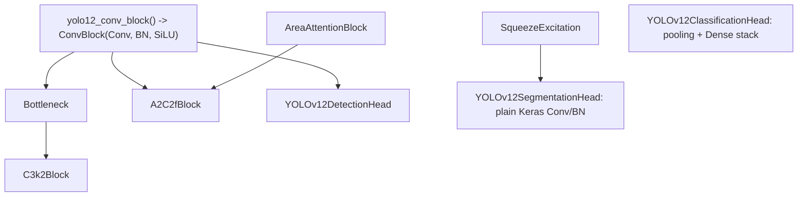

# yolo12

Path: `src/dl_techniques/layers/yolo12/`
Purpose: YOLOv12 backbone blocks (`Bottleneck`, `C3k2Block`, `A2C2fBlock`) and three task heads (detection, segmentation, classification) as Keras 3 layers.

## Scope

In: the two modules `yolo12_blocks.py` and `yolo12_heads.py`, and an empty `__init__.py` (the package exports nothing; import from submodules).

Not here: the YOLOv12 models (`src/dl_techniques/models/vision/yolo12/feature_extractor.py`, `multitask.py`), the multitask loss (`src/dl_techniques/losses/yolo12_multitask_loss.py`), `AreaAttentionBlock` (`layers/transformers/area_attention_block.py`), `ConvBlock` (`layers/conv_blocks/conv_block.py`), `SqueezeExcitation` (`layers/conv_blocks/squeeze_excitation.py`), generic anchor-based heads (`layers/heads/vision`, `create_vision_head`).

Consumers (by grep of `layers.yolo12`): the two model files and the loss above.

## Architecture



- All layers are `keras.layers.Layer` subclasses, registered with `@register_dl_technique("dl_techniques.layers.yolo12.yolo12_blocks")` or `"...yolo12_heads"`.
- Blocks create sub-layers in `__init__` and build them explicitly in `build()` in computational order, then call `super().build`.
- Heads differ in when they create sub-layers; channel counts come from the input shapes, so anything that depends on them waits for `build()`:
  - `YOLOv12DetectionHead`: `bbox_branches` / `cls_branches` are empty `keras.Sequential` shells in `__init__`; all layers are added and built in `build()`.
  - `YOLOv12SegmentationHead`: `upconv_blocks` and `skip_convs` are empty `Sequential` shells and `attention_blocks` holds `None` placeholders in `__init__`; `build()` replaces them with real layers. `final_conv` and `dropout` (only if `dropout_rate > 0`) are fully constructed in `__init__`; `build()` only calls their `build`.
  - `YOLOv12ClassificationHead`: `pooling_layers`, `dense_layers`, `dropout_layers` (only if `dropout_rate > 0`) and `final_dense` are fully constructed in `__init__`; `build()` only calls their `build`. Only `attention_pooling` is created in `build()`.
- Heads take a Python `list` of exactly 3 tensors `[P3, P4, P5]`, NHWC, strides 8, 16, 32.

## Key files

| File | Role | Notes |
| --- | --- | --- |
| `yolo12_blocks.py` | Backbone blocks and conv helper | 671 lines. Imports `from keras import ops` (module-level `ops.concatenate`, `ops.shape`). |
| `yolo12_heads.py` | Three heads plus the task-refusal helper | 1108 lines. Uses `keras.ops` qualified. Logs via `dl_techniques.utils.logger`. |
| `__init__.py` | Empty | No `__all__`. |

## Public interface

`yolo12_blocks.py`

- `YOLO12_NORM_KWARGS: Dict[str, Any] = {"epsilon": 1e-3, "momentum": 0.97}`. Ultralytics port values (momentum flipped from PyTorch 0.03). `yolo12_conv_block` and `A2C2fBlock`'s `AreaAttentionBlock`s receive `dict(YOLO12_NORM_KWARGS)` copies.
- `yolo12_conv_block(filters, kernel_size=3, strides=1, padding="same", groups=1, activation=True, use_bias=False, kernel_initializer="he_normal", kernel_regularizer=None, **kwargs) -> ConvBlock`. `activation=False` maps to `activation_type="linear"`. Always `normalization_type="batch_norm"`. Extra kwargs go to `ConvBlock` (e.g. `name`). Returns unbuilt.
- `Bottleneck(filters, shortcut=True, kernel_initializer="he_normal")`. `cv1` 3x3 with SiLU, `cv2` 3x3 linear. Shortcut added only if `shortcut` and `ops.shape(inputs)[-1] == filters`. `ValueError` if `filters <= 0`.
- `C3k2Block(filters, n=1, shortcut=True, kernel_initializer="he_normal")`. `hidden_filters = filters // 2`. `cv1`, `cv2` (1x1, hidden), `bottlenecks` list (`bottleneck_{i}`), `cv3` (1x1, `filters`). `ValueError` if `filters <= 0` or `n < 0`.
- `A2C2fBlock(filters, n=1, area=1, kernel_initializer="he_normal")`. `hidden_filters = filters // 2`. `cv1` (1x1), lists `attention_first_blocks` / `attention_second_blocks` (`attn_{i}_1`, `attn_{i}_2`, each `AreaAttentionBlock(dim=hidden, num_heads=max(1, hidden // 32), area=area)`), `cv2` (1x1, `filters`, input `hidden * (n + 1)` channels). `ValueError` if `filters <= 0`, `n < 0` or `area <= 0`.
- Every block: `compute_output_shape` sets last dim to `filters`; `get_config` returns constructor args with the initializer serialized.
- `_fresh_initializer(initializer)` (private): `keras.initializers.get(keras.initializers.serialize(initializer))`, a new instance with the same config.

`yolo12_heads.py`

- `YOLOV12_HEAD_TASKS = frozenset({DETECTION, SEGMENTATION, CLASSIFICATION})` of `VisionTaskType`.
- `refuse_tasks_without_a_yolov12_head(task_config: TaskConfiguration, owner: str) -> None`. Reads only `task_config.get_enabled_tasks()`. Raises `ValueError` naming `owner`, the unsupported task values, and `create_vision_head`. Called by `YOLOv12MultiTask` and `YOLOv12MultiTaskLoss` before building anything. Deliberately refuses rather than routing other tasks to `create_vision_head`: the generic heads are anchor-based and `YOLOv12MultiTaskLoss` has no sub-loss for them, so a mixed model would train a head nothing supervises.
- `YOLOv12DetectionHead(num_classes=80, reg_max=16, bbox_channels=None, cls_channels=None, kernel_initializer="he_normal", kernel_regularizer=None)`. Output `(B, sum(H_i*W_i), 4*reg_max + num_classes)`, bbox values first, raw (no activation on the final 1x1 convs, which keep default bias).
- `YOLOv12SegmentationHead(num_classes=1, intermediate_filters=(128, 64, 32, 16), target_size=None, use_attention=True, dropout_rate=0.1, kernel_initializer="he_normal", kernel_regularizer=None)`. Output `(B, th, tw, num_classes)` logits.
- `YOLOv12ClassificationHead(num_classes=1, hidden_dims=(512, 256), pooling_types=("avg", "max"), use_attention=True, dropout_rate=0.3, kernel_initializer="he_normal", kernel_regularizer=None)`. Output `(B, num_classes)` logits.
- Heads: `compute_output_shape` returns `(None, ..., ...)` fallbacks when the input is not a 3-list or spatial dims are `None`.

## Data shapes

| Tensor | Shape |
| --- | --- |
| Head input | `[(B, H/8, W/8, C1), (B, H/16, W/16, C2), (B, H/32, W/32, C3)]` |
| Detection branch (per scale) | bbox `(B, H*W, 4*reg_max)`, cls `(B, H*W, num_classes)` |
| Detection default widths | bbox `max(16, C // 4, reg_max * 4)`, cls `max(C, min(num_classes, 100))` |
| Segmentation stages | stage 0: P5 -> 2x, concat processed P4 (`2*f0` ch); stage 1: 2x, concat processed P3 (`2*f1` ch); stages 2+: 2x each; then bilinear resize, dropout, 1x1 conv |
| Segmentation target | `target_size` or `(P3 h * 8, P3 w * 8)`; `(256, 256)` fallback with a warning if P3 spatial dims are `None` |
| Classification feature dim | `sum(C_i) * len(pooling_types)`; attention gate width `max(total // 4, 16)` |

Config keys (from `get_config`): blocks `filters`, `n`, `shortcut` / `area`, `kernel_initializer`. Heads: all constructor args; `kernel_regularizer` serialized via `keras.regularizers.serialize`. Segmentation `intermediate_filters`, classification `hidden_dims` and `pooling_types` are stored as lists (classification stores a list rather than the tuple default because `get_config` has always emitted a list).

## Invariants and constraints

- `YOLO12_NORM_KWARGS` is the single home of the BN epsilon/momentum pair (one dict instead of per-site literals, so every BN site shares it). `create_normalization_layer` silently falls back to 1e-6 / 0.99 if these are omitted, so any new BN site in blocks must pass them.
- Block convs come from `yolo12_conv_block`, whose defaults are `use_bias=False` and `kernel_initializer="he_normal"`. The blocks never pass `use_bias`, so their convs are bias-free (the BN that follows has its own beta). He-normal holds only at the default: `kernel_initializer` is a constructor argument of every block and of `yolo12_conv_block`. The detection head's `bbox_{i}_pred` / `cls_{i}_pred` `Conv2D` layers are plain Keras convs with the default bias.
- Initializer sharing: a Keras `Initializer` instance reused by two same-shape sub-layers draws identical weights.
  - `Bottleneck.cv2` and `C3k2Block.cv2` get `_fresh_initializer(...)`.
  - `cv1` and the other sites deliberately keep the shared object, so same-role correlation across blocks is unchanged.
  - `A2C2fBlock` passes the shared object everywhere because its `cv1`/`cv2` have different shapes and `AreaAttentionBlock` decorrelates its own pair.
  - `YOLOv12DetectionHead` clones with `clone_initializer(self.kernel_initializer)` at every site (a shared instance once produced 161 bit-identical weight pairs, 6 of them across different roles, per the source comment).
  - `YOLOv12SegmentationHead` and `YOLOv12ClassificationHead` pass the one shared `self.kernel_initializer` object to all their convs and denses; they do not clone.
- Do not make `cv1`/`cv2` in `Bottleneck` or `C3k2Block` share an initializer instance again.
- Segmentation head: `skip_convs` and `attention_blocks` exist only for the first `min(2, len(intermediate_filters))` stages; `attention_blocks` is non-empty only when `use_attention`. `SqueezeExcitation(reduction_ratio=0.25)`.
- Segmentation and classification heads use plain `keras.layers.BatchNormalization` (Keras defaults), not `YOLO12_NORM_KWARGS`; the detection head uses `yolo12_conv_block` so it does.
- Classification head: pooling layers and dense layers are called without `training`; only the attention gate and dropout layers receive it. `attention_pooling` is created only if `use_attention` and the summed channel count is known and > 0.
- Registered package strings must stay `dl_techniques.layers.yolo12.yolo12_blocks` / `yolo12_heads` (matching defining module path).
- Blocks and heads are built via explicit `build()`; keep sub-layer build order equal to the compute order so weight lists and saved archives stay stable.

## Dependencies

Internal:

- `dl_techniques.utils.keras_registration.register_dl_technique`
- `dl_techniques.layers.conv_blocks.conv_block` (`ConvBlock`)
- `dl_techniques.layers.transformers.area_attention_block.AreaAttentionBlock`
- `dl_techniques.layers.conv_blocks.squeeze_excitation.SqueezeExcitation`
- `dl_techniques.initializers.clone_initializer`
- `dl_techniques.layers.heads.vision.task_types` (`VisionTaskType`, `TaskConfiguration`)
- `dl_techniques.utils.logger.logger`

External: `keras` (Keras 3, >= 3.8).

## Failure modes

All raise `ValueError`.

| Trigger | Message gist |
| --- | --- |
| Block `filters <= 0`, `n < 0`, `area <= 0` | "... must be positive / non-negative" |
| Detection head: `num_classes <= 0`, `reg_max <= 0`, channel lists not length 3 or with non-positive values | validation in `__init__` |
| Head input not a `list`, or not length 3 | in `build()`, and again in `call()` |
| Detection head: a feature map with `None` channels | "Input channels for scale i cannot be None" |
| Segmentation: `len(intermediate_filters) < 2`, `dropout_rate` outside [0, 1], bad `target_size` | validation in `__init__` |
| Classification: empty `hidden_dims` / `pooling_types`, non-positive dims, pooling type not in `{"avg", "max"}`, `dropout_rate` outside [0, 1] | validation in `__init__` |
| Any sub-layer `build` failure inside heads | re-raised as `ValueError("Failed to build ...: ...")`, message embeds the original exception text |
| Task outside `YOLOV12_HEAD_TASKS` | `refuse_tasks_without_a_yolov12_head` |

## Working here

- Follow the existing Sphinx/reST docstring style (`:param:` / `:type:`). Match the file; do not convert it.
- New YOLO conv sites in blocks: use `yolo12_conv_block`, not a raw `ConvBlock` or Conv2D+BN, so the norm pair stays in one place.
- New sub-layers sharing a shape with a sibling need their own initializer instance (`_fresh_initializer` in blocks, `clone_initializer` in heads).
- Changing `get_config` keys, registration strings, `YOLO12_NORM_KWARGS`, or sub-layer names (`cv1`, `bbox_{i}_conv1`, ...) affects saved weights and model-level tests.
- Tests: `tests/test_layers/test_yolo12/` (`test_yolo12.py`, `test_yolo12_heads.py`, `test_the_yolo12_conv_block_contract_is_pinned.py`, `test_the_yolo12_relocation_is_equivalent.py`). Model-level: `tests/test_models/test_yolo12/`. Registry: `tests/test_serialization_registry.py`.
- Run only the scoped suites, not the full test suite:

```bash
.venv/bin/python -m pytest tests/test_layers/test_yolo12/ tests/test_models/test_yolo12/ -q
```

- No `print`; use the library logger.
