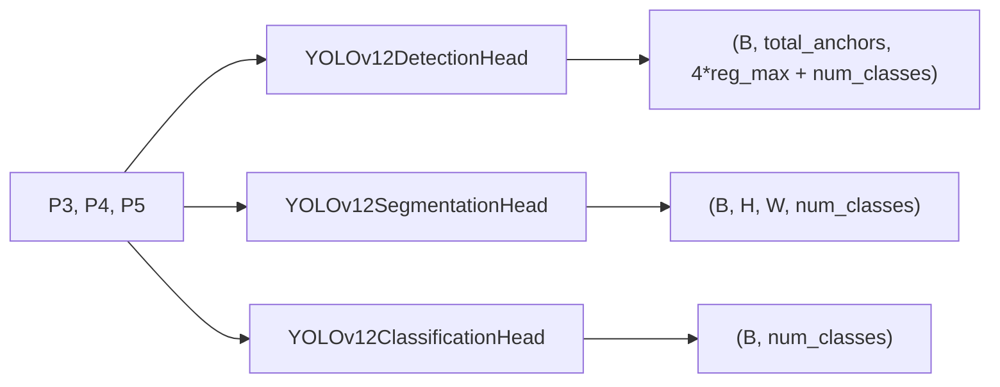

# yolo12

Keras 3 layers for the YOLOv12 object detection family: three backbone building blocks and three task heads (detection, segmentation, classification). It lives in `src/dl_techniques/layers/yolo12/` of the `dl_techniques` library.

## What it is for

YOLOv12 is a real-time vision network. Its backbone turns an image into three feature maps at different resolutions, called P3, P4 and P5 (1/8, 1/16 and 1/32 of the input height and width). A "head" reads those three maps and produces a task answer.

This package holds the reusable layers. The blocks are what a YOLOv12 backbone is built from. The heads are what you put on top of the three feature maps. The full models (feature extractor, multitask model) and the multitask loss live elsewhere and import from here.

## How it works

Blocks (`yolo12_blocks.py`):

- `yolo12_conv_block(...)` is a function, not a class. It returns a shared `ConvBlock` configured as Conv2D, then BatchNorm, then SiLU (or no activation). The conv has no bias and uses He-normal init. BatchNorm always uses `epsilon=1e-3, momentum=0.97`, kept in one dict, `YOLO12_NORM_KWARGS`.
- `Bottleneck` is two 3x3 conv blocks. The second one has no activation. If `shortcut=True` and the input channel count equals `filters`, the input is added to the output.
- `C3k2Block` splits the input into two 1x1 paths of `filters // 2` channels each. One path runs through `n` `Bottleneck` layers, the other passes through. Both are concatenated and fused by a 1x1 conv to `filters` channels.
- `A2C2fBlock` runs a 1x1 conv to `filters // 2` channels, then `n` pairs of `AreaAttentionBlock`. Every stage's output, including the first, is kept. All `n + 1` tensors are concatenated and fused by a 1x1 conv to `filters` channels.

Heads (`yolo12_heads.py`). Each takes a list of exactly three feature maps `[P3, P4, P5]`, shaped `(B, H/8, W/8, C1)`, `(B, H/16, W/16, C2)`, `(B, H/32, W/32, C3)`:



- `YOLOv12DetectionHead`: per scale, a bbox branch (two 3x3 conv blocks, then a 1x1 conv to `4 * reg_max`) and a class branch (depthwise 3x3, pointwise 1x1, depthwise 3x3, pointwise 1x1, then a 1x1 conv to `num_classes`). Each scale is flattened to `(B, H*W, ...)`, bbox and class outputs are joined on the last axis (bbox first), and the three scales are joined on the anchor axis. Outputs are raw values, with no sigmoid or softmax applied.
- `YOLOv12SegmentationHead`: starts at P5 and upsamples by 2x per stage with a transposed conv plus a refine conv. After stage 0 it concatenates a 1x1-processed P4. After stage 1 it concatenates a 1x1-processed P3. Optional squeeze-and-excitation attention follows each concatenation. Remaining stages upsample further. The result is bilinear-resized to the target size, passed through dropout, then a 1x1 conv gives `num_classes` channels (logits).
- `YOLOv12ClassificationHead`: global average and/or max pooling on each scale, all concatenated, optionally re-weighted by a small sigmoid gate, then ReLU dense layers with dropout and a final dense layer that outputs logits.

## Files

- `__init__.py` - empty. The package exports nothing; import from the submodules.
- `yolo12_blocks.py` - `YOLO12_NORM_KWARGS`, `yolo12_conv_block()`, `Bottleneck`, `C3k2Block`, `A2C2fBlock`, and the private `_fresh_initializer()`.
- `yolo12_heads.py` - `YOLOv12DetectionHead`, `YOLOv12SegmentationHead`, `YOLOv12ClassificationHead`, plus `YOLOV12_HEAD_TASKS` and `refuse_tasks_without_a_yolov12_head()`.

## How to use it

```python
import keras
from dl_techniques.layers.yolo12.yolo12_blocks import C3k2Block, A2C2fBlock
from dl_techniques.layers.yolo12.yolo12_heads import (
    YOLOv12DetectionHead, YOLOv12SegmentationHead, YOLOv12ClassificationHead,
)

x = keras.Input((64, 64, 32))
x = C3k2Block(filters=64, n=2)(x)
x = A2C2fBlock(filters=64, n=1, area=1)(x)

p3 = keras.Input((80, 80, 64))
p4 = keras.Input((40, 40, 128))
p5 = keras.Input((20, 20, 256))

det = YOLOv12DetectionHead(num_classes=80, reg_max=16)([p3, p4, p5])      # (None, 8400, 144)
seg = YOLOv12SegmentationHead(num_classes=3)([p3, p4, p5])                 # (None, 640, 640, 3)
cls = YOLOv12ClassificationHead(num_classes=10)([p3, p4, p5])              # (None, 10)
```

To refuse unsupported tasks in a multitask owner, call `refuse_tasks_without_a_yolov12_head(task_config, "MyOwner")`. It raises `ValueError` if the config enables any task other than detection, segmentation or classification.

## Things to know

- Layout is channels-last (NHWC).
- Heads require a Python `list` of exactly 3 tensors. A tuple raises `ValueError`.
- The detection head raises `ValueError` if any feature map has an unknown (`None`) channel dimension.
- Detection output channel order is `[4 * reg_max bbox values, num_classes class values]`. Defaults for branch widths: bbox `max(16, C // 4, reg_max * 4)`, class `max(C, min(num_classes, 100))`, where `C` is the scale's input channels. `bbox_channels` and `cls_channels`, if given, must have length 3.
- Segmentation `target_size` defaults to `(P3 height * 8, P3 width * 8)`. If P3 spatial size is unknown at build, it falls back to `(256, 256)` and logs a warning. `intermediate_filters` needs at least 2 entries; only the first two stages have skip connections.
- Segmentation and classification defaults: `num_classes=1`, dropout 0.1 and 0.3.
- Sub-layer creation differs per head. `YOLOv12DetectionHead` creates all its conv branches in `build()`. `YOLOv12SegmentationHead` creates its upsampling blocks, skip convs and SE attention in `build()`, but creates `final_conv` and `dropout` in `__init__`. `YOLOv12ClassificationHead` creates its pooling, dense, dropout and final dense layers in `__init__`, and only the attention gate in `build()`. In all three, weights exist only after the head is called or built.
- `Bottleneck` adds its shortcut only when the input channel count equals `filters`. In `C3k2Block` and `A2C2fBlock`, `filters` should be even because the hidden width is `filters // 2`.
- `n=0` is allowed for `C3k2Block` and `A2C2fBlock`.
- `A2C2fBlock` uses `num_heads = max(1, filters // 2 // 32)` in each attention block.
- Classes are registered with `register_dl_technique` under `dl_techniques.layers.yolo12.yolo12_blocks` and `dl_techniques.layers.yolo12.yolo12_heads`. A saved model that uses them needs these modules imported before loading.
- Tests live in `tests/test_layers/test_yolo12/`.
