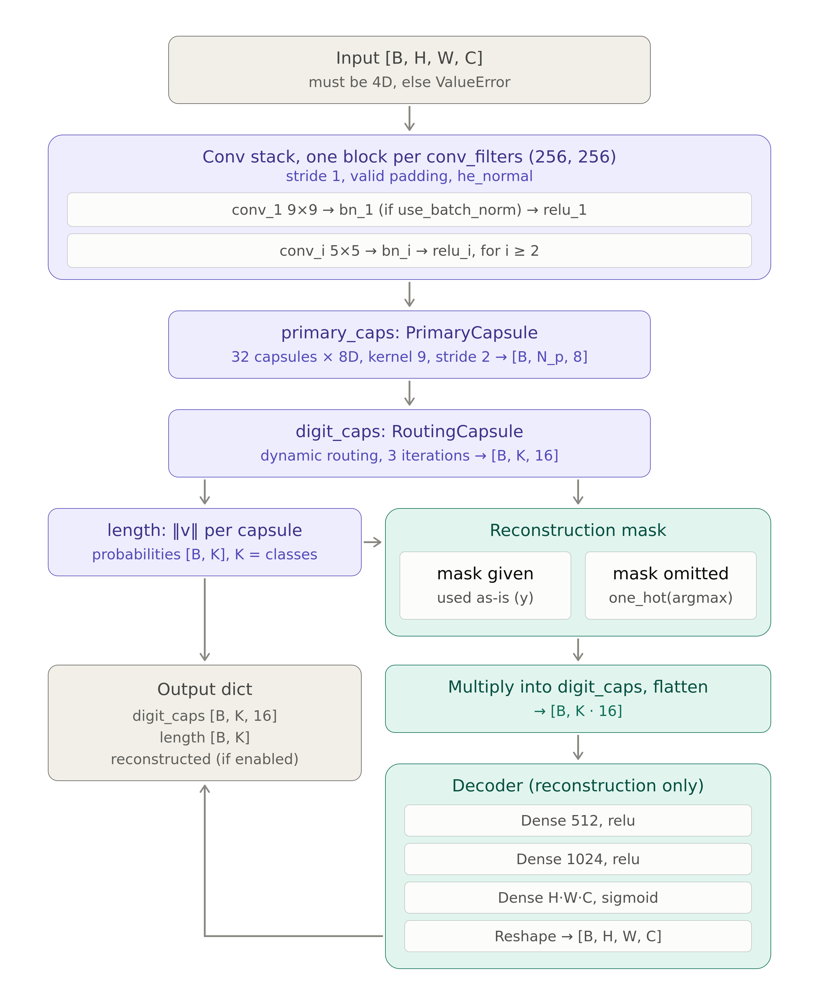

# CapsNet: A Keras 3 Implementation of Capsule Networks

[](https://keras.io/)
[](https://www.python.org/)
[](https://www.tensorflow.org/)

A Keras 3 implementation of **Capsule Networks (CapsNet)**, as proposed by Sabour, Frosst, and Hinton. This architecture introduces a novel approach to feature representation that preserves hierarchical spatial relationships, making it inherently more robust to rotation, translation, and other affine transformations compared to traditional Convolutional Neural Networks (CNNs).

This package holds two models. **`CapsNet`** (`model.py`) is the original: dynamic routing-by-agreement, a reconstruction decoder and its own `train_step`. **`CapsNetV2`** (`model_v2.py`) routes in one attention step, returns one tensor of capsule lengths so it trains through stock `compile`/`fit`, and takes either the original convolution trunk or a ResNet backbone as its stem. Sections 1 to 3 and 15 describe the original algorithm; section 4.6 describes `CapsNetV2`.

---

## Table of Contents

1. [Overview: What is CapsNet and Why It Matters](#1-overview-what-is-capsnet-and-why-it-matters)
2. [The Problem CapsNet Solves](#2-the-problem-capsnet-solves)
3. [How CapsNet Works: Core Concepts](#3-how-capsnet-works-core-concepts)
4. [Architecture Deep Dive](#4-architecture-deep-dive)
5. [Quick Start Guide](#5-quick-start-guide)
6. [Component Reference](#6-component-reference)
7. [Configuration & Key Hyperparameters](#7-configuration--key-hyperparameters)
8. [Comprehensive Usage Examples](#8-comprehensive-usage-examples)
9. [Advanced Usage Patterns](#9-advanced-usage-patterns)
10. [Performance Optimization](#10-performance-optimization)
11. [Training and Best Practices](#11-training-and-best-practices)
12. [Serialization & Deployment](#12-serialization--deployment)
13. [Testing & Validation](#13-testing--validation)
14. [Troubleshooting & FAQs](#14-troubleshooting--faqs)
15. [Technical Details](#15-technical-details)
16. [Citation](#16-citation)

---

## 1. Overview: What is CapsNet and Why It Matters

### What is CapsNet?

**Capsule Networks (CapsNet)** are a neural network architecture designed to overcome fundamental limitations of traditional CNNs. Instead of using individual neurons, CapsNets use groups of neurons called **capsules**. Each capsule outputs a vector that represents a specific entity or part of an object. The length of the vector signifies the probability of the entity's existence, while its orientation encodes the entity's properties (e.g., pose, rotation, scale).

### Key Innovations

1.  **Capsules as Feature Detectors**: Capsules learn to detect specific features and their instantiation parameters (like position and orientation), preserving richer information than the scalar outputs of traditional neurons.
2.  **Dynamic Routing-by-Agreement**: CapsNets replace the information-destroying max-pooling layers of CNNs with a **dynamic routing** mechanism. Lower-level capsules send their predictions to higher-level capsules, and connections are strengthened only when multiple lower-level capsules "agree" on the presence of a higher-level entity. This enforces a strong part-whole relationship.
3.  **Reconstruction Regularization**: An optional decoder network is trained to reconstruct the input image from the final capsule representation. This forces the capsules to learn useful and descriptive features.

### Why CapsNet Matters

**The Convolutional Neural Network (CNN) Problem**:
```
Problem: Recognize objects robustly, regardless of viewpoint.
CNN's Approach:
  1. Learn feature detectors (e.g., for eyes, noses, mouths).
  2. Use max-pooling to achieve local invariance and reduce dimensionality.
  3. Limitation: Pooling discards precise spatial information. A CNN might recognize
     a face's features but fail to notice they are in the wrong positions.
  4. Result: CNNs require massive data augmentation to learn viewpoint invariance and
     can be brittle to small spatial perturbations.
```

**CapsNet's Solution**:
```
CapsNet's Approach:
  1. Capsules detect features AND their properties (e.g., "an eye, rotated 15 degrees").
  2. Dynamic routing checks for agreement. A "face" capsule is only activated if the
     "eye," "nose," and "mouth" capsules' predictions are spatially consistent.
  3. Benefit: Achieves much stronger invariance with less data and creates more
     interpretable representations. It understands not just *what* it sees, but
     *how* the parts are arranged.
```

---

## 2. The Problem CapsNet Solves

### The "Picasso Problem": Beyond a Bag of Features

A standard CNN can be thought of as a "bag-of-features" model. It detects the presence of features but struggles to understand their precise spatial relationships.

```
┌─────────────────────────────────────────────────────────────┐
│  The Dilemma of CNNs (The Picasso Problem)                  │
│                                                             │
│  CNN View:                                                  │
│    - "I see an eye."                                        │
│    - "I see another eye."                                   │
│    - "I see a nose."                                        │
│    - "I see a mouth."                                       │
│    - Conclusion: "It's a face!" (even if scrambled)         │
│                                                             │
│  CapsNet View:                                              │
│    - "I see an eye capsule at position (x1, y1)."           │
│    - "I see a nose capsule at position (x2, y2)."           │
│    - "Prediction for 'face' capsule from eye: ..."          │
│    - "Prediction for 'face' capsule from nose: ..."         │
│    - Routing: "The predictions agree! Activate the 'face'   │
│      capsule."                                              │
└─────────────────────────────────────────────────────────────┘
```

CapsNet's routing mechanism forces the network to learn and verify the hierarchical structure of objects, making it fundamentally more robust to viewpoint changes.

---

## 3. How CapsNet Works: Core Concepts

### The Architectural Flow

```
┌─────────────────────────────────────────────────────────────────────────┐
│                          CapsNet Complete Data Flow                     │
└─────────────────────────────────────────────────────────────────────────┘

STEP 1: FEATURE EXTRACTION
──────────────────────────
Input Image (H, W, C)
    │
    ├─► Standard Conv2D Layers
    │   (Extract low-level features like edges and textures)
    │
    └─► Feature Maps


STEP 2: PRIMARY CAPSULES
────────────────────────
Feature Maps
    │
    ├─► PrimaryCapsule Layer
    │   (Groups CNN features into the first set of capsule vectors)
    │
    └─► Primary Capsule Vectors


STEP 3: ROUTING CAPSULES
────────────────────────
Primary Capsule Vectors
    │
    ├─► RoutingCapsule Layer
    │   (Uses dynamic routing to form higher-level capsules)
    │
    └─► Final "Digit" Capsules (one per class)


STEP 4: OUTPUT & RECONSTRUCTION
───────────────────────────────
Final Capsules
    │
    ├─► Capsule Lengths (L2 Norm) ──► Class Predictions
    │
    └─► [Optional] Masked Capsule ──► Decoder Network ──► Reconstructed Image
```

---

## 4. Architecture Deep Dive

### 4.1 `PrimaryCapsule` Layer

-   **Purpose**: To bridge the gap between standard CNN feature maps and the capsule world.
-   **Functionality**: It applies a convolutional operation to the input feature maps and then reshapes the output into a set of low-level capsule vectors. A non-linear "squashing" activation is applied to ensure vector lengths are between 0 and 1.

### 4.2 `RoutingCapsule` Layer

-   **Purpose**: The heart of the network. It implements the iterative **dynamic routing-by-agreement** algorithm.
-   **Functionality**: For each potential parent capsule, it takes predictions from all child capsules in the layer below. It iteratively adjusts "coupling coefficients" to determine which children's predictions are consistent. Strong agreement leads to a high-magnitude output vector for the parent capsule.

### 4.3 `Squash` Activation

-   **Purpose**: A non-linear activation function applied to capsule vectors.
-   **Functionality**: It "squashes" the vector, scaling its magnitude to be between 0 and 1 without changing its orientation. This allows the length to be interpreted as a probability.
    `squash(s) = (||s||^2 / (1 + ||s||^2)) * (s / ||s||)`

### 4.4 `CapsuleMarginLoss`

-   **Purpose**: A custom loss function designed for capsule lengths.
-   **Functionality**: It penalizes the model if the correct class's capsule is too short (length < 0.9) or if any incorrect class's capsule is too long (length > 0.1). This enforces a clear margin between the "winning" capsule and all others.

### 4.5 The convolution trunk: `conv_blocks`

Both models start with a trunk of single-convolution `ConvStem` blocks, one per entry of `conv_filters` (`CapsNet`) or `legacy_conv_filters` (`CapsNetV2` with `stem_type="legacy"`), kept in `model.conv_blocks`. Block `i` is named `conv_block_{i}` (counted from 0) and is

```
Conv2D(filters, 9x9 for block 0 and 5x5 for the others, stride 1, padding "valid", bias)
  -> BatchNormalization(epsilon=1e-3)      only when use_batch_norm (CapsNetV2: always)
  -> ReLU
```

The two models build the trunk through one function, `capsnet.model.build_capsule_conv_blocks`. The batch-norm epsilon is 1e-3, the Keras default these layers had before the trunk moved onto `ConvStem`; it is not a published value (the paper has no batch normalization), and the norm factory's own default of 1e-6 would have moved every block's statistics by 1000x. The equivalence to the hand-written layers is proven at `rtol=0, atol=0` for the output, the regularization loss, the `training=True` output and the batch-norm statistics by `tests/test_models/test_the_conv_stem_replicates_every_hand_rolled_stem.py` (six CapsNet cases).

The weights of block `i` are `conv_block_{i}/conv_block_{i}_conv1/{kernel,bias}` and, with batch norm, `conv_block_{i}/conv_block_{i}_norm1/{gamma,beta,moving_mean,moving_variance}`. A default `CapsNet` has 16 weights without the decoder and 22 with it, before its first call as after.

### 4.6 `CapsNetV2`: attention routing and a choice of stem

-   **Stem**: `stem_type="legacy"` is the trunk above (`model.conv_blocks`, `model.stem` is `None`); `"resnet18"` to `"resnet152"` builds a headless `ResNet` held as `model.stem` (named `stem`, `conv_blocks` empty), with the primary-capsule convolution fixed to 1x1, stride 1. `stem_pretrained` is `False`, a local `.keras` path, or `True`, which raises `NotImplementedError`: no ResNet weights ship with this package.
-   **Routing**: `CapsuleBlockV2` wraps `AttentionRoutingCapsule`, which scores every input capsule against one learned query per output capsule and takes a single softmax, instead of the iterative loop. Its transformation `W`, query `q` and probability-head kernel are three independent draws.
-   **Output**: `call` returns the capsule lengths, shape `(batch, num_classes)`, so the model compiles and trains like any Keras model. `reconstruct(images, mask=None)` runs the decoder; reconstruction never enters the loss.
-   **Build**: `build` materializes everything `call` runs and also the decoder, so a model with `reconstruction=True` that is saved and loaded keeps its decoder weights. (Before this change the loaded model held none of the decoder's weights, and its `reconstruct` differed from the saved model's by 0.06 to 0.15 on the measured configuration.)
-   **Factories**: `create_capsnet_v2(num_classes, input_shape, stem_type="legacy", ...)` builds and compiles it with AdamW, a cosine schedule with warmup, EMA and gradient clipping, and the capsule margin loss or categorical cross-entropy; `create_capsnet_v2_pretrained(backbone="resnet18", ...)` is the same with a ResNet stem; its `pretrained` argument is a local `.keras` weights path, and `True` (its default) raises `NotImplementedError`, since no weights are distributed.

```python
from dl_techniques.models.vision.capsnet import create_capsnet_v2

model = create_capsnet_v2(num_classes=10, input_shape=(28, 28, 1), stem_type="legacy",
                          decay_steps=1000)
model.fit(x_train, y_train_one_hot, epochs=1)      # stock fit: the call returns one tensor
digit_capsules = model.get_capsules(x_test[:8])    # (8, 10, 16)
```

### 4.7 Initializers

`kernel_initializer` is stored as a name or a serialized config (an `Initializer` instance is serialized once) and every block, capsule layer, decoder layer and the ResNet backbone resolves its own instance from it. A single seedless instance handed to all of them would replay one random sample at every kernel (the old code did: 21 of 21 kernel pairs of a default `CapsNet` carried the same numbers, and the attention routing layer tied its `W`, `q` and probability head). A seeded instance, or a config with an explicit `seed`, keeps that seed at every site by contract, so same-shaped kernels start equal.



---

## 5. Quick Start Guide

### Installation

```bash
# Install Keras 3 and a backend (e.g., tensorflow)
pip install keras tensorflow numpy
```

### Your First CapsNet Model (30 seconds)

Let's build a CapsNet for MNIST classification.

```python
import keras
import numpy as np

# Local imports from your project structure
from dl_techniques.models.vision.capsnet.model import create_capsnet

# 1. Create a CapsNet model for MNIST (28x28 grayscale images, 10 classes)
# The factory function handles creation and compilation.
model = create_capsnet(
    num_classes=10,
    input_shape=(28, 28, 1),
    routing_iterations=3,
    reconstruction=True  # Enable the reconstruction regularizer
)

# 2. The model is already compiled!
# It uses a custom train_step, so loss is handled internally.
print("✅ CapsNet model created and compiled successfully!")
model.summary()

# 3. Create dummy data for a forward pass
batch_size = 16
dummy_images = np.random.rand(batch_size, 28, 28, 1).astype("float32")
# Labels must be one-hot encoded for the margin loss
dummy_labels = keras.utils.to_categorical(
    np.random.randint(0, 10, batch_size), num_classes=10
)

# 4. Train for one step
# The model returns a dict of losses and metrics.
logs = model.train_on_batch(dummy_images, dummy_labels, return_dict=True)
print(f"\n✅ Training step complete! Logs: {logs}")

# 5. Run inference
# The model call returns a dictionary with capsule outputs and reconstructions
predictions = model.predict(dummy_images)
print(f"Prediction lengths shape: {predictions['length'].shape}") # (batch_size, 10)
print(f"Reconstruction shape: {predictions['reconstructed'].shape}") # (batch_size, 28, 28, 1)
```

---

## 6. Component Reference

| Component | Location | Purpose |
| :--- | :--- | :--- |
| **`CapsNet`** | `...capsnet.model.CapsNet` | The main Keras `Model` class with integrated `train_step`. |
| **`create_capsnet`** | `...capsnet.model.create_capsnet` | Factory function to create and compile a standard model. |
| **`CapsNetV2`** | `...capsnet.model_v2.CapsNetV2` | Attention-routed capsule network; returns the capsule lengths; `stem_type` picks the legacy trunk or a ResNet backbone. |
| **`create_capsnet_v2`**, **`create_capsnet_v2_pretrained`** | `...capsnet.model_v2` | Factories that build and compile a `CapsNetV2` with the default training recipe. |
| **`build_capsule_conv_blocks`** | `...capsnet.model.build_capsule_conv_blocks` | The `ConvStem` trunk both models share. |
| **`ConvStem`** | `...layers.conv_blocks.stem.ConvStem` | One trunk block (`conv_block_{i}`). |
| **`AttentionRoutingCapsule`**, **`CapsuleBlockV2`** | `...layers.attention.attention_routing_capsule` | The single-step routing layer of `CapsNetV2` and its dropout/normalization wrapper. |
| **`PrimaryCapsule`** | `...layers.capsules.PrimaryCapsule` | Converts CNN features to initial capsules. |
| **`RoutingCapsule`** | `...layers.capsules.RoutingCapsule` | Implements the dynamic routing algorithm. |
| **`CapsuleMarginLoss`** | `...losses.capsule_margin_loss.CapsuleMarginLoss` | The margin-based loss function for training. |
| **`CapsuleAccuracy`** | `...metrics.capsule_accuracy.CapsuleAccuracy` | A custom metric that computes accuracy from capsule lengths. |

---

## 7. Configuration & Key Hyperparameters

The `CapsNet` model is configured via its constructor. Key parameters include:

| Parameter | Type | Default | Description |
| :--- | :--- | :--- | :--- |
| `num_classes` | `int` | - | Number of output classes (and final capsules). |
| `routing_iterations` | `int` | `3` | Number of iterations for dynamic routing. |
| `conv_filters` | `List[int]` | `[256, 256]`| Filters for the initial `Conv2D` layers. |
| `primary_capsules` | `int` | `32` | Number of primary capsule types. |
| `primary_capsule_dim`| `int` | `8` | Vector dimension of each primary capsule. |
| `digit_capsule_dim` | `int` | `16` | Vector dimension of each final class capsule. |
| `reconstruction` | `bool` | `True` | Whether to include the decoder for regularization. |
| `reconstruction_weight`|`float` | `0.01`| The weight of the reconstruction loss in the total loss. |
| `use_batch_norm` | `bool` | `True` | Whether each trunk block has a batch norm (epsilon 1e-3). |
| `input_shape` | `Tuple[int, int, int]` | `None` | Image shape; sets the decoder width. Stored as `input_shape_config`; `get_config` reports the shape `build` resolved. |
| `kernel_initializer` | `str`, `dict` or `Initializer` | `"he_normal"` | Stored as a spec; every site draws independently (section 4.7). |

`CapsNetV2` takes `num_classes` and `input_shape` (both required), `stem_type` (`"legacy"` or `"resnet18"` to `"resnet152"`), `stem_pretrained`, `legacy_conv_filters` (default `[256, 256]`), `primary_capsules`, `primary_capsule_dim`, `primary_kernel_size`, `primary_strides`, `digit_capsule_dim`, `reconstruction`, `decoder_architecture`, the routing options (`attention_softmax_axis`, `attention_top_k`, `use_load_balancing`, `load_balancing_weight`, `block_dropout_rate`, `block_direction_only_norm`), the margin options, `loss_type` and the initializer and regularizer. See its class docstring.

---

## 8. Comprehensive Usage Examples

### Example 1: Full Training on MNIST

```python
import tensorflow_datasets as tfds

# 1. Load and preprocess data
def preprocess(data):
    img = tf.cast(data['image'], tf.float32) / 255.0
    label = tf.one_hot(data['label'], 10)
    return img, label

ds = tfds.load('mnist', split='train', as_supervised=False).map(preprocess).batch(64)
val_ds = tfds.load('mnist', split='test', as_supervised=False).map(preprocess).batch(64)

# 2. Create and compile the model
model = create_capsnet(num_classes=10, input_shape=(28, 28, 1))

# 3. Train the model using the standard Keras .fit() method
history = model.fit(ds, epochs=10, validation_data=val_ds)
```

### Example 2: Disabling Reconstruction

For faster training or simpler tasks, you can disable the reconstruction decoder.

```python
model = create_capsnet(
    num_classes=10,
    input_shape=(28, 28, 1),
    reconstruction=False  # Disable the decoder
)
# The model will now only compute the margin loss.
model.fit(...)
```

---

## 9. Advanced Usage Patterns

### Tuning `routing_iterations`

This is the most critical hyperparameter in CapsNet. It controls the complexity of the routing-by-agreement process.

-   **`iterations=1`**: The model behaves like a standard feed-forward network with a special non-linearity. It's much faster but loses much of the benefit of routing.
-   **`iterations=3`**: The value recommended in the paper. It provides a strong balance between computational cost and performance, allowing the routing process to converge effectively.
-   **`iterations > 3`**: May provide marginal accuracy gains on very complex datasets at the cost of significantly slower training. It is rarely necessary.

---

## 10. Performance Optimization

### Mixed Precision Training

CapsNet's components (convolutions, dense transformations) are compatible with mixed precision, which can accelerate training on modern GPUs.

```python
# Enable mixed precision globally before creating the model
keras.mixed_precision.set_global_policy('mixed_float16')

# The model will now automatically use mixed precision
model = create_capsnet(num_classes=10, input_shape=(28, 28, 1))
```

---

## 11. Training and Best Practices

-   **Labels Must Be One-Hot Encoded**: The `CapsuleMarginLoss` requires `y_true` to be in one-hot format.
-   **Optimizer**: The original paper used `Adam` with its default parameters, which remains a solid choice.
-   **Loss Function**: The model's `train_step` is hard-coded to use the `capsule_margin_loss`. When compiling, you should pass `loss=None`, as any provided loss will be ignored.
-   **Metrics**: You must include `CapsuleAccuracy` in the `metrics` list during compilation to get meaningful accuracy readings.
-   **Data Augmentation**: CapsNet is designed to be less reliant on data augmentation than CNNs. Small shifts and rotations are good, but extensive augmentation may not be necessary.

---

## 12. Serialization & Deployment

The `CapsNet` model and all its custom layers (`PrimaryCapsule`, `RoutingCapsule`) and functions are fully serializable using Keras 3's modern `.keras` format.

### Saving and Loading

The model class includes convenient `save_model` and `load_model` methods that handle the `custom_objects` dictionary for you.

```python
# Create and train model
model = create_capsnet(num_classes=10, input_shape=(28, 28, 1))
# ... model.fit(...)

# Save the entire model to a single file
model.save_model('my_capsnet_model.keras')

# Load the model in a new session, with all custom logic intact
loaded_model = CapsNet.load_model('my_capsnet_model.keras')
print("✅ CapsNet model loaded successfully!")
```

### `CapsNetV2`

`CapsNetV2` saves and loads with `model.save(path)` and `keras.models.load_model(path)`; its decoder, when `reconstruction=True`, is part of the archive (section 4.6). `from_config` never reads stem weights from a `stem_pretrained` path: the archive already holds them.

### Archives written before the `ConvStem` trunk

Archives of `CapsNet` and `CapsNetV2` written by the earlier code do not load into the current models. Measured by saving each model with the earlier source (`be92a74eb`, and `20b48aba6^`, which gives the same results) and loading it with the current one, in a separate process:

| Archive | `keras.models.load_model` | `model.load_weights` into a current model |
| :--- | :--- | :--- |
| `CapsNet`, default and three convolutions | fails: "A total of 4 (6) objects could not be loaded ... Layer 'conv_block_0_conv1' expected 2 variables, but received 0" | the same error |
| `CapsNetV2`, legacy stem | refused: "Unrecognized keyword arguments passed to CapsNetV2: {'stem': 'legacy'}" | fails: 4 objects (7 with reconstruction) |
| `CapsNetV2`, ResNet stem | refused: the same, with `{'stem': 'resnet18'}` | from `be92a74eb` restores, outputs equal at `training=False` and `True`; from `20b48aba6^` fails (2 objects, the ResNet stem) |

The weights themselves are intact and move by path. Copying the weights of an earlier-revision model by these renames into a current model of the same configuration gives outputs equal at atol 0 for `CapsNet` (default and three convolutions), `CapsNetV2` with the legacy stem, with a ResNet-18 stem, and with reconstruction (its 19 non-decoder weights; see the last row):

| Earlier path | Current path |
| :--- | :--- |
| `capsnet/conv_{n}/{kernel,bias}` | `capsnet/conv_block_{n-1}/conv_block_{n-1}_conv1/{kernel,bias}` |
| `capsnet/bn_{n}/*` | `capsnet/conv_block_{n-1}/conv_block_{n-1}_norm1/*` |
| `capsnet_v2/legacy_conv_{n}/*`, `capsnet_v2/legacy_bn_{n}/*` | `capsnet_v2/conv_block_{n-1}/conv_block_{n-1}_conv1/*`, `.../conv_block_{n-1}_norm1/*` |
| `capsnet_v2/res_net/*` (the name carried a per-process counter) | `capsnet_v2/stem/*` |
| `CapsNetV2` config key `stem` | `stem_type` |
| `CapsNetV2` decoder weights (an archive saved before the first `reconstruct` call has none) | `capsnet_v2/reconstruction_decoder/*`, always present now |

The new starting weights differ from the earlier ones: every kernel now draws from its own initializer instance (section 4.7), so a freshly built model is not bit-equal to one built by the earlier code under the same seed (the first trunk block's kernel is equal at the default initializer, by coincidence of the seed counter, not by guarantee). Computation given the weights is unchanged.

---

## 13. Testing & Validation

A simple `pytest` test to ensure model creation and a forward pass work as expected.

```python
import pytest
import numpy as np
import keras
from dl_techniques.models.vision.capsnet.model import CapsNet

def test_capsnet_creation_and_forward_pass():
    """Test model creation and check output shapes."""
    model = CapsNet(num_classes=10, input_shape=(28, 28, 1))
    dummy_input = np.random.rand(4, 28, 28, 1).astype("float32")
    
    # Build the model before calling it
    model.build(dummy_input.shape)

    outputs = model.predict(dummy_input)
    assert 'length' in outputs
    assert 'reconstructed' in outputs
    assert outputs['length'].shape == (4, 10)
    assert outputs['reconstructed'].shape == (4, 28, 28, 1)
    print("✓ Forward pass has correct shape")
```

---

## 14. Troubleshooting & FAQs

**Issue 1: Training is very slow.**

-   **Cause**: Dynamic routing is computationally more expensive than max-pooling due to its iterative nature.
-   **Solution**:
    1.  For initial debugging, reduce `routing_iterations` to `1`.
    2.  Ensure you are using a GPU and have the necessary CUDA/cuDNN libraries installed correctly.
    3.  Use a smaller batch size if you are running out of memory.

### Frequently Asked Questions

**Q: Is CapsNet a replacement for CNNs?**

A: Not universally. CapsNet is a powerful architecture, but it's more complex and computationally intensive. It excels in tasks where preserving spatial hierarchies is critical (like object recognition with viewpoint changes). For simpler tasks like texture classification, a standard CNN may be more efficient.

**Q: Why does compilation use `loss=None`?**

A: Because all loss calculations (`margin_loss` and `reconstruction_loss`) are handled inside the model's `train_step` method. This encapsulates the custom training logic within the model itself, but means the standard `compile` loss argument is not used.

**Q: Can I use this on non-image data?**

A: The initial `Conv2D` layers are designed for 2D spatial data like images. To use it on 1D or 3D data, you would need to replace `Conv2D` with `Conv1D` or `Conv3D` and adapt the `PrimaryCapsule` layer accordingly.

---

## 15. Technical Details

### Dynamic Routing Algorithm

The routing process iteratively refines the connection strengths (`c_ij`) between a child capsule `i` and a parent capsule `j`.

1.  **Initialize**: Routing logits `b_ij` are initialized to zero.
2.  **Loop `r` times** (for `r` routing iterations):
    a. **Softmax**: `c_ij = softmax(b_ij)`. This normalizes the logits into coupling coefficients that sum to 1.
    b. **Weighted Sum**: The parent's input `s_j` is the sum of predictions from all children, weighted by the coefficients: `s_j = Σ_i (c_ij * u_hat_j|i)`.
    c. **Squash**: The parent's output vector is calculated: `v_j = squash(s_j)`.
    d. **Update Logits**: The logits are updated based on the agreement between the parent's output and the child's prediction: `b_ij += u_hat_j|i ⋅ v_j`.

### Margin Loss Formulation

For each class capsule `k`, the loss `L_k` is:
`L_k = T_k * max(0, m⁺ - ||v_k||)² + λ * (1 - T_k) * max(0, ||v_k|| - m⁻)²`

-   `T_k` is 1 if class `k` is the true class, 0 otherwise.
-   `m⁺` is the positive margin (e.g., 0.9).
-   `m⁻` is the negative margin (e.g., 0.1).
-   `λ` is a down-weighting factor for the negative loss (e.g., 0.5).

The total loss is the sum of `L_k` over all classes, plus the weighted reconstruction loss.

---

## 16. Citation

This implementation is based on the original research paper. If you use this work, please cite:

```bibtex
@inproceedings{sabour2017dynamic,
  title={Dynamic routing between capsules},
  author={Sabour, Sara and Frosst, Nicholas and Hinton, Geoffrey E},
  booktitle={Advances in neural information processing systems},
  pages={3856--3866},
  year={2017}
}
```