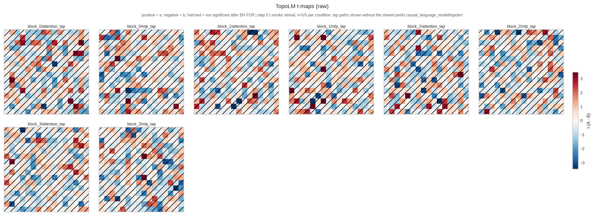
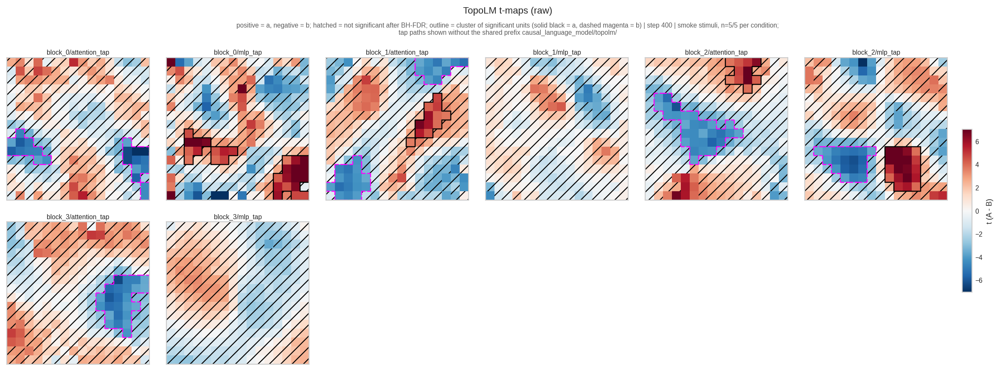
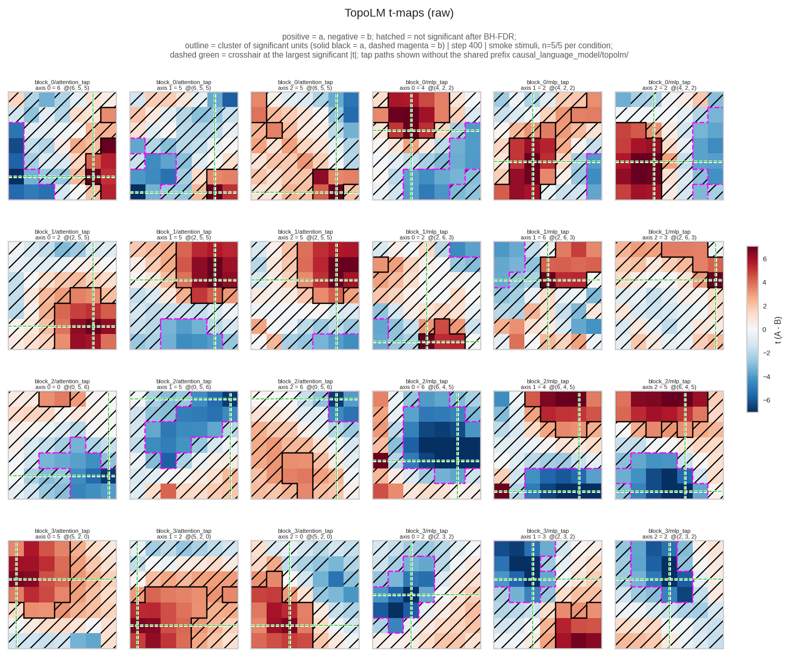
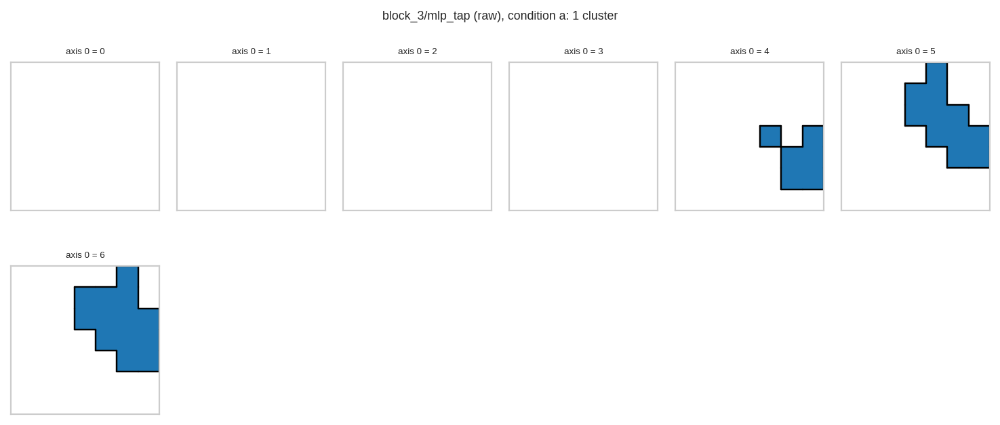
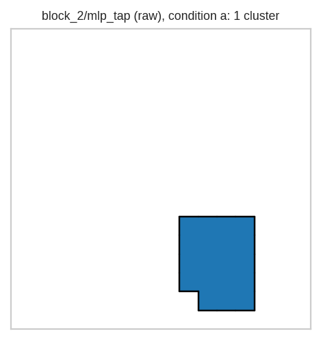
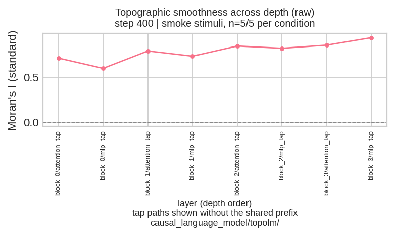
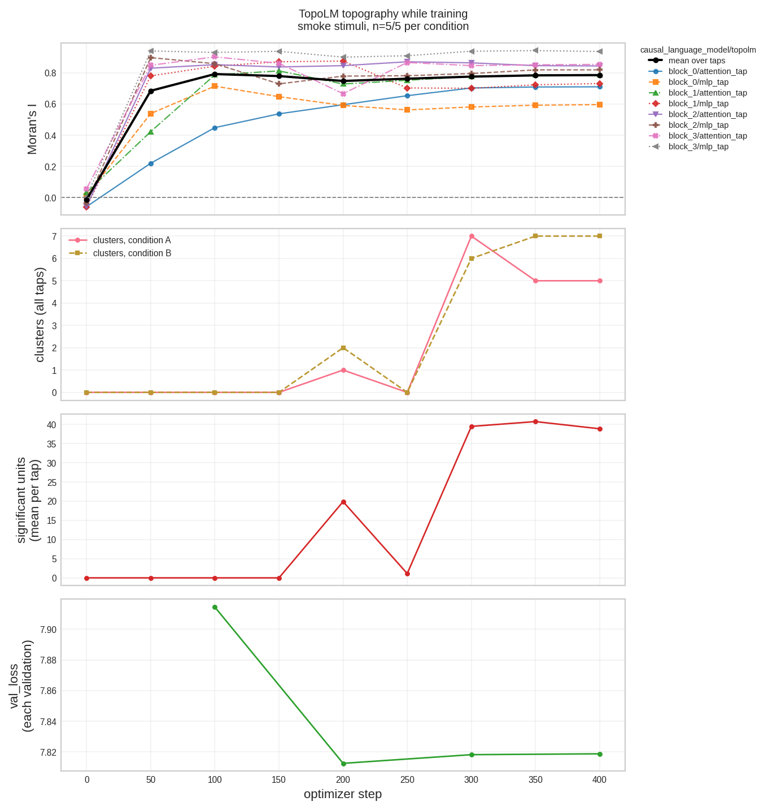

# `train/topolm`: pre-training a topographic language model

> Pipeline for [TopoLM](../../dl_techniques/models/language/topolm/README.md)
> (Rathi et al., ICLR 2025, [arXiv:2410.11516](https://arxiv.org/abs/2410.11516)).

```bash
MPLBACKEND=Agg python -m train.topolm.pretrain --variant tiny --train-steps 20
```

`MPLBACKEND=Agg` is required on a headless machine. The run draws training curves
at the end, and an unset backend reaches for X11 and takes the process down with
it.

---

## 1. Two things that would otherwise look like bugs

### The validation cadence *is* the virtual epoch length

Pretraining is roughly one pass over a text stream, and Keras only validates at
epoch ends. A run that validates once per pass cannot early-stop on the rule the
paper used, so `fit` is given `steps_per_epoch=eval_every_steps` and the
optimization-step count becomes `eval_every_steps * epochs`.

The consequence is stated rather than hidden: **that is not one pass over the
data.** Set `--train-steps` to pin the step count instead; the evaluation cadence
is then derived from it and is unchanged. Both numbers are logged before the
first step, and `resolve_cadence` reports how many steps one real pass would have
taken so the discrepancy is visible in the log rather than inferred later from a
short run.

```python
from train.topolm import TopoLMTrainingConfig, resolve_cadence

config = TopoLMTrainingConfig(eval_every_steps=100, train_steps=250)
resolve_cadence(config, real_steps_per_epoch=9_999)   # -> (3, 100)
```

250 steps at a 100-step cadence rounds *up* to three epochs, so no requested step
is dropped.

### The head must be told to aggregate the backbone's losses

`create_topolm_model` passes `aggregate_backbone_losses=True`, and it is
load-bearing. The taps reach the objective only through `backbone.losses`; without
the flag the head computes every penalty, discards it, and the run produces a
non-topographic model with a healthy curve.

Measured on identical weights at `alpha = 2.5`, same data, same seed, same taps:

| `aggregate_backbone_losses` | reported train loss | eval loss |
|---|---|---|
| `True` | **15.31** | 5.31 |
| `False` | **5.36** | 5.31 |

The evaluation loss is 5.31 either way, because the taps add nothing when
`training` is not `True`. That is the intended behaviour and it is what makes the
paper's reported 3.075 / 2.966 pair comparable.

---

## 2. What a run reports, and which number to read

`loss` alone cannot answer the question this trainer exists to ask. A rising curve
can be a rising task loss with a falling penalty, or the reverse, and the two look
identical in one number. Every run therefore also records, through
`SpatialLossLogger`:

| key | meaning |
|---|---|
| `spatial/<tap_name>` | that tap's penalty for the last batch |
| `spatial/total` | `sum(alpha_k * SL_k)` — the weighted total |
| `spatial/unweighted` | `sum(SL_k)` — with no `alpha` |
| `task_loss` | `loss - spatial/total` |
| `spatial/share` | `spatial/total / loss`, the fraction topography currently owns |
| `spatial/accounted` | `loss - compile_loss` — what the loop actually folded in |
| `spatial/unaccounted` | `spatial/total - accounted` |

**`spatial/unaccounted` is the one to watch.** It is non-zero exactly when the
backbone's losses are being computed and thrown away. Note that `task_loss` does
*not* reveal this: it equals `loss - spatial_total` by construction, whatever the
training loop did with the term.

---

## 3. Why not the shared callback factory

`train.common.create_nlp_callbacks` unconditionally installs
`keras.callbacks.EarlyStopping`. The rule the paper trained under is "**three
CONSECUTIVE INCREASES** on validation loss", which is a different question: the
stock callback counts from the best value seen, so a curve that dips to a new best
and then rises three times is stopped by the paper's rule and tolerated by the
stock one. Two stop signals on one run would also be two answers to one question.

So `build_callbacks` constructs its own list and takes `results_dir` from
`prepare_run_dir`.

```python
from train.topolm import TopoLMTrainingConfig, build_callbacks

callbacks = build_callbacks(config, head, results_dir, initial_step=0)
# [ConsecutiveIncreaseEarlyStopping, SpatialLossLogger,
#  StepCheckpointCallback, GenerationProbeCallback]
```

With `viz_every_steps > 0` the call also takes `backbone=` and `preprocessor=` and a
fifth callback, `TopographyLiveCallback`, is appended last (see *Watching a run*
in section 5). With the default `0` the list is the four above and nothing else
is added.

`ConsecutiveIncreaseEarlyStopping` restores the snapshot taken immediately before
the final streak — the last *good* evaluation, not the best one seen — which is
deliberately different from `EarlyStopping(restore_best_weights=True)`.

---

## 4. The optimizer recipe

The paper's numbers are the defaults, so the shipped configuration *is* the recipe
rather than an approximation of it:

```python
optimizer_builder({
    "type": "adamw",
    "beta_1": 0.9, "beta_2": 0.95,
    "weight_decay": 0.1,
    "gradient_clipping_by_norm": 1.0,          # GLOBAL norm
    "exclude_from_weight_decay": ["bias", "gamma", "beta", "embedding"],
}, schedule)
```

Two details that are not interchangeable:

- `gradient_clipping_by_norm` is the **global** norm. The builder also accepts
  `gradient_clipping_by_norm_local`, and the two keys look alike while clipping
  different quantities. "Gradient clipping at 1.0" means the global one.
- Weight decay is excluded for biases, the two normalization scales and the
  embedding table. Both exclusions matter: decaying a LayerNorm gain toward zero
  fights the very normalization the taps are trying to make spatially smooth, and
  the embedding table is **tied** to the output head, so decaying it decays both.

No `loss=` or `metrics=` are passed to `compile`. `CausalLanguageModel` owns its
loss and its `loss` / `accuracy` / `perplexity` trackers through a hand-rolled
`train_step`, so a compiled loss here would be inert config. `jit_compile` is not
passed either, so it stays at Keras's `"auto"`: XLA whenever a GPU is visible,
eager on a CPU-only host (`compile_model`'s docstring records the measurement:
`model.jit_compile` is `True` after the call on a GPU). That is why the taps'
index tables are int64 weights: an int32 weight is kept in host memory, where an
XLA step on a GPU cannot read it.

---

## 5. Running it

```bash
# The paper's shape.
MPLBACKEND=Agg python -m train.topolm.pretrain --variant paper --train-steps 100000

# The non-topographic control the paper compares against.
MPLBACKEND=Agg python -m train.topolm.pretrain --variant paper --alpha 0

# Both arms, identical seeds and data order, back to back.
MPLBACKEND=Agg python -m train.topolm.pretrain --variant tiny --paired

# The Fig. 12 ablation: one shared unit layout instead of one per tap.
MPLBACKEND=Agg python -m train.topolm.pretrain --no-permute

# A single-tap ablation, and the stopping rule relaxed.
MPLBACKEND=Agg python -m train.topolm.pretrain \
    --tap-sites attention --early-stop-patience 10

# Watch the topography form: a draw at step 0, every 50 optimizer steps and at the end.
MPLBACKEND=Agg python -m train.topolm.pretrain --variant tiny --train-steps 400 \
    --eval-every-steps 100 --viz-every-steps 50 --batch-size 8

# A 3D layout (343 units on a 7 x 7 x 7 box, radius 2), raw arm only.
MPLBACKEND=Agg python -m train.topolm.pretrain --variant tiny3d --train-steps 400 \
    --eval-every-steps 100 --viz-every-steps 50 --batch-size 8
```

`--variant` offers every row of `MODEL_VARIANTS`. The grid's rank comes from the
variant, so there is no grid flag: `paper3d` (1000 units on a 10 x 10 x 10 box,
radius 4) and `tiny3d` (343 units on 7 x 7 x 7, radius 2) train a 3D layout (see
*Training a 3D variant* below). `--radius` means a radius-`r` patch of
`(2r+1)**grid_dim` units. Left unset it resolves per variant: the row's own radius
for `tiny3d` (2) and `paper3d` (4), 5 (the paper's) for the 2D variants, and an
explicit value wins. `config.json` records the integer that was used.

Every flag maps onto exactly one field of `TopoLMTrainingConfig`, so `--help` and
`config.json` describe the same run — and
`tests/test_train/test_topolm/test_cli_contract.py` drives the real parser and the
real config builder to assert that every declared flag arrives, with set-equality
against the parser so a newly added flag fails until it is given a row.

### Two defaults that must match the tokenizer, not the paper

Both of these were wrong and both killed the run on its first batch, so they are
worth stating rather than leaving to `--help`:

| Flag | Value that works | Why the other value fails |
|---|---|---|
| `--vocab-size` | `100277` (default) | The trainer's tokenizer is Tiktoken `gpt2`: `encoding_name` is a field of `ClmPretrainConfig` (default `"gpt2"`) with no flag, and the run log says `encoding 'gpt2'`, `vocab_size=50257`. Its 50,257 base ids are followed by the four special ids the config assigns, 50257 to 50260 (`cls_token_id`, `sep_token_id`, `pad_token_id`, `mask_token_id`), so a table that holds all of them has at least 50,261 rows (derived: 50260 + 1). A 50,257-row table failed with `indices[..] = 50259 is not in [0, 50257)`, which is the pad id of that list. `100277` is larger than that and is the flag's default. |
| `--max-seq-length` | `512` (default) | The data pipeline chunks to this, so the position table must match. `build_backbone` forwards it to `max_seq_len`; before it did, a `tiny` run kept the variant's 256-entry table against 512-token windows and died with `indices[256] = 256 is not in [0, 256)`. |

An earlier version of this table said `create_tokenizer` uses `cl100k_base`, whose
special ids reach `100267`. That does not describe this trainer: `create_tokenizer`'s
own default is `cl100k_base`, but the trainer passes `config.encoding_name`. The
guard `_require_vocab_covers_tokenizer` compares `--vocab-size` with the larger of
the base `vocab_size` the log prints (50257) and the largest special id plus one
(50261), so a 50,257-row or 50,260-row table is refused at start-up by name, before
the dataset is built; `build_backbone` checks the same number. Both failures above
were measured on the pre-audit pipeline; the `--vocab-size 50257` case was not
re-run on the packed dataset path the trainer uses now.

Both are measured, not inferred: each was reproduced on a clean worktree at the
pre-audit commit before being fixed here. `build_backbone` now also raises, rather
than deferring the mismatch to the first forward.

### Run directory naming

```text
<save_dir>/topolm_<variant>_<topo|control>_alpha<a>_<timestamp>/
```

`alpha` is in the name because the control arm writes into the same tree, and the
two must not be confusable when they are read back months apart. Contents:
`config.json`, `training_history.json`, `training_curves.png`,
`topography_report.json`, `checkpoints/`, `generation_probes/`, plus the figures
below when topography ran, and `topography_live/` when `--viz-every-steps` is
positive.

### Figures

New to these pictures? [Reading the figures: a plain-language guide](#reading-the-figures-a-plain-language-guide)
explains every term and every mark, with an example of each figure.

| File | Contents |
|---|---|
| `t_maps_raw.png` | one t-map per tapped layer, shared diverging scale, rejected cells hatched, both conditions' clusters outlined (solid black for A, dashed magenta for B); on a 3D grid, three orthogonal planes per tap |
| `t_maps_readout.png` | the same, after the simulated fMRI Gaussian readout (2D variants only) |
| `morans_i_raw.png`, `morans_i_readout.png` | standard Moran's I against depth |
| `clusters_raw.png`, `clusters_readout.png` | one categorical cluster map per arm, from the deepest tap that found a cluster, drawn from condition A's clusters only and titled with the tap, the arm and the condition (`block_3/mlp_tap (raw), condition a: 1 cluster`; the t-map of the same tap outlines both conditions); on a 3D grid, every slice along axis 0 |

Three rules the figures follow, each of which exists because the obvious
alternative misleads:

- **One shared colour scale per row, diverging at zero.** Per-panel autoscaling
  renders noise and signal at identical contrast, which is the cheapest way to
  manufacture a topographic result out of an untrained model. The limit is a
  pooled 99th percentile, not the maximum, so one diverging cell cannot flatten
  the map.
- **Every rejected cell is hatched, one box per cell, and the hatch is measured.**
  `_hatch_rejected` draws one unfilled box for each cell that failed BH-FDR, all in
  one `PatchCollection` (the same function serves the 2D panel and every 3D plane),
  so a cell without hatching is a cell that passed. Two earlier drawers lied. A
  filled contour of a masked array fills the *unmasked* cells, so the obvious mask
  hatched the **survivors**; and once that was inverted, a contour of the mask
  still filled only the quads whose four neighbouring cells were all rejected, so
  an isolated rejected cell and a one-cell strip got no hatch at all (326 of 545
  rejected cells, 60 per cent, in the trained 2D map of the earlier example). Pinned
  by `TestTheHatchMarksEveryRejectedCell` (2D) and
  `TestTheHatchMarksEveryRejectedVoxelOfEveryPlane` (3D), which read the boxes off
  the axes' artists and compare them cell by cell with the mask (one box per
  rejected cell, none for an accepted one, at the exact cell edges), and by
  `test_the_hatch_covers_rejected_cells_and_spares_surviving_ones` (the
  direction).
- **No contour lines around surviving cells.** At realistic BH-FDR densities
  that is a dense mesh over the whole panel that buries the t-values it annotates.
  Cluster edges come from the label grid instead, so a cluster outlined in a
  figure is the cluster counted in the JSON — there is one source for both.
- **The figure says what its marks mean.** The line under the headline reads, for
  example, `positive = a, negative = b; hatched = not significant after BH-FDR;
  outline = cluster of significant units (solid black = a, dashed magenta = b)`.
  Both conditions' clusters are outlined, because a map shows both signs and a
  large blue region without an outline would read as "not a cluster". Only the
  marks actually drawn are described, and if a caller hands over condition A's
  labels alone the line says that B's clusters are not drawn.

The figures are drawn by `train.topolm.plotting` from the arrays
`evaluate_topography` already computed, which it returns alongside the report.
Matplotlib is imported lazily inside `plot_topography`, so importing `common` for
its analysis does not pull in a plotting stack.

> `results/` at the repo root is **gitignored and untracked**. There is no history
> and no backup. Do not clean it up by name; route a test's config through
> `tmp_path`.

### Reading the figures: a plain-language guide

This part is for a reader who has never seen a t-map, a Moran's I or a topographic
model. Each term is explained where it first appears, and the glossary at the end
repeats them one line each. The pictures come from two small runs made to show what
the figures look like: 400 optimizer steps, seed 42, the built-in smoke stimuli, run
with the text-token pooling and the per-cell hatch described below. Figures made
before those two changes should not be read with this guide: see
[A correction to earlier 2D numbers](#a-correction-to-earlier-2d-numbers), which
covers the placement fix and the pooling change.
**They are toy runs. They show that the pipeline works and what its output looks
like; they are not a result.**

#### The idea in one paragraph

Inside a language model, each layer turns every word position into a list of numbers
(256 of them in the `tiny` variant). Each of those numbers is a **unit**. In an
ordinary model the order of the units means nothing: unit 17 and unit 18 are
unrelated. TopoLM gives every unit a cell on a grid (a 16 by 16 square for 256 units,
a 7 by 7 by 7 cube for the 343 units of `tiny3d`) and adds a **penalty** to the
training loss: units that are neighbours on the grid should respond alike, more than
units that are far apart (the formula is in
[section 2 of the model README](../../dl_techniques/models/language/topolm/README.md)).
If that works, the grid becomes a **topographic map**: nearby units respond to
similar things, like the functional patches of the brain's cortex that the paper
sets out to reproduce. The
penalty is applied to the output of the attention part and of the feed-forward part of
every block; each of those places is called a **tap**. `tiny` has 4 blocks and 2 taps
per block, so 8 taps, each with its own grid of 256 units.

Which cell a unit gets comes from a random permutation that is drawn once per tap at
the start and never changed. So at step 0 the units that sit side by side are
unrelated, and any map drawn then is noise. Training has to make units that happen to
sit side by side behave alike. That is why the first picture below is noise.

#### The experiment behind every map

The maps are not computed from the training text. The trainer runs a separate small
test: it feeds the model a fixed set of hand-written sentences in two **conditions**
and compares how each unit reacts to them. The built-in set (`SMOKE_STIMULI` in
`common.py`) has 5 sentences per condition:

| Condition | What it is | Two examples |
|---|---|---|
| `a` | well-formed English sentences | "the quick brown fox jumps over the lazy dog"; "she sells sea shells by the seashore" |
| `b` | unconnected real words, no grammar | "bright table yellow winter quiet glass"; "silver morning pocket corner gentle" |

(The set also holds conditions `c` and `d`, jabberwocky sentences and unconnected
nonwords; the default test does not use them.) For every tap and every unit:

1. Run each sentence through the model and record the unit's activation at every
   token position. The unit's **response** to a sentence is that activation
   averaged over the text tokens of the sentence: the word pieces the tokenizer
   produced. The tokenizer also adds a start marker (CLS) and an end marker (SEP)
   and pads every sentence with PAD up to the window length (512 here), so a
   sentence of about ten tokens fills about 2 per cent of the window. Those three
   kinds of position are **excluded by id** (`extract_tap_activations` reads the ids
   from the preprocessor), every remaining token weighs the same, and a sentence
   with no text token at all is refused by name before the model runs.
2. The unit now has 5 responses to condition `a` and 5 to condition `b`. Compute a
   two-sample **t value** from them: the difference of the two group means (a minus
   b) divided by the standard error of that difference. In words, how many standard
   errors apart the two groups are. A positive t means the unit responds more to the
   sentences (`a`); a negative t means it responds more to the word lists (`b`);
   near 0 means no difference.
3. Put each unit's t value on the grid, in the cell the permutation gave that unit.
   The grid of t values is the **t-map**.

What a t-map is **not**: it is not accuracy and it is not a measure of how well the
model writes. It says, for these 10 sentences, which units react differently to
sentences and to word lists. It says nothing about why.

**The maps are not free of length effects.** Averaging over the text tokens only
removes the largest artefact, the padding: before that change the CLS, SEP and pad
positions (about 98 per cent of the window) carried most of the difference between
the conditions (see the second correction in
[A correction to earlier 2D numbers](#a-correction-to-earlier-2d-numbers)). It does
not make the contrast independent of how long a sentence is. The model reads left to
right with absolute position embeddings, so a text token's activation depends on
where it sits and on the text before it, and the `a` sentences are longer than the
`b` lists (10.0 text tokens on average against 7.8). Two controls were run with the
text-token pooling on the two checkpoints of the *previous* example runs (same
flags and seed, GPU runs are not bit-reproducible, so these are not the checkpoints
drawn below); they were not repeated on the figures below:

- Cutting every `a` sentence to the exact token lengths of the `b` sentences and
  testing it against `b` gave **0.0 significant units per tap in 2D and 0.0 in 3D**,
  while the full `a`-against-`b` contrast of those checkpoints gave 36.5 (2D) and
  92.8 (3D). So the contrast that remains is not shown to survive when lengths are
  matched: some or all of it can still be a sentence-length or position effect.
- The same five `a` sentences with ` . . . .` appended, tested against themselves
  (same content, four more tokens), gave 10.9 significant units per tap in 2D (0
  clusters) and 35.9 in 3D (4 and 6 clusters), against 202.9 and 111.0 under the old
  padded average. In 2D the artefact is nearly gone; the 3D map still reacts to four
  appended dots, so a 3D map is the less trustworthy of the two on length.

Read a significant cell as "this unit responds differently to these `a` sentences
than to these `b` lists", which mixes grammar, vocabulary and length.

#### Reading a t-map

<a href="figures/t_maps_2d_untrained.png"></a>

*`--variant tiny`, 400 steps, seed 42, smoke stimuli, drawn at step 0 (untrained).
Mean Moran's I -0.013, 0.0 significant units per tap in all 8 taps, 0 clusters. t
values run from -6.03 to 5.20 and the colour scale reaches +/-3.5 (the colour bar
ticks stop at 3). Click for the full-size file (2356 x 856).*

<a href="figures/t_maps_2d_trained.png"></a>

*The same run at step 400. Mean Moran's I 0.786 (per tap 0.597 to 0.938), 1 to 63
significant units per tap (mean 38.9 of 256), 5 clusters for `a` and 7 for `b` over
the 8 taps. t values run from -8.56 to 14.19 and the colour scale reaches +/-7.0 (the
colour bar ticks stop at 6). Click for the full-size file (2356 x 875).*

Each small square is one tap, titled `block_k/attention_tap` or `block_k/mlp_tap`
(the prefix `causal_language_model/topolm/` is the same for all of them, so the
figure drops it and says so under the headline). Each cell is one unit at its grid
position. The colour is its t value: red means the unit prefers sentences, blue means
it prefers word lists, white means no difference. The colour bar on the right shows
the scale.

At step 0 the cells are salt and pepper: a red cell sits next to a blue one for no
reason, because neighbours are unrelated. At step 400 there are patches of one
colour several cells wide. That is the topography forming: neighbouring units now
tend to share a t value (the mean Moran's I went from -0.013 to 0.786). That the
patches exist follows from the penalty; whether a patch means anything about
language is a separate question the figure cannot answer.

Now look at the hatching, which covers most of every panel at step 400. The map is
smooth almost everywhere, but only a small part of it passes the significance test:
15 per cent of the cells on average (38.9 of 256, from 1 to 63 depending on the tap).
What you see is **islands of significance in a mostly non-significant field**: a
few patches (the outlined clusters and some smaller groups) where the difference
is large enough to pass, and hatched colour everywhere else. That is the expected look with 5
sentences per condition: the correction has to hold over 2048 comparisons
(8 taps of 256 units), and with so few sentences only the largest differences clear it.
Two taps barely show any island: `block_1/mlp_tap` has 11 significant units and
`block_3/mlp_tap` has 1, although both maps are smooth (Moran's I 0.732 and 0.938).

**Do not compare colours between two figures.** Each figure sets its own colour
limit, the 99th percentile of the absolute t values pooled over all its panels, and
the colour bar says what it is. Step 0 is drawn on +/-3.5 and step 400 on +/-7.0, so
the same shade means a different t in the two pictures. Colours are comparable
between the panels of one figure. A cell above the limit is drawn in the darkest
shade (at step 0 a few cells reach t = -6.03 or 5.20 on a scale of +/-3.5; at step
400 the largest is 14.19 on a scale of +/-7.0).

#### Hatching and outlines

**Hatched cells** (diagonal lines) are units that are *not significant*. Every
rejected cell carries its own hatched box and an accepted cell never does, so a
hatched cell did not pass, whatever its colour. The converse holds up to one
drawing limit: the strokes are about two cells apart, so a rejected cell can fall
between two strokes and look bare. A pixel count on the 2D figure above found a stroke
inside every rejected cell in 4 of the 8 panels and 1 or 2 bare rejected cells (of
about 200) in each of the other 4; the count of stroked cells never exceeded the
number of rejected cells. With 256
units in each of 8 taps there are 2048 comparisons, and some would look different by
luck alone. So the trainer applies a **Benjamini-Hochberg false discovery rate
(BH-FDR)** correction, which is designed to keep the expected share of false alarms
among the cells it marks significant at or below 5% (`fdr_alpha` 0.05). The
correction is applied once, jointly over all units of all taps (the report says
`fdr_scope: joint across all taps`), so the threshold is a statement about the whole
model and not about each layer on its own. A cell without hatching passed it (bar
the rare bare rejected cell above). At step
0 every cell is hatched: nothing is significant. At step 400 most cells are still
hatched; the unhatched ones are the islands described above. (An earlier version of
the drawing left a rejected cell unhatched whenever one of its neighbours had
passed, so a figure made before the per-cell hatch shows far fewer hatch strokes than
it has rejected cells; it cannot be read this way.)

**Outlines** mark **clusters**. A cluster is a group of significant cells that
all have the same sign and touch each other (a diagonal touch counts: 8 neighbours in
2D, 26 in 3D), with at least 10 cells. The trainer finds them by starting from the
strongest unused significant cell (largest |t|) and adding touching significant
cells of the same sign until none is left; a group of fewer than 10 cells is
dropped. A **solid black** outline surrounds a cluster of condition `a` (red,
positive t); a **dashed magenta** outline surrounds a cluster of condition `b` (blue,
negative t).

A large coloured region without an outline is one of three things: its cells are
hatched (not significant), it is smaller than 10 cells, or its significant cells do
not touch. Most coloured regions of the step-400 2D map are the first kind: smooth
because of the penalty, and hatched because the test does not call them significant. The outline count in the JSON is the same number as the outlines you see:
both come from one label grid.

#### The 3D figures

<a href="figures/t_maps_3d_trained.png"></a>

*`--variant tiny3d` (343 units per tap on a 7x7x7 box), 400 steps, seed 42, smoke
stimuli, step 400. Mean Moran's I 0.711 (per tap 0.533 to 0.802), 67 to 115
significant units per tap (mean 89.2 of 343), 10 clusters for `a` and 8 for `b` over
the 8 taps, t values from -11.23 to 8.74, colour scale +/-7.1. The panel titles are
small (about 6 pt) at the width shown here; click for the full-size file
(1522 x 1265).*

A cube cannot be shown on a flat page, so every tap is drawn as **three slices** of
the cube. A slice is the flat plane you get by fixing one of the three axes at one
index. The three panels of a tap are the planes through one chosen cell, one for each
axis.

- The **dashed green crosshair** marks that cell: the one with the largest significant
  |t| of the tap (the largest |t| overall when no cell is significant, and the line
  under the headline says which applies).
- A title such as `axis 0 = 6  @(6, 5, 5)` (the first panel of `block_0/attention_tap`
  in the figure above) has two parts. `axis 0 = 6` says that this panel is the plane
  at index 6 along axis 0. `@(6, 5, 5)` is the crosshair cell, as (axis 0, axis 1,
  axis 2); every index runs from 0 to 6 on a 7x7x7 box. It is the same in the three
  panels of one tap (`axis 0 = 6`, `axis 1 = 5`, `axis 2 = 5`), and the three panels
  are the planes through that cell.
- The crosshair is a place to start looking, not a result. A cluster that does not
  pass through the crosshair cell is not in these three planes.

Hatching, outlines and the colour scale mean what they mean in 2D, applied to each
slice. The figure has no axis ticks, so the title is the only place that says which
slice you are looking at. Far more cells are unhatched here than in the 2D figure
(89.2 of 343 per tap, 26 per cent), but this is the map to trust least on length:
the dotted control above (on the previous example checkpoint) still found 35.9
significant units per tap in 3D.

<a href="figures/clusters_3d.png"></a>

*The cluster montage of the same `tiny3d` run: tap `block_3/mlp_tap`, condition `a`
only, one cluster of 30 units. Slices 0 to 3 are empty and the cluster occupies
slices 4 to 6. Full-size file 1475 x 628.*

The cluster montage shows **every slice along axis 0** of the clusters of one tap, so
a cluster is followed through the cube. It is one 3D object, which is why one colour
runs through several slices. Each cluster gets its own colour, and **the colours only
tell clusters apart: they do not mean condition** (the first cluster is drawn in
blue, but blue does not mean `b` here; the condition is in the title). This run has
one cluster in the montage. The t-map of the same tap also outlines a dashed
magenta cluster of 45 units that this figure does not draw.

#### The cluster figure



*The 2D run at step 400: tap `block_2/mlp_tap`, condition `a`, one cluster of 19
units. Full size, 469 x 496.*

`clusters_raw.png` (2D: one picture; 3D: the montage above) shows **one tap, the
deepest one that has a condition-`a` cluster**, and **one condition: `a` only**, which the title
says (`block_2/mlp_tap (raw), condition a: 1 cluster`). Each cluster is one colour on
a white background. It is the same cluster as the solid black outline in the t-map
of that tap, redrawn alone. The t-map shows both conditions, so the same tap there
also has a dashed magenta cluster of 19 units that this figure does not draw.

**The cluster colours only tell clusters apart; they do not encode the condition.**
The first cluster is drawn in blue, which in the t-map means `b` (negative t), but
every cluster in this figure belongs to condition `a`. The condition is in the title,
not in the colour.

#### Moran's I



*The 2D run, after training (`morans_i_raw.png`). Moran's I (standard) per tap in
depth order: 0.711, 0.597, 0.790, 0.732, 0.845, 0.820, 0.855, 0.938. Full size,
782 x 467.*

**Moran's I** is one number per tap that answers: *do neighbouring cells hold similar
values?* It compares each cell's t value with its neighbours' (queen contiguity, the
same 8 or 26 neighbours as for clusters).

- Near 0: no spatial pattern, as in a random map. (For a map with no structure the
  expected value is -1/(N-1), about -0.004 for 256 cells, not exactly 0.)
- Toward 1: a smooth map, neighbours alike.
- Negative: neighbours tend to differ, as on a checkerboard.

The **standard** version is computed on the whole unthresholded t-map of the tap (every
cell, significant or not), because a patch of non-significant cells would otherwise
count as agreement. This is the number in the pictures: one point per tap in the
profile above, and the mean over the 8 taps (`mean_morans_i`) in the curve below. In
this run the lowest tap is `block_0/mlp_tap` (0.597) and the highest
`block_3/mlp_tap` (0.938), and the profile rises with depth overall with two dips,
at `block_0/mlp_tap` and `block_1/mlp_tap`. That is one 400-step run; do not read
it as a law about depth.

The **islands** version is computed only inside each connected group (an "island") of
significant cells, using those cells' own values and the adjacency between them, and
the islands are then averaged with equal weight (islands of at least 3 cells; the
sign is not looked at; `nan` when there is none). It exists for the case where few
cells are significant and the standard value mostly describes the rest. It is in
`topography_report.json` (`morans_i.islands`) and `metrics.jsonl`
(`morans_i_islands`), and the figures do not plot it. **It can exceed 1**, so do not
read it as a correlation: an earlier 2D example run (before the text-token pooling)
had 1.034 at `block_0/attention_tap`. In the runs shown here the largest value over
the 8 taps is 0.172 in 2D and 0.972 in 3D (in 2D a tap with a single significant
unit has no islands value, `nan`).

A third version, a **permutation p-value** (how often a random shuffle of the map
scores at least as high), is off by default (`--permutation-p-value`); the example
reports hold `nan` for it.

#### The live curve

<a href="figures/live_curve_2d.png"></a>

*`topography_curve.png` of the 2D run (`--variant tiny`, 400 steps, seed 42, a draw
every 50 steps, validation every 100). Full-size file 1360 x 1432.*

With `--viz-every-steps N` the trainer redraws this picture after every draw. Four
panels share the step axis (steps 0, 50, ..., 400 here):

- **Top, Moran's I.** One thin line per tap (each has its own colour, marker and dash
  pattern, named in the legend on the right) and the mean over taps in bold black. The
  dashed horizontal line at 0 is "no pattern". Rising means the map is getting
  smoother. Example: the mean goes from -0.013 at step 0 to 0.685 at step 50, peaks at
  0.793 at step 100 and sits between 0.748 and 0.793 from step 100 on; the taps end
  between 0.597 and 0.938.
- **Second, clusters.** The number of clusters of condition `a` (solid) and of `b`
  (dashed), summed over all 8 taps, with integer ticks. Example: 0 and 0 from step 0
  to step 150, 1 and 2 at step 200, **0 and 0 again at step 250**, 7 and 6 at step
  300, and 5 and 7 at steps 350 and 400.
- **Third, significant units.** The mean over taps of how many units pass BH-FDR (out
  of 256). This is **not a growth curve**: it is 0 up to step 150, 19.9 at step 200,
  falls back to 1.1 at step 250, and then reads 39.5, 40.8 and 38.9 at steps 300, 350
  and 400. A count that jumps up and down between two draws means the set of
  significant units is unstable at this stage (and 5 sentences per condition make it
  unstable by themselves); read the plateau at the end, not the shape in between.
- **Bottom, validation loss.** The ordinary language-model loss on held-out text,
  without the penalty term. Validation runs once per virtual epoch (every 100 steps
  here), so there is a point at 100, 200, 300 and 400, each at the step where it was
  measured: 7.914, 7.813, 7.818, 7.819. That is a flat curve (a range of 0.1) and it is
  not a trained model: 400 steps only prove the pipeline.

What to expect: Moran's I jumps in the first 50 steps, then moves little, while the
clusters and significant units stay at zero for a while, then appear, and may fall
back before they settle (they did at step 250 here). What would be a warning sign:

- **Moran's I stays near 0.** The penalty is not reaching the objective. Look at
  `spatial/unaccounted` ([section 2](#2-what-a-run-reports-and-which-number-to-read))
  and at the head's `aggregate_backbone_losses`
  ([section 1](#1-two-things-that-would-otherwise-look-like-bugs)).
- **No clusters and no significant units while Moran's I is high.** One possible
  reading is a smooth map whose units react too little to these stimuli to pass the
  test. The curve cannot tell you more than that.
- **The validation loss rises.** The task is getting worse while the map forms.

#### What these figures do and do not tell you

- **The smoothness is what the penalty asks for.** A rising Moran's I shows that the
  penalty is working. It does not show that the model learned anything about
  language.
- **Five sentences per condition is very little.** A live map is noisy, and its
  clusters will change from one draw to the next (the clusters panel above reads 7
  and 6 at step 300 and 5 and 7 at step 350, and goes through 0 and 0 at step 250).
  A large |t| from 5 against 5 values is a weak statement.
- **A t-map is not free of length effects.** The padding is left out of the average,
  but a text token's activation still depends on its position and context, and the
  length-matched control found no significant unit (see *The experiment behind every
  map*). Do not read a cluster as "the grammar region".
- **The runs are toys.** `tiny` has 256 units per tap and 4 blocks, `tiny3d` 343 units;
  both ran 400 steps on a GPU, which is not bit-reproducible, so a re-run gives
  similar and not identical pictures. The numbers in the captions are from one run
  each.
- **No claim is made that 3D is better or worse than 2D.** They were never compared:
  the widths (256 against 343) and the neighbourhood radii differ, so their numbers
  are not comparable. The 3D layout is an extension of the paper, which is 2D only.
- **Earlier numbers need care, in two ways.** Moran's I and cluster numbers made
  under the default permutation before a placement fix were computed on a scrambled
  map, and every t-map, significance count and cluster count made before the
  text-token pooling was averaged over the padding as well; see
  [A correction to earlier 2D numbers](#a-correction-to-earlier-2d-numbers).

#### Glossary

| Term | In one line |
|---|---|
| unit | one number in a layer's output vector; one cell of the grid |
| grid, layout | the 2D square or 3D cube of cells; a fixed random permutation decides which unit sits in which cell |
| tap | one place the penalty and the figures look at: the output of the attention part or the feed-forward part of a block (`block_k/attention_tap`, `block_k/mlp_tap`) |
| condition `a`, `b` | the two kinds of test sentence: `a` well-formed sentences, `b` unconnected words; 5 of each |
| response | a unit's activation for one sentence, averaged over the text tokens of the sentence (the CLS, SEP and pad positions the tokenizer adds are excluded by id) |
| t value, t-map | per unit, (mean response to `a` minus mean response to `b`) divided by its standard error; the t-map is those values on the grid; red positive, blue negative |
| significant, FDR | a unit that passes the BH-FDR correction (5%), applied jointly over all units of all taps |
| hatch | diagonal lines in a box on every unit that is not significant (one box per rejected cell); a hatched cell did not pass |
| cluster | at least 10 touching significant cells of one sign; solid black outline for `a`, dashed magenta for `b` in the t-map; in the cluster figure each cluster has its own colour, which only tells clusters apart and does not encode the condition |
| Moran's I (standard) | one number per tap: do neighbouring t values match? about 0 none, toward 1 smooth, negative checkerboard |
| Moran's I (islands) | the same inside each island of significant cells, averaged; can exceed 1 |
| crosshair | the dashed green lines of a 3D figure, through the cell of largest significant \|t\| |
| slice | one flat plane of the 3D cube, with one axis fixed at one index |
| text token | a token of the sentence itself, as opposed to the CLS and SEP markers and the PAD fill; only these enter a response |
| step | one optimizer step; the figures are drawn at step 0 and every N steps |
| draw | one evaluation of the t-map, clusters and Moran's I at a step, with its figures |

Where the pictures come from (paths relative to a run directory; both runs are the
commands in section 5 with `--variant tiny` and `--variant tiny3d`, seed 42, made
after the text-token pooling and the per-cell hatch):
`t_maps_2d_untrained.png` is `topography_live/step_0000000/t_maps_raw.png`;
`t_maps_2d_trained.png` and `t_maps_3d_trained.png` are
`topography_live/step_0000400/t_maps_raw.png`; `live_curve_2d.png` is
`topography_live/topography_curve.png`; `clusters_2d.png`, `clusters_3d.png` and
`morans_i_by_depth_2d.png` are the run's own `clusters_raw.png` and `morans_i_raw.png`.
The files are unchanged copies, kept in `figures/` next to this README.
`figures/figure_facts.json` is written from those runs' `metrics.jsonl` and
`topography_report.json` and records, for every image, its SHA-256, its size, the
step and the run it came from, and every number a caption quotes (as a value and as
the string the caption prints). The README test pins each image to that file and
checks that the captions still print those strings, so a swapped figure or a caption
that drifted from the data fails. A regenerated figure comes with a regenerated
facts file.

### Watching a run: `--viz-every-steps`

```bash
MPLBACKEND=Agg python -m train.topolm.pretrain --variant tiny --train-steps 400 \
    --eval-every-steps 100 --viz-every-steps 50 --batch-size 8
```

`--viz-every-steps N` (default `0`, off) makes the run score its own topography
while it trains (what the pictures mean is in the
[plain-language guide](#reading-the-figures-a-plain-language-guide) above). A draw is taken at step 0 (the untrained map), at every optimizer
step that is a multiple of `N`, and at the end of the run. **`N` counts optimizer
steps and is independent of the virtual epoch**: `--eval-every-steps` sets the
length of the epoch Keras validates at, `N` is a count of steps inside the run
(a resumed run continues from its checkpoint's step), so `--viz-every-steps 500`
in a run that validates every 2000 steps draws four times per virtual epoch.
`0` adds no callback and no directory. A negative value is refused by name.
`--no-topography` does not switch it off: that flag skips the post-hoc report
only, so passing both gives live figures and no final report. With `--paired` each
arm draws into its own run directory.

```text
<run_dir>/topography_live/
    step_0000000/               one figure set per draw (t_maps_raw.png,
    step_0000050/ ...           morans_i_raw.png, clusters_raw.png once a cluster exists)
    latest_t_maps_raw.png       the newest t-maps
    latest_morans_i_raw.png     the newest Moran's I profile
    metrics.jsonl               one JSON row per draw, and a closing metrics-only row
                                when a validation ran after the last draw
    topography_curve.png        Moran's I per tap (one colour, marker and dash
                                pattern each, named in a legend right of the axes),
                                clusters, significant units and validation loss
                                against step
```

**How to watch it live.** Open `latest_t_maps_raw.png` in an image viewer that
reloads a file when it changes; its subtitle names the step and the stimulus set.
Follow the numbers with `tail -f <run_dir>/topography_live/metrics.jsonl`, and open
`topography_curve.png` for the trend. The `latest_*` files and the curve are
written to a temporary name and moved into place, so a viewer that reloads in the
middle of a draw never reads a half-written PNG.

**`metrics.jsonl`.** One strict-JSON row per draw (a value that is not finite is
`null`), flushed to disk after each row. Fields: `step`, `seconds` (wall time of
the draw), `val_loss`, `val_loss_step`, `grid_shape`, `contrast`,
`stimuli_are_smoke_set`, `mean_morans_i`, `mean_num_significant_units`,
`total_clusters_a`, `total_clusters_b`, and `per_tap`: for each tap `morans_i`,
`morans_i_islands`, `num_significant_units`, `clusters_a`, `clusters_b`, `t_min`,
`t_max` and `t_abs_mean`. `val_loss` is the last validation completed when the row
was written and `val_loss_step` is the step it was measured at. A draw at a step
where a validation is also due is taken at the end of that batch, before Keras
validates, so **the last full row lags the final value in `training_history.json`**:
in the 400-step `tiny3d` example run (validation every 100 steps, a draw every 50)
the step-400 row held 7.5340 (the validation of step 300) and the final history
value was 7.4923; in the matching `tiny` run 7.8183 and 7.8188 (read from those two
runs' `metrics.jsonl` and `training_history.json`; the `tiny` points are also in
`figure_facts.json`). The curve plots each validation once, at its own
`val_loss_step`.

**The closing validation row.** So that the curve ends on the run's last validation,
`on_train_end` appends one metrics-only row when a validation newer than the one the
last row carries ran after it: `{"step": 400, "val_only": true, "val_loss": ...,
"val_loss_step": 400}`, with the `step` of the last row, the newer value and nothing
else (no `per_tap`, no map statistics). It redraws the curve only: no evaluation,
no second set of map figures, the `latest_*` t-maps untouched. A run whose last
validation is already in the last row (a draw made after it, an off-grid final step,
a restore redraw) gets no such row, and a switched-off callback writes none. A
reader merges a repeated step with `last_row_per_step`: a row with map statistics
replaces the row before it, a metrics-only row is merged onto it (its non-null fields
override, a null or a missing field leaves the earlier value alone), and the curve
reads every validation from every row, so a merge never drops an older one.

**The last frame is the model the run ends with.** `fit` draws the last step at
the end of its final batch; `ConsecutiveIncreaseEarlyStopping` restores its
snapshot only afterwards. When the weights differ from the ones the last draw saw
(a fingerprint of the trainable weights decides), the end of training draws that
step again: the step directory and the `latest_*` files are replaced and
`metrics.jsonl` gets a second row with the same `step` and
`"restored_weights": true`. A run without a restore has strictly increasing steps
and no such field (apart from the closing row above, which repeats the last step). A
reader takes one entry per step with `last_row_per_step`, as the curve does. A stop
that falls between two draws gets one final frame labelled with the step it stopped
at, already showing the restored weights. A `metrics.jsonl` with a damaged line (a crash mid-write) does not stop the view:
the line is skipped with one warning and the next row starts on a line of its own.

**What a draw scores.** The two contrast conditions of the built-in smoke stimuli
(five sentences per condition; the command line has no flag for other stimuli),
the raw arm only, no permutation test, in batches of 8 prompts. A live map is
noisy, and the subtitle says so (`smoke stimuli, n=5/5 per condition`): it shows
that a structure is forming, not a result. Each unit's response to a sentence is
its activation averaged over the sentence's text tokens only (CLS, SEP and pad
excluded by id, see the guide above).

**The colour scale is per frame, on purpose.** Each figure uses the pooled 99th
percentile of its own t-values (see the rules above), and the colour bar states
that scale. The 2D `tiny` example run was on +/-3.5 at step 0 and +/-7.0 at step 400. Two
frames are therefore not comparable by colour across steps; a fixed scale would
either clip the trained map or hide the early structure.

**The frame size is not constant.** The figure is laid out in inches and the line
under the headline wraps at clause boundaries (after a `;` or a `|`), so its height,
and with it the PNG's pixel size, changes by a few pixels between draws when the
subtitle gains or loses a wrapped line (the 2D example run went from 2356x856 at step
0 to 2356x875 at step 400). A viewer that reloads the file may resize its window
or rescale the picture; padding every frame to one size was not done, because it
would change every figure. The 3D subtitle also says where the crosshair is and is
true at every step: `crosshair at the largest significant |t|`, with `(the largest
|t| where none is significant)` added when only some taps have a significant cell,
and `at the largest |t| (nothing is significant)` at step 0.

**What the periodic pass guarantees.**

- *Eval mode only.* A draw never calls the model with `training=True`. A
  training-mode forward overwrites each tap's non-trainable `last_spatial_loss`
  and advances every `SeedGenerator` (measured on CPU).
- *A tripwire.* Around each draw the callback compares every `SeedGenerator`
  state and the Python and NumPy random states. On any difference it restores
  them, logs an ERROR and switches the live view off; the run continues. At the
  start it warns if it finds fewer generators than taps, because the tripwire
  would then be blind.
- *Failure isolation.* An exception in a draw is logged with its location and
  training goes on. Three consecutive failed draws switch the live view off; a
  good draw resets the count. `KeyboardInterrupt` and `SystemExit` are not
  caught. The post-hoc evaluation still raises on a real failure, so a run cannot
  exit 0 without its topography report.

**Warnings after the last line.** A long run with the live view can print five TensorFlow
warnings, `Error occurred when finalizing GeneratorDataset iterator: FAILED_PRECONDITION:
Python interpreter state is not initialized`, after the final `Wrote ...` line. The exit code
is 0 and every output is written: the data generator's iterators are finalized after the
interpreter has begun to shut down. It is intermittent: on `tiny3d` runs of 400 steps with
`--viz-every-steps 50` it appeared in 9 of 11 runs of the current code and 1 of 3 runs of
an earlier callback, and in none of 6 runs without the live view (nor in 60-step runs with
it). It was traced as far as exceptions retained inside `pyparsing` (matplotlib's math-text
parser) keeping the `fit` frame, and with it the data iterators, alive to the end of the
process; it was not traced to the callback's own code, and nothing was changed for it.

**Does it change the run?** On CPU, no: a same-seed training with the callback
gives bit-equal trainable and non-trainable weights, `SeedGenerator` states and
per-epoch losses (`TestTheABInstrument`; its control run reproduces itself, and a
callback doing a `training=True` forward is seen to fail it). On GPU the
comparison cannot be bit-exact, because two identical runs without the callback
differ from each other. Measured on GPU 0 (`tiny`, seed 42, 200 steps,
`--eval-every-steps 50 --batch-size 8`, four runs without and two with
`--viz-every-steps 25`), the largest absolute difference over the trainable weights
of the final checkpoints, as min / median / max:

| Pairs | n | max abs difference |
|---|---|---|
| without vs without | 6 | 1.145e-2 / 1.331e-2 / 1.466e-2 |
| with vs without | 8 | 1.071e-2 / 1.304e-2 / 1.581e-2 |

The ranges overlap and most of the difference sits in the embedding table in both
rows. The honest statement is: **bit-exact on CPU; on GPU no effect detectable
above the device's own run-to-run noise (n=6 pairs without, n=8 with); the GPU is
not deterministic.** A single-pair criterion set before the runs (with-callback
difference no larger than the self-difference) was not met: 1.549e-2 against
1.291e-2, which one pair cannot resolve at this noise level. Every
`SeedGenerator` state and every non-trainable variable other than
`last_spatial_loss` was bit-identical in all 15 pairs, and the tripwire never
fired. One observation is unexplained: the epoch-3 training loss of both runs with
the callback (8.93612 and 8.93605) is below all four runs without it (8.93624 to
8.93645), by 1.2e-4 to 1.9e-4; no mechanism was found.

**What it costs.** Two measurements, on an RTX 4090, 2026-10-24.

- *Per draw*, the `seconds` field over the 9 draws of the two example runs of the
  guide (current code: text-token pooling, per-cell hatch; the card was idle, and
  the runs are recorded in `figures/figure_facts.json`, key `runs`): `tiny` median
  1.96 s (1.90 to 2.33; 17.9 s in all, in a run of 256.2 s) and `tiny3d` median 1.89 s
  (1.80 to 2.90; 19.6 s in all, in a run of 198.0 s). Peak memory held by each of
  those processes was 6,052 MiB (`tiny`) and 6,564 MiB (`tiny3d`) (the allocator's
  reserved memory under `TF_FORCE_GPU_ALLOW_GROWTH`, an upper bound on use). An
  earlier measurement, on code from before those two changes and on a card that
  another process was sharing (about 11,065 MiB of 24,564 MiB already in use),
  gave `tiny` median 1.46 s (0.87 to 1.97), `tiny3d` median 1.93 s (1.28 to 2.37)
  and a `paper3d`-width run (`--num-layers 2 --max-seq-length 128 --batch-size 4`,
  not repeated since) median 1.75 s (0.76 to 2.16); the `tiny` difference was not
  attributed to a cause. The step-0 draw is the cheapest: nothing is learned yet
  and no cluster outlines are drawn.
- *Against a run without it* (the earlier measurement, before the pooling and hatch
  changes, on the shared card, the four runs without the callback agreeing in wall
  time within 2.5%): `tiny`, 200 steps, a draw every 25 steps (9 draws).
  The fit phase took a median of 100.15 s over four runs without the callback and
  116.27 s and 117.07 s with it, i.e. 16.1 s and 16.9 s more (+16.1% and +16.9%).
  A draw every 25 steps is much denser than a real run needs; the overhead at a
  sparser cadence was not measured, and the example runs above (a draw every 50
  steps) were not timed against a run without the callback. Peak memory held by the
  process rose from 5,028 to 6,052 MiB in that measurement.

### Training a 3D variant

`--variant tiny3d` (343 units, 7 x 7 x 7, radius 2) and `--variant paper3d` (1000
units, 10 x 10 x 10, 8 heads, radius 4) are repo-authored layouts, not the paper's,
and no number in the paper applies to them. The trainer trains, scores and draws
them like a 2D variant, with these differences.

- *Radius.* `--radius` unset resolves to the variant's own radius, so
  `--variant tiny3d` needs no radius flag. An explicit radius the grid cannot hold
  is refused before the run starts: no run directory, tokenizer or dataset is
  touched, and on the command line the GPU is not configured either. It is a parser
  error (the message on stderr under the usage line, exit code 2, no traceback; a head
  count that does not divide the width is refused the same way; so is a radius below
  1, `--radius 0` or `--radius -2`, on every variant, naming the minimum of 1: a
  radius-r patch is `2r+1` units across and below 1 it holds no pair of units to
  smooth), and a programmatic
  call of `train_topolm` raises the same text as a `ValueError`. The message names the
  radius, the variant and its unit grid, the unit count a radius-r neighbourhood needs,
  and the largest radius the grid can use; `--variant tiny3d --radius 5` reports the
  7x7x7 grid, the 1331 units needed against 343, and a largest usable radius of 3.
  When the unit count suffices but an axis is short, it names that axis and its length.
- *Readout.* The Gaussian readout is a `Conv2D`, so the readout arm is 2D only.
  `--readout-fwhm` unset means 2.0 on a 2D variant and no readout on a 3D one, `0`
  means no readout on either, and a positive value typed for a 3D variant is
  refused by flag and variant before any work is done. A 3D run therefore scores
  the raw arm only. Its `topography_report.json` has a three-entry `grid_shape`,
  the single arm `raw`, and a top-level `readout_skipped` string giving the reason;
  a 2D report has no such key. (A programmatic config left at the dataclass default
  `readout_fwhm=2.0` on a 3D backbone also runs: the arm is skipped with one INFO
  line.)
- *Analysis.* The t-map, BH-FDR, cluster growth and both Moran statistics follow
  the grid's rank: queen contiguity is 26 neighbours in 3D and rook is 6.
- *Figures.* `t_maps_raw.png` draws three orthogonal planes per tap, two taps per
  row, through a crosshair at the cell of the largest `|t|` among the significant
  cells (the largest `|t|` overall if none is significant, ties to the lowest flat
  index). The subtitle states which of the two applies. The crosshair is a proposal
  for where to look, not a result: a cluster away from it is not in the planes.
  `clusters_raw.png` is a montage of every slice
  along axis 0 of the clusters of the deepest tap that found one, one colour per
  cluster. There are no `*_readout.png` files. The colour scale, hatch and outlines
  are the 2D ones, applied to each plane.
- *Measured, `tiny3d`* (the 3D example run of the guide: `--train-steps 400
  --eval-every-steps 100 --viz-every-steps 50 --batch-size 8`, smoke stimuli, raw
  arm, text-token pooling): the t-maps are finite and not all zero, and the mean
  Moran's I over the 8 taps went from -0.0015 at step 0 to 0.613 at step 50 and 0.711
  at step 400, while the mean significant units per tap were 0 up to step 200 and
  then 58.8, 87.0, 91.4 and 89.2 at steps 250, 300, 350 and 400 (10 clusters for `a`
  and 8 for `b` at step 400). Read the significance with the length caveat of the
  guide: the dotted control, run on the previous example checkpoint, still found 35.9
  significant units per tap in 3D.
- *Memory at paper width.* `--variant paper3d --num-layers 2 --train-steps 200
  --eval-every-steps 50 --viz-every-steps 25 --batch-size 4`: the first attempt, at
  the default `--max-seq-length 512`, held 8,608 MiB in its own process when it was
  stopped by an 8,000 MiB cap set for that measurement on a shared card, so its
  peak is not known. With `--max-seq-length 128` it finished, peaking at 6,558 MiB.
  That run shows the pipeline and the figures work at the paper's width; it is not
  what a real `paper3d` run looks like (2 layers, 200 steps).

### A correction to earlier 2D numbers

This section holds two corrections: where the maps were placed on the grid (first
paragraphs) and what the t-maps were averaged over (**the second correction**, at
the end). Both change numbers that earlier runs, logs and figures reported.

Before this change `evaluate_topography` put each tap's per-unit t and
significance vectors on the grid with a plain `reshape`. Under the default
`permute=True` unit `i` does not sit at cell `i`: the tap's layout places it at
`layout.positions`. **Earlier 2D Moran's I and cluster numbers produced under the
default `permute=True` were computed on a map whose cells were not at their layout
positions; they should be recomputed.** Runs with `permute=False`
(`--no-permute`) were unaffected, because the two placements agree there. The
t-map and cluster figures from `permute=True` runs were drawn from the same
scrambled map. Per-unit quantities, such as the t value of a unit and the number
of significant units, do not depend on where a unit is placed.

Both arms and the 3D path now place the vectors through the tap's
`layout.to_grid` (the readout also returns unit order). On a field that is smooth
on a 28 x 28 layout, Moran's I came out at 0.7927 through `layout.to_grid` and
0.0005 through `reshape`, with 5 clusters against 0 (measured before the fix, on
synthetic data). Pinned by `TestTheMapPlacementFollowsTheLayout`.

A second, separate figure defect: the cluster outline was drawn displaced from the
cells it enclosed (for the cell at row 3, column 4, the segments sat at x 5 to 6
and 4 to 5, while the cell spans x 3.5 to 4.5). It is drawn on the cell edges now,
for 2D and 3D; the cluster counts in the JSON never depended on it. Pinned by
`TestClusterBoundariesSitOnTheirCells`.

**A second correction: earlier t-maps were averaged over the padding.** Until the
text-token pooling, `extract_tap_activations` averaged each unit's activation over
all 512 positions of the input window, the CLS, SEP and pad positions included,
although the model never sees those tokens in training and a sentence of about ten
tokens fills about 2 per cent of the window. A comment in the code said padding
contributes an equal share to every condition; it did not (`a` has 10.0 text tokens
on average, `b` 7.8, so the real share of the average was 1.95 against 1.52 per
cent). On the 2D example checkpoint of that time the padding positions alone carried
83 to 98 per cent of the a-minus-b difference per tap, and a t-map computed on
padding alone correlated r = 0.992 to 1.000 with the trainer's. **Every t-map,
significance count and cluster count produced before the change (a figure, a
`topography_report.json`, a `metrics.jsonl`, an earlier version of this README)
came from that padded average and overstates what the sentence contrast supports
in 2D; recompute any you mean to quote.** Moran's I was nearly unchanged on
average in 2D. Measured on the two example checkpoints of that time (same
stimuli, raw arm, the old average re-run as an instrument and reproducing the
stored reports exactly):

| | padded average (old) | text tokens only (new) |
|---|---|---|
| 2D `tiny` (16x16): significant units per tap | 187.9 | 36.5 |
| 2D: clusters `a` / `b` over the 8 taps | 14 / 14 | 5 / 7 |
| 2D: mean Moran's I | 0.763 | 0.787 |
| 3D `tiny3d` (7x7x7): significant units per tap | 72.9 | 92.8 |
| 3D: clusters `a` / `b` over the 8 taps | 7 / 9 | 10 / 8 |
| 3D: mean Moran's I | 0.623 | 0.712 |

The two dimensions did not move the same way, so there is no rule for converting an
old count into a new one. In 3D significance went up, not down, and Moran's I
moved by +0.09 on average (single taps moved by -0.04 to +0.33 in 3D and by -0.09
to +0.16 in 2D). The same five `a` sentences with ` . . . .` appended, tested
against themselves, gave 202.9 significant units per tap in 2D under the old average
(more than the real contrast) and 10.9 under the new. The example figures of this
README were regenerated after the change from new 400-step GPU runs, so their
numbers (2D: 38.9 significant units per tap, 5 / 7 clusters, Moran's I 0.786; 3D:
89.2, 10 / 8, 0.711) are close to, not equal to, the "new" column above. The
pooling is guarded by `TestPoolingIsOverTextTokensOnly`.

---

## 6. `--paired`

The control is the paper's comparison and the point of running it, so the two arms
share a seed, a data ordering and every other hyperparameter except `alpha`. The
control's taps are still created and still built, which is what makes that true at
the **weight level** rather than only at the config level — pinned in
`test_the_control_arm_is_only_alpha_that_differs` and
`test_an_alpha_zero_control_holds_an_identical_weight_set`.

`train_paired` reports the delta between the two arms' best validation losses and
names the paper's own figure for comparison:

```text
Task cost of topography: control is +0.1090 nats versus the topographic model.
The paper reports +0.109 for its own pair.
```

`--no-topography` reaches **both** arms. The flag is a CLI argument arriving at
`train_paired`, and it was originally dropped on this path, so `--paired
--no-topography` still wrote a report and four figures for the topographic arm
while the user had asked for no topography. A one-armed evaluation is worse than
none: it reads as a result and invites comparison against a control that has
nothing. Pinned by `test_no_topography_reaches_both_arms` and
`test_topography_still_runs_on_both_arms_when_asked`.

---

## 7. Reading activations out of the model

`extract_tap_activations` is not `keras.Model(inputs=..., outputs=layer.output)`:
the backbone is subclassed, so there is no `layer.output`, and wrapping internal
tensors functionally would mean rebuilding the stack under a second model.

Instead `TopoLM.call` accepts a `taps` argument — a sequence of identity layers,
one per entry of `model.tap_layers` — and each capture returns its input
unchanged. The captures are therefore invisible to the arithmetic, which is
asserted directly:

```python
plain   = backbone(tokens, training=False)["last_hidden_state"]
observed = backbone(tokens, training=False, taps=tuple(TapCapture() for _ in
                                                      backbone.tap_layers))
np.testing.assert_array_equal(plain, observed)
```

Pooling is a **mean** over the text tokens of a sentence (the CLS, SEP and pad
positions are excluded by id), not a sum, so a longer encoding does not read as a
stronger response, a confound the paper's own footnote 9 reports for exactly this
analysis. Excluding the markers and the padding is what makes the mean about the
sentence: when it was a mean over all 512 window positions, about 98 per cent of it
was padding (see the second correction in *A correction to earlier 2D
numbers*), and a mean over text tokens still depends on a token's position and
context.

---

## 8. What is *not* here

The paper trained on **FineWeb-Edu** and evaluated against an **fMRI stimulus
set**. Neither is in this repository.

- The data path is Wikipedia, the shared `ClmPretrainConfig` default.
- The evaluation falls back to a small built-in `SMOKE_STIMULI` set. Every report
  it produces is stamped `"stimuli_are_smoke_set": true` and a warning is logged:

  ```text
  These topography numbers came from the BUILT-IN smoke stimuli, not a published
  stimulus set. They demonstrate that the pipeline runs end to end; they are not
  a result.
  ```

  Pass `stimuli=` in the config for a real analysis. The paper's four conditions
  are named in `PAPER_CONDITIONS`; `--contrast c d` selects which pair the t-map
  contrasts.

The encoding probe, RSA and bootstrap CIs are deferred to a later pass.

**Dimension.** The trainer evaluates, plots and live-draws a 2D or a 3D grid; the
rank comes from the variant's row (`grid_dim`), and there is no grid flag. The grid
metrics (`morans_i_grid`, `label_islands`, `islands_morans_i`, `morans_i_summary`
and `grow_clusters`) take a `(height, width)` or a `(depth, height, width)` map and
refuse any other rank by name. Deferred, not built: a 3D Gaussian readout.
`GaussianReadout` is a `Conv2D` and refuses a three-entry grid at build, so a 3D
run scores its raw arm only (see *Training a 3D variant* in section 5).

Moran's I **permutation test** is now implemented and reaches the report via
`--permutation-p-value` (off by default). It is the paper's third Moran
statistic; the standard and islands values are reported either way. The p-value
is reproducible from the run seed and independent per tap, so re-running one arm
regenerates exactly the same numbers.

> On `run_paired`: there is no function by that name in this package. The paired
> run is `train_paired`, reached with `--paired`, and it **is** implemented — see
> §6. If a note elsewhere defers `run_paired`, it means this and should be read as
> a stale reference to the same work, not as a gap.

---

## 9. Tests

```bash
pytest tests/test_train/test_topolm/
```

The training-shaped tests drive the real `train_topolm` with the dataset loader
and tokenizer replaced, because what is worth testing here is the cadence
arithmetic, the objective wiring and the evaluation — none of which need
Wikipedia. The substitution is explicit in `_patch_data`, not hidden in a fixture,
and the run directory is redirected under `tmp_path` by an autouse fixture.

The plotting tests (`test_topolm_plotting.py`) assert on **artists**, not on saved
images. The hatch is one `PatchCollection` with one unfilled box per rejected cell,
and the oracle reads those boxes off the axes (`_hatch_paths`, and `_hatch_coverage`,
which samples nine points per cell) and compares them cell by cell with the mask, so
a failure names the cell that was wrong. Reading the pixels would work too, but it
would say less. An earlier drawer filled a contour of the mask: its hatch lives on
the set rather than on a per-level collection, so a test that read
`ax.collections[0].get_hatch()` saw `None` and passed vacuously, and a test of the
hatched region's extent could not see the unmarked cells inside it.

One note on the stub tokenizer: it takes a **list of strings**, which is what
`TiktokenPreprocessor.__call__` accepts (`str` or `list`, and it raises `TypeError`
on anything else). It used to take a `{"text": [...]}` mapping — a shape that
matched neither the real preprocessor nor anything else — and that agreement
between two unlike stubs is what hid the live `TypeError` in
`extract_tap_activations` for the whole first pass of this code.

The 3D work and the live view live in these files (all under
`tests/test_train/test_topolm/` unless a path is given):

- `test_topolm_3d_evaluation.py` (new): `TestThreeDimensionalPlacement`,
  `TestThreeDimensionalReadout`, `TestAThreeDimensionalReportAlwaysSaysItsReadoutIsAbsent`,
  `TestThreeDimensionalFigures` and `TestTheTrainerTrainsA3DVariant`, a short CPU
  `tiny3d` run through `train_topolm`.
- `test_topolm_live.py` (new): `TestTheABInstrument` (the same-seed CPU A/B, with a
  control that must reproduce itself and a `training=True` negative control),
  `TestTheTripwire`, `TestEvalModeOnly`, `TestFailureIsolation`, `TestOutputs`,
  `TestLatestFilesAreAtomic`, `TestTheMetricsRows`, `TestBothRanks`,
  `TestTheFlagIsRefusedNegativeAndNeedsItsInputs`, `TestTheFinalFrameShowsTheEndingWeights`,
  `TestADamagedMetricsFileDoesNotKillTheView`, `TestTheLastValidationIsDrawn` (the closing
  metrics-only row) and `TestARepeatedStepIsMerged` (`last_row_per_step`).
- `test_topolm_trainer.py`: `TestThreeDimensionalVariantsTrain` (it replaces
  the class that pinned an earlier refusal of 3D variants, which this trainer no
  longer makes), `TestRadiusResolution`, `TestVizEveryStepsField`,
  `TestTheMapPlacementFollowsTheLayout` (the placement correction above, against an
  oracle that does not use `to_grid`), the golden pins that hold the 2D report, config
  and `permute=False` placement as they were
  (`TestTwoDimensionalUnchangedReport`, `TestTwoDimensionalUnchangedConfig`,
  `TestTwoDimensionalUnchangedPlacementWithoutPermutation`), and
  `TestTheGridIsReportedAtItsOwnRank`.
- `test_cli_contract.py`: `TestRadiusPerVariant` and `TestVizEveryStepsFlag`.
- `test_topolm_trainer.py` also holds `TestTheVariantIsCheckedAgainstTheRadiusFirst` and
  `TestTheRadiusRefusalIsAParserError` (`main([...])` exits 2 with the refusal's text,
  before any run work), `TestARadiusBelowOneIsRefusedUpFront` (`--radius 0` and
  `--radius -2` on any variant, by the same path, before the GPU, the seeds, the save
  directory, the tokenizer and the dataset) and `TestPoolingIsOverTextTokensOnly`
  (the pooling of a response: a per-sentence loop oracle, window-length invariance,
  a 1e6 poison at each CLS, SEP and PAD position with a text-position control, the
  refusal of a sentence with no text token, the dotted length control).
- `test_topolm_plotting.py`: `TestClusterBoundariesSitOnTheirCells`,
  `TestThreeDimensionalFigures`, `TestThreeDimensionalCrosshairAndMontageContent`,
  `TestTheCurveDrawsValidationAtItsOwnStep`,
  `TestTheClusterFigureNamesItsTapAndCountsCorrectly`,
  `TestTheCrosshairIsVisibleOnSaturatedCells`, `TestTheClusterFigureNamesTheConditionItShows`,
  `TestTheHatchMarksEveryRejectedCell` and
  `TestTheHatchMarksEveryRejectedVoxelOfEveryPlane` (one box per rejected cell, none
  for an accepted one, on the 2D panel and on every 3D plane),
  `TestTheCurveCountPanelsHaveIntegerTicks`, `TestTheTapLinesCanBeToldApart`, `TestTheCrosshairSentenceIsTrueAtEveryStep`,
  `TestTheSubtitleBreaksAtClauses`, and the layout classes
  `TestThreeDimensionalTitlesAreReadableForRealTapPaths`,
  `TestTwoDimensionalTitlesAreReadableForRealTapPaths` and
  `TestTheMoransProfileIsReadableForRealTapPaths`, which render real-length tap paths
  and assert that no title box overlaps another or leaves the figure. The four 2D
  pixel pins in `TestTwoDimensionalUnchangedPixels` were re-pinned once on purpose,
  for layout and not for content, when the 2D figure was laid out in inches; the
  hatch golden and the two hatch pixel pins were re-pinned once more, on purpose,
  when the hatch became one box per rejected cell.
- `test_topolm_readme.py`: the README and its figures. Every cited test class
  exists, every link and image exists, the first 37 lines are pinned by hash, and
  the guide is held to the data: each image is pinned to the SHA-256, byte size
  and pixel size in `figures/figure_facts.json`, every number a caption quotes must
  be the string that file holds for it, and the sentences retracted by review
  (a wrong islands maximum, an impossible crosshair index, the padded-average
  pooling, a hatch described through a contour) must not come back.
- `tests/test_metrics/test_spatial_autocorrelation.py` and
  `tests/test_metrics/test_topographic_selectivity.py`: golden pins of the 2D results
  (`TestMoransIGoldenPins`, `TestLabelIslandsGoldenPins`,
  `TestGrowClustersGoldenPins`) and the 3D oracles (`TestMoransIGrid3D`,
  `TestGridWeightsNd`, `TestGrowClusters3D`). The rank guard is
  `test_a_map_that_is_not_two_dimensional_is_named_not_unpacked`, now parametrized
  over ranks 1, 4 and 5.

**Do not run the full suite as a routine check.** It takes about 1.5 hours and is
also the pre-push hook; scope pytest to the modules you touched.